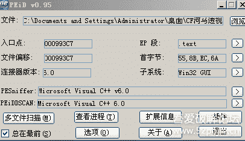
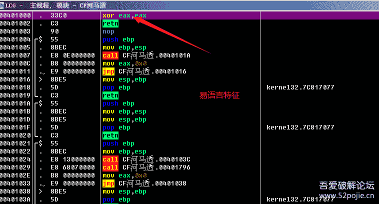
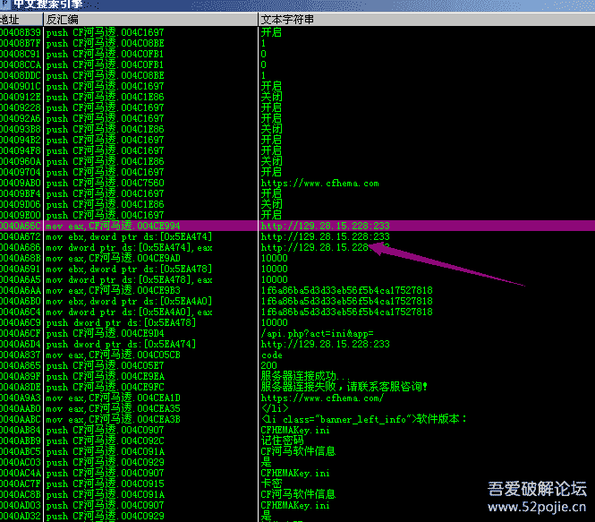
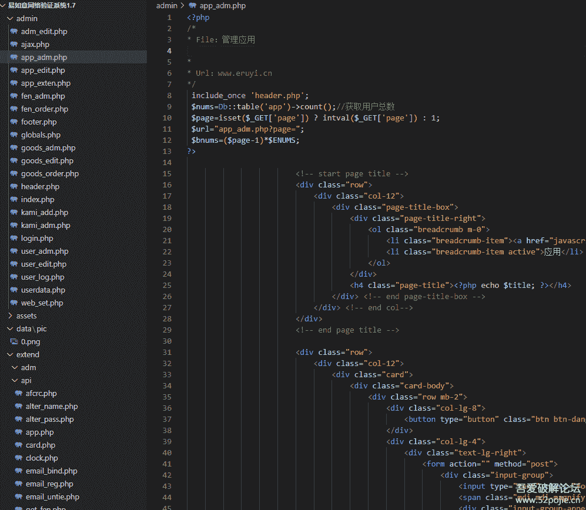
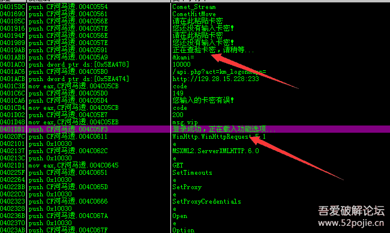
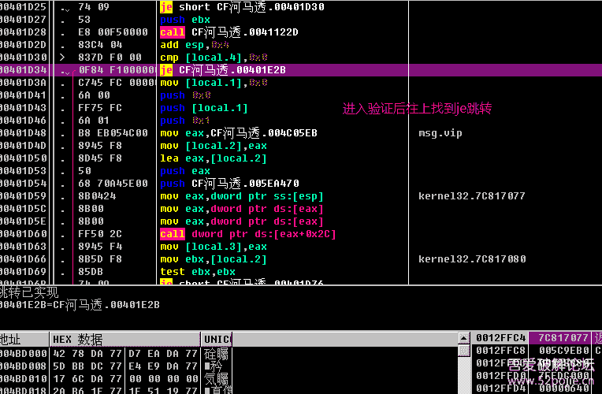
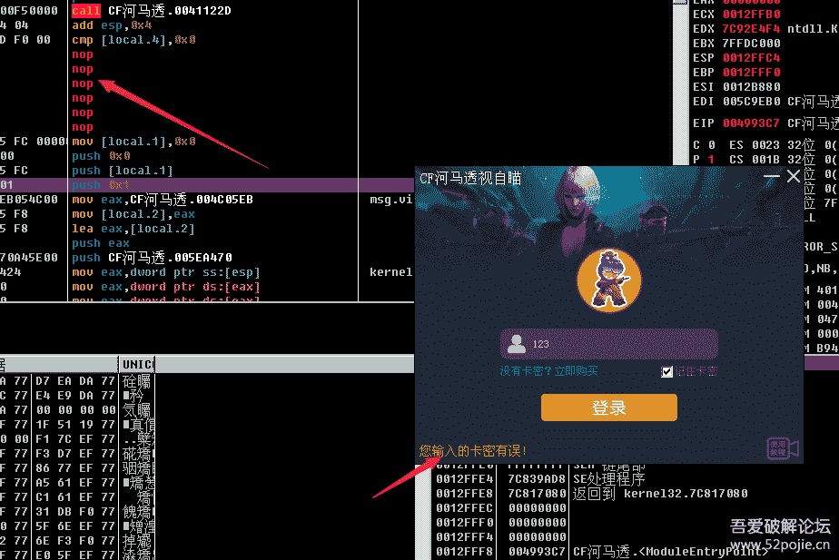
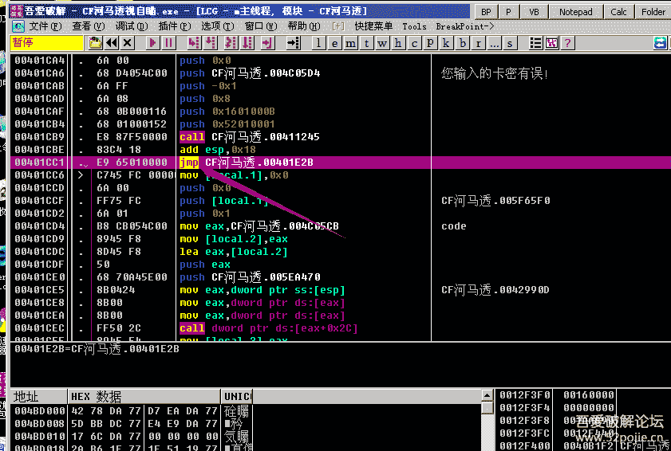
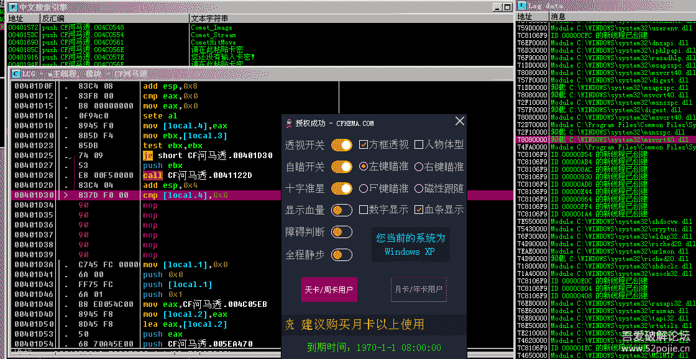

# [原创] 新手尝试破易如意网络验证系统1.7

- 原帖: `https://www.52pojie.cn/forum.php?mod=viewthread&tid=1684565`
- 抓取时间: `2026-11-01T23:10:10`

第一次发帖，学 `https://www.52pojie.cn` 的第五天，感谢大佬的教学很详细受教了 `https://www.52pojie.cn/home.php?mod=space&uid=396495`，
某辅助网的主播专用，软件可用性无知，新手无法确认有无木马，大佬辨别。网站全靠引流，百度前三，新手尝试。

拿到软件先查壳看看，发现无壳直接拖 `od`

万能开场 `Ctrl+G`，输入 `00401000` 来到入口查看易语言特征，再次感谢吾爱大佬的精心教学。

继续往下走，`Ctrl+D`，是智能搜索的快捷键发现关键字符，浏览器打开看看

网络验证系统，本人新手一枚，看到网络验证基本打退堂鼓心里没底，不过来吾爱这么久了看了很多大佬的帖子心里也想试试，毕竟来都来了。

百度看看，发现有安卓的验证系统源码和一篇类似的破解文章，再往下找。

找到验证系统的源码下载部署成功，但是由于能力有限，软件只会更换网址，还有 `APPKEY` 不会修改，尝试了几次堆栈没办法找到修改，果断放弃。回到软件。

继续发现关键字符，验证前后的都有，进去看看

发现个 `je` 大跳 `nop` 掉试试

出现卡密错误，重新进来往上五个 `je` 发现就 `jmp` 跳，`nop` 试试。

登录成功出现功能，最后到期时间尝试了几遍没办法，希望大佬指点。

解压密码：`http://www.52pojie.cn`
