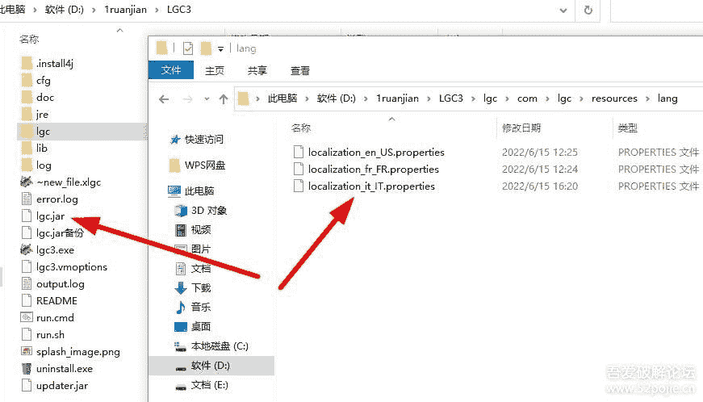
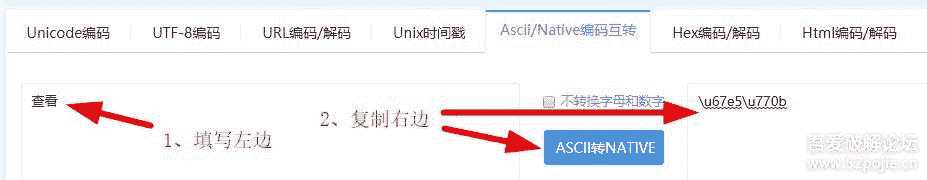
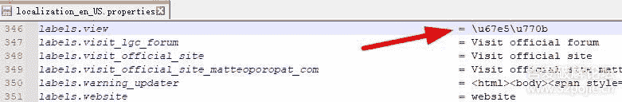
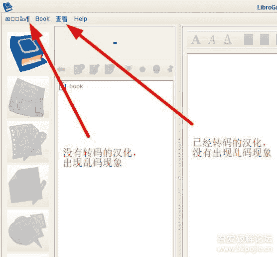

# [原创] 【汉化教程】--第15课：解决`jar`程序汉化出现的乱码问题

- 原帖：https://www.52pojie.cn/forum.php?mod=viewthread&tid=1685046
- 抓取时间：2026-11-01T23:10:03

无论是汉化软件或游戏，都应该先用到第1课的教程，通过第1课的教程，可以很轻松搜索到需要汉化内容在`lgc.jar`里面。

我之前第13课已经讲解了`jar`程序的汉化，这节课讲解`jar`程序在汉化过程中出现的乱码问题。

第10课的教程，可能无法解决一些`QT`或`jar`程序出现的乱码问题，这节课将用另外一种方法解决乱码。

由于LibroGameCreator 3自带`jre`环境文件，所以电脑不用另外安装`jre`环境，都可以正常运行软件。

需要汉化的演示软件是：LibroGameCreator 3（这是一个意大利的软件，中文名叫交互式游戏故事编辑器，只能用谷歌搜索才能搜到）

需要用到的汉化软件是：Notepad++

需要用到的汉化技术是：Ascii/Native编码互转（转码）

## 教程

### 一、用压缩软件打开`lgc.jar`，再解压出来

如下图：

`1.jpg` (60.91 KB, 下载次数: 0)

[下载附件](https://www.52pojie.cn/forum.php?mod=attachment&aid=MjU1MTk5MHw3Y2E0NGFkOHwxNzkzNTc0NjAwfDE2ODA4NnwxNjg1MDQ2&nothumb=yes)

2022-9-6 20:55 上传

### 二、用Notepad++软件打开`localization_en_US.properties`文件

将一个单词“`View`”翻译成“查看”，再复制到“Ascii/Native编码互转”网页，如下图：

`4.jpg` (24.6 KB, 下载次数: 0)

[下载附件](https://www.52pojie.cn/forum.php?mod=attachment&aid=MjU1MTk5NHxiM2FmMTNhZHwxNzkzNTc0NjAwfDE2ODA4NnwxNjg1MDQ2&nothumb=yes)

2022-9-6 21:24 上传

### 三、将已经转码的“`\u67e5\u770b`”复制到原本的“`View`”位置中

最后保存，如下图：

`5.jpg` (27.43 KB, 下载次数: 1)

[下载附件](https://www.52pojie.cn/forum.php?mod=attachment&aid=MjU1MTk5NXw0MjI4OTZlMHwxNzkzNTc0NjAwfDE2ODA4NnwxNjg1MDQ2&nothumb=yes)

2022-9-6 21:26 上传

### 四、通过第13课的教程，将已经汉化的`localization_en_US.properties`放回到`lgc.jar`中

看看效果吧，如下图：

`8.jpg` (37.09 KB, 下载次数: 1)

[下载附件](https://www.52pojie.cn/forum.php?mod=attachment&aid=MjU1MjAzMHxkOTRmNDk2YXwxNzkzNTc0NjAwfDE2ODA4NnwxNjg1MDQ2&nothumb=yes)

2022-9-6 21:38 上传

## 提示

如果学习了前面的教程，这种转码方法可以实现批量汉化。

## 课程导航

上一课：[https://www.52pojie.cn/thread-1681235-1-1.html](https://www.52pojie.cn/thread-1681235-1-1.html)

下一课：[https://www.52pojie.cn/thread-1687064-1-1.html](https://www.52pojie.cn/thread-1687064-1-1.html)
