# [CTF] CISCN CTF `rthread.bin` 逆向题

- 原帖：https://www.52pojie.cn/forum.php?mod=viewthread&tid=1685318
- 抓取时间：2026-11-01T23:10:01

## 题目介绍

CISCN - `rtthread` 是一个非常新颖的好题。

题目中给的是一个 `sh` 文件和一个类似固件的 `bin` 文件 `rtthread.bin`。

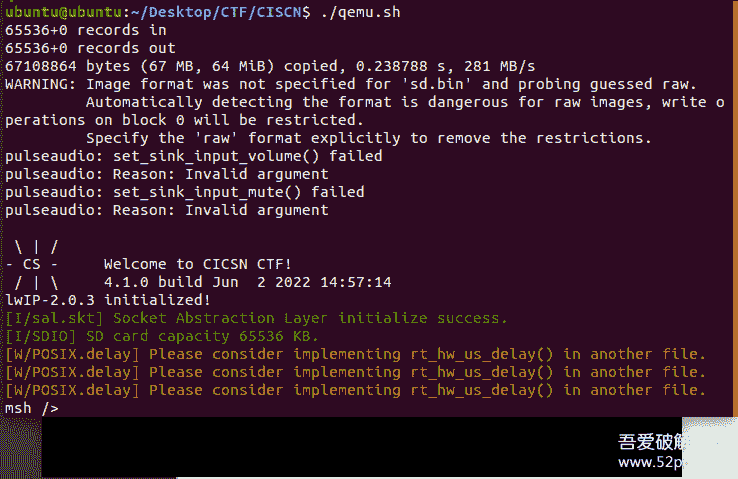

图片.png（92.08 KB，下载次数：265）

[href="forum.php?mod=attachment&aid=MjU1OTg2MnwyY2UyNjA1MHwxNzkzNTc0NTk5fDE2ODA4NnwxNjg1MzE4&nothumb=yes" target="_blank"](https://www.52pojie.cn/forum.php?mod=attachment&aid=MjU1OTg2MnwyY2UyNjA1MHwxNzkzNTc0NTk5fDE2ODA4NnwxNjg1MzE4&nothumb=yes)

2022-10-12 09:05 上传

运行起来，啥也没有。

尝试 `？`、`help` 等，看看会给我们提供什么信息。

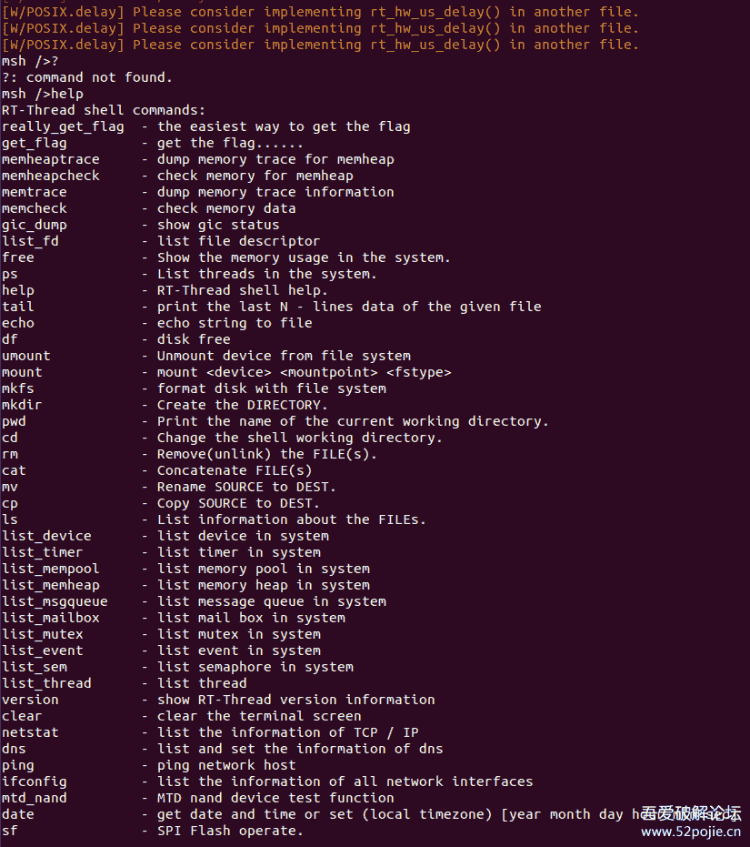

图片.png（155.18 KB，下载次数：266）

[href="forum.php?mod=attachment&aid=MjU1OTg2M3w4NzgzZTM3NnwxNzkzNTc0NTk5fDE2ODA4NnwxNjg1MzE4&nothumb=yes" target="_blank"](https://www.52pojie.cn/forum.php?mod=attachment&aid=MjU1OTg2M3w4NzgzZTM3NnwxNzkzNTc0NTk5fDE2ODA4NnwxNjg1MzE4&nothumb=yes)

2022-10-12 09:05 上传

里面有一些提供的命令，比如 `ifconfig`、`date` 等信息。

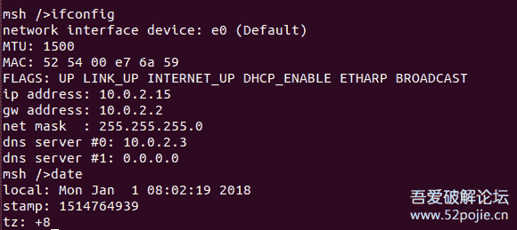

图片.png（41.29 KB，下载次数：267）

[href="forum.php?mod=attachment&aid=MjU1OTg2NHwzMWZiOGNhZHwxNzkzNTc0NTk5fDE2ODA4NnwxNjg1MzE4&nothumb=yes" target="_blank"](https://www.52pojie.cn/forum.php?mod=attachment&aid=MjU1OTg2NHwzMWZiOGNhZHwxNzkzNTc0NTk5fDE2ODA4NnwxNjg1MzE4&nothumb=yes)

2022-10-12 09:05 上传

## 获取迷宫

CTF 题目当然就会想要追求 flag，看到最前面的两个命令。

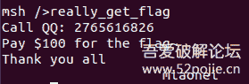

图片.png（16.29 KB，下载次数：265）

[href="forum.php?mod=attachment&aid=MjU1OTg2NXw3NjQ5ZDlhZXwxNzkzNTc0NTk5fDE2ODA4NnwxNjg1MzE4&nothumb=yes" target="_blank"](https://www.52pojie.cn/forum.php?mod=attachment&aid=MjU1OTg2NXw3NjQ5ZDlhZXwxNzkzNTc0NTk5fDE2ODA4NnwxNjg1MzE4&nothumb=yes)

2022-10-12 09:05 上传

可以看到是作者自定义的一个广告位置，真有意思~~~

然后尝试 `get_flag` 这个命令，得到一个迷宫。

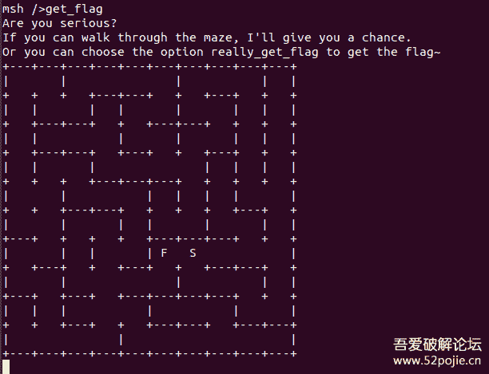

图片.png（25.93 KB，下载次数：277）

[href="forum.php?mod=attachment&aid=MjU1OTg2NnwzZDQxYjI2NXwxNzkzNTc0NTk5fDE2ODA4NnwxNjg1MzE4&nothumb=yes" target="_blank"](https://www.52pojie.cn/forum.php?mod=attachment&aid=MjU1OTg2NnwzZDQxYjI2NXwxNzkzNTc0NTk5fDE2ODA4NnwxNjg1MzE4&nothumb=yes)

2022-10-12 09:05 上传

如果瞎输入的话，就是会报错的。

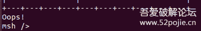

图片.png（9.82 KB，下载次数：270）

[href="forum.php?mod=attachment&aid=MjU1OTg3N3w4ZGViYmQwNnwxNzkzNTc0NTk5fDE2ODA4NnwxNjg1MzE4&nothumb=yes" target="_blank"](https://www.52pojie.cn/forum.php?mod=attachment&aid=MjU1OTg3N3w4ZGViYmQwNnwxNzkzNTc0NTk5fDE2ODA4NnwxNjg1MzE4&nothumb=yes)

2022-10-12 09:06 上传

不是上下左右键的话，就是 `WASD` 呗（多年来打小霸王游戏机的经验）。

合理的猜想就是从 `S`（Start）点上下左右走到 `F`（Finish）点。

很多条可达的路径，通过 `Oops` 的方式 ban 掉了很多条，当然就只留下来了唯一确定的可行字符串。

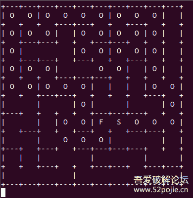

图片.png（16.59 KB，下载次数：258）

[href="forum.php?mod=attachment&aid=MjU1OTg2OHw1MTUwMzc3M3wxNzkzNTc0NTk5fDE2ODA4NnwxNjg1MzE4&nothumb=yes" target="_blank"](https://www.52pojie.cn/forum.php?mod=attachment&aid=MjU1OTg2OHw1MTUwMzc3M3wxNzkzNTc0NTk5fDE2ODA4NnwxNjg1MzE4&nothumb=yes)

2022-10-12 09:06 上传

输入的字符串为：

```text
dddwwawwwwaasdsasawawdwaaasawassssdwdsddssasddw
```

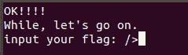

图片.png（5.43 KB，下载次数：265）

[href="forum.php?mod=attachment&aid=MjU1OTg2OXw3Njk0MzdhOXwxNzkzNTc0NTk5fDE2ODA4NnwxNjg1MzE4&nothumb=yes" target="_blank"](https://www.52pojie.cn/forum.php?mod=attachment&aid=MjU1OTg2OXw3Njk0MzdhOXwxNzkzNTc0NTk5fDE2ODA4NnwxNjg1MzE4&nothumb=yes)

2022-10-12 09:06 上传

首先是判断长度，再是判断逻辑。

OK，到了这里就需要开始逆向了！

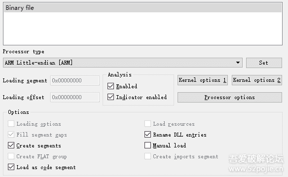

图片.png（14.59 KB，下载次数：258）

[href="forum.php?mod=attachment&aid=MjU1OTg3MHwxODdhMjM2MnwxNzkzNTc0NTk5fDE2ODA4NnwxNjg1MzE4&nothumb=yes" target="_blank"](https://www.52pojie.cn/forum.php?mod=attachment&aid=MjU1OTg3MHwxODdhMjM2MnwxNzkzNTc0NTk5fDE2ODA4NnwxNjg1MzE4&nothumb=yes)


图片.png（14.51 KB，下载次数：259）

[href="forum.php?mod=attachment&aid=MjU1OTg3MXw2OTk3NzRmZnwxNzkzNTc0NTk5fDE2ODA4NnwxNjg1MzE4&nothumb=yes" target="_blank"](https://www.52pojie.cn/forum.php?mod=attachment&aid=MjU1OTg3MXw2OTk3NzRmZnwxNzkzNTc0NTk5fDE2ODA4NnwxNjg1MzE4&nothumb=yes)

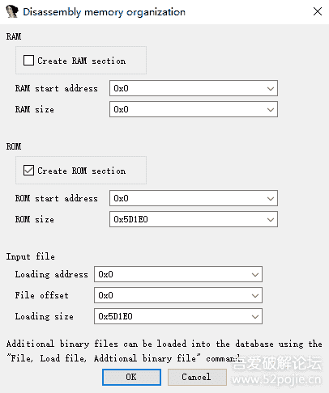

图片.png（15.77 KB，下载次数：253）

[href="forum.php?mod=attachment&aid=MjU1OTg3Mnw2ZmIzOGEyM3wxNzkzNTc0NTk5fDE2ODA4NnwxNjg1MzE4&nothumb=yes" target="_blank"](https://www.52pojie.cn/forum.php?mod=attachment&aid=MjU1OTg3Mnw2ZmIzOGEyM3wxNzkzNTc0NTk5fDE2ODA4NnwxNjg1MzE4&nothumb=yes)

可以发现，字符串是没有交叉引用的。

不过既然函数不是很多，可以手动 F5 去看特征。

这个是典型的常数值：`0x61C88647`、`0xC6EF3720`：典型的 TEA 算法特征。

`5F4` 这个函数是递归，根据输入来处理地图中的迷宫的。

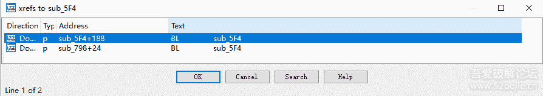

图片.png（14.97 KB，下载次数：267）

[href="forum.php?mod=attachment&aid=MjU1OTg3M3xkZjA2ZWVkNXwxNzkzNTc0NTk5fDE2ODA4NnwxNjg1MzE4&nothumb=yes" target="_blank"](https://www.52pojie.cn/forum.php?mod=attachment&aid=MjU1OTg3M3xkZjA2ZWVkNXwxNzkzNTc0NTk5fDE2ODA4NnwxNjg1MzE4&nothumb=yes)

可以看到这里的 `sub_798` 是 `sub_5F4` 的上层函数。

根据 `sub_798` 的逻辑：

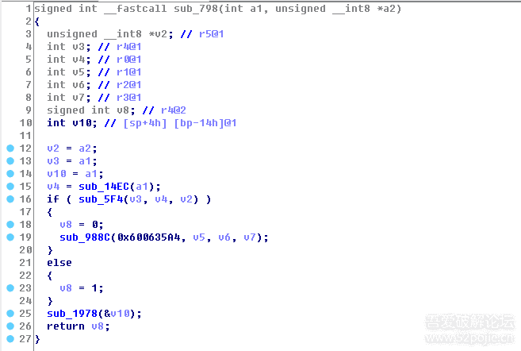

图片.png（17.39 KB，下载次数：261）

[href="forum.php?mod=attachment&aid=MjU1OTg3NHw4MTc1NDFmYXwxNzkzNTc0NTk5fDE2ODA4NnwxNjg1MzE4&nothumb=yes" target="_blank"](https://www.52pojie.cn/forum.php?mod=attachment&aid=MjU1OTg3NHw4MTc1NDFmYXwxNzkzNTc0NTk5fDE2ODA4NnwxNjg1MzE4&nothumb=yes)

第 16 行的 `sub_5F4` 的 `if` 语句需要成立。

需要执行 `sub_988C` 函数，然后就双击不进去了，就很艰难。

## 从 QEMU 源码分析

所以，我们换一种思路，从 QEMU 源码的角度来分析，QEMU 是把该二进制文件 rebase 到了哪里呢？

```text
https://github.com/qemu/qemu
https://github.com/qemu/qemu/tree/master/hw/arm
https://github.com/qemu/qemu/blob/master/hw/arm/boot.c
https://github.com/qemu/qemu/blob/master/hw/arm/vexpress.c
```

QEMU 中对于 ARM 架构的 boot 启动方式：

https://github.com/qemu/qemu/blob/master/hw/arm/boot.c

`Line 1079`：`/* 32-bit ARM */`

```c
entry = info->loader_start + KERNEL_LOAD_ADDR;
```

`Line 35`：

```c
#define KERNEL_LOAD_ADDR 0x00010000
```

https://github.com/qemu/qemu/blob/master/hw/arm/vexpress.c

`Line 339`：

```c
static VEDBoardInfo a9_daughterboard = {
    ……
    .loader_start = 0x60000000,
    ……
};
```

```text
entry = 0x60010000
```

当没有 `entry` 的时候，IDA 里的字符串没有交叉引用的。

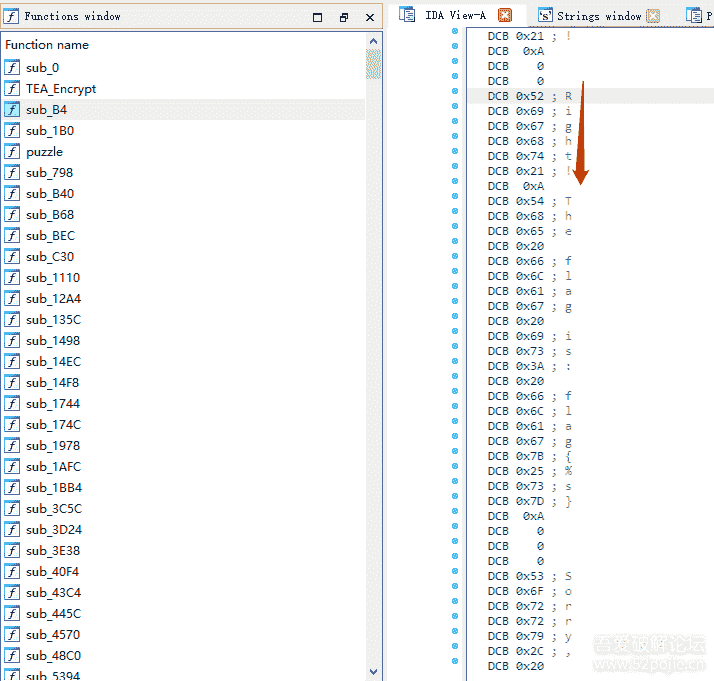

图片.png（77.91 KB，下载次数：260）

[href="forum.php?mod=attachment&aid=MjU1OTg3NXxjM2I5MjllN3wxNzkzNTc0NTk5fDE2ODA4NnwxNjg1MzE4&nothumb=yes" target="_blank"](https://www.52pojie.cn/forum.php?mod=attachment&aid=MjU1OTg3NXxjM2I5MjllN3wxNzkzNTc0NTk5fDE2ODA4NnwxNjg1MzE4&nothumb=yes)

设置 `entry`。

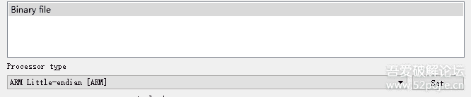

图片.png（8.74 KB，下载次数：265）

[href="forum.php?mod=attachment&aid=MjU1OTg3Nnw0YjM3ODNkOHwxNzkzNTc0NTk5fDE2ODA4NnwxNjg1MzE4&nothumb=yes" target="_blank"](https://www.52pojie.cn/forum.php?mod=attachment&aid=MjU1OTg3Nnw0YjM3ODNkOHwxNzkzNTc0NTk5fDE2ODA4NnwxNjg1MzE4&nothumb=yes)

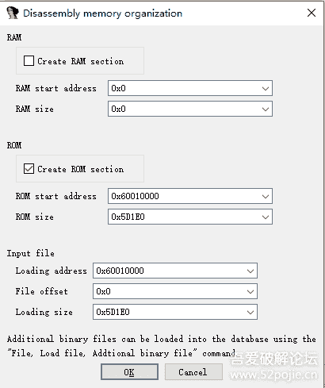

图片.png（16.16 KB，下载次数：268）

[href="forum.php?mod=attachment&aid=MjU1OTg3N3xlMzcwMDY1ZHwxNzkzNTc0NTk5fDE2ODA4NnwxNjg1MzE4&nothumb=yes" target="_blank"](https://www.52pojie.cn/forum.php?mod=attachment&aid=MjU1OTg3N3xlMzcwMDY1ZHwxNzkzNTc0NTk5fDE2ODA4NnwxNjg1MzE4&nothumb=yes)

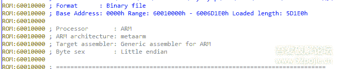

图片.png（18.53 KB，下载次数：255）

[href="forum.php?mod=attachment&aid=MjU1OTg3OHxhZDk1NGY0MHwxNzkzNTc0NTk5fDE2ODA4NnwxNjg1MzE4&nothumb=yes" target="_blank"](https://www.52pojie.cn/forum.php?mod=attachment&aid=MjU1OTg3OHxhZDk1NGY0MHwxNzkzNTc0NTk5fDE2ODA4NnwxNjg1MzE4&nothumb=yes)

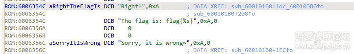

图片.png（22.74 KB，下载次数：268）


https://www.52pojie.cn/forum.php?mod=attachment&aid=MjU1OTg3OXw2ZjM3YTkyN3wxNzkzNTc0NTk5fDE2ODA4NnwxNjg1MzE4&nothumb=yes
2022-10-12 09:09 上传
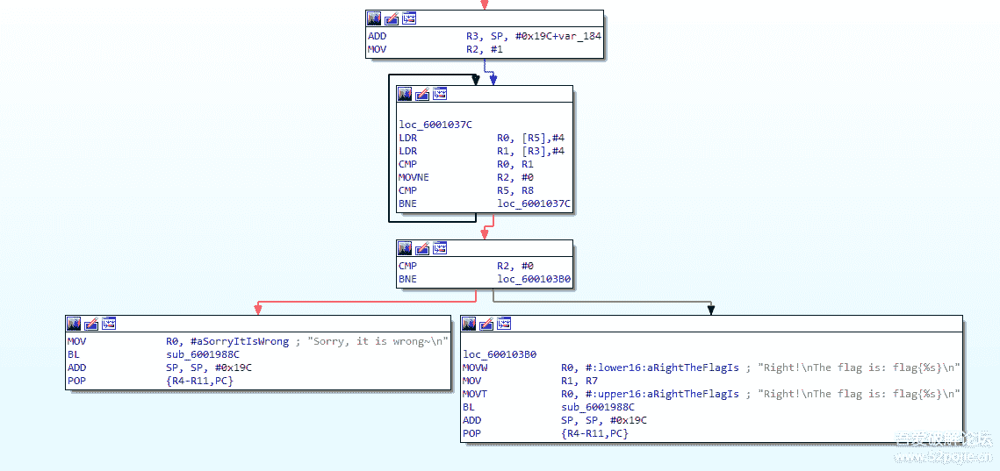
图片.png (46.89 KB, 下载次数: 243)

https://www.52pojie.cn/forum.php?mod=attachment&aid=MjU1OTg4MHxmOWYyZGY0ZXwxNzkzNTc0NTk5fDE2ODA4NnwxNjg1MzE4&nothumb=yes
2022-10-12 09:09 上传
顺着这个流程图，明显就能找到题中的 `main` 了
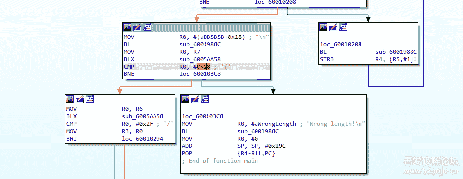
图片.png (36.98 KB, 下载次数: 270)

https://www.52pojie.cn/forum.php?mod=attachment&aid=MjU1OTg4MXxlNDk5MmIxMHwxNzkzNTc0NTk5fDE2ODA4NnwxNjg1MzE4&nothumb=yes
2022-10-12 09:09 上传
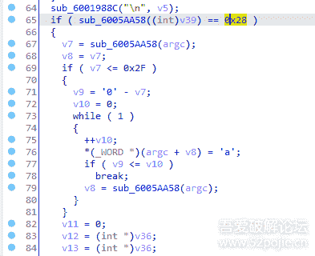
图片.png (24.64 KB, 下载次数: 267)

https://www.52pojie.cn/forum.php?mod=attachment&aid=MjU1OTg4Mnw2ZTljYWZlNnwxNzkzNTc0NTk5fDE2ODA4NnwxNjg1MzE4&nothumb=yes
2022-10-12 09:09 上传
`length` = 0x28 = 40
长度不够，后续添加字符 'a'，加上之前的 `TEA` 算法，就很容易搞明白程序的流程和逻辑了
该函数为输入`flag`后的程序函数，其首先会对输入的`flag`进行分组，每组两个`int`一共5组。
对`key`进行分组，每组4个`int`，一共3组。并对`flag`做5次`tea`加密。

[C++] 纯文本查看 复制代码
```
#include 
using namespace std;

#define UINT unsigned int
#define DELTA 0x9e3779b9

void tea_decrypt(UINT* v, UINT* key) {
    UINT l = v[0], r = v[1], sum = 0;
    sum = DELTA * 32;
    for (size_t i = 0; i > 5)) + l) ^ (sum + key[(sum >> 11) & 3]);
        sum -= DELTA;
        l -= (((r > 5)) + r) ^ (sum + key[sum & 3]);
    }
    v[0] = l;
    v[1] = r;
}

UINT str2int(char* str){
    UINT ret = 0;
    for (int i = 0; i > 8;
        str1[i] = ch;
    }
    return;
}

int main(){
    char flag[100] = { 0 }, key[] = "dddwwawwwwaasdsasawawdwaaasawassssdwdsddssasddwa";
    UINT keys[12], tea_cry[2], tea_key[4], cry[] = {3179062266, 2936962595, 3754839610, 2425968462, 1458506693, 3303317055, 1294083110, 1674144741, 1029754371, 3863932833};
    for (int i = 0; i < 12; i++){
        char newkey[4] = { 0 };
        memcpy(newkey, key + i * 4, 4);
        keys[i] = str2int(newkey);
    }
    for (int i = 0; i < 5; i++){
        tea_cry[0] = cry[i * 2], tea_cry[1] = cry[i * 2 + 1];
        for (int j = 0; j < 4; j++)
            tea_key[j] = keys[(i * 4 + j) % 12];
        tea_decrypt(tea_cry, tea_key);
        cry[i * 2] = tea_cry[0], cry[i * 2 + 1] = tea_cry[1];
    }
    for (int i = 0; i < 10; i++)
        cout << "0x" << hex << cry[i]<< " ";
    cout << endl;
    for (int i = 0; i < 10; i++)
        int2str(cry[i], flag + i * 4);
    cout << flag << endl;
    return 0;
}
```
结果为：
`flag`{932b424a9-9fe2-42d51-9403e-601db1baa5678}
