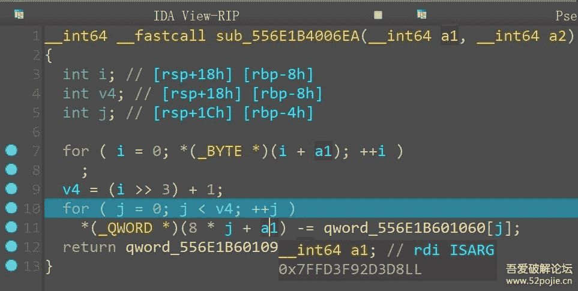

# [CTF] 【reverse】buu-[Zer0pts2020]easy_strcmp——main函数的启动过程+IDA动态调试ELF

- 原帖: `https://www.52pojie.cn/forum.php?mod=viewthread&tid=1686873`
- 抓取时间: `2026-11-01T23:09:49`

## 依赖

- `IDA7.7`
- `Ubuntu20.04`

作者：`https://blog.csdn.net/hans774882968` 以及 `https://juejin.cn/user/1464964842528888` 以及 `https://www.52pojie.cn/home.php?mod=space&uid=1906177`

本文52pojie：`https://www.52pojie.cn/thread-1686873-1-1.html`

本文juejin：`https://juejin.cn/post/7142310602067673124`

本文csdn：`https://blog.csdn.net/hans774882968/article/details/126813906`

## 思路

64位ELF。用IDA打开即可看到`main`函数：

```
__int64 __fastcall main(int a1, char **a2, char **a3)
{
  if ( a1 > 1 )
  {
    if ( !strcmp(a2[1], "zer0pts{********CENSORED********}") )
      puts("Correct!");
    else
      puts("Wrong!");
  }
  else
  {
    printf("Usage: %s \n", *a2);
  }
  return 0LL;
}
```

会这么简单嘛？我们应该关注`a2[1]`是否被修改了。因此看看`start`函数：

```
// positive sp value has been detected, the output may be wrong!

void __fastcall __noreturn start(__int64 a1, __int64 a2, void (*a3)(void))

{

  __int64 v3; // rax

  int v4; // esi

  __int64 v5; // [rsp-8h] [rbp-8h] BYREF

  char *retaddr; // [rsp+0h] [rbp+0h] BYREF

  v4 = v5;

  v5 = v3;

  _libc_start_main(main, v4, &retaddr, init, fini, a3, &v5);

  __halt();

}
```

查阅`_libc_start_main`的资料（参考链接1）可知`init`函数会在`main`函数之前被调用。

```
void __fastcall init(unsigned int a1, __int64 a2, __int64 a3)
{
  signed __int64 v4; // rbp
  __int64 i; // rbx

  v4 = &off_200DF0 - &funcs_889;
  init_proc();
  if ( v4 )
  {
    for ( i = 0LL; i != v4; ++i )
      ((void (__fastcall *)(_QWORD, __int64, __int64))*(&funcs_889 + i))(a1, a2, a3);
  }
}
```

有这些函数被调用了：

```
.init_array:0000000000200DE0 E0 06 00 00 00 00 00 00       funcs_889 dq offset sub_6E0 
.init_array:0000000000200DE8 95 07 00 00 00 00 00 00       dq offset sub_795
```

看了看`sub_6E0`啥也没有，那重点肯定是`sub_795`了：

```
// write access to const memory has been detected, the output may be wrong!
int (**sub_795())(const char *s1, const char *s2)
{
  int (**result)(const char *, const char *); // rax

  result = &strcmp;
  qword_201090 = (__int64)&strcmp;
  off_201028 = sub_6EA;
  return result;
}
```

点击查看`off_201028`，发现是`strcmp`函数的地址，也就是说`off_201028 = sub_6EA`把`strcmp`的地址篡改为`sub_6EA`的地址。因此`main`函数调用`strcmp`的时候会调用`sub_6EA`。

```
__int64 __fastcall sub_6EA(__int64 a1, __int64 a2)
{

  int i; // [rsp+18h] [rbp-8h]

  int v4; // [rsp+18h] [rbp-8h]

  int j; // [rsp+1Ch] [rbp-4h]

  for ( i = 0; *(_BYTE *)(i + a1); ++i )

    ;

  v4 = (i >> 3) + 1;

  for ( j = 0; j 
```

这里`a1`, `a2`类型不对，应该是`const char *`。回忆一下`sub_795`这句`qword_201090 = (__int64)&strcmp`，可知`qword_201090(a1, a2)`就是调用原有的`strcmp`函数。至此我们已经知道`a2[1]`被修改的过程。

总结：一种`hook`，很有趣。

### 代码

#### CPP实现

考虑到这里要把字符串当`_QWORD`使用，python不方便实现，因此我们用IDA安装目录下可找到的`defs.h`，赋能cpp，打出一套组合👊。

```
#include 
#include "defs.h"
using namespace std;
typedef long long LL;
#define rep(i,a,b) for(int i = (a);i = (b);--i)

void dbg() {
    puts ("");
}
templatevoid dbg (const T &f, const R &... r) {
    cout 
```

#### Python+libnum库

`libnum`可以让我们方便地把`char`数组当成整数来进行内存操作，同时支持一些基本的数论操作（如：求逆元、分解质因数）。安装`libnum`（注意：只支持`python3`）：

```
pip config set global.index-url https://pypi.douban.com/simple # 注意现在pip只支持https的源了

pip install libnum
```

代码

```
from libnum import s2n, n2s

def main():
    key = [0, 0x410A4335494A0942, 0x0B0EF2F50BE619F0, 0x4F0A3A064A35282B]
    a = b'zer0pts{********CENSORED********}'
    ans = b''
    for i in range(4):
        j = s2n(a[i * 8: i * 8 + 8][::-1]) + key[i]
        ans += n2s(j)[::-1]
    ans += b'}'
    print(ans)

if __name__ == "__main__":
    main()
```

### IDA动态调试

`https://www.52pojie.cn/thread-1686855-1-1.html`

动调时`sub_795`和`main`函数长这样（因为没有去掉ASLR）：

```
// write access to const memory has been detected, the output may be wrong!

__int64 (__fastcall *sub_561199200795())()

{

  __int64 (__fastcall *result)(); // rax

  result = sub_5611992005C6;

  qword_561199401090 = (__int64)sub_5611992005C6;

  off_561199401028 = sub_5611992006EA;

  return result;

}

__int64 __fastcall sub_5588DE0007C7(int a1, __int64 a2)

{

  if ( a1 > 1 )

  {

    if ( (unsigned int)sub_5588DE0005C0(*(_QWORD *)(a2 + 8), "zer0pts{********CENSORED********}") )

      sub_5588DE0005A0("Wrong!");

    else

      sub_5588DE0005A0("Correct!");

  }

  else

  {

    sub_5588DE0005B0("Usage: %s \n", *(const char **)a2);

  }

  return 0LL;

}
```

即使不知道`sub_795`hook了`strcmp`也没关系，我们断点断在`main`函数，然后“步进”`strcmp`函数也能找到关键代码。

在`sub_6ea`点击`a1`变量，可以定位输入字符串，进而看到它被修改的过程。



1-a1变量的地址.JPG (66 KB, 下载次数: 0)

[href="forum.php?mod=attachment&aid=MjU1Mjk1Mnw0ZDVlNTMwZHwxNzkzNTc0NTg3fDE2ODA4NnwxNjg2ODcz&nothumb=yes" target="_blank"](https://www.52pojie.cn/forum.php?mod=attachment&aid=MjU1Mjk1Mnw0ZDVlNTMwZHwxNzkzNTc0NTg3fDE2ODA4NnwxNjg2ODcz&nothumb=yes)

2022-9-12 10:07 上传


金句.jpg (67.98 KB, 下载次数: 0)

[href="forum.php?mod=attachment&aid=MjU1Mjk1Nnw3ZWExMDU3OHwxNzkzNTc0NTg3fDE2ODA4NnwxNjg2ODcz&nothumb=yes" target="_blank"](https://www.52pojie.cn/forum.php?mod=attachment&aid=MjU1Mjk1Nnw3ZWExMDU3OHwxNzkzNTc0NTg3fDE2ODA4NnwxNjg2ODcz&nothumb=yes)

2022-9-12 10:09 上传

### 参考资料

- `https://zhuanlan.zhihu.com/p/52054044`
- 一篇写得不错的wp：`https://blog.csdn.net/Tokameine/article/details/118148770`
