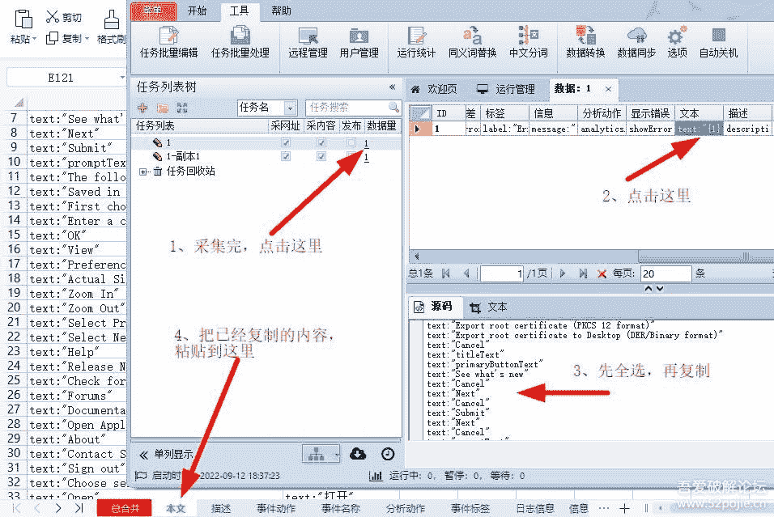
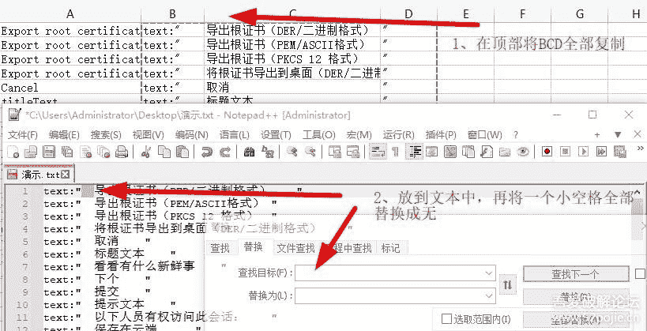
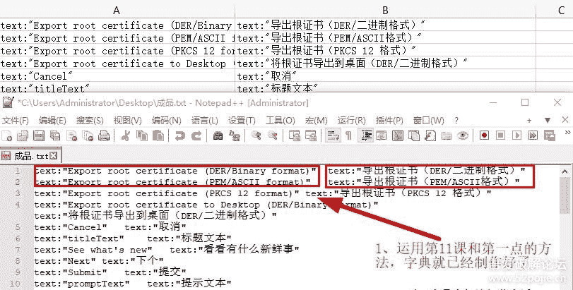
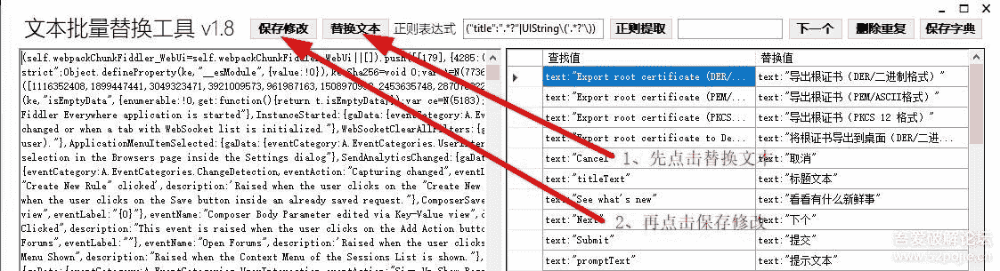
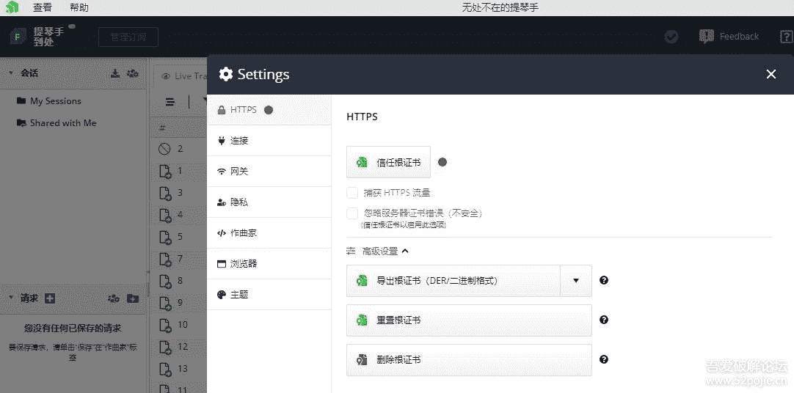

# [原创] 【汉化教程】--第16课：高铁采集器提取字符串

- 原帖: https://www.52pojie.cn/forum.php?mod=viewthread&tid=1687064
- 抓取时间: 2026-11-01T23:09:45

需要汉化的演示软件是：Fiddler Everywhere

需要用到的汉化软件是：Notepad++、phpStudy、高铁采集器、TextReplace_v1.8（文本批量替换工具）

需要用到的汉化技术是：高铁采集器技术

Fiddler Everywhere这个软件已经诞生很久了，但网上一直都找不到汉化版本，可能是Fiddler Everywhere的汉化难度已经超出了所有人想象，它大部分需要翻译的内容都在`Fiddler Everywhere\resources\app\out\WebServer\ClientApp\dist`中的一个`main.9c27a5768c5c6da2.js`里面（红色字体的代表每个人在安装时候显示不同名称），别看这个js只有不超过5M大小的文件，它解压美化可能会达到35M。

使用Notepad++打开js文件，你会发现这个js把所有的内容都压缩在一行里面，如果你使用Radialix 3去汉化，可能会卡住，而且有可能导致文件的结构发生变化，导致软件无法正常打开。如果使用Notepad++去汉化，有可能会出现Notepad++卡死、或汉化容易出现错误，难以调试，又或者汉化太慢了，下面这节课的教程将是在汉化游戏或者软件中的一种重大的变革。

## 操作步骤

1. 很多人都会使用高铁采集器，我这里就不细说了，简单说一下：将`main.9c27a5768c5c6da2.js`改名成`1.js`放入到phpStudy文件夹的`WWW`中，启动phpStudy软件；
2. 将`main.9c27a5768c5c6da2.js`文件用Notepad++打开，你会发现有很多`text:"`开头的字符串，我这里为了方便就把它当成100个吧。
3. 打开高铁采集器，将起始网址填写`http://localhost/1.js`，“起始网址就是内容网址”这里要点击一下，之后填写规则，正则提取，匹配内容填写`text:"[参数]"`，组合结果填写`text:"[参数1]"`，最后返回界面点击采集；
4. 最后在采集里面直接复制，粘贴到一个`.xlsx`表格“文本”里面，如下图：

`1.jpg`（148.97 KB，下载次数: 0）

[附件下载](https://www.52pojie.cn/forum.php?mod=attachment&aid=MjU1MzA0NHw5OWEwNjkwNXwxNzkzNTc0NTgzfDE2ODA4NnwxNjg3MDY0&nothumb=yes)

2022-9-12 18:54 上传

## 进入教程

由于我第11课的教程已经讲解的非常清楚，表格字典是怎么制作的，下面就直接简单描述一下。

一、在将`text:"`与`"`替换成空字符之后，就把英文全部翻译成中文，最后把`text:"`把到B列，`"`放到D列，如下图：

`2.jpg`（99.25 KB，下载次数: 0）

[附件下载](https://www.52pojie.cn/forum.php?mod=attachment&aid=MjU1MzA0OHxjNWI1NjA2MnwxNzkzNTc0NTgzfDE2ODA4NnwxNjg3MDY0&nothumb=yes)

2022-9-12 19:14 上传

二、将已经替换好的内容全选，复制到表格的E列，字典就已经做好了，如下图：

`3.jpg`（104.68 KB，下载次数: 0）

[附件下载](https://www.52pojie.cn/forum.php?mod=attachment&aid=MjU1MzA1MnxkMDFjMDY2MXwxNzkzNTc0NTgzfDE2ODA4NnwxNjg3MDY0&nothumb=yes)

2022-9-12 19:21 上传

三、打开文本批量替换工具，将`main.9c27a5768c5c6da2.js`拖拉到左边，把`成品.txt`拖拉到右边（查看注意事项），再按照下图操作，最后在点击保存修改的之后，等待10几秒钟，如下图：

`4.jpg`（137.56 KB，下载次数: 0）

[附件下载](https://www.52pojie.cn/forum.php?mod=attachment&aid=MjU1MzA1NnxmNzczMWFjMnwxNzkzNTc0NTgzfDE2ODA4NnwxNjg3MDY0&nothumb=yes)

2022-9-12 19:28 上传

四、把已经汉化好的`main.9c27a5768c5c6da2.js`替换到`Fiddler Everywhere\resources\app\out\WebServer\ClientApp\dist`里面，看看汉化效果吧，如下图：

`5.jpg`（53.5 KB，下载次数: 0）

[附件下载](https://www.52pojie.cn/forum.php?mod=attachment&aid=MjU1MzA1N3xmYTAwMjMxMXwxNzkzNTc0NTgzfDE2ODA4NnwxNjg3MDY0&nothumb=yes)

2022-9-12 19:33 上传

## 注意事项

1. 凡是提取到的符号和小写开头的英文字母（句子除外），都要在表格里面筛选删除，目的为了避免汉化错误。
2. 凡是提取到连体英文都要删除，如`FileDirectory`，`e`与`D`之间是没有空格的，目的为了避免汉化错误。
3. 在第三步的时候，应该将`成品.txt`，转换成ANSI编码，查看我第10课的教程。
4. 用高铁采集器提取到的不同规则不能放到一起，如`text:"`、`description:"`、`logInfo("`，目的可能增加制作字典难度。
5. Fiddler Everywhere软件还有一部分英文，在其它文件中，如`dll`格式的。本字典包已经汉化了`main.9c27a5768c5c6da2.js`文件80%英文内容。

[附件下载](https://www.52pojie.cn/forum.php?mod=attachment&aid=MjU1MzA2MHxkMGY0NTFmNnwxNzkzNTc0NTgzfDE2ODA4NnwxNjg3MDY0)

（154.89 KB，下载次数: 106）

2022-9-12 19:48 上传

点击文件名下载附件

下载积分: 吾爱币 -1 CB

上一课：[https://www.52pojie.cn/thread-1685046-1-1.html](https://www.52pojie.cn/thread-1685046-1-1.html)

下一课：[https://www.52pojie.cn/thread-1736159-1-1.html](https://www.52pojie.cn/thread-1736159-1-1.html)
