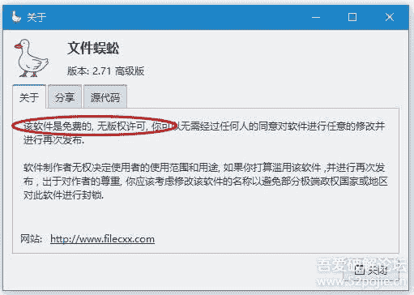
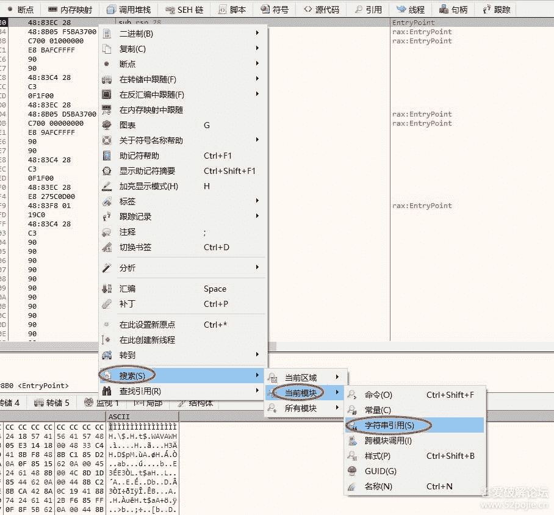
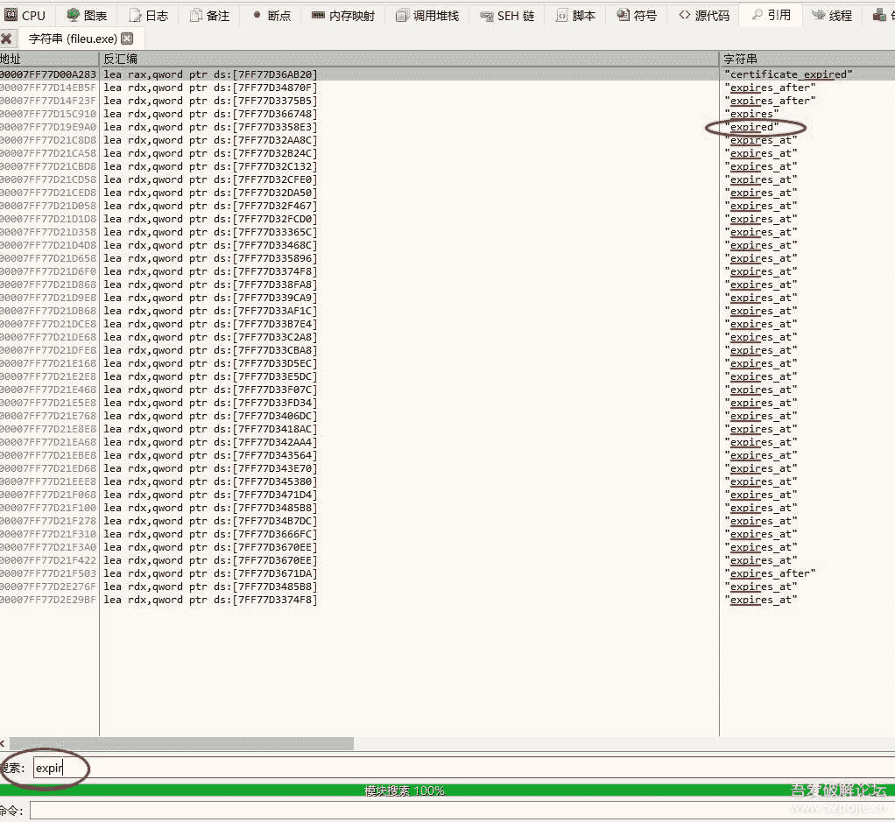
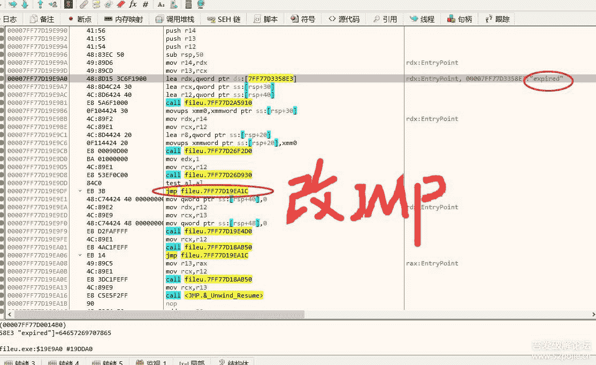

# [分享] 打通Filecxx的最后一公里，免激活免升级

- 原帖: https://www.52pojie.cn/forum.php?mod=viewthread&tid=1687426
- 抓取时间: 2026-11-01T23:09:40

前一阵子，坛友转了一个软件`filecxx`，原文如下：

https://www.52pojie.cn/thread-1654256-1-1.html

我也下载并使用了，功能还可以（下在线视频、文件等）但就是激活和悄无声息的更新。。。


官方目前更新2.71版本：

https://github.com/filecxx/FileCentipede/raw/main/release/filecxx_latest_win_x64.zip



360截图20220913161314029.jpg (36.36 KB, 下载次数: 1)

https://www.52pojie.cn/forum.php?mod=attachment&aid=MjU1MzE3OXxhYWU0MGY3M3wxNzkzNTc0NTc3fDE2ODA4NnwxNjg3NDI2&nothumb=yes

2022-9-13 16:13 上传

这个软件没有版权，所以重点来了：

1、浏览器安装插件：程序主目录下`browser_extensions`文件夹内有`crx`文件，拖入浏览器即可！安装以后就可以在浏览器播放视频右上方出现下载按钮！期望值不要太高，只能下载部份网站的。
2、2.71免激活土方法：`LIB`目录下`fileu`拖入`x64dbg`，右键搜索，当前模块，字符串引用，下方筛选`expired`，双击来到引用区，下方地址最后`E9DF`后的`JE`改`JMP`，右键补丁即可！
3、免升级方法：`hosts`文件加入（注意地址和域名之间有空格）：
```
127.0.0.1 download.filecxx.com
```
4、更多功能待坛友自行发现。。。

只提供思路，不提供成品！仅供讨论交流，自行决定使用与否！



01.jpg (130.21 KB, 下载次数: 2)

https://www.52pojie.cn/forum.php?mod=attachment&aid=MjU1MzQ5NnwwMzc2ZWZlMXwxNzkzNTc0NTc3fDE2ODA4NnwxNjg3NDI2&nothumb=yes

2022-9-15 07:53 上传



02.jpg (209.77 KB, 下载次数: 1)

https://www.52pojie.cn/forum.php?mod=attachment&aid=MjU1MzQ5N3wzOWQ0NTU1N3wxNzkzNTc0NTc3fDE2ODA4NnwxNjg3NDI2&nothumb=yes

2022-9-15 07:53 上传



03.jpg (156.54 KB, 下载次数: 0)

https://www.52pojie.cn/forum.php?mod=attachment&aid=MjU1MzQ5OHwxNmJhYTQ1MHwxNzkzNTc0NTc3fDE2ODA4NnwxNjg3NDI2&nothumb=yes

2022-9-15 07:53 上传
