# [原创] 某车软件的注册

- 原帖：<https://www.52pojie.cn/forum.php?mod=viewthread&tid=1687919>
- 抓取时间：2026-11-01T23:09:38

最近使用的一个软件过期了，需要注册，没事就研究了一下。打开软件界面是这样的：

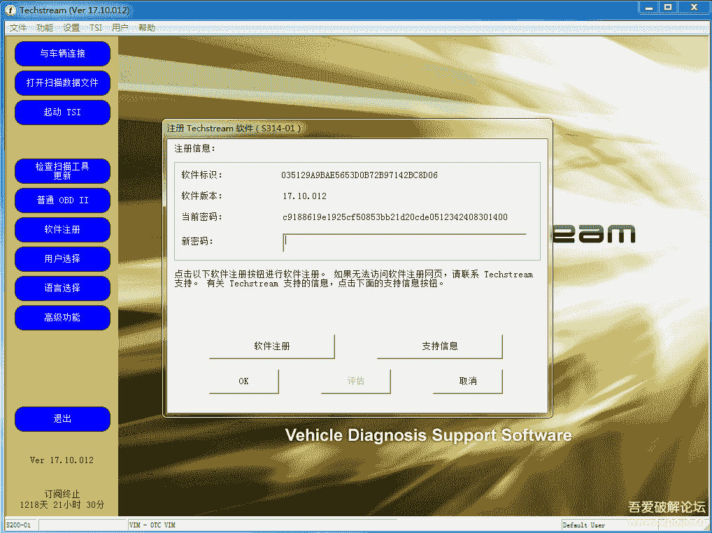

初次打开这里的当前密码是没有的，我这里是注册过的，然后还要选择一下区域，我选的是欧洲区：

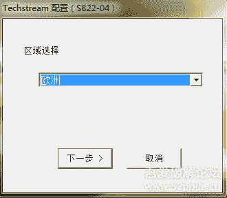

## 定位关键函数

随便输入一个码，然后下个断点，找到调用函数 `sub_41D500`：

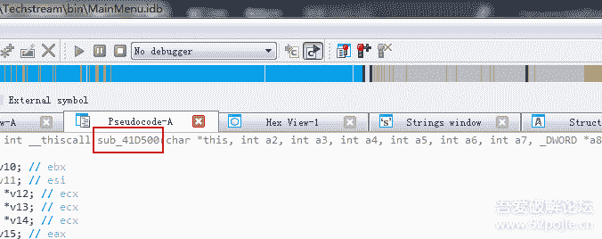

发现需要长度是46，后10位是时间，由年月日时分组成，然后前面年份添加20开头，后面秒用01：

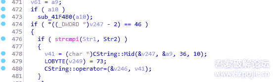

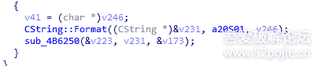

接着往下走可以看到46位密码由前32位 `+` 4位的订阅时间 `+` 10位的时间组成：

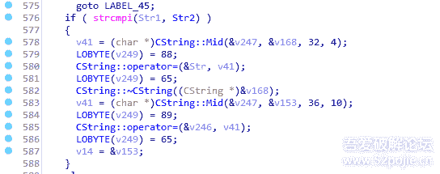

前面是对密码的组成部分判断，`sub_420D80` 函数就是具体处理的。

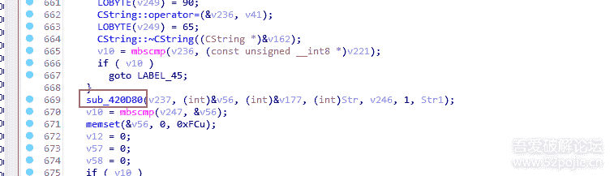

## 分析 `sub_420D80` 函数

进入函数先截取了软件版本部分：

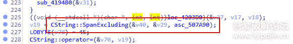

然后用软件标识和软件版本调用 `TisServiceRegistration` 函数得到一个32位的码，这个码需要和输入的一致：

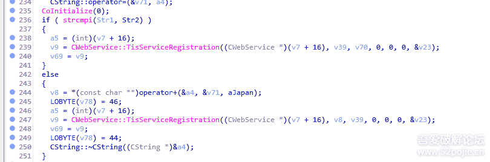

第一次调用 `TisServiceRegistration` 后还需要调用一次，一个参数是上面的32位码，一个参数其中一部分是 `sub_425100` 而来，用他返回的结果 `+` 4位的订阅时间 `+` 10位的时间：

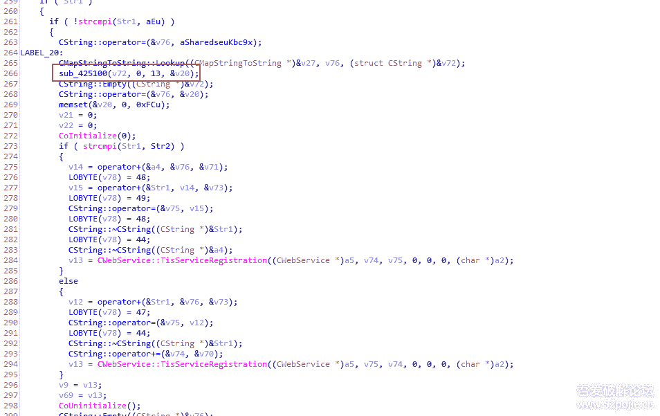

这个函数里面用到了 `DecryptByRotatShiftVariable` 函数：

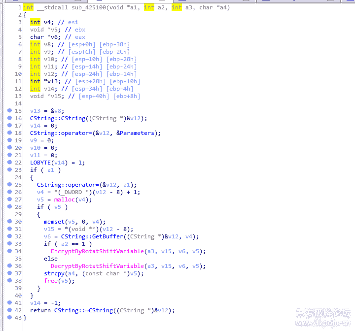

`DecryptByRotatShiftVariable` 需要的参数是前面 `Lookup` 调用的结果，我们通过 `aSharedseuKbc9x` 找一下就发现了：

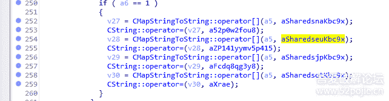

## 区域码生成流程与验证

这样欧洲区域注册码的基本流程就完了，其他区域类似，有兴趣的小伙伴可以试试。

`TisServiceRegistration` 和 `DecryptByRotatShiftVariable` 函数可以直接通过他的函数地址直接调用，就懒得扣出来了。

写代码试一下，注册码更改成新的了：

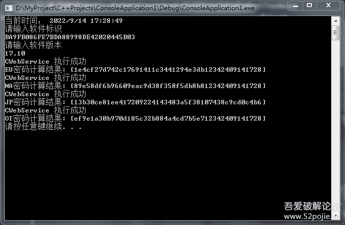

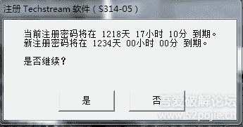

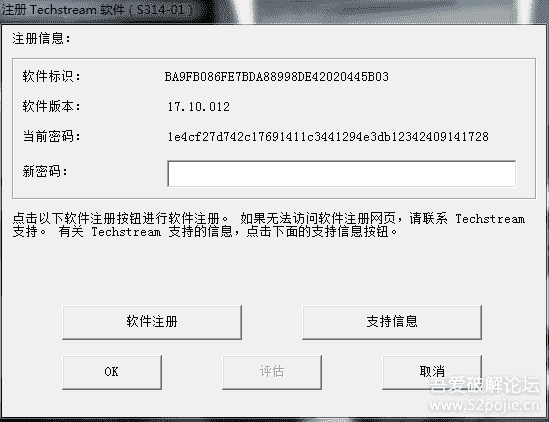
