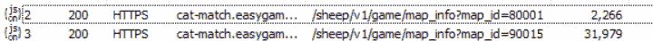
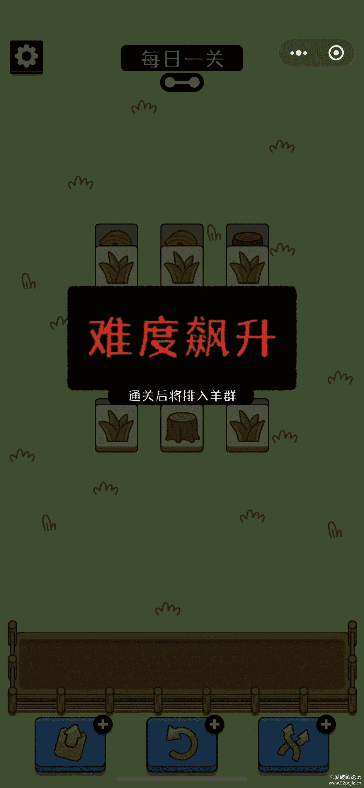

# [Web逆向] 羊了个羊修改通关思路分析

- 原帖：[https://www.52pojie.cn/forum.php?mod=viewthread&tid=1688065](https://www.52pojie.cn/forum.php?mod=viewthread&tid=1688065)
- 抓取时间：2026-11-01T23:09:36

本思路适合有一定 fiddler 基础的朋友观看，如果只是想简单快速通关，请看[//www.52pojie.cn/thread-1688884-1-1.html](https://www.52pojie.cn/thread-1688884-1-1.html)。

## 抓包分析

用 fiddler 抓包，看到点击开始游戏后生成了两个请求文件。分析了一下，这是请求关卡数据，得到关卡 `id` 分别为 80001 和 90016。分析了一下确定 90016 是第二关，也就是难度比较高的关卡。



`1.jpg`（21.49 KB，下载次数：3）

[附件下载](https://www.52pojie.cn/forum.php?mod=attachment&aid=MjU1MzQ5MXw0MjdmY2U0YXwxNzkzNTc0NTczfDE2ODA4NnwxNjg4MDY1&nothumb=yes)

2022-9-15 02:26 上传

## 修改关卡 `id`

接下来直接使用 `FiddlerScript`。


直接在 `OnBeforeRequest` 类中加入替换关卡 `id` 的代码。

```javascript
if (oSession.url=="cat-match.easygame2021.com/sheep/v1/game/map_info?map_id=90016") {
        oSession.url = "cat-match.easygame2021.com/sheep/v1/game/map_info?map_id=80001";
}
```

然后重新点击开始游戏，之后你会发现两个关卡都是简单的关卡了。

PS：狼人吸血鬼模式也可以用同样的逻辑。只要开发者不更新关卡逻辑，这个方法就应该一直可以用。每天的关卡 `id` 自己替换一下就好。

再 PS：只要姿势正确，安卓、ios 和 pc 通吃。


`5629f298014f2c6cc895656c4c5237e.png`（376.7 KB，下载次数：2）

[附件下载](https://www.52pojie.cn/forum.php?mod=attachment&aid=MjU1MzQ5Mnw2YzVjNzRiY3wxNzkzNTc0NTczfDE2ODA4NnwxNjg4MDY1&nothumb=yes)

2022-9-15 02:34 上传

## 补充说明

学会了快去装X吧，别忘了你们的免费评分哦，不做伸手党从我做起。

11点40亲测还是可以用的，铁子们论坛有很多 fiddler 配置相关的帖子了，关于 fiddler 证书配置问题我就不一一回答了，快去补课，以后有这种好玩的也免不了需要用上！！



`c6b5ad26f6d4042f604bfadb9a5bf86.jpg`（142.38 KB，下载次数：3）

[附件下载](https://www.52pojie.cn/forum.php?mod=attachment&aid=MjU1MzU0NXw4NTFhNGJjY3wxNzkzNTc0NTczfDE2ODA4NnwxNjg4MDY1&nothumb=yes)

2022-9-15 11:44 上传
