# [Web逆向] 某鹅通m3u8视频JS获取解密Key的过程分析

- 原帖：`https://www.52pojie.cn/forum.php?mod=viewthread&tid=1689801`
- 抓取时间：2026-11-01T23:09:09

## 前言
近期网页更新，m3u8链接也发生了变化，以前的很多工具都无法直接下载视频了，下面和大家分享一下新的m3u8文件获取`AES`加密`key`的过程。
本文下面描述部分链接会脱敏处理，不展示实际链接。
其m3u8的文件的链接特征如下：
`https://pri-cdn-tx.xiaoeknow.com/app*****193/private_index/16630*****cxyn0.m3u8?sign=bd76*****57c6763&t=6326d139`

## 工具环境
m3u8下载工具：`N_m3u8DL-CLI`（`https://github.com/nilaoda/N_m3u8DL-CLI`）

## 分析过程

### 获取m3u8文件
首先我们还是先拿到m3u8文件，有很多方法都能拿到m3u8文件，如图用控制台抓包获取链接。
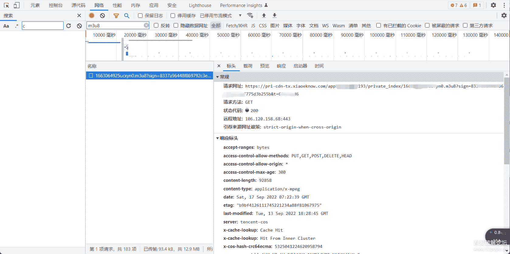
图片1.png（126.31 KB，下载次数：5）
下载得到的m3u8文件的内容如下：
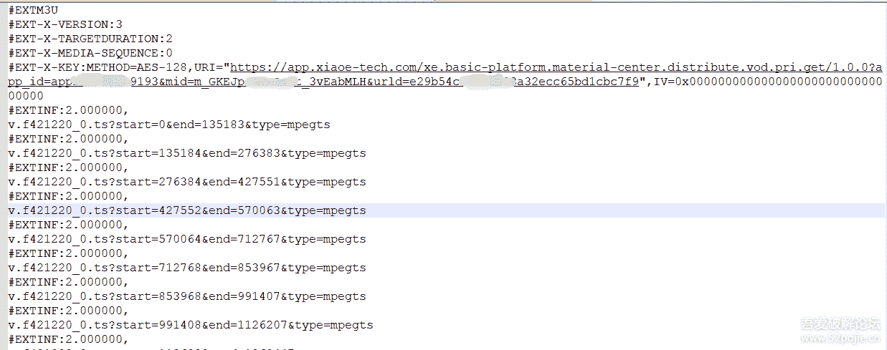
图片2.png（60.24 KB，下载次数：3）

### 补全ts分片链接
用工具直接下载时会出现报错，这时分片信息的链接还不完整，ts分片的链接从控制台可以抓到，样例URL是：
`https://encrypt-k-vod.xet.tech/97*****26/18*****18/drm/v.f421220_0.ts?start=276384&end=427551&type=mpegts&sign=e3******c6&t=63***96&us=nh***sc&whref=v.*****.cn`
将m3u8文件中ts分片的链接信息补充完整，样例如图：
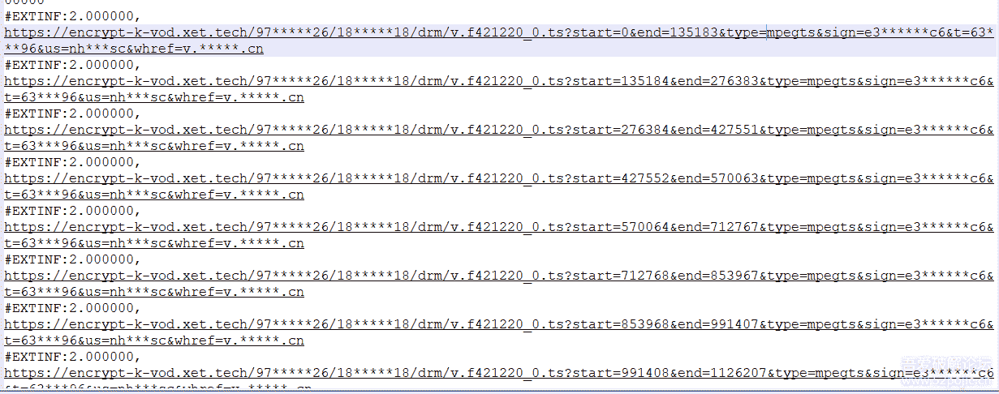
图片3.png（69.38 KB，下载次数：7）
用m3u8工具尝试下载视频，会再次出现报错，如图：
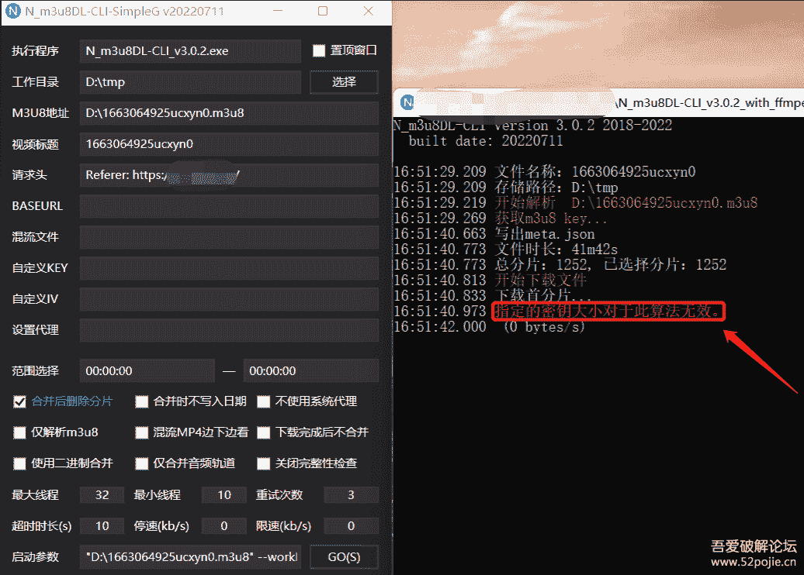
图片4.png（281.18 KB，下载次数：9）

### 获取解密KEY
从上面的报错中能发现，密钥获取失败。从文件的信息可以知道，加密方法是：`AES-128`，`KEY`的获取URL是：
`https://app.xiaoe-tech.com/xe.basic-platform.material-center.distribute.vod.pri.get/1.0.0?app_id=app*****93&mid=m_G*****MLH&urld=e29*****7f9`
`IV`是：`0x00000000000000000000000000000000`。
这里是`GET`方式，我们尝试直接请求URL链接获取`KEY`，得到的结果如下：
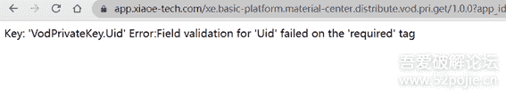
图片5_1.png（30.81 KB，下载次数：5）
到这里发现这个链接应该是缺少什么参数，打开控制台对源码搜索分析了一波，搜索关键词：
`xe.basic-platform.material-center.distribute.vod.pri.get`
找到如下代码：
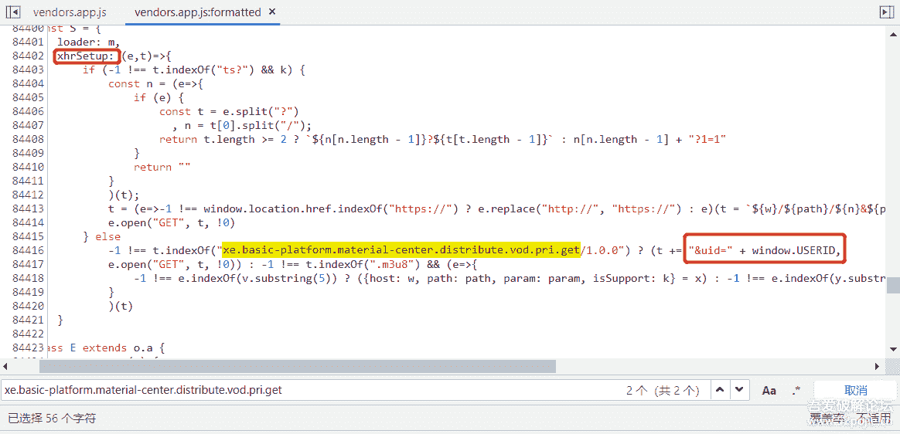
图片5.png（77.56 KB，下载次数：6）
上图能看出在发请求时在链接后拼接了一个`&uid=windows.USERID`，这里`windows.USERID`的值是什么呢，由于是全局的常量，这里在控制台打印一下。如图：
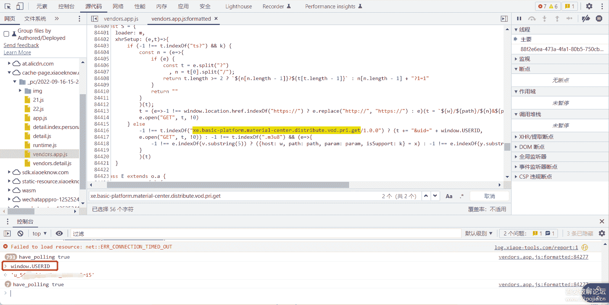
图片6.png（170.97 KB，下载次数：5）
发现这个`USERID`就是我们看视频在那里飘来飘去的一串字符串。
这时候我们手动将上面的链接拼接完整，示例为：
`https://app.xiaoe-tech.com/xe.basic-platform.material-center.distribute.vod.pri.get/1.0.0?app_id=app*****93&mid=m_G*****MLH&urld=e29*****7f9&uid=u_5f****6f_oR****i5`
放到浏览器试一下，结果如图：
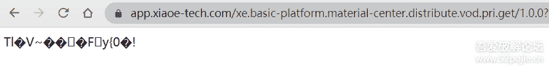
图片7.png（17.05 KB，下载次数：7）

### 脚本验证KEY
看到这里看起来像是正常的响应了，下面写个简单的python脚本验证一下，代码如下：
```
import requests

url = 'https://app.xiaoe-tech.com/xe.basic-platform.material-center.distribute.vod.pri.get/1.0.0?app_id=app*****93&mid=m_G*****MLH&urld=e29*****7f9&uid=u_5f****6f_oR****i5'
response = requests.get(url=url)
key = response.content
print(key)
print(list(key))
print(len(key))
```
控制台打印结果如下：
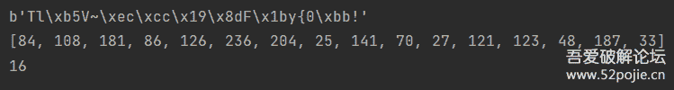
图片8.png（15.51 KB，下载次数：4）
请求返回结果长度是16字节的`bytes`，看起来就是我们需要的`key`，那将m3u8文件里面的`url`拼上`uid`参数，再次放到下载工具测试一波。
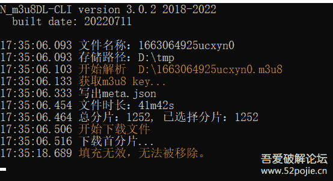
图片9.png（47.77 KB，下载次数：2）

### 分析二次加密KEY
看到这里发现，这事果然没那么简单。按网上的一些教程用python写了一个解密方法，对单独下载的一个ts分片进行解密，下面贴一下方法代码：
```
from Crypto.Cipher import AES
from Crypto.Util.Padding import pad

def aes_decrypt(data, key, iv):
    new_data = pad(data_to_pad=data, block_size=AES.block_size)
    aes_d = AES.new(key, AES.MODE_CBC, iv)
    return aes_d.decrypt(new_data)
```
接口请求返回的这16字节长度的`KEY`依然无法解密视频，那这`KEY`应该是二次加密了。那我们只能继续从源码去分析了。
经过几天的研究（不得不说混淆后的源码真难懂），搜索关键词`decryptdata`，在其下一步，如下地方打上断点（别问我怎么找到的，经过了很多次尝试），如图：
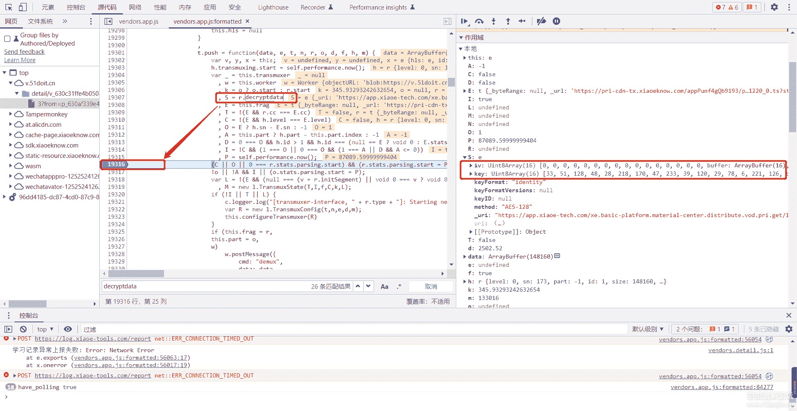
图片10.png（256.64 KB，下载次数：5）
在这里发现了疑似解密的`KEY`和`IV`，将其复制出来，用上面描述的解密方法对下载的ts分片进行了解密测试，发现解密之后能正常播放。
由此得出结论：这里的`bytes`才是真实的解密`KEY`，上面接口请求得到的`bytes`确实经过二次加密。


# 接口得到的KEY
[84, 108, 181, 86, 126, 236, 204, 25, 141, 70, 27, 121, 123, 48, 187, 33]

## 源码打断点得到的KEY
[33, 51, 128, 48, 28, 218, 170, 47, 233, 39, 120, 29, 78, 6, 221, 126]

看到这里大家就很好奇了，这个真实的KEY是怎么得到的呢！！！

我当时就挺难受的，还真的是二次加密了，抓了好多视频的两组KEY拿来做对比观察，发现没有明显的规律。

好吧，那只能继续看一堆混淆的代码去研究了。

这里再次回到上面说到的关键词`xe.basic-platform.material-center.distribute.vod.pri.get`，这里请求之后在某个地方肯定会对获得的结果进行处理，

在如下地方打上断点：

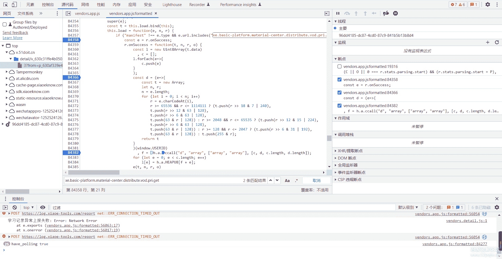

图片11.png (220.8 KB, 下载次数: 4)

[href="forum.php?mod=attachment&aid=MjU1NDk2MHxhNDM4ZmE1NXwxNzkzNTc0NTQ2fDE2ODA4NnwxNjg5ODAx&nothumb=yes" target="_blank"](https://www.52pojie.cn/forum.php?mod=attachment&aid=MjU1NDk2MHxhNDM4ZmE1NXwxNzkzNTc0NTQ2fDE2ODA4NnwxNjg5ODAx&nothumb=yes)

2022-9-19 10:24 上传

打上断点之后需要刷新一下网页让代码停在断点处，单步跟进第一个断点，发现这里是发送请求的过程，请求接口得到KEY的值，这里的值会在下面使用，如图：

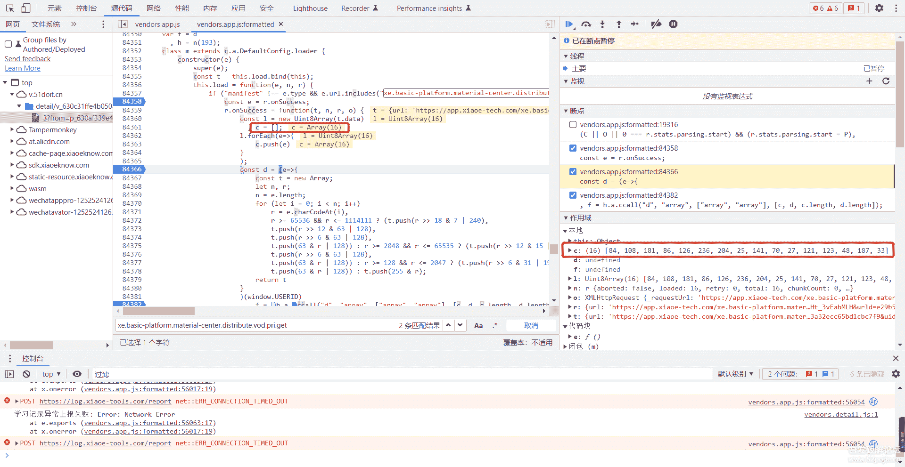

图片12.png (251.5 KB, 下载次数: 2)

[href="forum.php?mod=attachment&aid=MjU1NDk2MXxhOWY5MDYwY3wxNzkzNTc0NTQ2fDE2ODA4NnwxNjg5ODAx&nothumb=yes" target="_blank"](https://www.52pojie.cn/forum.php?mod=attachment&aid=MjU1NDk2MXxhOWY5MDYwY3wxNzkzNTc0NTQ2fDE2ODA4NnwxNjg5ODAx&nothumb=yes)

2022-9-19 10:24 上传

继续单步调试，这里能看出对`USERID`处理后得到了`d`的值，从代码来看，这一步其实就是将`USERID`字符串转成`bytes`字节数组，如图：

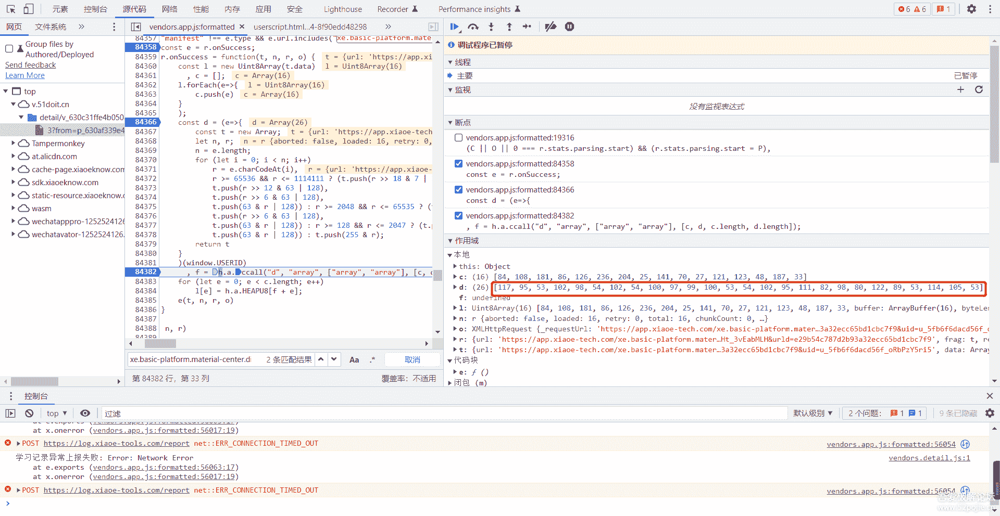

图片13.png (261.73 KB, 下载次数: 1)

[href="forum.php?mod=attachment&aid=MjU1NDk2Mnw0MDliOTUxMHwxNzkzNTc0NTQ2fDE2ODA4NnwxNjg5ODAx&nothumb=yes" target="_blank"](https://www.52pojie.cn/forum.php?mod=attachment&aid=MjU1NDk2Mnw0MDliOTUxMHwxNzkzNTc0NTQ2fDE2ODA4NnwxNjg5ODAx&nothumb=yes)

2022-9-19 10:24 上传

继续跟进，发现调用了一个`ccall`函数，并且将两个数组都当参数传入了，我们继续跟进代码，分析其逻辑是创建一个很长的数组，

将传入的参数进行处理之后放进去，再利用方法反向操作取出对应的值，这里的`f`值就是一个初始的偏移量。

这应该是混淆对我们的干扰。如下：

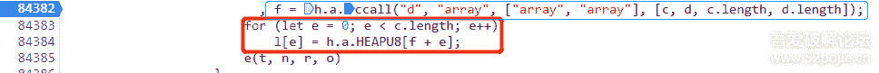

图片14.png (18.5 KB, 下载次数: 2)

[href="forum.php?mod=attachment&aid=MjU1NDk2M3xmMmNlOTY2NHwxNzkzNTc0NTQ2fDE2ODA4NnwxNjg5ODAx&nothumb=yes" target="_blank"](https://www.52pojie.cn/forum.php?mod=attachment&aid=MjU1NDk2M3xmMmNlOTY2NHwxNzkzNTc0NTQ2fDE2ODA4NnwxNjg5ODAx&nothumb=yes)

2022-9-19 10:24 上传

回顾上面传入的两个字节数组，

[84, 108, 181, 86, 126, 236, 204, 25, 141, 70, 27, 121, 123, 48, 187, 33]，

[117, 95, 53, 102, 98, 54, 102, 54, 100, 97, 99, 100, 53, 54, 102, 95, 111, 82, 98, 80, 122, 89, 53, 114, 105, 53]，

我们跟进代码发现在堆栈中，其取出了两个数组的第一个值，如图：

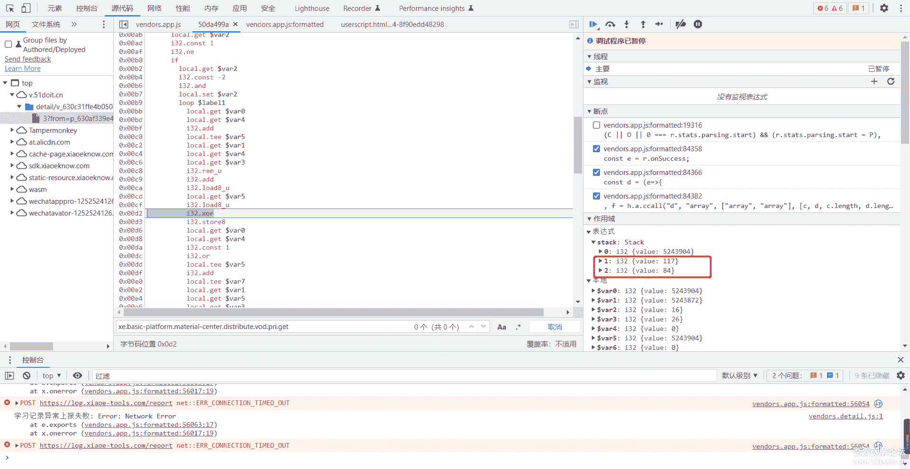

图片15.png (226.57 KB, 下载次数: 3)

[href="forum.php?mod=attachment&aid=MjU1NDk2NHxhM2E1ZWU3MXwxNzkzNTc0NTQ2fDE2ODA4NnwxNjg5ODAx&nothumb=yes" target="_blank"](https://www.52pojie.cn/forum.php?mod=attachment&aid=MjU1NDk2NHxhM2E1ZWU3MXwxNzkzNTc0NTQ2fDE2ODA4NnwxNjg5ODAx&nothumb=yes)

2022-9-19 10:24 上传

看到这里猜测其应该是某种字节码注入技术，我对前端不是太懂，欢迎大佬评论区补充。

回到正题，这里取出之后做了一个`i32.xor`操作，然后得到了33的值，

如图：

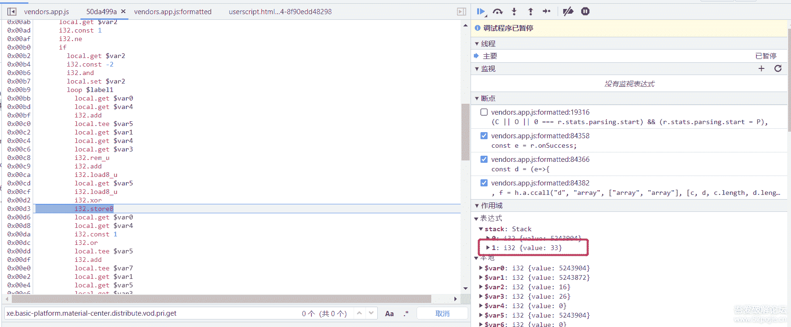

图片16.png (141.12 KB, 下载次数: 1)

[href="forum.php?mod=attachment&aid=MjU1NDk2NXw4YjVhZDU2YnwxNzkzNTc0NTQ2fDE2ODA4NnwxNjg5ODAx&nothumb=yes" target="_blank"](https://www.52pojie.cn/forum.php?mod=attachment&aid=MjU1NDk2NXw4YjVhZDU2YnwxNzkzNTc0NTQ2fDE2ODA4NnwxNjg5ODAx&nothumb=yes)

2022-9-19 10:24 上传

细心的小伙伴们肯定已经发现了一点什么，

我们实际来解密的KEY是

[33, 51, 128, 48, 28, 218, 170, 47, 233, 39, 120, 29, 78, 6, 221, 126]，

上面得到的结果就是33！！！

是不是我们想的那样呢，我们继续跟进验证想法，如图：

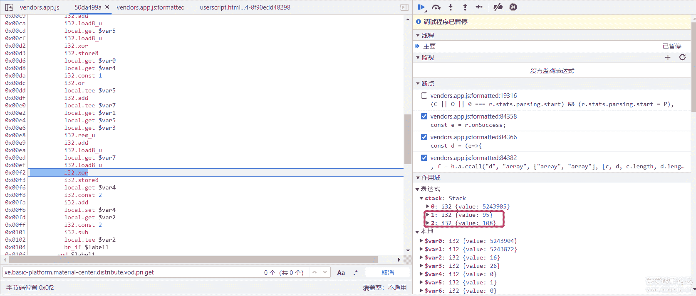

图片17.png (143.91 KB, 下载次数: 3)

[href="forum.php?mod=attachment&aid=MjU1NDk2NnwzYTdlZDExMXwxNzkzNTc0NTQ2fDE2ODA4NnwxNjg5ODAx&nothumb=yes" target="_blank"](https://www.52pojie.cn/forum.php?mod=attachment&aid=MjU1NDk2NnwzYTdlZDExMXwxNzkzNTc0NTQ2fDE2ODA4NnwxNjg5ODAx&nothumb=yes)

2022-9-19 10:24 上传

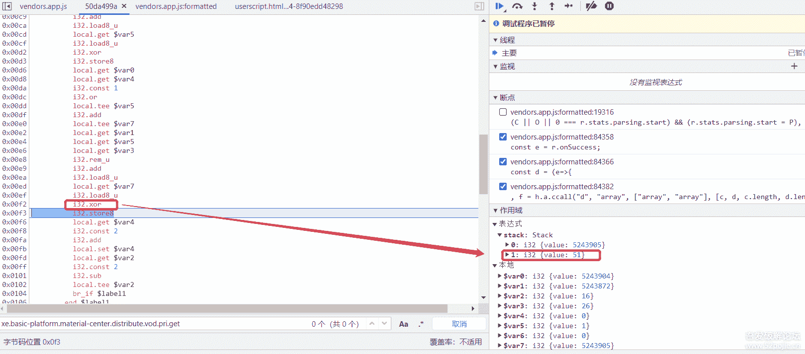

图片18.png (146.93 KB, 下载次数: 3)

[href="forum.php?mod=attachment&aid=MjU1NDk2N3w5YjM4Y2E0NHwxNzkzNTc0NTQ2fDE2ODA4NnwxNjg5ODAx&nothumb=yes" target="_blank"](https://www.52pojie.cn/forum.php?mod=attachment&aid=MjU1NDk2N3w5YjM4Y2E0NHwxNzkzNTc0NTQ2fDE2ODA4NnwxNjg5ODAx&nothumb=yes)

2022-9-19 10:24 上传

没错，就是我们想的那样子，这里的操作就是对两个数组进行循环，将两个数组取出来的值进行一个`i32.xor`操作就能得到我们需要的结果值。

查了一波`i32.xor`发现是异或操作，为了验证，写波代码测试一下，代码如下：

```python
url_key = [84, 108, 181, 86, 126, 236, 204, 25, 141, 70, 27, 121, 123, 48, 187, 33]

userid_bytes = [117, 95, 53, 102, 98, 54, 102, 54, 100, 97, 99, 100, 53, 54, 102, 95,
                111, 82, 98, 80, 122, 89, 53, 114, 105, 53]

# 目标:[33, 51, 128, 48, 28, 218, 170, 47, 233, 39, 120, 29, 78, 6, 221, 126]

result_key = []

for i in range(0, len(url_key)):

    result_key.append(url_key[i] ^ userid_bytes[i])

print(result_key)
```

## 结论

M3U8文件中的URL获取到的16位长度字节数组，与用户ID转化得到的字节数组的前16位依次做异或操作即可得到真实的解密KEY。

Python实现的通过URL获取解密KEY的代码如下：

```python
import requests
import base64

def get_key_from_url(url: str, userid: str) -> str:
    """
    通过请求m3u8文件中的key的url,获取解密视频key的base64字符串密钥
    :param url: m3u8文件中获取key的url
    :param userid: 用户id，放视频时飘动的那一串
    :return: key的base64字符串
    """
    # url拼接uid参数
    url += f'&uid={userid}'
    # 发送get请求
    rsp = requests.get(url=url)
    rsp_data = rsp.content
    if len(rsp_data) == 16:
        userid_bytes = bytes(userid.encode(encoding='utf-8'))
        result_list = []
        for index in range(0, len(rsp_data)):
            result_list.append(
                rsp_data[index] ^ userid_bytes[index])
        print(result_list)
        return base64.b64encode(bytes(result_list)).decode()
    else:
        print(f"获取异常，请求返回值：{rsp.text}")
        return ''

if __name__ == '__main__':
    _url = 'https://app.xiaoe-tech.com/xe.basic-platform.material-center.distribute.vod.pri.get/1.0.0?app_id=app****3&mid=m_G****t_3****H&urld=e****f9'
    _uid = 'u_5****f_o****5'
    base64_key = get_key_from_url(url=_url, userid=_uid)
    print(base64_key)
```

将获取到的密钥填入工具即可下载成功，如图：

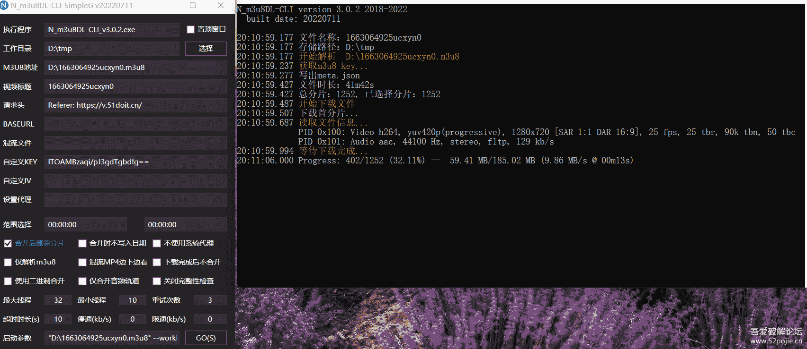

图片19.png (532.18 KB, 下载次数: 4)

[href="forum.php?mod=attachment&aid=MjU1NDk2OHwxZmU1MzE5ZXwxNzkzNTc0NTQ2fDE2ODA4NnwxNjg5ODAx&nothumb=yes" target="_blank"](https://www.52pojie.cn/forum.php?mod=attachment&aid=MjU1NDk2OHwxZmU1MzE5ZXwxNzkzNTc0NTQ2fDE2ODA4NnwxNjg5ODAx&nothumb=yes)

2022-9-19 10:24 上传

## 写在最后

本文仅供研究学习使用，请勿用于非法用途。如有侵权，请联系管理员删除！

注：若转载请注明来源（本贴地址）与作者信息。
