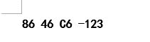
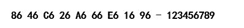
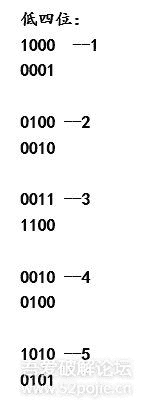
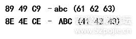
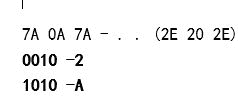
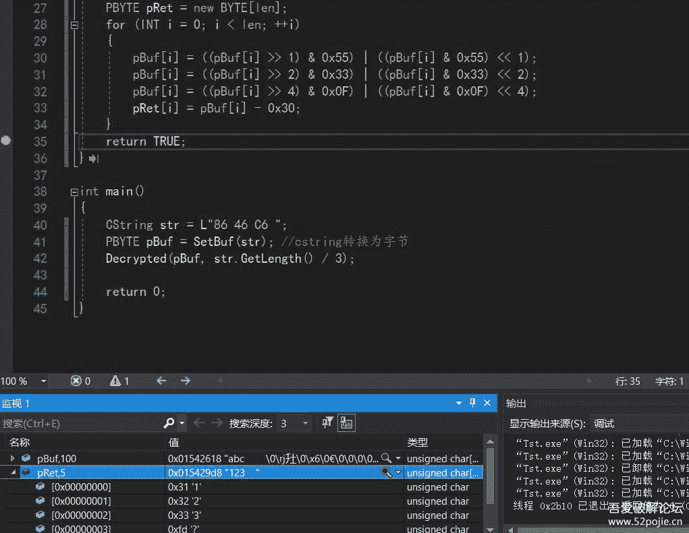

# [原创] 封包解密趣事

- 原帖: https://www.52pojie.cn/forum.php?mod=viewthread&tid=1690327
- 抓取时间: 2026-11-01T23:08:59

由于只是平时玩玩，解密仍局限于加减乘除，移位，异或（毕竟是游戏封包，不太可能太复杂）

咋们直接进入正题（咋肯定够不会被断在第一关）：

主角是这个

VeryCapture_20220920093431.jpg (3.34 KB, 下载次数: 1)

[href="forum.php?mod=attachment&aid=MjU1NTM0N3w5YTIyNmUzNnwxNzkzNTc0NTM2fDE2ODA4NnwxNjkwMzI3&nothumb=yes" target="_blank"](https://www.52pojie.cn/forum.php?mod=attachment&aid=MjU1NTM0N3w5YTIyNmUzNnwxNzkzNTc0NTM2fDE2ODA4NnwxNjkwMzI3&nothumb=yes)

2022-9-20 11:54 上传

VeryCapture_20220920115537.jpg (5.58 KB, 下载次数: 1)

[href="forum.php?mod=attachment&aid=MjU1NTM1M3wxMGE0M2JlMnwxNzkzNTc0NTM2fDE2ODA4NnwxNjkwMzI3&nothumb=yes" target="_blank"](https://www.52pojie.cn/forum.php?mod=attachment&aid=MjU1NTM1M3wxMGE0M2JlMnwxNzkzNTc0NTM2fDE2ODA4NnwxNjkwMzI3&nothumb=yes)

2022-9-20 11:55 上传

；

首先加减乘除试试，但是吧，直接看都可以排除了，`86 > 46`

VeryCapture_20220920093442.jpg (7.6 KB, 下载次数: 1)

[href="forum.php?mod=attachment&aid=MjU1NTM0OHxjYWEwYjcwM3wxNzkzNTc0NTM2fDE2ODA4NnwxNjkwMzI3&nothumb=yes" target="_blank"](https://www.52pojie.cn/forum.php?mod=attachment&aid=MjU1NTM0OHxjYWEwYjcwM3wxNzkzNTc0NTM2fDE2ODA4NnwxNjkwMzI3&nothumb=yes)

2022-9-20 11:54 上传

；

一看这组数据，这规律立马出来了，低四位一样；

所以先看高四位，`8 = 1`，`4 = 2`，`C=3`...，这样看当然看不出来什么。

咋们得用计算机视角（还得万能的二进制）：

所以得这样

VeryCapture_20220920093501.jpg (8.66 KB, 下载次数: 1)

[href="forum.php?mod=attachment&aid=MjU1NTM1MHxiOGMyMzNiZnwxNzkzNTc0NTM2fDE2ODA4NnwxNjkwMzI3&nothumb=yes" target="_blank"](https://www.52pojie.cn/forum.php?mod=attachment&aid=MjU1NTM1MHxiOGMyMzNiZnwxNzkzNTc0NTM2fDE2ODA4NnwxNjkwMzI3&nothumb=yes)

2022-9-20 11:54 上传

，这样规律就立马出来了；

！！！逆序；

这不简简单单？

Over！！！？？？

不？还有低四位，`3 = 6`? 显然数据不够；

再来组 `abc`

VeryCapture_20220920093449.jpg (5.49 KB, 下载次数: 1)

[href="forum.php?mod=attachment&aid=MjU1NTM0OXwyNTczMTkxMHwxNzkzNTc0NTM2fDE2ODA4NnwxNjkwMzI3&nothumb=yes" target="_blank"](https://www.52pojie.cn/forum.php?mod=attachment&aid=MjU1NTM0OXwyNTczMTkxMHwxNzkzNTc0NTM2fDE2ODA4NnwxNjkwMzI3&nothumb=yes)

2022-9-20 11:54 上传

；

`3 = 6`，`4 = E`, `6 = 9`；

`0011 = 0110`, `0100 = 1110`, `0110 = 1001`,

很明显不是加减乘除？

异或，用`calc`敲一敲，仍然不行；

但这也不是逆序；也不是反码，离大谱！！！

数据不够？

再来一组

VeryCapture_20220920093518.jpg (8.37 KB, 下载次数: 0)

[href="forum.php?mod=attachment&aid=MjU1NTM1Mnw3OWJiN2VmY3wxNzkzNTc0NTM2fDE2ODA4NnwxNjkwMzI3&nothumb=yes" target="_blank"](https://www.52pojie.cn/forum.php?mod=attachment&aid=MjU1NTM1Mnw3OWJiN2VmY3wxNzkzNTc0NTM2fDE2ODA4NnwxNjkwMzI3&nothumb=yes)

2022-9-20 11:54 上传

，

有毛用！！！破解之路到此终结？

NO!!!

咋们的密文高位是逆序的

地位也是，所以得这么看：

`0011 = 0110`；`0100 = 0111`；`0110 = 1001`；`0010 = 0101`；

这里规律已经很明显了；

更明显一点 `3 = 6`, `4 = 7`, `6 = 9`, `2 = 5`;

所以加密方式就是逆序，高位 + `0x30`;

解密就变得easy

VeryCapture_20220920124237.jpg (124.91 KB, 下载次数: 1)

[href="forum.php?mod=attachment&aid=MjU1NTM2NHwyN2YwYjk3MHwxNzkzNTc0NTM2fDE2ODA4NnwxNjkwMzI3&nothumb=yes" target="_blank"](https://www.52pojie.cn/forum.php?mod=attachment&aid=MjU1NTM2NHwyN2YwYjk3MHwxNzkzNTc0NTM2fDE2ODA4NnwxNjkwMzI3&nothumb=yes)

2022-9-20 12:53 上传
