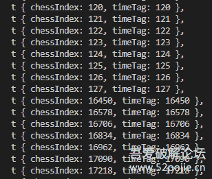

# [Web逆向] 羊了个羊MatchPlayInfo序列化分析

- 原帖: https://www.52pojie.cn/forum.php?mod=viewthread&tid=1690631
- 抓取时间: 2026-11-01T23:08:57

通过分析源码可以得到以下`MatchPlayInfo`序列的生成代码

```js
const protobuf = require("protobufjs");
var i = protobuf.Reader, a = protobuf.Writer, r = protobuf.util;
MatchStepInfo = function () {
    function t(t) {
        if (t)
            for (var e = Object.keys(t), o = 0; o >> 3) {
                case 1:
                    n.chessIndex = t.int32();
                    break;
                case 2:
                    n.timeTag = t.int32();
                    break;
                default:
                    t.skipType(7 & a)
            }
        }
        return n
    }, t
}(), MatchPlayInfo = function () {
    function t(t) {
        if (this.stepInfoList = [], t)
            for (var e = Object.keys(t), o = 0; o >> 3) {
                    case 1:
                        n.gameType = t.int32();
                        break;
                    case 2:
                        n.mapId = t.int32();
                        break;
                    case 3:
                        n.mapSeed = t.int32();
                        break;
                    case 4:
                        n.stepInfoList && n.stepInfoList.length || (n.stepInfoList = []),
                            n.stepInfoList.push(MatchStepInfo.decode(t,
                                t.uint32()));
                        break;
                    default:
                        t.skipType(7 & a)
                }
            }
            return n
        }, t
}()
var operationList = []
function addOp(t, e) { //增加操作
    void 0 === e && (e = -100);
    var o = {
        id: t, // 操作卡片的id，从levelData第一层开始按顺序编号
        time: Date.now() // 操作时间
    };
    operationList.push(o)
}
function sleep(delay) {
    for (var t = Date.now(); Date.now() - t  [...Array(n).keys()]
for (let i of range(50)) { // 生成了50次操作
    addOp(i);
    sleep(Math.random() * 10); // 模拟操作过程中的等待
}
console.log(operationList)
for (var u = operationList, p = [], d = 0, h = 0; h
```

分析一下`MatchPlayInfo`的生成操作

首先可以得知`MatchPlayInfo`是由`stepInfoList`和`gameType`组成的，`stepInfoList`里有两个参数分别是`chessIndex`和`timeTag`，分别记录点击卡片id和两次操作间隔

观察`MatchPlayInfo.encode`可以看到

```js
e = a.create()
```

会创建一个`Writer`对象

```js
e.uint32(8).int32(t.gameType)
```

会创建序列`"\x08\x03"`，虽然写着是32但是经过调试发现是1字节的，不知道是为什么

```js
MatchStepInfo.encode(t.stepInfoList[o], e.uint32(34).fork()).ldelim()
```

这里首先插入1字节34变成`"\x08\x03\x22"`，接着`fork`函数会生成一个分叉，类似于git等待处理完这个分支后调用`ldelim`就会把当前分支上内容的长度和内容合并回主分支，分析`MatchStepInfo.encode`后可以得知会插入4个字节，分别是`[8, chessIndex, 16, timeTag]`，此时序列就是`"\x08\x03\x22" + "\x04" + "\x08\x00\x10\x00" = "\x08\x03\x22\x04\x08\x00\x10\x00"`，重复这个过程把`stepInfoList`里的`chessIndex`和`timeTag`循环增加到序列，可以得知生成过程是`MatchPlayInfo = "\x08\x03" + ("\x22\x04\x08\x??\x10\x??" * 卡牌个数)`



1.png (16.99 KB, 下载次数: 2)

[href="forum.php?mod=attachment&aid=MjU1NTUyOHw4NDVmYzM5MnwxNzkzNTc0NTM0fDE2ODA4NnwxNjkwNjMx&nothumb=yes" target="_blank"](https://www.52pojie.cn/forum.php?mod=attachment&aid=MjU1NTUyOHw4NDVmYzM5MnwxNzkzNTc0NTM0fDE2ODA4NnwxNjkwNjMx&nothumb=yes)

2022-9-21 05:32 上传

然而生成的序列无法增加通关次数，研究了一下发现`stepInfoList`里的值大于127的数值是错误的，不知道是什么原因，于是过滤掉大于127的数可以成功增加通关次数

python代码如下

```python
import struct
import base64
import requests

headers = {
    't': '',
    'User-Agent': '',
    'Referer': 'https://servicewechat.com/wx141bfb9b73c970a9/23/page-frame.html'

}
url = 'https://cat-match.easygame2021.com/sheep/v1/game/personal_info?'
r = requests.get(url, headers=headers)
print(r.json())
url = 'https://cat-match.easygame2021.com/sheep/v1/game/map_info_ex?matchType=3'
r = requests.get(url, headers=headers)
map_md5 = r.json()['data']['map_md5'][1]
url = f'https://cat-match-static.easygame2021.com/maps/{map_md5}.txt'  # 由于每天获取的地图不一样，需要计算地图大小
r = requests.get(url)
levelData = r.json()['levelData']
p = []
for h in range(len(sum(levelData.values(), []))):  # 生成操作序列
    p.append({'chessIndex': 127 if h > 127 else h, 'timeTag': 127 if h > 127 else h})
GAME_DAILY = 3
GAME_TOPIC = 4
data = struct.pack('BB', 8, GAME_DAILY)
for i in p:
    c, t = i.values()
    data += struct.pack('BBBBBB', 34, 4, 8, c, 16, t)
MatchPlayInfo = base64.b64encode(data)
print(MatchPlayInfo)
url = 'https://cat-match.easygame2021.com/sheep/v1/game/game_over_ex?'
r = requests.post(url, headers=headers,
                  json={'rank_score': 1, 'rank_state': 1, 'rank_time': 1, 'rank_role': 1, 'skin': 1,
                        'MatchPlayInfo': MatchPlayInfo})
print(r.json())
url = 'https://cat-match.easygame2021.com/sheep/v1/game/personal_info?'
r = requests.get(url, headers=headers)
print(r.json())
```

补充一下，`int`采用了多字节编码，所以大于127的数并不是错误的，而是需要进行编码，编码后需要重新计算长度

```python
def multi_byte_int(number: int):
    # > 7)
    elif number > 7 & 127 | 128, number >> 14)
    elif number > 7 & 127 | 128, number >> 14 & 127 | 128, number >> 21)
    else:
        return struct.pack('BBBBB', number & 127 | 128, number >> 7 & 127 | 128, number >> 14 & 127 | 128, number >> 21 & 127 | 128, number >> 28)
```

关于游戏更新后通关次数无法增加的问题，原因是接口增加了判断，游戏时间小于1分钟的不算有效记录
