# [原创] 福利放送，v12.0.1 `010editor` 简单破解

- 原帖：<https://www.52pojie.cn/forum.php?mod=viewthread&tid=1690709>
- 抓取时间：2026-11-01T23:08:55

## 前言

这篇文章简单破解了下 `010editor`，下面是过程。如果不想看，可以直接到文章末尾把破解后的 `010editor` 领走。因为比较忌惮网上的破解版，所以那些下载的工具啥的都放在了 [https://www.52pojie.cn/thread-661779-1-1.html](https://www.52pojie.cn/thread-661779-1-1.html) 里。但是最近 12 版本更新的一些功能比较实用，就想放在物理机上，网上也没啥 12 破解版，所以就索性简单修改了下。这里都是无毒的吼，大家可以放心用。

然后这边有个小 bug，不过不影响使用，就是每次打开都会弹一遍窗。

[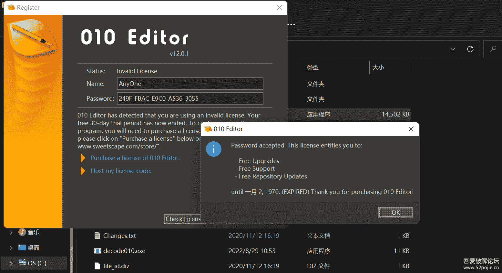](https://www.52pojie.cn/forum.php?mod=attachment&aid=MjU1NTU3M3w0NWVjZDUwYnwxNzkzNTc0NTMzfDE2ODA4NnwxNjkwNzA5&nothumb=yes)

`1.png`（156.68 KB，下载次数：2；2022-9-21 10:31 上传）

## 注册测试

像这种，如果嫌麻烦可以接着我下面文章中的内容继续往下修改。

注册的时候账号密码随便输就可以，但是别是空。

[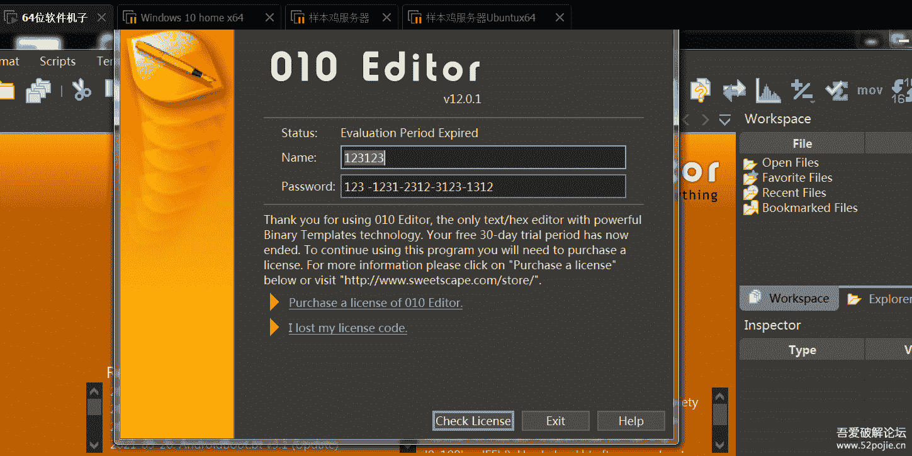](https://www.52pojie.cn/forum.php?mod=attachment&aid=MjU1NTU3NHxjMjAzNGRiNXwxNzkzNTc0NTMzfDE2ODA4NnwxNjkwNzA5&nothumb=yes)

`2.png`（161.33 KB，下载次数：1；2022-9-21 10:31 上传）

## 抓包与通信逻辑

下面就简单做下破解。

首先 `procmon` 对 `010editor` 验证过程做下简单预判，应该是网络请求服务器验证。

[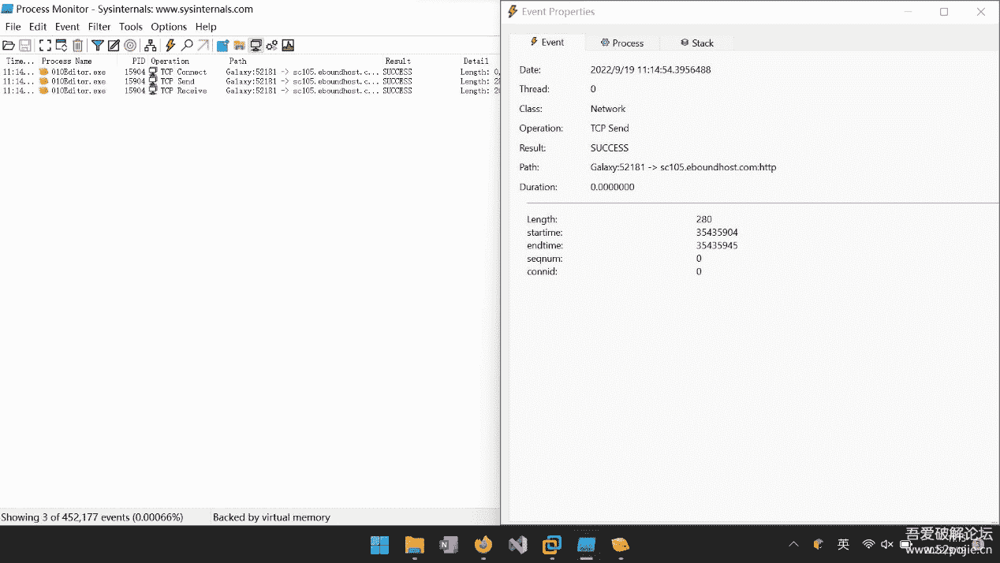](https://www.52pojie.cn/forum.php?mod=attachment&aid=MjU1NTU3NXw5NjBmYzliYXwxNzkzNTc0NTMzfDE2ODA4NnwxNjkwNzA5&nothumb=yes)

`3.png`（259.27 KB，下载次数：1；2022-9-21 10:31 上传）

然后我对着 `wireshark` 一顿过滤，但是没这个 `host` 地址就很怪，然后因为使用的 `http` 所以直接就放弃过滤上面的那个动态地址了，转而过滤 `http`。

[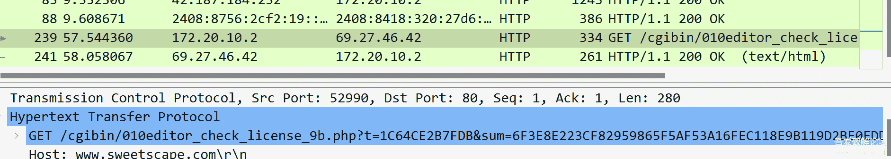](https://www.52pojie.cn/forum.php?mod=attachment&aid=MjU1NTU3NnwyN2RhZWJhM3wxNzkzNTc0NTMzfDE2ODA4NnwxNjkwNzA5&nothumb=yes)

`4.png`（61.7 KB，下载次数：0；2022-9-21 10:31 上传）

这边也是看到了一个 `010editor`。

通信逻辑大概就是这边一个 `get` 的 `request`，然后服务器反馈。

[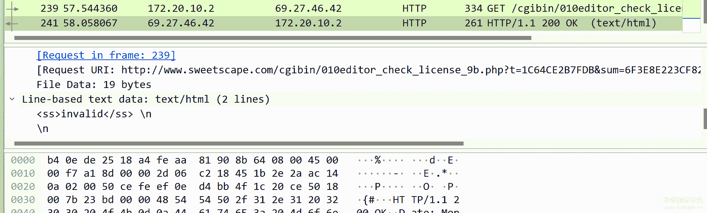](https://www.52pojie.cn/forum.php?mod=attachment&aid=MjU1NTU3N3wwNWIwMDlhN3wxNzkzNTc0NTMzfDE2ODA4NnwxNjkwNzA5&nothumb=yes)

`5.png`（80.83 KB，下载次数：0；2022-9-21 10:32 上传）

这是返回包。这里其实可以直接一个拦截，然后在本地开个服务器给传送一个 `success` 的返回包，简单提下思路；这里不做这么麻烦的了，就直接简单静态破解一下。

## 静态分析定位验证函数

然后用 `ida` 反编译一下，这里编译时间会有点长，可以等一下，然后用 `strings` 搜索关键字符串。

[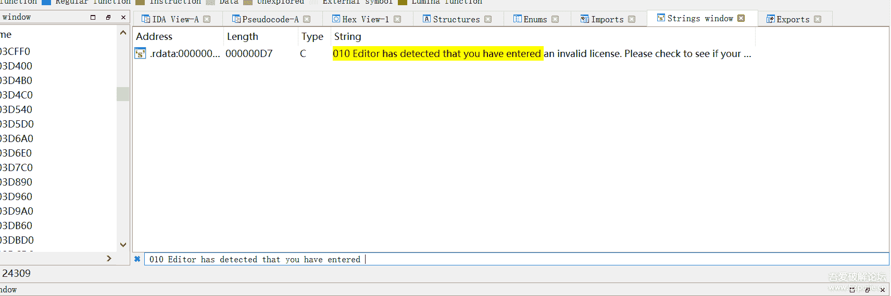](https://www.52pojie.cn/forum.php?mod=attachment&aid=MjU1NTU3OHw5NmU4NWUzM3wxNzkzNTc0NTMzfDE2ODA4NnwxNjkwNzA5&nothumb=yes)

`6.png`（47.69 KB，下载次数：0；2022-9-21 10:32 上传）

这里我搜索的是失败的那段文字，然后做下交叉引用查看调用的函数。

[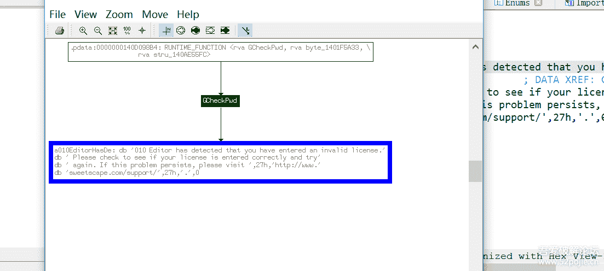](https://www.52pojie.cn/forum.php?mod=attachment&aid=MjU1NTU3OXwzMzRmNGUwNXwxNzkzNTc0NTMzfDE2ODA4NnwxNjkwNzA5&nothumb=yes)

`7.png`（32.29 KB，下载次数：1；2022-9-21 10:32 上传）

然后就找到了那段验证代码。上面的函数名是我后来修改过的，前面没有修改的应该是 `sub_xxxxxxxxx` 啥的，然后定位到函数。

往函数内部看，这里验证过程主要有两个。

[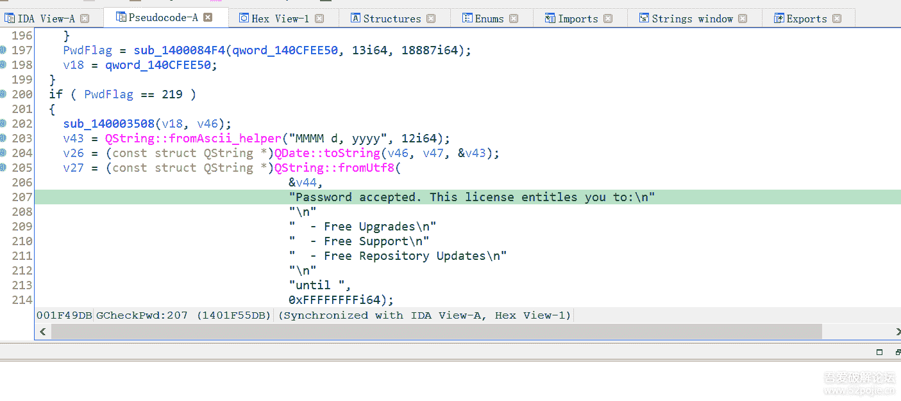](https://www.52pojie.cn/forum.php?mod=attachment&aid=MjU1NTU4MHw2OTlmNzI5MHwxNzkzNTc0NTMzfDE2ODA4NnwxNjkwNzA5&nothumb=yes)

`8.png`（66.34 KB，下载次数：2；2022-9-21 10:32 上传）

[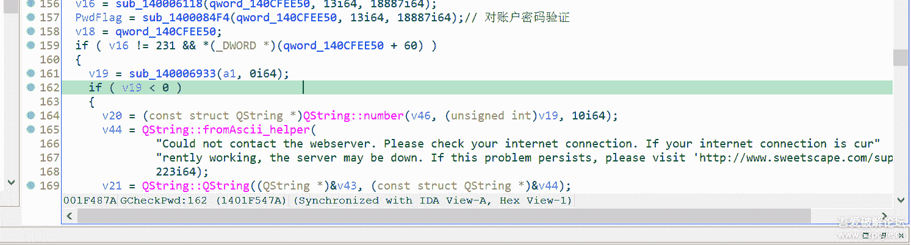](https://www.52pojie.cn/forum.php?mod=attachment&aid=MjU1NTU4MXw1NDQ2Zjc5MnwxNzkzNTc0NTMzfDE2ODA4NnwxNjkwNzA5&nothumb=yes)

`9.png`（64.23 KB，下载次数：0；2022-9-21 10:32 上传）

两个判断，这里我们定位到这两个判断的内存地址。

[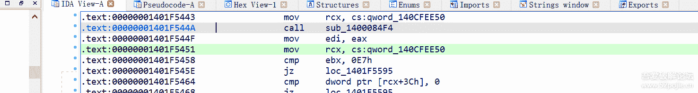](https://www.52pojie.cn/forum.php?mod=attachment&aid=MjU1NTU4Mnw3ZjBhY2M3MHwxNzkzNTc0NTMzfDE2ODA4NnwxNjkwNzA5&nothumb=yes)

`10.png`（39.18 KB，下载次数：2；2022-9-21 10:32 上传）

`11.png`（26.09 KB，下载次数：0；2022-9-21 10:32 上传）

## 修改验证逻辑

可以看到两个 `call` 的汇编，我的思路是直接重写两个函数，重新赋值 `eax`。

[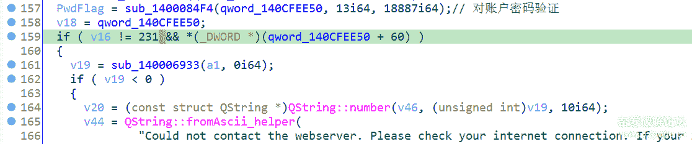](https://www.52pojie.cn/forum.php?mod=attachment&aid=MjU1NTU4NHw2MzQ0N2IzOHwxNzkzNTc0NTMzfDE2ODA4NnwxNjkwNzA5&nothumb=yes)

`12.png`（42.32 KB，下载次数：1；2022-9-21 10:32 上传）

[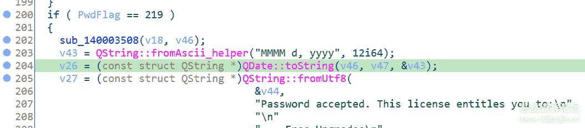](https://www.52pojie.cn/forum.php?mod=attachment&aid=MjU1NTU4NXxkNjM4ZjFhMXwxNzkzNTc0NTMzfDE2ODA4NnwxNjkwNzA5&nothumb=yes)

`13.png`（35.53 KB，下载次数：1；2022-9-21 10:32 上传）

使 `v16=231`，`pwdflag=219`，然后不修改其他的逻辑，使程序就直接这么跑下去。这么做的缺点也就是绕过了本地存储的一个过程，所以就不能做到第一次点击 `check lisence` 后面就不用 `check` 了，也算是一个无关痛痒的小 bug。

下面有了地址就直接在 `od` 中修改，注意 `od` 要使用 64位修改。

[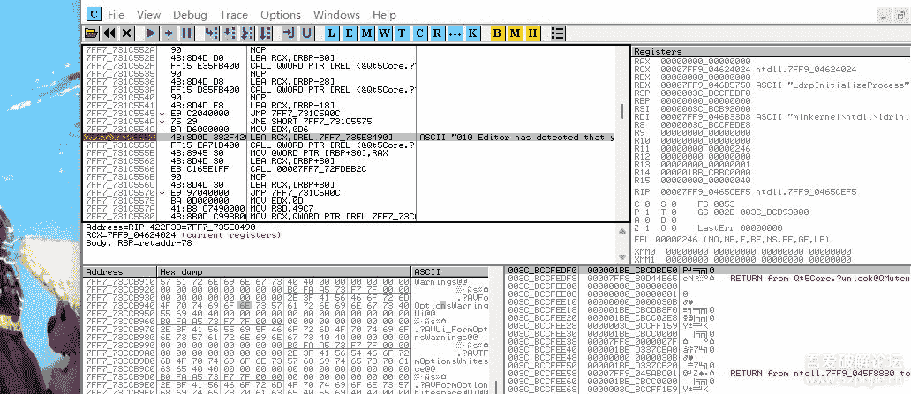](https://www.52pojie.cn/forum.php?mod=attachment&aid=MjU1NTU4NnwyODQxNzZiYnwxNzkzNTc0NTMzfDE2ODA4NnwxNjkwNzA5&nothumb=yes)

`14.png`（435.54 KB，下载次数：0；2022-9-21 10:32 上传）

还是对内存做下计算，然后定位到那段验证的过程，对前面的地址做下修改。

[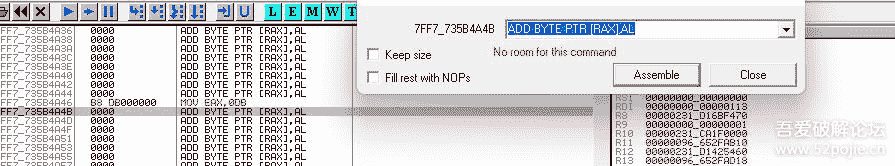](https://www.52pojie.cn/forum.php?mod=attachment&aid=MjU1NTU4N3w5ODg3ZTEwY3wxNzkzNTc0NTMzfDE2ODA4NnwxNjkwNzA5&nothumb=yes)

`15.png`（152.46 KB，下载次数：0；2022-9-21 10:32 上传）

这里之前修改的关掉了，我重新打开看下这个整体的逻辑。

[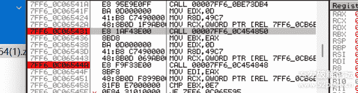](https://www.52pojie.cn/forum.php?mod=attachment&aid=MjU1NTU4OHw2NTYxYjVjZnwxNzkzNTc0NTMzfDE2ODA4NnwxNjkwNzA5&nothumb=yes)

`16.png`（55.56 KB，下载次数：1；2022-9-21 10:32 上传）

两个断点是修改后的，跳转到这两个的地址看下修改后是下面这样。

[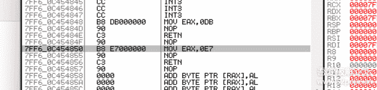](https://www.52pojie.cn/forum.php?mod=attachment&aid=MjU1NTU4OXw3ZjczODQ2N3wxNzkzNTc0NTMzfDE2ODA4NnwxNjkwNzA5&nothumb=yes)

`17.png`（45.61 KB，下载次数：1；2022-9-21 10:32 上传）

就对两个变量赋值。

## 保存与替换

到这里就完事了，然后对这个文件重新保存就 ok 了。

这里重新放在安装后的 `010editor` 的路径下，对之前的，把新的 `010editor.exe` 替换原有的就可以了。

## 附件

看到了评论区的朋友聊这个软件的版本，想起来，这个是当时我更新的最新版本，忘记最近到了 13，然后当时的官网安装包放在下面，需要自取。

- 链接：<https://pan.baidu.com/s/1An6eHUnoOxA5AI6l7SECpw>
- 提取码：`gala`
