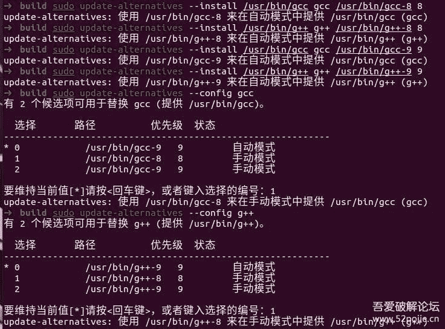
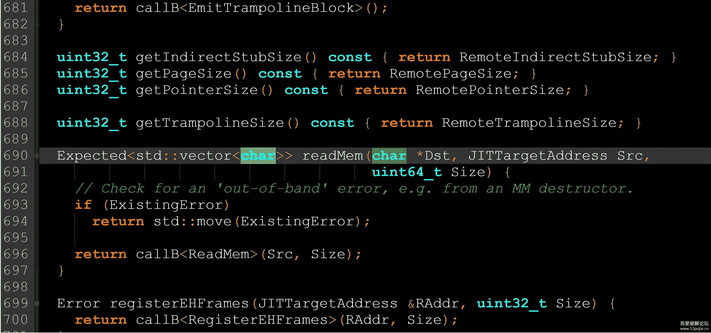
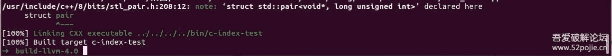
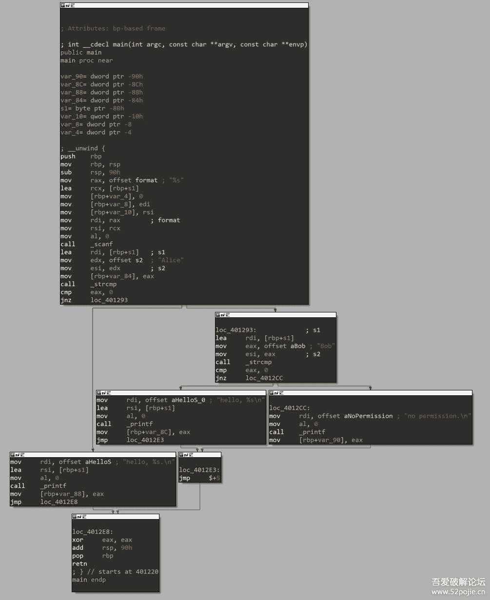
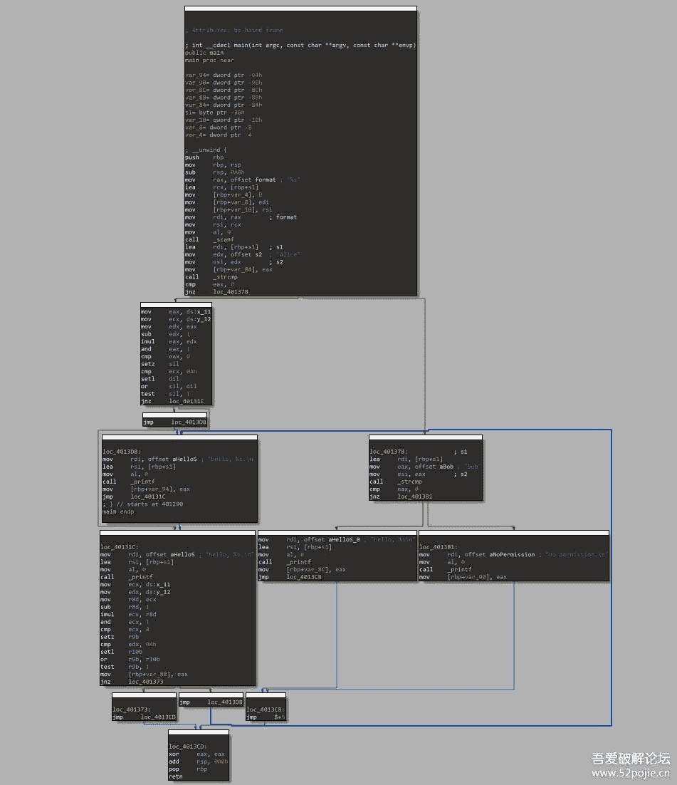

# [原创] 【reverse】虚假控制流入门：Ubuntu20.04安装ollvm4.0踩坑记+用IDApython去除BCF

- 原帖: https://www.52pojie.cn/forum.php?mod=viewthread&tid=1692596
- 抓取时间: 2026-11-01T23:08:40

## 引言

> 虚假控制流（Bogus Control Flow，BCF），通过加入包含不透明谓词的条件跳转（也就是跳转与否在运行之前就已经确定的跳转，但IDA无法分析）和不可达的基本块，来干扰IDA的控制流分析和F5反汇编。

## 依赖

- `IDA7.7`
- 虚拟机`Ubuntu20.04`

## Ubuntu20.04安装ollvm+各种踩坑记录

根据参考链接1，主要的命令就这些：

```
# 截至2022.09.25，这玩意已经5年没更新了……
git clone -b llvm-4.0 https://github.com/obfuscator-llvm/obfuscator.git
# 这里build文件夹和obfuscator-llvm-4.0文件夹同级
mkdir build-llvm-4.0 && sudo chmod 777 -R build-llvm-4.0 && cd build-llvm-4.0
cmake -DCMAKE_BUILD_TYPE=Release ../obfuscator-llvm-4.0/
# 防止出现Permission Denied
sudo make -j5
```

但你先别急，这里水很深，不看完参考链接1以及我总结的踩坑记录的话，泥巴握不住！

作者：[//blog.csdn.net/hans774882968" target="_blank" rel="noopener noreferrer nofollow"](https://blog.csdn.net/hans774882968:rel="nofollow noopener" href="https)以及[//juejin.cn/user/1464964842528888" target="_blank" rel="noopener noreferrer nofollow"](https://juejin.cn/user/1464964842528888:rel="nofollow noopener" href="https)以及[//www.52pojie.cn/home.php?mod=space&uid=1906177" target="_blank" rel="noopener noreferrer nofollow"](https://www.52pojie.cn/home.php?mod=space&uid=1906177:href="https)

本文52pojie：[//www.52pojie.cn/thread-1692596-1-1.html" target="_blank" rel="noopener noreferrer nofollow"](https://www.52pojie.cn/thread-1692596-1-1.html:href="https)

本文juejin：[//juejin.cn/post/7147302252846252046/" target="_blank" rel="noopener noreferrer nofollow"](https://juejin.cn/post/7147302252846252046/:rel="nofollow noopener" href="https)

本文csdn：[//blog.csdn.net/hans774882968/article/details/127043163" target="_blank" rel="noopener noreferrer nofollow"](https://blog.csdn.net/hans774882968/article/details/127043163:rel="nofollow noopener" href="https)

### 1、gcc和g++需要降级

如果用的是9及以后的版本，`make`时会没有任何提示，忽然报错`make: *** [Makefile:152：all] 错误 2`。直接执行下面这些命令进行降级就行：

```
sudo apt install gcc-8 g++-8 -y

sudo update-alternatives --install /usr/bin/gcc gcc /usr/bin/gcc-8 8

sudo update-alternatives --install /usr/bin/g++ g++ /usr/bin/g++-8 8

sudo update-alternatives --install /usr/bin/gcc gcc /usr/bin/gcc-9 9

sudo update-alternatives --install /usr/bin/g++ g++ /usr/bin/g++-9 9

sudo update-alternatives --config gcc

sudo update-alternatives --config g++

# 最后可以看看版本是否修改成功

gcc -v

g++ -v
```

效果



1.jpg (125.46 KB, 下载次数: 276)

[href="forum.php?mod=attachment&aid=MjU1NjY0Mnw1MjRhM2NiZnwxNzkzNTc0NTE4fDE2ODA4NnwxNjkyNTk2&nothumb=yes" target="_blank"](https://www.52pojie.cn/forum.php?mod=attachment&aid=MjU1NjY0Mnw1MjRhM2NiZnwxNzkzNTc0NTE4fDE2ODA4NnwxNjkyNTk2&nothumb=yes)

2022-9-25 20:56 上传

### 2、编译前要先修改源码

根据参考链接1，不修改源码会踩坑。找到`/include/llvm/ExecutionEngine/Orc/OrcRemoteTargetClient.h`，按照下图把690行的`readMem`的返回类型从`Expected>`改为`Expected>`（这里参考链接1错误地说成了uint_8了）。



2.jpg (375.89 KB, 下载次数: 277)

[href="forum.php?mod=attachment&aid=MjU1NjY0M3w5YjlkMWYxM3wxNzkzNTc0NTE4fDE2ODA4NnwxNjkyNTk2&nothumb=yes" target="_blank"](https://www.52pojie.cn/forum.php?mod=attachment&aid=MjU1NjY0M3w5YjlkMWYxM3wxNzkzNTc0NTE4fDE2ODA4NnwxNjkyNTk2&nothumb=yes)

2022-9-25 20:56 上传

### 3、注意权限问题

如果你在编译时，看到`make`失败前有一大堆Permission Denied，说明你权限没给够。

- 建议编译前给到`build-llvm-4.0`和`obfuscator-llvm-4.0`的父文件夹777权限：`sudo chmod 777 -R`，防止新生成的文件Permission Denied。
- 不要在挂载点的文件夹进行编译，否则会有权限错误。
- 建议编译期间每次看到`build-llvm-4.0/bin`新生成一个文件，都给它777权限，防止Permission Denied造成失败（其实编译失败也没事，编译好的文件不会重新编译，不是很耽误时间。每次看到新生成的文件出现Permission Denied，先给它权限再重新编译即可）。

### 4、给足虚拟机内存

不给足内存的话虚拟机会死机。也可以选择降一降作业数，比如`sudo make -j7`降到`sudo make -j5`。

### 编译成功

大概等了一小时，终于成功了！纪念一下！



3-终于make成功了，纪念一下.jpg (24.9 KB, 下载次数: 267)

[href="forum.php?mod=attachment&aid=MjU1NjY0NHwxOGI4NGYwMnwxNzkzNTc0NTE4fDE2ODA4NnwxNjkyNTk2&nothumb=yes" target="_blank"](https://www.52pojie.cn/forum.php?mod=attachment&aid=MjU1NjY0NHwxOGI4NGYwMnwxNzkzNTc0NTE4fDE2ODA4NnwxNjkyNTk2&nothumb=yes)

2022-9-25 20:56 上传

### 先看一个demo

写个`bcf_demo.cpp`：

```
#include 
using namespace std;
#define rep(i,a,b) for(int i = (a);i = (b);--i)

void dbg() {
    puts ("");
}
templatevoid dbg (const T &f, const R &... r) {
    cout inline void read (Type &xx) {
    Type f = 1;
    char ch;
    xx = 0;
    for (ch = getchar(); ch  '9'; ch = getchar() ) if (ch == '-') f = -1;
    for (; ch >= '0' && ch void read (T &x, R &...r) {
    read (x);
    read (r...);
}

int main (int argc, char const *argv[]) {
    char name[100];
    scanf ("%s", name);
    if (strcmp (name, "Alice") == 0) {
        printf ("hello, %s.\n", name) ;
    } else if (strcmp (name, "Bob") == 0) {
        printf ("hello, %s\n", name);
    } else {
        printf ("no permission.\n");
    }
    return 0;
}
```

用`clang`正常编译

```
'build-llvm-4.0/bin/clang++ 的绝对路径' 'bcf_demo.cpp 的绝对路径' -o bcf_demo_normal
```

IDA反汇编效果：

```
int __cdecl main(int argc, const char **argv, const char **envp)
{
  char s1[112]; // [rsp+10h] [rbp-80h] BYREF
  const char **v5; // [rsp+80h] [rbp-10h]
  int v6; // [rsp+88h] [rbp-8h]
  int v7; // [rsp+8Ch] [rbp-4h]

  v7 = 0;
  v6 = argc;
  v5 = argv;
  scanf("%s", s1);
  if ( !strcmp(s1, (const char *)(unsigned int)"Alice") )
  {
    printf("hello, %s.\n", s1);
  }
  else if ( !strcmp(s1, (const char *)(unsigned int)"Bob") )
  {
    printf("hello, %s\n", s1);
  }
  else
  {
    printf("no permission.\n");
  }
  return 0;
}
```

流程图：



4.jpg (99.88 KB, 下载次数: 268)

[href="forum.php?mod=attachment&aid=MjU1NjY0NXwyNTYwMWRmNHwxNzkzNTc0NTE4fDE2ODA4NnwxNjkyNTk2&nothumb=yes" target="_blank"](https://www.52pojie.cn/forum.php?mod=attachment&aid=MjU1NjY0NXwyNTYwMWRmNHwxNzkzNTc0NTE4fDE2ODA4NnwxNjkyNTk2&nothumb=yes)

2022-9-25 20:56 上传

加上`bcf`，编译：

```
'build-llvm-4.0/bin/clang++ 的绝对路径' -mllvm -bcf 'bcf_demo.cpp 的绝对路径' -o bcf_demo
```

IDA反汇编效果：

```
int __cdecl main(int argc, const char **argv, const char **envp)
{
  char s1[112]; // [rsp+20h] [rbp-80h] BYREF
  const char **v5; // [rsp+90h] [rbp-10h]
  int v6; // [rsp+98h] [rbp-8h]
  int v7; // [rsp+9Ch] [rbp-4h]

  v7 = 0;
  v6 = argc;
  v5 = argv;
  scanf("%s", s1);
  if ( !strcmp(s1, (const char *)(unsigned int)"Alice") )
  {
    if ( y_12 >= 10 && ((((_BYTE)x_11 - 1) * (_BYTE)x_11) & 1) != 0 )
      goto LABEL_9;
    while ( 1 )
    {
      printf("hello, %s.\n", s1);
      if ( y_12 
```

流程图：



5.jpg (82.53 KB, 下载次数: 265)

[href="forum.php?mod=attachment&aid=MjU1NjY0Nnw0MmQ4ZmVmOXwxNzkzNTc0NTE4fDE2ODA4NnwxNjkyNTk2&nothumb=yes" target="_blank"](https://www.52pojie.cn/forum.php?mod=attachment&aid=MjU1NjY0Nnw0MmQ4ZmVmOXwxNzkzNTc0NTE4fDE2ODA4NnwxNjkyNTk2&nothumb=yes)

2022-9-25 20:56 上传

对比两图，`bcf`确实让程序更复杂了。

> 这些跳转中的`x_11`和`y_12`位于`.bss`段，并且通过交叉引用发现没有被修改过，也就是说`x_11`和`y_12`在运行过程中一直为0。这里的`x_11`和`y_12`被称为不透明谓词，所谓不透明，就是IDA难以推断其在运行时的值，但我们都知道它就是0。

简单分析一下`bcf`加入的干扰语句。`y_12 >= 10 && ((((_BYTE)x_11 - 1) * (_BYTE)x_11) & 1) != 0`：因为相邻两个数的乘积必为偶数，故此式总是false。根据德摩根定律，`y_12`就总是true。因此`printf("hello, %s.\n", s1);`恰好只执行一次。那些永远不会执行到的代码块，就叫做不可达的基本块。这些跳转和不可达基本块并不会影响程序原有的逻辑，但会干扰我们的分析，这就是虚假控制流混淆达到的效果。

### 尝试用IDApython去除bcf

我们把上面的demo写得更复杂一点：

```
#include 

using namespace std;

#define rep(i,a,b) for(int i = (a);i = (b);--i)

void dbg() {

    puts ("");

}

templatevoid dbg (const T &f, const R &... r) {

    cout inline void read (Type &xx) {

    Type f = 1;

    char ch;

    xx = 0;

    for (ch = getchar(); ch  '9'; ch = getchar() ) if (ch == '-') f = -1;

    for (; ch >= '0' && ch void read (T &x, R &...r) {

    read (x);

    read (r...);

}

int main (int argc, char const *argv[]) {

    char name[100];

    scanf ("%s", name);

    if (strcmp (name, "Alice") == 0) {

        printf ("hello, %s.\n", name) ;

    } else if (strcmp (name, "Bob") == 0) {

        printf ("hello, %s\n", name);

    } else {

        printf ("no permission.\n") ;

        return 0;

    }


## 干扰代码

```c
re_ (i, 0, 10) {
    if (i & 1) dbg (i
```

加上 `bcf` 编译，用 IDA 看看 patch 前的效果：

## Patch 前反汇编

```c
int __cdecl main(int argc, const char **argv, const char **envp)
{
  int v4; // [rsp+24h] [rbp-8Ch] BYREF
  int v5; // [rsp+28h] [rbp-88h] BYREF
  int i; // [rsp+2Ch] [rbp-84h]
  char s1[112]; // [rsp+30h] [rbp-80h] BYREF
  const char **v8; // [rsp+A0h] [rbp-10h]
  int v9; // [rsp+A8h] [rbp-8h]
  int v10; // [rsp+ACh] [rbp-4h]

  v10 = 0;
  v9 = argc;
  v8 = argv;
  scanf("%s", s1);
  if ( !strcmp(s1, (const char *)(unsigned int)"Alice") )
  {
    printf("hello, %s.\n", s1);
  }
  else
  {
    if ( strcmp(s1, (const char *)(unsigned int)"Bob") )
    {
      if ( y_13 >= 10 && ((((_BYTE)x_12 - 1) * (_BYTE)x_12) & 1) != 0 )
        goto LABEL_18;
      while ( 1 )
      {
        printf("no permission.\n");
        v10 = 0;
        if ( y_13 = 10 && ((((_BYTE)x_12 - 1) * (_BYTE)x_12) & 1) != 0 )
      ;
    if ( i >= 10 )
      break;
    if ( (i & 1) != 0 )
    {
      v5 = 2 * i;
      dbg(&v5);
      continue;
    }
    if ( y_13 >= 10 && ((((_BYTE)x_12 - 1) * (_BYTE)x_12) & 1) != 0 )
    {
LABEL_20:
      v4 = (2 * i) | 1;
      dbg(&v4);
    }
    v4 = (2 * i) | 1;
    dbg(&v4);
    if ( y_13 >= 10 && ((((_BYTE)x_12 - 1) * (_BYTE)x_12) & 1) != 0 )
      goto LABEL_20;
  }
  return 0;
}
```

## 干扰指令分析

我们随便找个例子，看看干扰代码的汇编长什么样：

```asm
.text:000000000040151C 8B 04 25 B4 41 40 00          mov     eax, ds:x_12
.text:0000000000401523 8B 0C 25 9C 41 40 00          mov     ecx, ds:y_13
.text:000000000040152A 89 C2                         mov     edx, eax
.text:000000000040152C 83 EA 01                      sub     edx, 1
.text:000000000040152F 0F AF C2                      imul    eax, edx
.text:0000000000401532 83 E0 01                      and     eax, 1
.text:0000000000401535 83 F8 00                      cmp     eax, 0
.text:0000000000401538 40 0F 94 C6                   setz    sil
.text:000000000040153C 83 F9 0A                      cmp     ecx, 0Ah
.text:000000000040153F 40 0F 9C C7                   setl    dil
.text:0000000000401543 40 08 FE                      or      sil, dil
.text:0000000000401546 40 F6 C6 01                   test    sil, 1
.text:000000000040154A 0F 85 05 00 00 00             jnz     loc_401555
.text:000000000040154A
.text:0000000000401550 E9 F3 01 00 00                jmp     loc_401748
```

我们不需要管这些干扰指令具体是 `true` 还是 `false`，只需要知道：它们不影响原有代码。我们简单分析可知，这里的 `jnz loc_401555` 一定会执行，因此我们只需要把 `jnz loc_401555` 改成 `jmp loc_401555`，即可去除所有的干扰效果。

## IDApython 脚本

```python
import idc

def next_instr(addr):
    # item_size返回addr处指令长度
    return addr + idc.get_item_size(addr)

def main():
    print('-' * 40)
    st_addr = 0x401470
    ed_addr = 0x401793
    addr = st_addr
    while addr = ed_addr:
                break
            print(idc.GetDisasm(addr))  # dbg
            # 获取jnz跳转的目的地址
            dest = idc.get_operand_value(addr, 0)
            print('dest', hex(dest))  # dbg
            # 将jnz patch成jmp
            idc.patch_byte(addr, 0xE9)
            # 计算目的地址相对addr的偏移offset
            offset = dest - (addr + 5)
            # 将jmp操作数patch为offset
            idc.patch_dword(addr + 1, offset)
            # patch jnz指令最后一个字节为nop
            idc.patch_byte(addr + 5, 0x90)
        addr = next
    print('-' * 40)

main()
```

输出：

```text
jnz     loc_401555
dest 0x401555
jnz     loc_4015AC
dest 0x4015ac
jnz     loc_4015F9
dest 0x4015f9
jnz     loc_401642
dest 0x401642
jnz     loc_4016C0
dest 0x4016c0
jnz     loc_401717
dest 0x401717
```

在上述例子中，patch 后，只有一条指令被修改了：

```asm
.text:000000000040151C 8B 04 25 B4 41 40 00          mov     eax, ds:x_12
.text:0000000000401523 8B 0C 25 9C 41 40 00          mov     ecx, ds:y_13
.text:000000000040152A 89 C2                         mov     edx, eax
.text:000000000040152C 83 EA 01                      sub     edx, 1
.text:000000000040152F 0F AF C2                      imul    eax, edx
.text:0000000000401532 83 E0 01                      and     eax, 1
.text:0000000000401535 83 F8 00                      cmp     eax, 0
.text:0000000000401538 40 0F 94 C6                   setz    sil
.text:000000000040153C 83 F9 0A                      cmp     ecx, 0Ah
.text:000000000040153F 40 0F 9C C7                   setl    dil
.text:0000000000401543 40 08 FE                      or      sil, dil
.text:0000000000401546 40 F6 C6 01                   test    sil, 1
.text:000000000040154A E9 06 00 00 00                jmp     loc_401555
.text:000000000040154A
.text:000000000040154A                               ; ---------------------------------------------------------------------------
.text:000000000040154F 90                            db  90h
.text:0000000000401550 E9 F3 01 00 00                jmp     loc_401748
```

## Patch 后反汇编

```c
int __cdecl main(int argc, const char **argv, const char **envp)
{
  int v4; // [rsp+24h] [rbp-8Ch] BYREF
  int v5; // [rsp+28h] [rbp-88h] BYREF
  int i; // [rsp+2Ch] [rbp-84h]
  char s1[112]; // [rsp+30h] [rbp-80h] BYREF
  const char **v8; // [rsp+A0h] [rbp-10h]
  int v9; // [rsp+A8h] [rbp-8h]
  int v10; // [rsp+ACh] [rbp-4h]

  v10 = 0;
  v9 = argc;
  v8 = argv;
  scanf("%s", s1);
  if ( !strcmp(s1, (const char *)(unsigned int)"Alice") )
  {
    printf("hello, %s.\n", s1);
  }
  else
  {
    if ( strcmp(s1, (const char *)(unsigned int)"Bob") )
    {
      printf("no permission.\n");
      return 0;
    }
    printf("hello, %s\n", s1);
  }
  for ( i = 0; i (&v5);
    }
    else
    {
      v4 = (2 * i) | 1;
      dbg(&v4);
    }
  }
  return 0;
}
```

效果不错，去得很干净。

地球人用 `angr` 去除 `bcf` 的做法以后（下辈子）再学。

## 参考资料

- [Ubuntu20.04安装ollvm各种踩坑记录](https://www.bilibili.com/read/cv13148974/)
- [地球人yyds%%%](https://bbs.pediy.com/thread-266005.htm)
