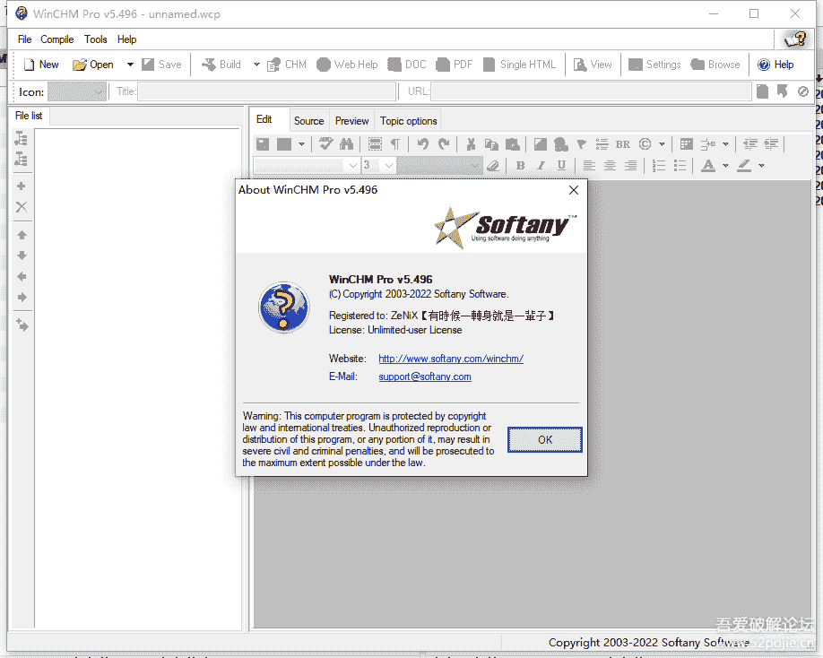
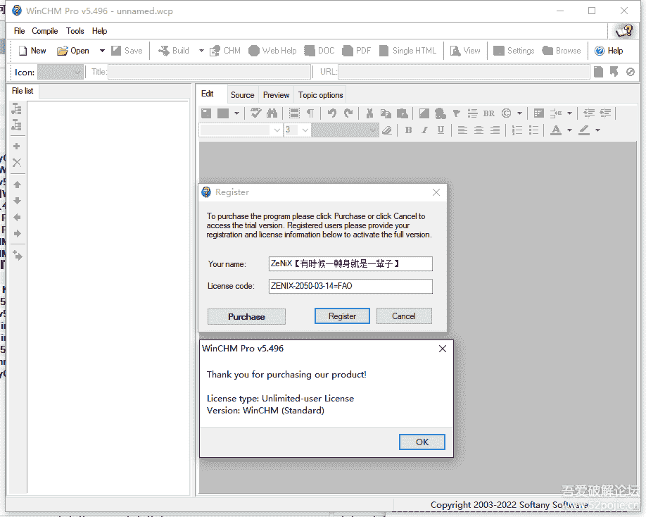
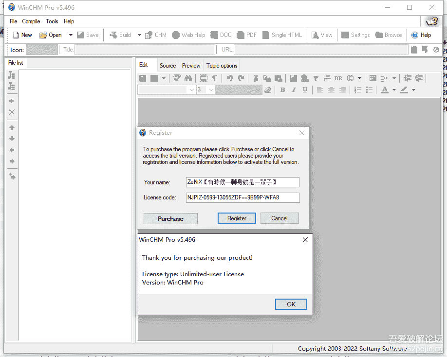

# [原创] SoftAny WinCHM 5.496 注册码笔记 by ZeNiX

- 原帖: https://www.52pojie.cn/forum.php?mod=viewthread&tid=1693287
- 抓取时间: 2026-11-01T23:08:36

## 先说结论

这软件其实存在 3 种注册码。
一种是 Standard 标准版本
一种是 Pro 专业版
另一种是 Upgrade 升级版本。
专业版注册码长度必须是 24，29，31，34。 其中 24
不知道是官方写错代码，或是刻意作废的。
底下是刚刚临时做的笔记。

[Asm] 纯文本查看 复制代码


```
0058C9E4    55              push ebp
0058C9E5    8BEC            mov ebp,esp
0058C9E7    83C4 D8         add esp,-0x28
0058C9EA    53              push ebx
0058C9EB    33C9            xor ecx,ecx
0058C9ED    894D F4         mov dword ptr ss:[ebp-0xC],ecx
0058C9F0    894D F0         mov dword ptr ss:[ebp-0x10],ecx
0058C9F3    894D EC         mov dword ptr ss:[ebp-0x14],ecx
0058C9F6    894D E8         mov dword ptr ss:[ebp-0x18],ecx
0058C9F9    894D E4         mov dword ptr ss:[ebp-0x1C],ecx
0058C9FC    8955 F8         mov dword ptr ss:[ebp-0x8],edx
0058C9FF    8945 FC         mov dword ptr ss:[ebp-0x4],eax
0058CA02    8B45 FC         mov eax,dword ptr ss:[ebp-0x4]
0058CA05    E8 BAA3E7FF     call 00406DC4
0058CA0A    8B45 F8         mov eax,dword ptr ss:[ebp-0x8]
0058CA0D    E8 B2A3E7FF     call 00406DC4
0058CA12    33C0            xor eax,eax
0058CA14    55              push ebp
0058CA15    68 B0D25800     push 0058D2B0
0058CA1A    64:FF30         push dword ptr fs:[eax]
0058CA1D    64:8920         mov dword ptr fs:[eax],esp
0058CA20    8D45 F4         lea eax,dword ptr ss:[ebp-0xC]
0058CA23    8B55 F8         mov edx,dword ptr ss:[ebp-0x8]
0058CA26    E8 05A4E7FF     call 00406E30
0058CA2B    8B45 F4         mov eax,dword ptr ss:[ebp-0xC]
0058CA2E    85C0            test eax,eax
0058CA30    74 16           je short 0058CA48
0058CA32    8BD0            mov edx,eax
0058CA34    83EA 0A         sub edx,0xA
0058CA37    66:833A 02      cmp word ptr ds:[edx],0x2
0058CA3B    74 0B           je short 0058CA48
0058CA3D    8D45 F4         lea eax,dword ptr ss:[ebp-0xC]
0058CA40    8B55 F4         mov edx,dword ptr ss:[ebp-0xC]
0058CA43    E8 6499E7FF     call 004063AC
0058CA48    85C0            test eax,eax
0058CA4A    74 05           je short 0058CA51
0058CA4C    83E8 04         sub eax,0x4
0058CA4F    8B00            mov eax,dword ptr ds:[eax]               ; 获取注册码长度，保存到 ebx
0058CA51    8BD8            mov ebx,eax
0058CA53    A1 B02F6000     mov eax,dword ptr ds:[]
0058CA58    C700 FFFFFFFF   mov dword ptr ds:[eax],-0x1              ; 这里是注册标记，先给它填值为 -1
0058CA5E    8B45 F4         mov eax,dword ptr ss:[ebp-0xC]           ; eax 指向注册码
0058CA61    E8 12F6FFFF     call                           ; 授权第一套算法
0058CA66    8945 D8         mov dword ptr ss:[ebp-0x28],eax          ; edx:eax 是计算结果
0058CA69    8955 DC         mov dword ptr ss:[ebp-0x24],edx
0058CA6C    837D DC 00      cmp dword ptr ss:[ebp-0x24],0x0
0058CA70    75 13           jnz short 0058CA85
0058CA72    817D D8 EE35000>cmp dword ptr ss:[ebp-0x28],0x35EE
0058CA79    75 0A           jnz short 0058CA85
0058CA7B    BB 01000000     mov ebx,0x1                              ; 单用户授权
0058CA80    E9 10080000     jmp 0058D295
0058CA85    837D DC 00      cmp dword ptr ss:[ebp-0x24],0x0
0058CA89    75 13           jnz short 0058CA9E
0058CA8B    817D D8 CD39000>cmp dword ptr ss:[ebp-0x28],0x39CD
0058CA92    75 0A           jnz short 0058CA9E
0058CA94    BB 02000000     mov ebx,0x2                              ; 2 用户授权
0058CA99    E9 F7070000     jmp 0058D295
0058CA9E    837D DC 00      cmp dword ptr ss:[ebp-0x24],0x0
0058CAA2    75 13           jnz short 0058CAB7
0058CAA4    817D D8 6F2E000>cmp dword ptr ss:[ebp-0x28],0x2E6F
0058CAAB    75 0A           jnz short 0058CAB7
0058CAAD    BB 03000000     mov ebx,0x3                              ; 3 用户授权
0058CAB2    E9 DE070000     jmp 0058D295
0058CAB7    837D DC 00      cmp dword ptr ss:[ebp-0x24],0x0
0058CABB    75 13           jnz short 0058CAD0
0058CABD    817D D8 832F000>cmp dword ptr ss:[ebp-0x28],0x2F83
0058CAC4    75 0A           jnz short 0058CAD0
0058CAC6    BB 05000000     mov ebx,0x5                              ; 5 用户授权
0058CACB    E9 C5070000     jmp 0058D295
0058CAD0    837D DC 00      cmp dword ptr ss:[ebp-0x24],0x0
0058CAD4    75 13           jnz short 0058CAE9
0058CAD6    817D D8 922E000>cmp dword ptr ss:[ebp-0x28],0x2E92
0058CADD    75 0A           jnz short 0058CAE9
0058CADF    BB 0A000000     mov ebx,0xA                              ; 10 用户授权
0058CAE4    E9 AC070000     jmp 0058D295
0058CAE9    837D DC 00      cmp dword ptr ss:[ebp-0x24],0x0
0058CAED    75 13           jnz short 0058CB02
0058CAEF    817D D8 5524000>cmp dword ptr ss:[ebp-0x28],0x2455
0058CAF6    75 0A           jnz short 0058CB02
0058CAF8    BB 14000000     mov ebx,0x14                             ; 20 用户授权
0058CAFD    E9 93070000     jmp 0058D295
0058CB02    837D DC 00      cmp dword ptr ss:[ebp-0x24],0x0
0058CB06    75 13           jnz short 0058CB1B
0058CB08    817D D8 502F000>cmp dword ptr ss:[ebp-0x28],0x2F50
0058CB0F    75 0A           jnz short 0058CB1B
0058CB11    BB 32000000     mov ebx,0x32                             ; 50 用户授权
0058CB16    E9 7A070000     jmp 0058D295
0058CB1B    837D DC 00      cmp dword ptr ss:[ebp-0x24],0x0
0058CB1F    75 13           jnz short 0058CB34
0058CB21    817D D8 A62F000>cmp dword ptr ss:[ebp-0x28],0x2FA6
0058CB28    75 0A           jnz short 0058CB34
0058CB2A    BB 0F270000     mov ebx,0x270F                           ; 9999 用户，也就是无限用户授权
0058CB2F    E9 61070000     jmp 0058D295
0058CB34    A1 B02F6000     mov eax,dword ptr ds:[]
0058CB39    C700 FFFFFFFF   mov dword ptr ds:[eax],-0x1
0058CB3F    83FB 1A         cmp ebx,0x1A                             ; 注册码长度 26 的情况
0058CB42    0F85 09010000   jnz 0058CC51
0058CB48    A1 B02F6000     mov eax,dword ptr ds:[]
0058CB4D    33D2            xor edx,edx
0058CB4F    8910            mov dword ptr ds:[eax],edx
0058CB51    8B45 F4         mov eax,dword ptr ss:[ebp-0xC]
0058CB54    E8 9FFDFFFF     call                         ; 授权第二套算法
0058CB59    8945 D8         mov dword ptr ss:[ebp-0x28],eax
0058CB5C    8955 DC         mov dword ptr ss:[ebp-0x24],edx
0058CB5F    817D DC 3428340>cmp dword ptr ss:[ebp-0x24],0x1342834
0058CB66    75 13           jnz short 0058CB7B
0058CB68    817D D8 74B4843>cmp dword ptr ss:[ebp-0x28],0x3784B474
0058CB6F    75 0A           jnz short 0058CB7B
0058CB71    BB 01000000     mov ebx,0x1                              ; 单用户授权
0058CB76    E9 1A070000     jmp 0058D295
0058CB7B    817D DC 35DEA00>cmp dword ptr ss:[ebp-0x24],0x1A0DE35
0058CB82    75 13           jnz short 0058CB97
0058CB84    817D D8 45796B3>cmp dword ptr ss:[ebp-0x28],0x386B7945
0058CB8B    75 0A           jnz short 0058CB97
0058CB8D    BB 02000000     mov ebx,0x2                              ; 2 用户授权
0058CB92    E9 FE060000     jmp 0058D295
0058CB97    817D DC ED48560>cmp dword ptr ss:[ebp-0x24],0x15648ED
0058CB9E    75 13           jnz short 0058CBB3
0058CBA0    817D D8 3988BF7>cmp dword ptr ss:[ebp-0x28],0x78BF8839
0058CBA7    75 0A           jnz short 0058CBB3
0058CBA9    BB 03000000     mov ebx,0x3                              ; 3 用户授权
0058CBAE    E9 E2060000     jmp 0058D295
0058CBB3    817D DC 504C2C0>cmp dword ptr ss:[ebp-0x24],0x12C4C50
0058CBBA    75 13           jnz short 0058CBCF
0058CBBC    817D D8 EBBD027>cmp dword ptr ss:[ebp-0x28],0x7302BDEB
0058CBC3    75 0A           jnz short 0058CBCF
0058CBC5    BB 05000000     mov ebx,0x5                              ; 5 用户授权
0058CBCA    E9 C6060000     jmp 0058D295
0058CBCF    817D DC 1226180>cmp dword ptr ss:[ebp-0x24],0x1182612
0058CBD6    75 13           jnz short 0058CBEB
0058CBD8    817D D8 3D61B93>cmp dword ptr ss:[ebp-0x28],0x32B9613D
0058CBDF    75 0A           jnz short 0058CBEB
0058CBE1    BB 0A000000     mov ebx,0xA                              ; 10 用户授权
0058CBE6    E9 AA060000     jmp 0058D295
0058CBEB    817D DC EFCC690>cmp dword ptr ss:[ebp-0x24],0x169CCEF
0058CBF2    75 13           jnz short 0058CC07
0058CBF4    817D D8 964EC34>cmp dword ptr ss:[ebp-0x28],0x47C34E96
0058CBFB    75 0A           jnz short 0058CC07
0058CBFD    BB 14000000     mov ebx,0x14                             ; 20 用户授权
0058CC02    E9 8E060000     jmp 0058D295
0058CC07    817D DC 2F98520>cmp dword ptr ss:[ebp-0x24],0x152982F
0058CC0E    75 13           jnz short 0058CC23
0058CC10    817D D8 08391FD>cmp dword ptr ss:[ebp-0x28],0xD61F3908
0058CC17    75 0A           jnz short 0058CC23
0058CC19    BB 32000000     mov ebx,0x32                             ; 50 用户授权
0058CC1E    E9 72060000     jmp 0058D295
0058CC23    817D DC D211720>cmp dword ptr ss:[ebp-0x24],0x17211D2
0058CC2A    75 13           jnz short 0058CC3F
0058CC2C    817D D8 D4FC05B>cmp dword ptr ss:[ebp-0x28],0xB605FCD4
0058CC33    75 0A           jnz short 0058CC3F
0058CC35    BB 0F270000     mov ebx,0x270F                           ; 9999 用户，也就是无限用户授权
0058CC3A    E9 56060000     jmp 0058D295
0058CC3F    33DB            xor ebx,ebx
0058CC41    A1 B02F6000     mov eax,dword ptr ds:[]
0058CC46    C700 FFFFFFFF   mov dword ptr ds:[eax],-0x1
0058CC4C    E9 44060000     jmp 0058D295
0058CC51    83FB 1F         cmp ebx,0x1F                             ; *** 注册码长度 31位的情况 ***
0058CC54    0F85 56010000   jnz 0058CDB0
0058CC5A    8D45 F0         lea eax,dword ptr ss:[ebp-0x10]
0058CC5D    50              push eax
0058CC5E    B9 1A000000     mov ecx,0x1A                             ; 从注册码第一位开始取 0x1A 位，其实就是最开始的26位。
0058CC63    BA 01000000     mov edx,0x1
0058CC68    8B45 F4         mov eax,dword ptr ss:[ebp-0xC]
0058CC6B    E8 601DE8FF     call 0040E9D0
0058CC70    8D45 EC         lea eax,dword ptr ss:[ebp-0x14]
0058CC73    50              push eax
0058CC74    B9 04000000     mov ecx,0x4                              ; 从注册码 0x1C 位开始取四位，其实就是最后4位。
0058CC79    BA 1C000000     mov edx,0x1C
0058CC7E    8B45 F4         mov eax,dword ptr ss:[ebp-0xC]
0058CC81    E8 4A1DE8FF     call 0040E9D0
0058CC86    8B45 EC         mov eax,dword ptr ss:[ebp-0x14]          ; 先取最后四位做计算
0058CC89    E8 6AFCFFFF     call                         ; 授权的第二套算法函数
0058CC8E    83FA 00         cmp edx,0x0
0058CC91    75 14           jnz short 0058CCA7
0058CC93    3D 903F0000     cmp eax,0x3F90                           ; *** 正确的计算结果是 0x3F90 ， 这是专业版的关键 ***
0058CC98    75 0D           jnz short 0058CCA7
0058CC9A    A1 B02F6000     mov eax,dword ptr ds:[]
0058CC9F    C700 01000000   mov dword ptr ds:[eax],0x1               ; 这里设置了专业版的注册标记
0058CCA5    EB 09           jmp short 0058CCB0
0058CCA7    A1 B02F6000     mov eax,dword ptr ds:[]
0058CCAC    33D2            xor edx,edx
0058CCAE    8910            mov dword ptr ds:[eax],edx               ; 不是 0x3F90 的话，就设定为标准版
0058CCB0    8B45 F0         mov eax,dword ptr ss:[ebp-0x10]
0058CCB3    E8 40FCFFFF     call                         ; 授权的第二套算法函数
0058CCB8    8945 D8         mov dword ptr ss:[ebp-0x28],eax
0058CCBB    8955 DC         mov dword ptr ss:[ebp-0x24],edx
0058CCBE    817D DC 3428340>cmp dword ptr ss:[ebp-0x24],0x1342834
0058CCC5    75 13           jnz short 0058CCDA
0058CCC7    817D D8 74B4843>cmp dword ptr ss:[ebp-0x28],0x3784B474
0058CCCE    75 0A           jnz short 0058CCDA
0058CCD0    BB 01000000     mov ebx,0x1                              ; 单用户授权
0058CCD5    E9 BB050000     jmp 0058D295
0058CCDA    817D DC 35DEA00>cmp dword ptr ss:[ebp-0x24],0x1A0DE35
0058CCE1    75 13           jnz short 0058CCF6
0058CCE3    817D D8 45796B3>cmp dword ptr ss:[ebp-0x28],0x386B7945
0058CCEA    75 0A           jnz short 0058CCF6
0058CCEC    BB 02000000     mov ebx,0x2                              ; 2 用户授权
0058CCF1    E9 9F050000     jmp 0058D295
0058CCF6    817D DC ED48560>cmp dword ptr ss:[ebp-0x24],0x15648ED
0058CCFD    75 13           jnz short 0058CD12
0058CCFF    817D D8 3988BF7>cmp dword ptr ss:[ebp-0x28],0x78BF8839
0058CD06    75 0A           jnz short 0058CD12
0058CD08    BB 03000000     mov ebx,0x3                              ; 3 用户授权
0058CD0D    E9 83050000     jmp 0058D295
0058CD12    817D DC 504C2C0>cmp dword ptr ss:[ebp-0x24],0x12C4C50
0058CD19    75 13           jnz short 0058CD2E
0058CD1B    817D D8 EBBD027>cmp dword ptr ss:[ebp-0x28],0x7302BDEB
0058CD22    75 0A           jnz short 0058CD2E
0058CD24    BB 05000000     mov ebx,0x5                              ; 5 用户授权
0058CD29    E9 67050000     jmp 0058D295
0058CD2E    817D DC 1226180>cmp dword ptr ss:[ebp-0x24],0x1182612
0058CD35    75 13           jnz short 0058CD4A
0058CD37    817D D8 3D61B93>cmp dword ptr ss:[ebp-0x28],0x32B9613D
0058CD3E    75 0A           jnz short 0058CD4A
0058CD40    BB 0A000000     mov ebx,0xA                              ; 10 用户授权
0058CD45    E9 4B050000     jmp 0058D295
0058CD4A    817D DC EFCC690>cmp dword ptr ss:[ebp-0x24],0x169CCEF
0058CD51    75 13           jnz short 0058CD66
0058CD53    817D D8 964EC34>cmp dword ptr ss:[ebp-0x28],0x47C34E96
0058CD5A    75 0A           jnz short 0058CD66
0058CD5C    BB 14000000     mov ebx,0x14                             ; 20 用户授权
0058CD61    E9 2F050000     jmp 0058D295
0058CD66    817D DC 2F98520>cmp dword ptr ss:[ebp-0x24],0x152982F
0058CD6D    75 13           jnz short 0058CD82
0058CD6F    817D D8 08391FD>cmp dword ptr ss:[ebp-0x28],0xD61F3908
0058CD76    75 0A           jnz short 0058CD82
0058CD78    BB 32000000     mov ebx,0x32                             ; 50 用户授权
0058CD7D    E9 13050000     jmp 0058D295
0058CD82    817D DC D211720>cmp dword ptr ss:[ebp-0x24],0x17211D2
0058CD89    75 13           jnz short 0058CD9E
0058CD8B    817D D8 D4FC05B>cmp dword ptr ss:[ebp-0x28],0xB605FCD4
0058CD92    75 0A           jnz short 0058CD9E
0058CD94    BB 0F270000     mov ebx,0x270F                           ; 9999 用户，也就是无限用户授权
0058CD99    E9 F7040000     jmp 0058D295
0058CD9E    33DB            xor ebx,ebx
0058CDA0    A1 B02F6000     mov eax,dword ptr ds:[]
0058CDA5    C700 FFFFFFFF   mov dword ptr ds:[eax],-0x1
0058CDAB    E9 E5040000     jmp 0058D295
0058CDB0    83FB 14         cmp ebx,0x14                             ; 注册码长度为 20 的情况
0058CDB3    0F85 0B010000   jnz 0058CEC4
0058CDB9    A1 B02F6000     mov eax,dword ptr ds:[]
0058CDBE    C700 03000000   mov dword ptr ds:[eax],0x3               ; 这个授权可能是需要升级用的吧？ 没深入研究
0058CDC4    8B45 F4         mov eax,dword ptr ss:[ebp-0xC]
0058CDC7    E8 40FAFFFF     call 
0058CDCC    8945 D8         mov dword ptr ss:[ebp-0x28],eax
0058CDCF    8955 DC         mov dword ptr ss:[ebp-0x24],edx
0058CDD2    817D DC 8C00000>cmp dword ptr ss:[ebp-0x24],0x8C
0058CDD9    75 13           jnz short 0058CDEE
0058CDDB    817D D8 3783789>cmp dword ptr ss:[ebp-0x28],0x9E788337
0058CDE2    75 0A           jnz short 0058CDEE
0058CDE4    BB 01000000     mov ebx,0x1                              ; 单用户授权
0058CDE9    E9 A7040000     jmp 0058D295
0058CDEE    817D DC BC00000>cmp dword ptr ss:[ebp-0x24],0xBC
0058CDF5    75 13           jnz short 0058CE0A
0058CDF7    817D D8 7E9F96D>cmp dword ptr ss:[ebp-0x28],0xD5969F7E
0058CDFE    75 0A           jnz short 0058CE0A
0058CE00    BB 02000000     mov ebx,0x2                              ; 2 用户授权
0058CE05    E9 8B040000     jmp 0058D295
0058CE0A    817D DC 9D00000>cmp dword ptr ss:[ebp-0x24],0x9D
0058CE11    75 13           jnz short 0058CE26
0058CE13    817D D8 28776E3>cmp dword ptr ss:[ebp-0x28],0x306E7728
0058CE1A    75 0A           jnz short 0058CE26
0058CE1C    BB 03000000     mov ebx,0x3                              ; 3 用户授权
0058CE21    E9 6F040000     jmp 0058D295
0058CE26    817D DC 8C00000>cmp dword ptr ss:[ebp-0x24],0x8C
0058CE2D    75 13           jnz short 0058CE42
0058CE2F    817D D8 C6C114A>cmp dword ptr ss:[ebp-0x28],0xA314C1C6
0058CE36    75 0A           jnz short 0058CE42
0058CE38    BB 05000000     mov ebx,0x5                              ; 5 用户授权
0058CE3D    E9 53040000     jmp 0058D295
0058CE42    817D DC 8100000>cmp dword ptr ss:[ebp-0x24],0x81
0058CE49    75 13           jnz short 0058CE5E
0058CE4B    817D D8 8DBECEC>cmp dword ptr ss:[ebp-0x28],0xC0CEBE8D
0058CE52    75 0A           jnz short 0058CE5E
0058CE54    BB 0A000000     mov ebx,0xA                              ; 10 用户授权
0058CE59    E9 37040000     jmp 0058D295
0058CE5E    817D DC A500000>cmp dword ptr ss:[ebp-0x24],0xA5
0058CE65    75 13           jnz short 0058CE7A
0058CE67    817D D8 15CE047>cmp dword ptr ss:[ebp-0x28],0x7104CE15
0058CE6E    75 0A           jnz short 0058CE7A
0058CE70    BB 14000000     mov ebx,0x14                             ; 20 用户授权
0058CE75    E9 1B040000     jmp 0058D295
0058CE7A    817D DC 9B00000>cmp dword ptr ss:[ebp-0x24],0x9B
0058CE81    75 13           jnz short 0058CE96
0058CE83    817D D8 7A2D114>cmp dword ptr ss:[ebp-0x28],0x4F112D7A
0058CE8A    75 0A           jnz short 0058CE96
0058CE8C    BB 32000000     mov ebx,0x32                             ; 50 用户授权
0058CE91    E9 FF030000     jmp 0058D295
0058CE96    817D DC AA00000>cmp dword ptr ss:[ebp-0x24],0xAA
0058CE9D    75 13           jnz short 0058CEB2
0058CE9F    817D D8 0C11C7D>cmp dword ptr ss:[ebp-0x28],0xDBC7110C
0058CEA6    75 0A           jnz short 0058CEB2
0058CEA8    BB 0F270000     mov ebx,0x270F                           ; 9999 用户，也就是无限用户授权
0058CEAD    E9 E3030000     jmp 0058D295
0058CEB2    33DB            xor ebx,ebx
0058CEB4    A1 B02F6000     mov eax,dword ptr ds:[]
0058CEB9    C700 FFFFFFFF   mov dword ptr ds:[eax],-0x1
0058CEBF    E9 D1030000     jmp 0058D295
0058CEC4    83FB 19         cmp ebx,0x19                             ; 注册码长度为 25 的情况， 以下参考上面的注释
0058CEC7    0F85 56010000   jnz 0058D023
0058CECD    8D45 F0         lea eax,dword ptr ss:[ebp-0x10]
0058CED0    50              push eax
0058CED1    B9 14000000     mov ecx,0x14
0058CED6    BA 01000000     mov edx,0x1
0058CEDB    8B45 F4         mov eax,dword ptr ss:[ebp-0xC]
0058CEDE    E8 ED1AE8FF     call 0040E9D0
0058CEE3    8D45 EC         lea eax,dword ptr ss:[ebp-0x14]
0058CEE6    50              push eax
0058CEE7    B9 04000000     mov ecx,0x4
0058CEEC    BA 16000000     mov edx,0x16
0058CEF1    8B45 F4         mov eax,dword ptr ss:[ebp-0xC]
0058CEF4    E8 D71AE8FF     call 0040E9D0
0058CEF9    8B45 EC         mov eax,dword ptr ss:[ebp-0x14]
0058CEFC    E8 0BF9FFFF     call 
0058CF01    83FA 00         cmp edx,0x0
0058CF04    75 14           jnz short 0058CF1A
0058CF06    3D 731F0000     cmp eax,0x1F73
0058CF0B    75 0D           jnz short 0058CF1A
0058CF0D    A1 B02F6000     mov eax,dword ptr ds:[]
0058CF12    C700 03000000   mov dword ptr ds:[eax],0x3
0058CF18    EB 09           jmp short 0058CF23
0058CF1A    A1 B02F6000     mov eax,dword ptr ds:[]
0058CF1F    33D2            xor edx,edx
0058CF21    8910            mov dword ptr ds:[eax],edx
0058CF23    8B45 F0         mov eax,dword ptr ss:[ebp-0x10]
0058CF26    E8 E1F8FFFF     call 
0058CF2B    8945 D8         mov dword ptr ss:[ebp-0x28],eax
0058CF2E    8955 DC         mov dword ptr ss:[ebp-0x24],edx
0058CF31    817D DC 8C00000>cmp dword ptr ss:[ebp-0x24],0x8C
0058CF38    75 13           jnz short 0058CF4D
0058CF3A    817D D8 3783789>cmp dword ptr ss:[ebp-0x28],0x9E788337
0058CF41    75 0A           jnz short 0058CF4D
0058CF43    BB 01000000     mov ebx,0x1
0058CF48    E9 48030000     jmp 0058D295
0058CF4D    817D DC BC00000>cmp dword ptr ss:[ebp-0x24],0xBC
0058CF54    75 13           jnz short 0058CF69
0058CF56    817D D8 7E9F96D>cmp dword ptr ss:[ebp-0x28],0xD5969F7E
0058CF5D    75 0A           jnz short 0058CF69
0058CF5F    BB 02000000     mov ebx,0x2
0058CF64    E9 2C030000     jmp 0058D295
0058CF69    817D DC 9D00000>cmp dword ptr ss:[ebp-0x24],0x9D
0058CF70    75 13           jnz short 0058CF85
0058CF72    817D D8 28776E3>cmp dword ptr ss:[ebp-0x28],0x306E7728
0058CF79    75 0A           jnz short 0058CF85
0058CF7B    BB 03000000     mov ebx,0x3
0058CF80    E9 10030000     jmp 0058D295
0058CF85    817D DC 8C00000>cmp dword ptr ss:[ebp-0x24],0x8C
0058CF8C    75 13           jnz short 0058CFA1
0058CF8E    817D D8 C6C114A>cmp dword ptr ss:[ebp-0x28],0xA314C1C6
0058CF95    75 0A           jnz short 0058CFA1
0058CF97    BB 05000000     mov ebx,0x5
0058CF9C    E9 F4020000     jmp 0058D295
0058CFA1    817D DC 8100000>cmp dword ptr ss:[ebp-0x24],0x81
0058CFA8    75 13           jnz short 0058CFBD
0058CFAA    817D D8 8DBECEC>cmp dword ptr ss:[ebp-0x28],0xC0CEBE8D
0058CFB1    75 0A           jnz short 0058CFBD
0058CFB3    BB 0A000000     mov ebx,0xA
0058CFB8    E9 D8020000     jmp 0058D295
0058CFBD    817D DC A500000>cmp dword ptr ss:[ebp-0x24],0xA5
0058CFC4    75 13           jnz short 0058CFD9
0058CFC6    817D D8 15CE047>cmp dword ptr ss:[ebp-0x28],0x7104CE15
0058CFCD    75 0A           jnz short 0058CFD9
0058CFCF    BB 14000000     mov ebx,0x14
0058CFD4    E9 BC020000     jmp 0058D295
0058CFD9    817D DC 9B00000>cmp dword ptr ss:[ebp-0x24],0x9B
0058CFE0    75 13           jnz short 0058CFF5
0058CFE2    817D D8 7A2D114>cmp dword ptr ss:[ebp-0x28],0x4F112D7A
0058CFE9    75 0A           jnz short 0058CFF5
0058CFEB    BB 32000000     mov ebx,0x32
0058CFF0    E9 A0020000     jmp 0058D295
0058CFF5    817D DC AA00000>cmp dword ptr ss:[ebp-0x24],0xAA
0058CFFC    75 13           jnz short 0058D011
0058CFFE    817D D8 0C11C7D>cmp dword ptr ss:[ebp-0x28],0xDBC7110C
0058D005    75 0A           jnz short 0058D011
0058D007    BB 0F270000     mov ebx,0x270F
0058D00C    E9 84020000     jmp 0058D295
0058D011    33DB            xor ebx,ebx
0058D013    A1 B02F6000     mov eax,dword ptr ds:[]
0058D018    C700 FFFFFFFF   mov dword ptr ds:[eax],-0x1
0058D01E    E9 72020000     jmp 0058D295
0058D023    83FB 1D         cmp ebx,0x1D                             ; 注册码长度为 29 的情况， 以下参考上面的注释
0058D026    0F85 EF000000   jnz 0058D11B
0058D02C    A1 B02F6000     mov eax,dword ptr ds:[]
0058D031    33D2            xor edx,edx
0058D033    8910            mov dword ptr ds:[eax],edx
0058D035    8D45 F0         lea eax,dword ptr ss:[ebp-0x10]
0058D038    50              push eax
0058D039    B9 13000000     mov ecx,0x13
0058D03E    BA 01000000     mov edx,0x1
0058D043    8B45 F4         mov eax,dword ptr ss:[ebp-0xC]
0058D046    E8 8519E8FF     call 0040E9D0
0058D04B    8D45 EC         lea eax,dword ptr ss:[ebp-0x14]
0058D04E    50              push eax
0058D04F    B9 04000000     mov ecx,0x4
0058D054    BA 15000000     mov edx,0x15
0058D059    8B45 F4         mov eax,dword ptr ss:[ebp-0xC]
0058D05C    E8 6F19E8FF     call 0040E9D0
0058D061    8D45 E8         lea eax,dword ptr ss:[ebp-0x18]
0058D064    50              push eax
0058D065    B9 04000000     mov ecx,0x4
0058D06A    BA 1A000000     mov edx,0x1A
0058D06F    8B45 F4         mov eax,dword ptr ss:[ebp-0xC]
0058D072    E8 5919E8FF     call 0040E9D0
0058D077    8B45 F0         mov eax,dword ptr ss:[ebp-0x10]
0058D07A    E8 79F8FFFF     call 
0058D07F    81FA 82080000   cmp edx,0x882
0058D085    75 2C           jnz short 0058D0B3
0058D087    3D 95146C25     cmp eax,0x256C1495
0058D08C    75 25           jnz short 0058D0B3
0058D08E    8B55 EC         mov edx,dword ptr ss:[ebp-0x14]
0058D091    8B45 FC         mov eax,dword ptr ss:[ebp-0x4]
0058D094    E8 23F6FFFF     call 0058C6BC
0058D099    84C0            test al,al
0058D09B    74 0F           je short 0058D0AC
0058D09D    8B45 E8         mov eax,dword ptr ss:[ebp-0x18]
0058D0A0    E8 97F0FFFF     call 0058C13C
0058D0A5    8BD8            mov ebx,eax
0058D0A7    E9 E9010000     jmp 0058D295
0058D0AC    33DB            xor ebx,ebx
0058D0AE    E9 E2010000     jmp 0058D295
0058D0B3    8B45 F0         mov eax,dword ptr ss:[ebp-0x10]
0058D0B6    E8 3DF8FFFF     call 
0058D0BB    81FA EB070000   cmp edx,0x7EB
0058D0C1    75 51           jnz short 0058D114
0058D0C3    3D 70EF40E1     cmp eax,0xE140EF70
0058D0C8    75 4A           jnz short 0058D114
0058D0CA    8B45 E8         mov eax,dword ptr ss:[ebp-0x18]
0058D0CD    E8 26F8FFFF     call 
0058D0D2    83FA 00         cmp edx,0x0
0058D0D5    75 14           jnz short 0058D0EB
0058D0D7    3D 903F0000     cmp eax,0x3F90
0058D0DC    75 0D           jnz short 0058D0EB
0058D0DE    A1 B02F6000     mov eax,dword ptr ds:[]
0058D0E3    C700 01000000   mov dword ptr ds:[eax],0x1               ; 专业版授权
0058D0E9    EB 09           jmp short 0058D0F4
0058D0EB    A1 B02F6000     mov eax,dword ptr ds:[]
0058D0F0    33D2            xor edx,edx
0058D0F2    8910            mov dword ptr ds:[eax],edx               ; 标准版授权
0058D0F4    8B55 EC         mov edx,dword ptr ss:[ebp-0x14]
0058D0F7    8B45 FC         mov eax,dword ptr ss:[ebp-0x4]
0058D0FA    E8 BDF5FFFF     call 0058C6BC
0058D0FF    84C0            test al,al
0058D101    74 0A           je short 0058D10D
0058D103    BB 0F270000     mov ebx,0x270F
0058D108    E9 88010000     jmp 0058D295
0058D10D    33DB            xor ebx,ebx
0058D10F    E9 81010000     jmp 0058D295
0058D114    33DB            xor ebx,ebx
0058D116    E9 7A010000     jmp 0058D295
0058D11B    83FB 22         cmp ebx,0x22                             ; 注册码长度为 34 的情况， 以下参考上面的注释
0058D11E    0F85 C5000000   jnz 0058D1E9
0058D124    8D45 F0         lea eax,dword ptr ss:[ebp-0x10]
0058D127    50              push eax
0058D128    B9 13000000     mov ecx,0x13
0058D12D    BA 01000000     mov edx,0x1
0058D132    8B45 F4         mov eax,dword ptr ss:[ebp-0xC]
0058D135    E8 9618E8FF     call 0040E9D0
0058D13A    8D45 EC         lea eax,dword ptr ss:[ebp-0x14]
0058D13D    50              push eax
0058D13E    B9 04000000     mov ecx,0x4
0058D143    BA 15000000     mov edx,0x15
0058D148    8B45 F4         mov eax,dword ptr ss:[ebp-0xC]
0058D14B    E8 8018E8FF     call 0040E9D0
0058D150    8D45 E8         lea eax,dword ptr ss:[ebp-0x18]
0058D153    50              push eax
0058D154    B9 04000000     mov ecx,0x4
0058D159    BA 1A000000     mov edx,0x1A
0058D15E    8B45 F4         mov eax,dword ptr ss:[ebp-0xC]
0058D161    E8 6A18E8FF     call 0040E9D0
0058D166    8D45 E4         lea eax,dword ptr ss:[ebp-0x1C]
0058D169    50              push eax
0058D16A    B9 04000000     mov ecx,0x4
0058D16F    BA 1F000000     mov edx,0x1F
0058D174    8B45 F4         mov eax,dword ptr ss:[ebp-0xC]
0058D177    E8 5418E8FF     call 0040E9D0
0058D17C    8B45 E4         mov eax,dword ptr ss:[ebp-0x1C]
0058D17F    E8 74F7FFFF     call 
0058D184    83FA 00         cmp edx,0x0
0058D187    75 14           jnz short 0058D19D
0058D189    3D 903F0000     cmp eax,0x3F90
0058D18E    75 0D           jnz short 0058D19D
0058D190    A1 B02F6000     mov eax,dword ptr ds:[]
0058D195    C700 01000000   mov dword ptr ds:[eax],0x1               ; 专业版授权
0058D19B    EB 09           jmp short 0058D1A6
0058D19D    A1 B02F6000     mov eax,dword ptr ds:[]
0058D1A2    33D2            xor edx,edx
0058D1A4    8910            mov dword ptr ds:[eax],edx               ; 标准版授权
0058D1A6    8B45 F0         mov eax,dword ptr ss:[ebp-0x10]
0058D1A9    E8 4AF7FFFF     call 
0058D1AE    81FA 82080000   cmp edx,0x882
0058D1B4    75 2C           jnz short 0058D1E2
0058D1B6    3D 95146C25     cmp eax,0x256C1495
0058D1BB    75 25           jnz short 0058D1E2
0058D1BD    8B55 EC         mov edx,dword ptr ss:[ebp-0x14]
0058D1C0    8B45 FC         mov eax,dword ptr ss:[ebp-0x4]
0058D1C3    E8 F4F4FFFF     call 0058C6BC
0058D1C8    84C0            test al,al
0058D1CA    74 0F           je short 0058D1DB
0058D1CC    8B45 E8         mov eax,dword ptr ss:[ebp-0x18]
0058D1CF    E8 68EFFFFF     call 0058C13C
0058D1D4    8BD8            mov ebx,eax
0058D1D6    E9 BA000000     jmp 0058D295
0058D1DB    33DB            xor ebx,ebx
0058D1DD    E9 B3000000     jmp 0058D295
0058D1E2    33DB            xor ebx,ebx
0058D1E4    E9 AC000000     jmp 0058D295
0058D1E9    83FB 18         cmp ebx,0x18                             ; 注册码长度为 24 的情况， 以下参考上面的注释
0058D1EC    0F85 A1000000   jnz 0058D293
0058D1F2    8D45 F0         lea eax,dword ptr ss:[ebp-0x10]
0058D1F5    50              push eax
0058D1F6    B9 13000000     mov ecx,0x13
0058D1FB    BA 01000000     mov edx,0x1
0058D200    8B45 F4         mov eax,dword ptr ss:[ebp-0xC]
0058D203    E8 C817E8FF     call 0040E9D0
0058D208    8D45 EC         lea eax,dword ptr ss:[ebp-0x14]
0058D20B    50              push eax
0058D20C    B9 04000000     mov ecx,0x4
0058D211    BA 15000000     mov edx,0x15
0058D216    8B45 F4         mov eax,dword ptr ss:[ebp-0xC]
0058D219    E8 B217E8FF     call 0040E9D0
0058D21E    8D45 E8         lea eax,dword ptr ss:[ebp-0x18]
0058D221    50              push eax
0058D222    B9 04000000     mov ecx,0x4
0058D227    BA 1A000000     mov edx,0x1A                             ; 明显这里超过长度的 24，可以说是官方写错代码了。
0058D22C    8B45 F4         mov eax,dword ptr ss:[ebp-0xC]
0058D22F    E8 9C17E8FF     call 0040E9D0
0058D234    8B45 E8         mov eax,dword ptr ss:[ebp-0x18]
0058D237    E8 BCF6FFFF     call 
0058D23C    83FA 00         cmp edx,0x0
0058D23F    75 14           jnz short 0058D255
0058D241    3D 903F0000     cmp eax,0x3F90
0058D246    75 0D           jnz short 0058D255
0058D248    A1 B02F6000     mov eax,dword ptr ds:[]
0058D24D    C700 01000000   mov dword ptr ds:[eax],0x1               ; 专业版授权
0058D253    EB 09           jmp short 0058D25E
0058D255    A1 B02F6000     mov eax,dword ptr ds:[]
0058D25A    33D2            xor edx,edx
0058D25C    8910            mov dword ptr ds:[eax],edx               ; 标准版授权
0058D25E    8B45 F0         mov eax,dword ptr ss:[ebp-0x10]
0058D261    E8 92F6FFFF     call 
0058D266    81FA EB070000   cmp edx,0x7EB
0058D26C    75 21           jnz short 0058D28F
0058D26E    3D 70EF40E1     cmp eax,0xE140EF70
0058D273    75 1A           jnz short 0058D28F
0058D275    8B55 EC         mov edx,dword ptr ss:[ebp-0x14]
0058D278    8B45 FC         mov eax,dword ptr ss:[ebp-0x4]
0058D27B    E8 3CF4FFFF     call 0058C6BC
0058D280    84C0            test al,al
0058D282    74 07           je short 0058D28B
0058D284    BB 0F270000     mov ebx,0x270F
0058D289    EB 0A           jmp short 0058D295
0058D28B    33DB            xor ebx,ebx
0058D28D    EB 06           jmp short 0058D295
0058D28F    33DB            xor ebx,ebx
0058D291    EB 02           jmp short 0058D295
0058D293    33DB            xor ebx,ebx
0058D295    33C0            xor eax,eax
0058D297    5A              pop edx
0058D298    59              pop ecx
0058D299    59              pop ecx
0058D29A    64:8910         mov dword ptr fs:[eax],edx
0058D29D    68 B7D25800     push 0058D2B7
0058D2A2    8D45 E4         lea eax,dword ptr ss:[ebp-0x1C]
0058D2A5    BA 07000000     mov edx,0x7
0058D2AA    E8 259BE7FF     call 00406DD4
0058D2AF    C3              retn
0058D2B0  ^ E9 4386E7FF     jmp 004058F8
0058D2B5  ^ EB EB           jmp short 0058D2A2
0058D2B7    8BC3            mov eax,ebx
0058D2B9    5B              pop ebx
0058D2BA    8BE5            mov esp,ebp
0058D2BC    5D              pop ebp
0058D2BD    C3              retn
```



REG.png (69.4 KB, 下载次数: 1)

[href="forum.php?mod=attachment&aid=MjU1Njk0NXxjYWRiMjE3YnwxNzkzNTc0NTEzfDE2ODA4NnwxNjkzMjg3&nothumb=yes" target="_blank"](https://www.52pojie.cn/forum.php?mod=attachment&aid=MjU1Njk0NXxjYWRiMjE3YnwxNzkzNTc0NTEzfDE2ODA4NnwxNjkzMjg3&nothumb=yes)

2022-9-27 15:14 上传

至于只想要成果的朋友，截图里面的两套注册码可以直接拿去享用。



Standard.png (53.31 KB, 下载次数: 1)

[href="forum.php?mod=attachment&aid=MjU1Njk0NnwwNzJmMzBiYXwxNzkzNTc0NTEzfDE2ODA4NnwxNjkzMjg3&nothumb=yes" target="_blank"](https://www.52pojie.cn/forum.php?mod=attachment&aid=MjU1Njk0NnwwNzJmMzBiYXwxNzkzNTc0NTEzfDE2ODA4NnwxNjkzMjg3&nothumb=yes)

2022-9-27 15:14 上传



Pro.png (52.21 KB, 下载次数: 2)

[href="forum.php?mod=attachment&aid=MjU1Njk0N3w2Y2JiMDRiYnwxNzkzNTc0NTEzfDE2ODA4NnwxNjkzMjg3&nothumb=yes" target="_blank"](https://www.52pojie.cn/forum.php?mod=attachment&aid=MjU1Njk0N3w2Y2JiMDRiYnwxNzkzNTc0NTEzfDE2ODA4NnwxNjkzMjg3&nothumb=yes)

2022-9-27 15:14 上传
