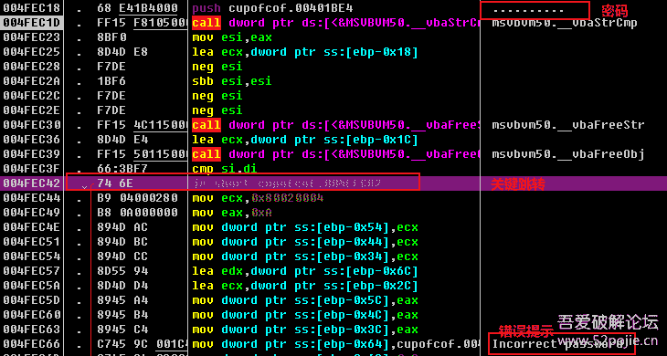
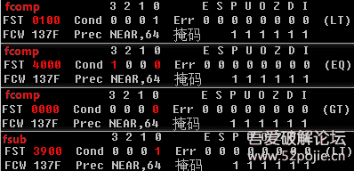
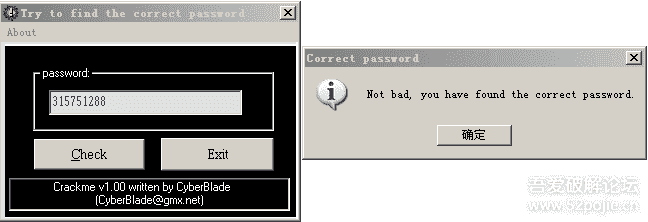

# [原创] 练习笔记之 160Crackme-035～37

- 原帖：https://www.52pojie.cn/forum.php?mod=viewthread&tid=1695026
- 抓取时间：2026-11-01T23:08:34

## 160CM-035～037

终于放假了，有时间再来做几道题了。

### 1. 035、036

这两道题除了界面不一样，里面的执行流程基本都一样，关键字搜索一下就全部找到了。



01.png（29.54 KB，下载次数：3）

[href="forum.php?mod=attachment&aid=MjU1ODA0MnwxNjg3YTFlZXwxNzkzNTc0NTExfDE2ODA4NnwxNjk1MDI2&nothumb=yes" target="_blank"](https://www.52pojie.cn/forum.php?mod=attachment&aid=MjU1ODA0MnwxNjg3YTFlZXwxNzkzNTc0NTExfDE2ODA4NnwxNjk1MDI2&nothumb=yes)

2022-10-2 10:01 上传

固定密码，没什么好分析的，一看就明白。

### 2. 037

这道题也比较简单，搜索一下关键字就能找到关键程序段，虽然错误提示做了几项不同的随机提示内容，但通过正确提示字符串的位置，还是很容易确定关键跳转位置。由于比较用到了浮点计算，稍微有些不是很好理解，但只看结果的话，也是一样的。其中，正确的密码保存在 `0x401008` 这个地址内，通过 `0040E111` 进行浮点比较来判断输入内容是否与正确密码相同。

```
0040E0E8   > \8B4D E4       mov ecx,dword ptr ss:[ebp-0x1C]          ;  取输入到密码
0040E0EB   .  51            push ecx
0040E0EC   .  FF15 5C114100 call dword ptr ds:[;  msvbvm50.__vbaR8Str
0040E0F2   .  DB43 4C       fild dword ptr ds:[ebx+0x4C]             ;  将整数转化为长双精压到st0
0040E0F5   .  DD9D 38FFFFFF fstp qword ptr ss:[ebp-0xC8]             ;  将st0弹出
0040E0FB   .  DCA5 38FFFFFF fsub qword ptr ss:[ebp-0xC8]             ;  浮点减法运算
0040E101   .  DFE0          fstsw ax                                 ;  取协处理器的状态字
0040E103   .  A8 0D         test al,0xD
0040E105   .  0F85 EB030000 jnz CyberBla.0040E4F6
0040E10B   .  FF15 14114100 call dword ptr ds:[>;  msvbvm50.__vbaFpR8
0040E111   .  DC1D 08104000 fcomp qword ptr ds:[0x401008]            ;  比较 ST(0) 与 指定地址
0040E117   .  DFE0          fstsw ax                                 ;  指令取协处理器的状态字
0040E119   .  F6C4 40       test ah,0x40
0040E11C   .  74 05         je short CyberBla.0040E123
0040E11E   .  BF 01000000   mov edi,0x1
0040E123   >  8D4D E4       lea ecx,dword ptr ss:[ebp-0x1C]
0040E126   .  FF15 8C114100 call dword ptr ds:[;  msvbvm50.__vbaFreeStr
0040E12C   .  8D4D E0       lea ecx,dword ptr ss:[ebp-0x20]
0040E12F   .  FF15 90114100 call dword ptr ds:[;  msvbvm50.__vbaFreeObj
0040E135   .  F7DF          neg edi
0040E137   .  66:85FF       test di,di
0040E13A      0F84 2C010000 je CyberBla.0040E26C                     ;  关键判断
```

其中，比较难理解的是浮点运算的状态寄存器的内容，如下图，`fcomp` 指令比较，小于、等于、大于三种结果，都应的寄存器状态字分别为 `0100`、`4000` 和 `0000`，低 8 位都是 0，没有问题，但是高 8 位的内容，和右侧按位显示的内容对应不上（`4000` 和 `3900` 对应不上，其他两个可以认为能对应上）。



02.png（15.52 KB，下载次数：1）

[href="forum.php?mod=attachment&aid=MjU1ODA0NHw4NmQ3M2RlY3wxNzkzNTc0NTExfDE2ODA4NnwxNjk1MDI2&nothumb=yes" target="_blank"](https://www.52pojie.cn/forum.php?mod=attachment&aid=MjU1ODA0NHw4NmQ3M2RlY3wxNzkzNTc0NTExfDE2ODA4NnwxNjk1MDI2&nothumb=yes)

2022-10-2 10:02 上传

抛开状态寄存器内容的分析，找到正确的密码还是比较简单的。



03.png（14.36 KB，下载次数：1）

[href="forum.php?mod=attachment&aid=MjU1ODA0NXw1Y2NkMjI0N3wxNzkzNTc0NTExfDE2ODA4NnwxNjk1MDI2&nothumb=yes" target="_blank"](https://www.52pojie.cn/forum.php?mod=attachment&aid=MjU1ODA0NXw1Y2NkMjI0N3wxNzkzNTc0NTExfDE2ODA4NnwxNjk1MDI2&nothumb=yes)

2022-10-2 10:02 上传

### 3. 总结

为了理解状态寄存器中的各位的含义，查找了很久，总算找到了 FPU 状态寄存器各位的具体定义，但是参照这部分定义，也还是无法理解高 8 位的内容。功力不够，暂且不琢磨浮点运算的内容，以后需要用到的时候再去研究吧。

FPU 状态寄存器（The status register）：

status 状态寄存器是一个 16 位的寄存器，它里面每个二进制位的含义如下表所示：

| Status Bit 状态位 | Description 描述 |
| --- |
| 0 |
