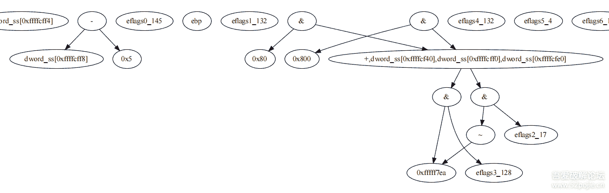
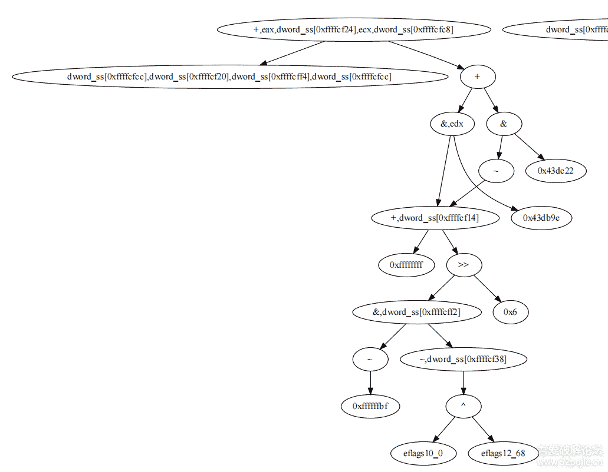
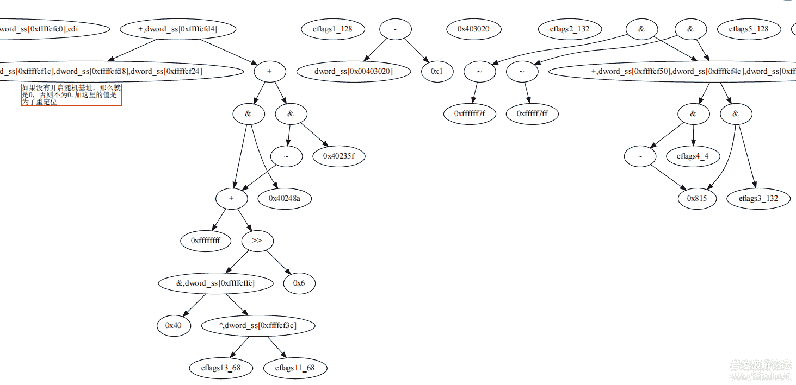
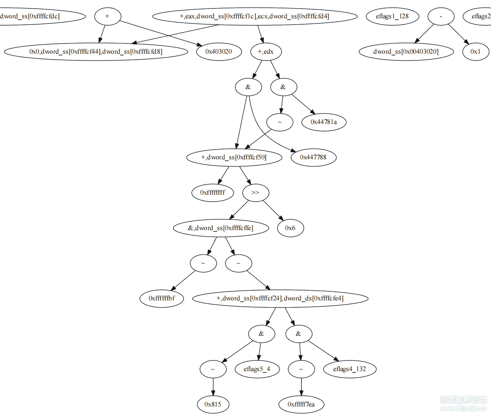
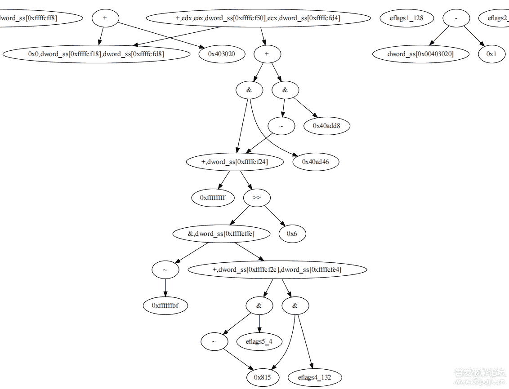
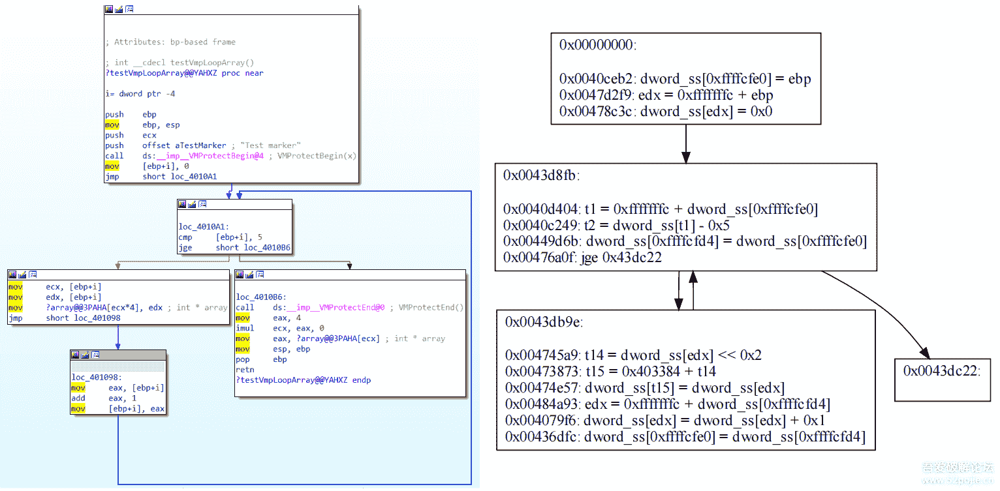

# [原创] vmp3.5 模拟 x86 分支指令 `je`、`jne`、`jge` 和 `jl` 的分析

- 原帖：<https://www.52pojie.cn/forum.php?mod=viewthread&tid=1696058>
- 抓取时间：`2026-11-01T23:08:20`

## 前言

这篇文章主要是分析 vmp3.5 对 `je`、`jne`、`jge` 和 `jl` 分支指令的模拟。因为识别出 vmp 的分支指令后，可以利用符号执行或者其它的 trace 工具得到程序的全部路径的执行 trace，然后合并这些路径重建程序混淆前的控制流图 CFG，最后对控制流图进行优化应该是可以还原出与原程序语义上等价的代码。

## 分支指令模拟分析

x86 指令的 `cmp` 实际是执行的减法操作，只是不改变操作数的值，而是程序状态寄存器 `eflags` 的值。vmp 模拟的减法指令如下：

```
x-y = ~(~x+y)
```

标志位还原如下：

```
eflags1 : (~x+y)
elfags2 : ~(~x+y)
eflags = (eflags1 & 0x815) + (elfags2 & ~0x815)
```

为什么 vmp 使用 `0x815` 可以参考《VMP学习笔记之万用门（七）》这篇文章。

### `Jge` 和 `Jl` 指令分析

这里先给出根据 trace 构建的 `eflags` 还原的 DAG 表示和 `jge` 指令模拟执行的 DAG 表示。



`图片1.png` (74.56 KB, 下载次数: 249)

[附件](https://www.52pojie.cn/forum.php?mod=attachment&aid=MjU1ODY0OHwxMTdmYjY0NHwxNzkzNTc0NDk3fDE2ODA4NnwxNjk2MDU4&nothumb=yes)

2022-10-6 10:09 上传



`图片2.png` (95.71 KB, 下载次数: 260)

[附件](https://www.52pojie.cn/forum.php?mod=attachment&aid=MjU1ODY0OXxjMTU2MTA4ZHwxNzkzNTc0NDk3fDE2ODA4NnwxNjk2MDU4&nothumb=yes)

2022-10-6 10:09 上传

以上两个 DAG 图都是优化过后得到的，对 MBA 表达式进行了处理，不然会很难看。主要优化了以下运算：

```
a&a = a
a|a = a
a|b = ~(~a & ~b)
a&b = ~(~a | ~b)
b = ~a, c=~b  -->  c=a
a-b = ~(~a+b)
a^b = (a|b) & (~a | ~b)
~(a^b) = (a & b) | (~a & ~b)
```

在 `eflags` 还原的 DAG 中，`0xfffff7ea = ~0x815`，还原后的 `eflags` 值分别与 `0x80` 和 `0x800` 进行 `and` 运算，`0x80` 和 `0x800` 对应的是 `sf` 和 `of` 标志位。分别 `and` 运算后也会产生两个 `eflags` 值，对应的是第二个 DAG 图里的 `eflags10_0` 和 `eflags12_68`。

令 `y = (~(eflags10_0 ^ eflags12_68) & (~0xffffffbf)) >> 6`

上面这个运算就是为了判断 `SF` 标志位是否等于 `OF` 标志位，如果等于则输出为 1，否则为 0。`SF==OF` 刚好是 `jge` 指令的跳转条件，这里 `~0xffffffbf = 0x40` 是取 `zf` 标志位的值。

令 `dword_ss[0xffffcf14] = 0xffffffff + y`，`y` 等于 0 或 1，则 vmbytecode 读取指针 `vm_ip = (dword_ss[0xffffcf14] & 0x43db9e) + (~dword_ss[0xffffcf14] & 0x43dc22) + dword_ss[0xffffcfcc]`。

`0x43dc22` 为满足跳转条件时的读取地址，否则为 `0x43db9e`。这里加一个 `dword_ss[0xffffcfcc]` 是为了重定位，如果程序加载的是默认基址的话 `dword_ss[0xffffcfcc]` 为 0。同理，vmp 访问全局变量前也是要重定位处理。需要注意的是模拟执行的过程中出现的一些常量并不是固定的。比如 `0xffffffbf`、`0x815`、`0x80`、`0x800` 等，有时候会对这些常量取反。

接下来给出 `jl` 指令的 DAG 表示。



`图片3.png` (148.1 KB, 下载次数: 261)

[附件](https://www.52pojie.cn/forum.php?mod=attachment&aid=MjU1ODY1MHwzMmRiNDdkMnwxNzkzNTc0NDk3fDE2ODA4NnwxNjk2MDU4&nothumb=yes)

2022-10-6 10:09 上传

从上图可以看出 `jl` 指令和 `jge` 指令的区别在于下面的异或运算结果有没有取反，其它都差不多。

### `Jne` 和 `Je` 指令分析

首先给出 `Jne` 指令的模拟执行的 DAG 表示。



`图片4.png` (135.84 KB, 下载次数: 250)

[附件](https://www.52pojie.cn/forum.php?mod=attachment&aid=MjU1ODY1MnxiMDVkZjg3MHwxNzkzNTc0NDk3fDE2ODA4NnwxNjk2MDU4&nothumb=yes)

2022-10-6 10:10 上传

`jne` 指令和 `jge` 指令模拟执行的区别在于上图下面的异或运算被替换成了 `eflags` 的还原运算，直接获取 `ZF` 标志位进行判断，其它都差不多。而 `jne` 指令与 `je` 指令的区别在于 `eflags` 的还原运算后有没有取反。`je` 指令模拟执行的 DAG 表示如下：



`图片5.png` (125.77 KB, 下载次数: 267)

[附件](https://www.52pojie.cn/forum.php?mod=attachment&aid=MjU1ODY1M3w4N2NiZmZmMnwxNzkzNTc0NDk3fDE2ODA4NnwxNjk2MDU4&nothumb=yes)

2022-10-6 10:10 上传

从以上几个分支指令的 DAG 图可以看出 vmp 模拟执行分支指令的一些特征如下：

1. `eflags` 寄存器的值参与了运算，正常编写程序几乎不会用到 `eflags` 寄存器。
2. 模拟分支指令的过程中会用到一些常量，比如 `0xffffffbf`、`0x815`、`0x80`、`0x800` 等。
3. `vm_ip` 的两个跳转地址也参与了运算。

根据以上几个特征以及一些模拟运算的特征，可以判断 vmp 是否在模拟分支指令的执行。模拟过程中的常量比如 `0x40`、`0x800` 等可以确定可能使用了哪些分支指令，一般是两个相反跳转条件的分支指令。再根据 `eflags` 还原后的结果或者异或运算后的结果有没有取反来确定是哪一个分支指令。最后根据用于修改 `vm_ip` 的两个目的地址中，有兄弟节点是取反运算的则为满足跳转条件的地址，比如 `je` 指令的 DAG 图里的 `0x40add8` 就是满足跳转条件的目的地址。

## 总结

根据分支指令确定各个执行路径，再利用这些路径的 trace 还原程序混淆前的 CFG 图，最后对 CFG 图进行全局优化达到虚拟化还原的目的是可行的。但是，这种方法会有一个路径爆炸问题。这里附上用于测试 `jge` 指令代码虚拟化混淆后还原的 CFG 图，由于没有做全局的赋值传播和公共子表达式删除，所以还原的代码还有些瑕疵。这次就不分享代码了，感兴趣的可以在之前分享的代码自行修改。



`图片6.png` (199.95 KB, 下载次数: 278)

[附件](https://www.52pojie.cn/forum.php?mod=attachment&aid=MjU1ODY1NHw3OTcwYzQ3N3wxNzkzNTc0NDk3fDE2ODA4NnwxNjk2MDU4&nothumb=yes)

2022-10-6 10:10 上传
