# [原创] 某宝宝取名软件 v30 破解记录

- 原帖：https://www.52pojie.cn/forum.php?mod=viewthread&tid=1700593
- 抓取时间：2026-11-01T23:07:56

## 宝宝取名软件

这个软件我相信很多人都遇到过吧！

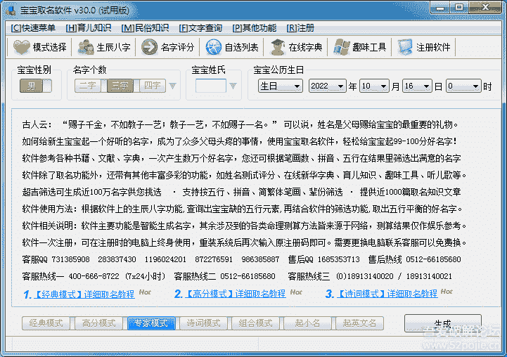

1.png（78.62 KB，下载次数：1）

[附件下载](https://www.52pojie.cn/forum.php?mod=attachment&aid=MjU2MTE0NHxlZWZlY2VjNHwxNzkzNTc0NDc0fDE2ODA4NnwxNzAwNTkz&nothumb=yes)

2022-10-18 07:49 上传

这个软件其实还是多友好的，没有加壳，没有自效验。

但他却有很多很多的比较验证，联网验证，联网获取数据。

主要功能，经典模式是本地生成，高分模式和专家模式需要联网。

首先是搜下字符串，大多软件是搜不到，而这个软件却反其道而行，给你很多字符串，让人头晕，不知道从何下手。

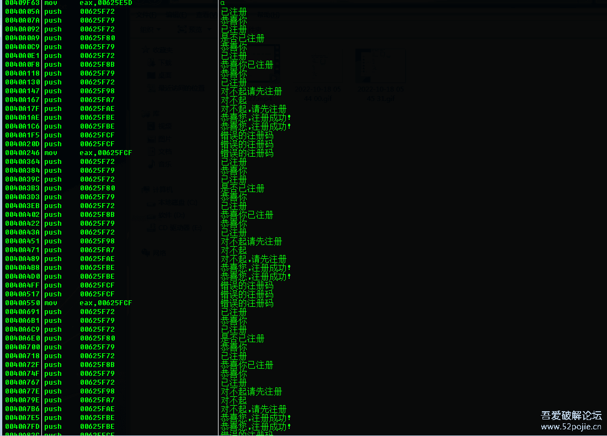

2.png（97.04 KB，下载次数：1）

[附件下载](https://www.52pojie.cn/forum.php?mod=attachment&aid=MjU2MTE0NXw2MzYyMDIxOHwxNzkzNTc0NDc0fDE2ODA4NnwxNzAwNTkz&nothumb=yes)

2022-10-18 07:50 上传

太基础的就不一步一步说了

## 1. 先说说流程

软件先在 `D:\Dosame`，生成配置文件，注册信息在 `Dosamesoft.p` 文件。

注册联网验证的，注册序列号是 168 开头的（开头不是 168 不联网验证，不写入注册码）。

注册时先在 `Dosamesoft.p` 文件写入：`序列号=1681111111111`，再从网络获取：`注册码=注册失败,请检查您的序列号`，写入 `Dosamesoft.p` 文件，正确时写入真码。


2022-10-18 05 55 10.gif（2.56 MB，下载次数：1）

[附件下载](https://www.52pojie.cn/forum.php?mod=attachment&aid=MjU2MTE0N3xhMTQ3OTY0NHwxNzkzNTc0NDc0fDE2ODA4NnwxNzAwNTkz&nothumb=yes)

2022-10-18 07:50 上传

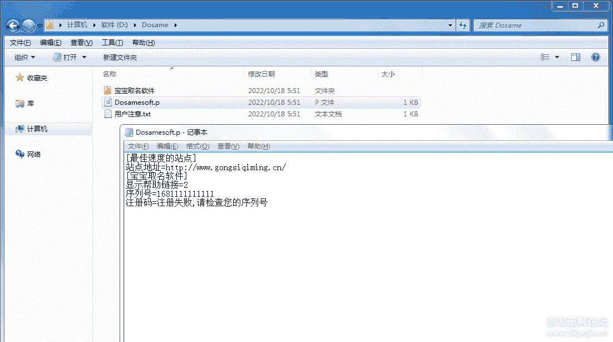

3.png（95.67 KB，下载次数：1）

[附件下载](https://www.52pojie.cn/forum.php?mod=attachment&aid=MjU2MTE0Nnw3ZDA5NmNkNXwxNzkzNTc0NDc0fDE2ODA4NnwxNzAwNTkz&nothumb=yes)

2022-10-18 07:50 上传

软件运行时验证的是 `Dosamesoft.p` 文件里的注册码，而不是序列号。

## 2. 软件有很多很多验证 `call`

我相信很多人花点时间都能找到，找到太多的验证 `call` 有时候又不自信了。

验证 `call` 真心挺多的，这个没法简单的 `jmp` 或 `nop`。只能通过赋值进行破解。

我随便拿个好识别的 `call` 来，取 4 个字名字时的验证。

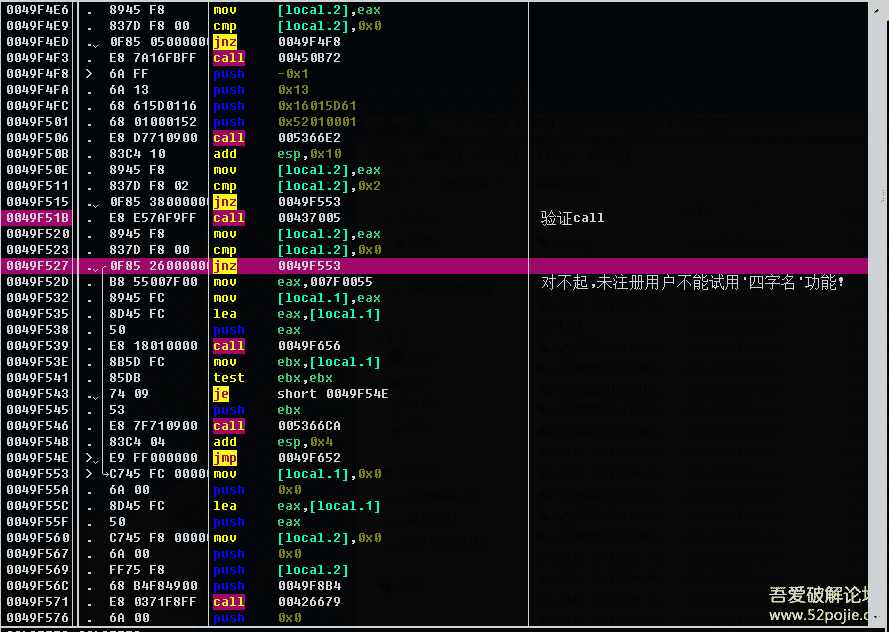

QQ截图20221018080347.png（137.43 KB，下载次数：0）

[附件下载](https://www.52pojie.cn/forum.php?mod=attachment&aid=MjU2MTE1OHxhNzVjMzYwMXwxNzkzNTc0NDc0fDE2ODA4NnwxNzAwNTkz&nothumb=yes)

2022-10-18 08:04 上传

主要是返回 `eax` 的值，进 `call` 从后往前找，我这直接上往里跟的图。

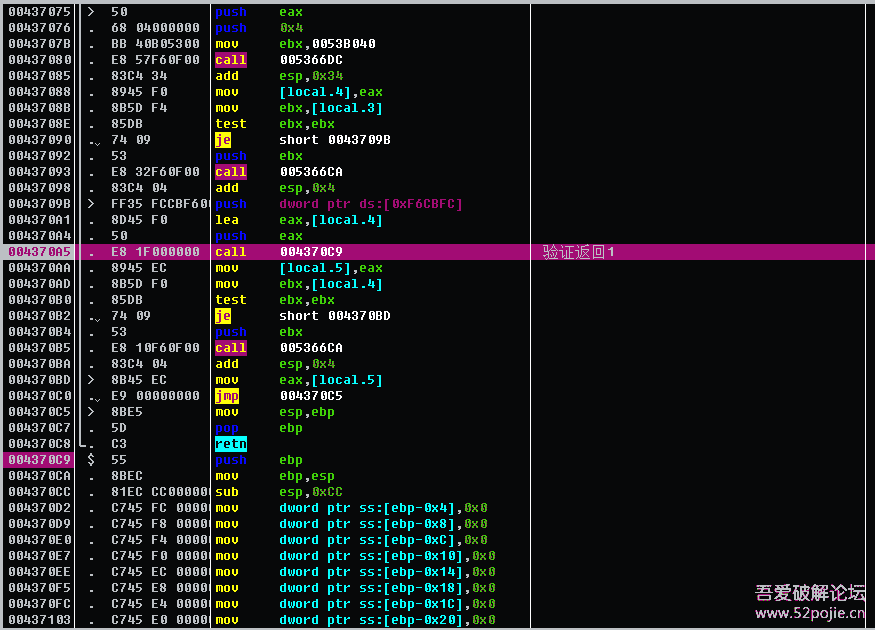

QQ截图20221018060936.png（75.46 KB，下载次数：1）

[附件下载](https://www.52pojie.cn/forum.php?mod=attachment&aid=MjU2MTE0OHw2ZTkzY2Y5M3wxNzkzNTc0NDc0fDE2ODA4NnwxNzAwNTkz&nothumb=yes)

2022-10-18 07:51 上传

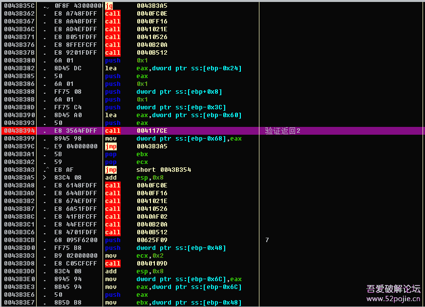

QQ截图20221018061632.png（74.56 KB，下载次数：0）

[附件下载](https://www.52pojie.cn/forum.php?mod=attachment&aid=MjU2MTE1MHwxNjUxZDcxMXwxNzkzNTc0NDc0fDE2ODA4NnwxNzAwNTkz&nothumb=yes)

2022-10-18 07:51 上传

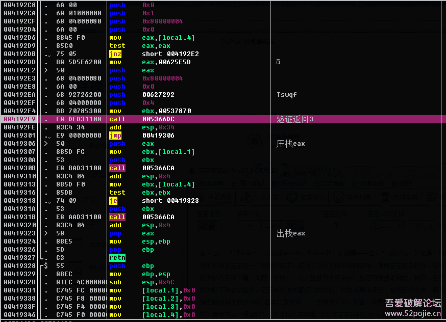

QQ截图20221018061612.png（72.64 KB，下载次数：0）

[附件下载](https://www.52pojie.cn/forum.php?mod=attachment&aid=MjU2MTE0OXw0MjdhNDQ0ZXwxNzkzNTc0NDc0fDE2ODA4NnwxNzAwNTkz&nothumb=yes)

2022-10-18 07:51 上传

`call 005366DC` 再往下跟就分析不了，没有意义了。

`call 005366DC` 有很多地方调用，不能段首 `mov retn`。

我这可以直接将 `call 005366DC` 修改为 `mov eax,0x1`

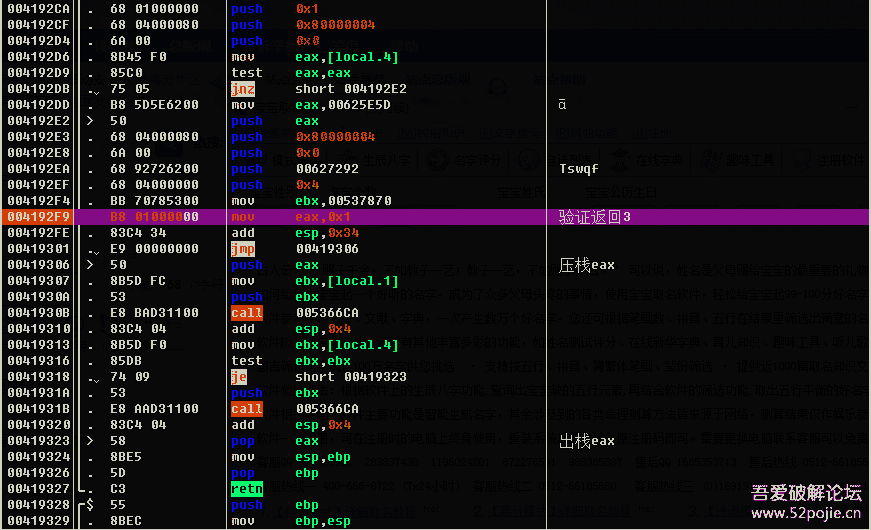

QQ截图20221018082430.png（88.6 KB，下载次数：1）

[附件下载](https://www.52pojie.cn/forum.php?mod=attachment&aid=MjU2MTE2M3wyNjYxNzZlOHwxNzkzNTc0NDc0fDE2ODA4NnwxNzAwNTkz&nothumb=yes)

2022-10-18 08:24 上传

再重点说一次软件有很多验证 `call`，这不是唯一的一个。

```
push 00627292 ; Tswqf
```

验证 `call` 前面 `push` 了字符串 `Tswqf`，

根据经验，如果有其他相同验证，同样也是压入的 `Tswqf`，

查找参考-立即数，共 5 个，每个点开看，代码都是一样的，

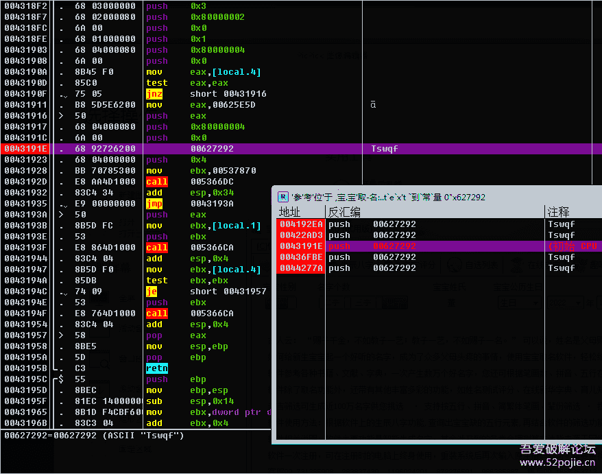

QQ截图20221018061836.png（88.22 KB，下载次数：0）

[附件下载](https://www.52pojie.cn/forum.php?mod=attachment&aid=MjU2MTE1MXxlOGFiODFlNHwxNzkzNTc0NDc0fDE2ODA4NnwxNzAwNTkz&nothumb=yes)

2022-10-18 07:51 上传

有时候字符串 `Tswqf`，不是同一个地址，可以再从字符串搜索里面去找，在这里就这一个地址。

5 个 `call` 全部修改为 `mov eax,0x1`

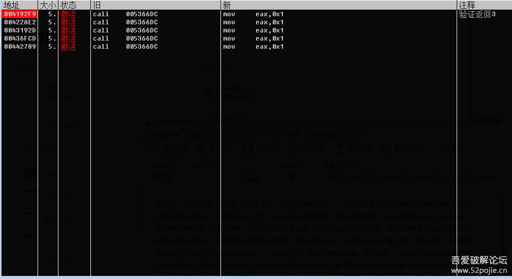

QQ截图20221018061948.png（58.01 KB，下载次数：0）

[附件下载](https://www.52pojie.cn/forum.php?mod=attachment&aid=MjU2MTE1MnxiZjQ5Zjk0NXwxNzkzNTc0NDc0fDE2ODA4NnwxNzAwNTkz&nothumb=yes)

2022-10-18 07:51 上传

现在 4 个字的名字经典模式可以用了，但 2 个字和 3 个字的却报错了，有桩。

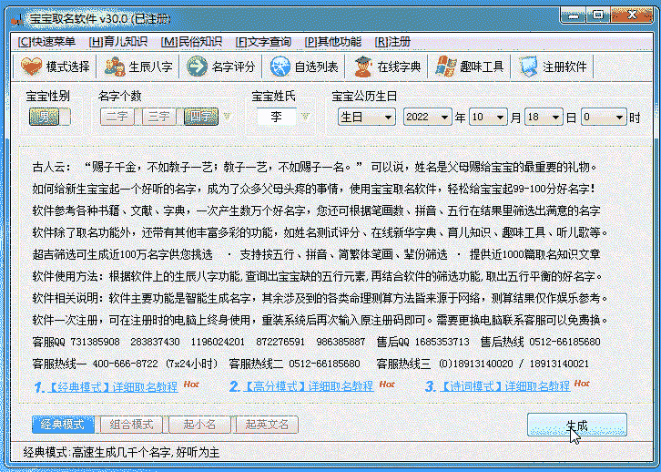

2022-10-18 08 12 50.gif（2.17 MB，下载次数：0）

[附件下载](https://www.52pojie.cn/forum.php?mod=attachment&aid=MjU2MTE1OXw1ZjNjOGI5MXwxNzkzNTc0NDc0fDE2ODA4NnwxNzAwNTkz&nothumb=yes)

2022-10-18 08:13 上传

而且联网的模式也没发用，报错。

## 桩 1

也不算桩吧，

首先，我们写入 `Dosamesoft.p` 文件的是假码：`注册码=注册失败,请检查您的序列号`

这个肯定的错的，花时间跟了一下，发现软件会生成真码，和文件 `Dosamesoft.p` 里注册码比较，每次都是重新去文件取值。

不能 `jmp` 或 `nop`，有联网验证，否则联网功能没发用，只能用本地功能。

中文搜索数字 99，也有很多，所有下断，走一走，你就会看到真码。

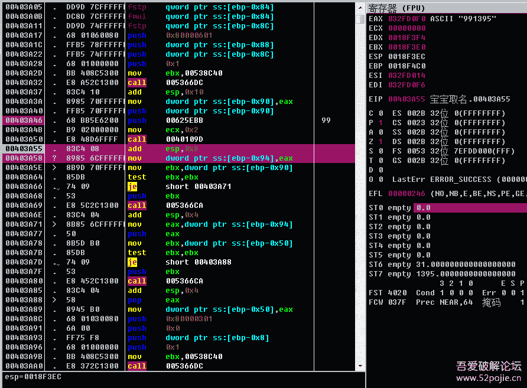

QQ截图20221018062835.png（120.82 KB，下载次数：0）

[附件下载](https://www.52pojie.cn/forum.php?mod=attachment&aid=MjU2MTE1M3w2NGUxOGZlMnwxNzkzNTc0NDc0fDE2ODA4NnwxNzAwNTkz&nothumb=yes)

2022-10-18 07:51 上传

软件会将取 `Dosamesoft.p` 中注册码前两个字节和 99 进行比较，不等就报错。

后几位应该是联网获取数据时用的。

可以手动将注册码改下真码，每台电脑的都不一样，但前两位一定是 99。

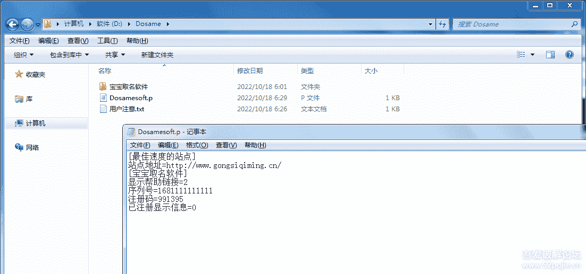

QQ截图20221018063019.png（101.76 KB，下载次数：0）

[附件下载](https://www.52pojie.cn/forum.php?mod=attachment&aid=MjU2MTE1NHw5NGI5YzQyMXwxNzkzNTc0NDc0fDE2ODA4NnwxNzAwNTkz&nothumb=yes)

2022-10-18 07:51 上传

这样，联网的高分模式和专家模式就可以用了。

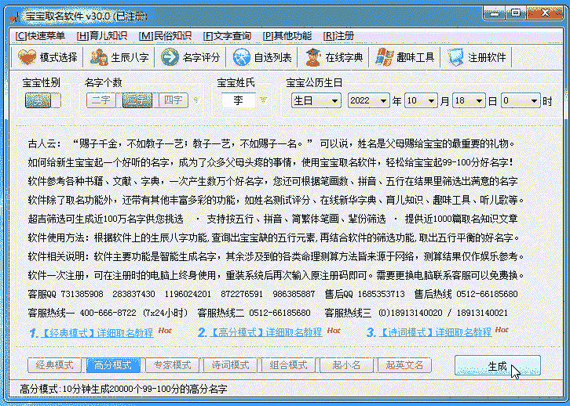

2022-10-18 08 13 53.gif（2 MB，下载次数：0）

[附件下载](https://www.52pojie.cn/forum.php?mod=attachment&aid=MjU2MTE2MHxhYTU3ZmVjZHwxNzkzNTc0NDc0fDE2ODA4NnwxNzAwNTkz&nothumb=yes)

2022-10-18 08:14 上传


2022-10-18 08 15 09.gif（2.09 MB，下载次数：0）

[附件下载](https://www.52pojie.cn/forum.php?mod=attachment&aid=MjU2MTE2MXw3OTBmMjFiZHwxNzkzNTc0NDc0fDE2ODA4NnwxNzAwNTkz&nothumb=yes)

2022-10-18 08:15 上传

## 桩 2

2 个字和 3 个字的经典模式依旧报错退出，这个只要一步步跟就能找到，我直接上图。

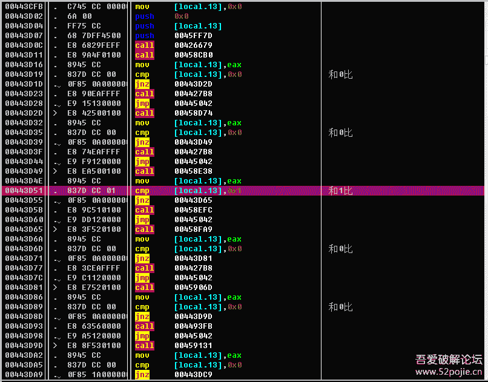

QQ截图20221018063318.png（97.59 KB，下载次数：0）

[附件下载](https://www.52pojie.cn/forum.php?mod=attachment&aid=MjU2MTE1NXwwMDVjODAyOHwxNzkzNTc0NDc0fDE2ODA4NnwxNzAwNTkz&nothumb=yes)

2022-10-18 07:51 上传


`2022-10-18 08 16 32.gif` (2.31 MB, 下载次数: 0)

[href="forum.php?mod=attachment&aid=MjU2MTE2Mnw4NmE4ZjQxMXwxNzkzNTc0NDc0fDE2ODA4NnwxNzAwNTkz&nothumb=yes" target="_blank"](https://www.52pojie.cn/forum.php?mod=attachment&aid=MjU2MTE2Mnw4NmE4ZjQxMXwxNzkzNTc0NDc0fDE2ODA4NnwxNzAwNTkz&nothumb=yes)

2022-10-18 08:16 上传

完


