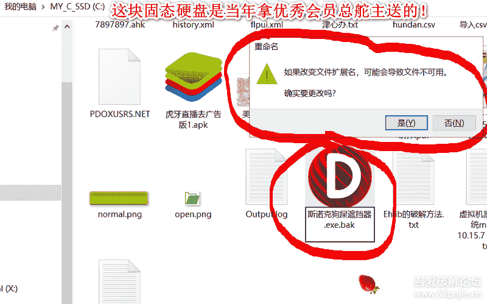
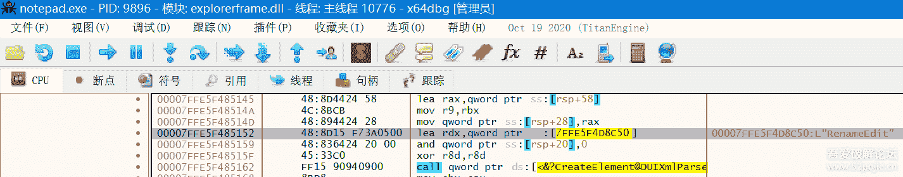
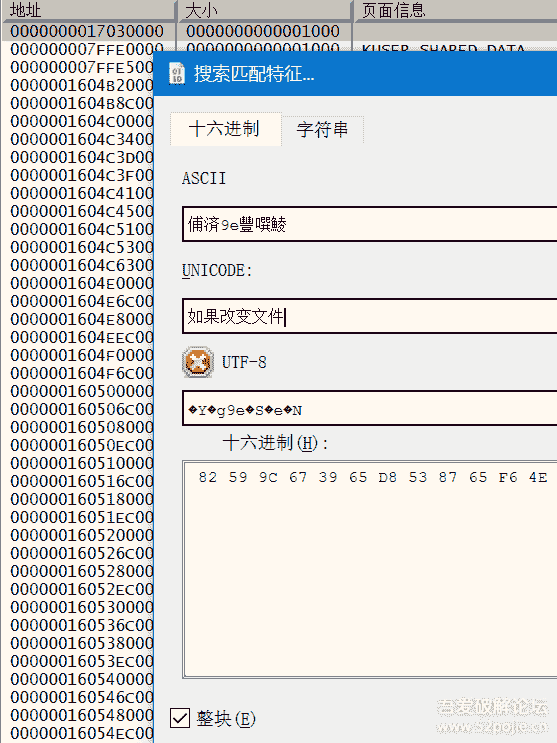
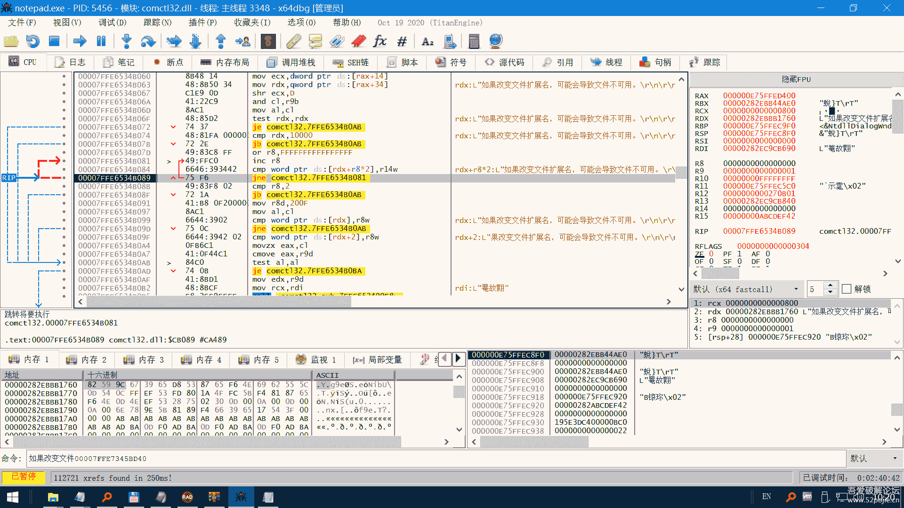
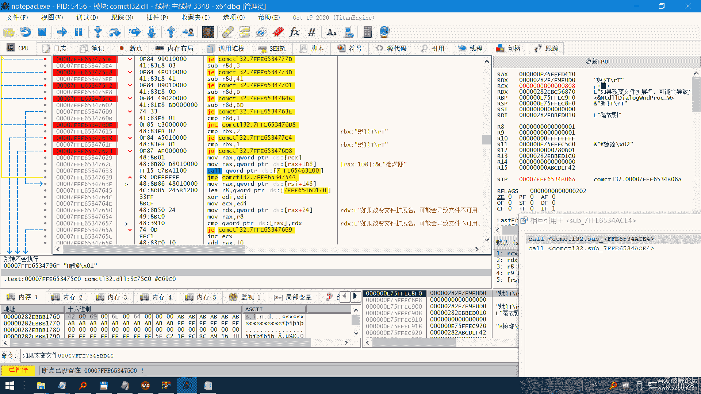
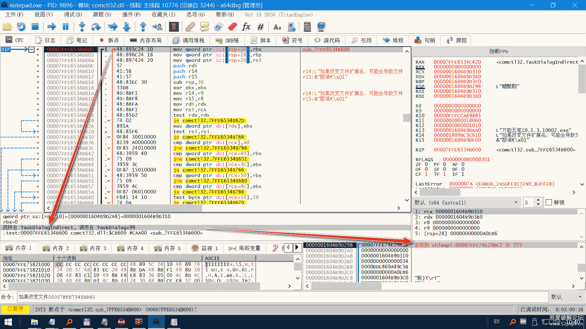
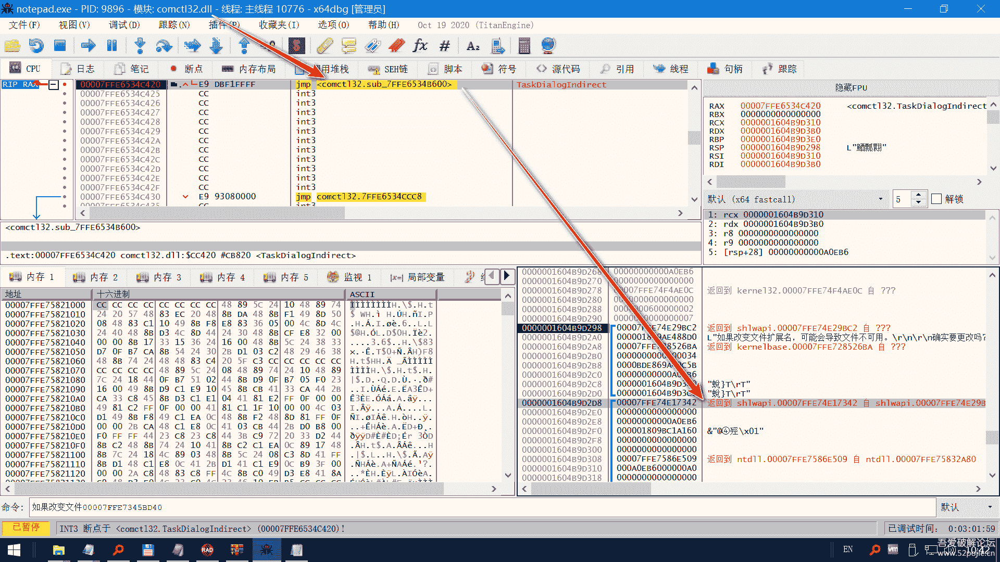
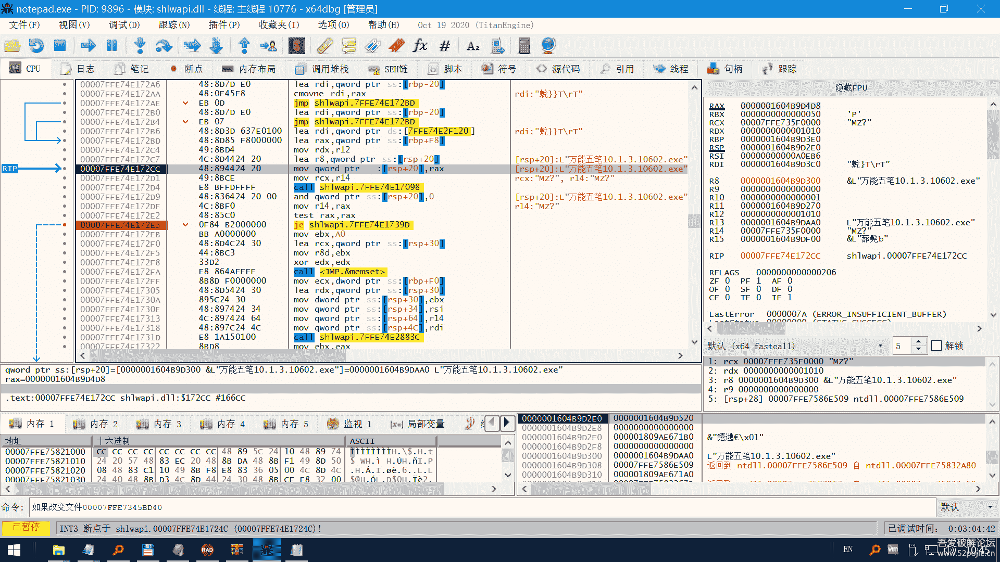
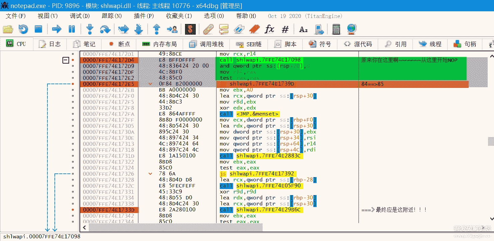
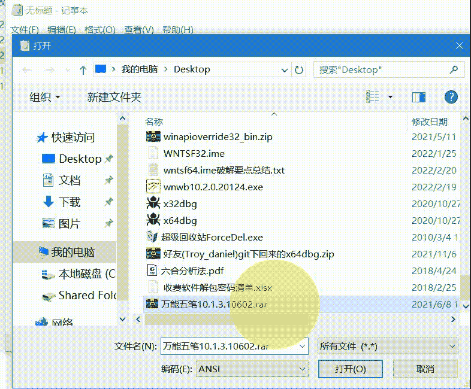

# [原创] 给Win10的资源管理器治疗啰嗦病症

- 原帖: https://www.52pojie.cn/forum.php?mod=viewthread&tid=1700704
- 抓取时间: 2026-11-01T23:07:55

## 问题描述



`image.png` (182.75 KB, 下载次数: 2)

[href="forum.php?mod=attachment&aid=MjU2MTIxNnxkODZkYmE2ZnwxNzkzNTc0NDcyfDE2ODA4NnwxNzAwNzA0&nothumb=yes" target="_blank"](https://www.52pojie.cn/forum.php?mod=attachment&aid=MjU2MTIxNnxkODZkYmE2ZnwxNzkzNTc0NDcyfDE2ODA4NnwxNzAwNzA0&nothumb=yes)

2022-10-18 10:55 上传

如图所示，当你在Windows资源管理器重命名时，是不是总有个啰了叭嗦的对话框出来？

询问你是否要改名？今天，我们就是调试修改一下它。

## 调试思路

当你在Win9x系统时，使用`SoftICE`或`TRW2000`时，任意时刻你都能用`Ctrl+D`唤出控制台来调试目标程序。

这个框框出来，你再去附加我们的调试器，比如`x64dbg`就已经晚了。

所以呢，我们就得先找一个假想敌，过渡一下来间接的来调试它。

## 从 `notepad.exe` 开始

开始以为是不是`exeplor.exe`？一切从怀疑开始。

用`x32dbg`来打开吧，结果提示需要64位的来

就重换`x64dbg`来走起吧。

当你一按运行时，就发现进程已经结束了。

。。。

所以呢，几经失败，我们就换成了调试`notepad.exe`

先`Alt+E`来到模块窗口中，尝试搜索`message`，下好断点，发现并不好使啊。。。

于是想。。。是不是位于`shell32.dll`模块中？

结果发现设断也好，搜索字符串也好，并不好使啊。。。

然后一想自从win8以后，不少人都说windows是印度人搞的。。。越来越臃肿，没用的功能与来越多，蛋痛的功能也不少。

以前你一个`notepad.exe`只需要一个主程序就行了，如今你去搜索还会发现多余的语言文件。。。

所以呢？搜索中文是多么的愚蠢行为。。。

那么，我们换成英文`renname`吧。

```asm
00007FFE5F485152 | 48:8D15 F73A0500 | lea rdx,qword ptr ds:[7FFE5F4D8C50] | 00007FFE5F4D8C50:L"RenameEdit"
```

就是就发现了多个，在这上断到了。

位于`explorerframe.dll`



`image.png` (81.29 KB, 下载次数: 2)

[href="forum.php?mod=attachment&aid=MjU2MTIxN3xlNGM1MWY3MnwxNzkzNTc0NDcyfDE2ODA4NnwxNzAwNzA0&nothumb=yes" target="_blank"](https://www.52pojie.cn/forum.php?mod=attachment&aid=MjU2MTIxN3xlNGM1MWY3MnwxNzkzNTc0NDcyfDE2ODA4NnwxNzAwNzA0&nothumb=yes)

2022-10-18 11:15 上传

## 回溯调用来源

然后呢，我们试图使用堆栈窗口，慢慢向上回溯，似乎发现这样是无功而返的，因为它出现的地方更早。

所以，我再`Alt+M`搜索下内存窗口`Ctrl+B`



`image.png` (91.56 KB, 下载次数: 2)

[href="forum.php?mod=attachment&aid=MjU2MTIyMHwwZmVkYjBhNnwxNzkzNTc0NDcyfDE2ODA4NnwxNzAwNzA0&nothumb=yes" target="_blank"](https://www.52pojie.cn/forum.php?mod=attachment&aid=MjU2MTIyMHwwZmVkYjBhNnwxNzkzNTc0NDcyfDE2ODA4NnwxNzAwNzA0&nothumb=yes)

2022-10-18 11:19 上传

就会发现2处

我们来到DUMP窗口中按下`Ctrl+Shift+1`，设置1字节硬件访问断点

断下后



`image.png` (373.22 KB, 下载次数: 2)

[href="forum.php?mod=attachment&aid=MjU2MTIyMXw0MWIzMTEwZHwxNzkzNTc0NDcyfDE2ODA4NnwxNzAwNzA0&nothumb=yes" target="_blank"](https://www.52pojie.cn/forum.php?mod=attachment&aid=MjU2MTIyMXw0MWIzMTEwZHwxNzkzNTc0NDcyfDE2ODA4NnwxNzAwNzA0&nothumb=yes)

2022-10-18 11:21 上传

就会来到这下面附近



`image.png` (354.23 KB, 下载次数: 2)

[href="forum.php?mod=attachment&aid=MjU2MTIyMnw0Zjg5YzdmY3wxNzkzNTc0NDcyfDE2ODA4NnwxNzAwNzA0&nothumb=yes" target="_blank"](https://www.52pojie.cn/forum.php?mod=attachment&aid=MjU2MTIyMnw0Zjg5YzdmY3wxNzkzNTc0NDcyfDE2ODA4NnwxNzAwNzA0&nothumb=yes)

2022-10-18 11:22 上传

然后不断的`Ctrl+A`向上查看段首 是哪里调用的。。。



`image.png` (422.91 KB, 下载次数: 2)

[href="forum.php?mod=attachment&aid=MjU2MTIyM3w5YTg0YzkxNHwxNzkzNTc0NDcyfDE2ODA4NnwxNzAwNzA0&nothumb=yes" target="_blank"](https://www.52pojie.cn/forum.php?mod=attachment&aid=MjU2MTIyM3w5YTg0YzkxNHwxNzkzNTc0NDcyfDE2ODA4NnwxNzAwNzA0&nothumb=yes)

2022-10-18 11:24 上传

不断的重复向上查看，并配合堆栈窗口



`image.png` (457.39 KB, 下载次数: 2)

[href="forum.php?mod=attachment&aid=MjU2MTIyNHwwOTBiYjJjYXwxNzkzNTc0NDcyfDE2ODA4NnwxNzAwNzA0&nothumb=yes" target="_blank"](https://www.52pojie.cn/forum.php?mod=attachment&aid=MjU2MTIyNHwwOTBiYjJjYXwxNzkzNTc0NDcyfDE2ODA4NnwxNzAwNzA0&nothumb=yes)

2022-10-18 11:25 上传



`image.png` (386.62 KB, 下载次数: 0)

[href="forum.php?mod=attachment&aid=MjU2MTIyNXwwYTg3MjlmMHwxNzkzNTc0NDcyfDE2ODA4NnwxNzAwNzA0&nothumb=yes" target="_blank"](https://www.52pojie.cn/forum.php?mod=attachment&aid=MjU2MTIyNXwwYTg3MjlmMHwxNzkzNTc0NDcyfDE2ODA4NnwxNzAwNzA0&nothumb=yes)

2022-10-18 11:25 上传



`image.png` (178.89 KB, 下载次数: 2)

[href="forum.php?mod=attachment&aid=MjU2MTIyNnwzZmVhYTNlOXwxNzkzNTc0NDcyfDE2ODA4NnwxNzAwNzA0&nothumb=yes" target="_blank"](https://www.52pojie.cn/forum.php?mod=attachment&aid=MjU2MTIyNnwzZmVhYTNlOXwxNzkzNTc0NDcyfDE2ODA4NnwxNzAwNzA0&nothumb=yes)

2022-10-18 11:28 上传

## 修改与替换

最终，我们就来到了上面的这个地方！！！ 照图那样修改那个烦人的框框就再也不会出来了。。。

补丁后的文件，需要到WinPE环境下去替换。。。

[Asm] 纯文本查看 复制代码


```
00007FFE74E171E0 | 40:55                  | push rbp                                      |
00007FFE74E171E2 | 53                     | push rbx                                      |
00007FFE74E171E3 | 56                     | push rsi                                      |
00007FFE74E171E4 | 57                     | push rdi                                      |
00007FFE74E171E5 | 41:54                  | push r12                                      |
00007FFE74E171E7 | 41:56                  | push r14                                      |
00007FFE74E171E9 | 41:57                  | push r15                                      |
00007FFE74E171EB | 48:8DAC24 70FFFFFF     | lea rbp,qword ptr ss:[rsp-90]                 |
00007FFE74E171F3 | 48:81EC 90010000       | sub rsp,190                                   |
00007FFE74E171FA | 48:8B05 57410300       | mov rax,qword ptr ds:[7FFE74E4B358]           | 00007FFE74E4B358:L"丫洝&#48638;"
00007FFE74E17201 | 48:33C4                | xor rax,rsp                                   |
00007FFE74E17204 | 48:8985 80000000       | mov qword ptr ss:[rbp+80],rax                 |
00007FFE74E1720B | 8365 D0 00             | and dword ptr ss:[rbp-30],0                   |
00007FFE74E1720F | 45:32FF                | xor r15b,r15b                                 |
00007FFE74E17212 | 49:8BF9                | mov rdi,r9                                    |
00007FFE74E17215 | 4D:8BE0                | mov r12,r8                                    |
00007FFE74E17218 | 48:8BF2                | mov rsi,rdx                                   |
00007FFE74E1721B | 4C:8BF1                | mov r14,rcx                                   |
00007FFE74E1721E | 49:81F9 00000100       | cmp r9,10000                                  |
00007FFE74E17225 | 0F83 92000000          | jae shlwapi.7FFE74E172BD                      |
00007FFE74E1722B | 48:85C9                | test rcx,rcx                                  |
00007FFE74E1722E | 0F84 89000000          | je shlwapi.7FFE74E172BD                       |
00007FFE74E17234 | 41:0FB7D1              | movzx edx,r9w                                 |
00007FFE74E17238 | 4C:8D45 E0             | lea r8,qword ptr ss:[rbp-20]                  |
00007FFE74E1723C | BB 50000000            | mov ebx,50                                    | 50:'P'
00007FFE74E17241 | 44:8BCB                | mov r9d,ebx                                   |
00007FFE74E17244 | FF15 7E5F0100          | call qword ptr ds:[]            |
00007FFE74E1724A | 85C0                   | test eax,eax                                  |
00007FFE74E1724C | 75 62                  | jne shlwapi.7FFE74E172B0                      |
00007FFE74E1724E | 48:85F6                | test rsi,rsi                                  |
00007FFE74E17251 | 74 63                  | je shlwapi.7FFE74E172B6                       |
00007FFE74E17253 | 44:8BC3                | mov r8d,ebx                                   |
00007FFE74E17256 | 48:8D55 E0             | lea rdx,qword ptr ss:[rbp-20]                 |
00007FFE74E1725A | 48:8BCE                | mov rcx,rsi                                   |
00007FFE74E1725D | FF15 B55C0100          | call qword ptr ds:[]         |
00007FFE74E17263 | 85C0                   | test eax,eax                                  |
00007FFE74E17265 | 74 4F                  | je shlwapi.7FFE74E172B6                       |
00007FFE74E17267 | 48:8D15 1AA20100       | lea rdx,qword ptr ds:[7FFE74E31488]           | 00007FFE74E31488:L"Program Manager"
00007FFE74E1726E | 48:8D4D E0             | lea rcx,qword ptr ss:[rbp-20]                 |
00007FFE74E17272 | FF15 88660100          | call qword ptr ds:[]                |
00007FFE74E17278 | 85C0                   | test eax,eax                                  |
00007FFE74E1727A | 75 34                  | jne shlwapi.7FFE74E172B0                      |
00007FFE74E1727C | 33D2                   | xor edx,edx                                   |
00007FFE74E1727E | 48:8BCE                | mov rcx,rsi                                   |
00007FFE74E17281 | FF15 595D0100          | call qword ptr ds:[]     |
00007FFE74E1728F | 3BD8                   | cmp ebx,eax                                   |
00007FFE74E17291 | 75 2A                  | jne shlwapi.7FFE74E172BD                      |
00007FFE74E17293 | 48:8D15 0EA20100       | lea rdx,qword ptr ds:[7FFE74E314A8]           | 00007FFE74E314A8:L"pszDesktopTitleW"
00007FFE74E1729A | 48:8BCE                | mov rcx,rsi                                   |
00007FFE74E1729D | FF15 655C0100          | call qword ptr ds:[]               |
00007FFE74E172A3 | 48:85C0                | test rax,rax                                  |
00007FFE74E172A6 | 48:8D7D E0             | lea rdi,qword ptr ss:[rbp-20]                 |
00007FFE74E172AA | 48:0F45F8              | cmovne rdi,rax                                |
00007FFE74E172AE | EB 0D                  | jmp shlwapi.7FFE74E172BD                      |
00007FFE74E172B0 | 48:8D7D E0             | lea rdi,qword ptr ss:[rbp-20]                 |
00007FFE74E172B4 | EB 07                  | jmp shlwapi.7FFE74E172BD                      |
00007FFE74E172B6 | 48:8D3D 637E0100       | lea rdi,qword ptr ds:[7FFE74E2F120]           |
00007FFE74E172BD | 48:8D85 F8000000       | lea rax,qword ptr ss:[rbp+F8]                 |
00007FFE74E172C4 | 49:8BD4                | mov rdx,r12                                   |
00007FFE74E172C7 | 4C:8D4424 20           | lea r8,qword ptr ss:[rsp+20]                  |
00007FFE74E172CC | 48:894424 20           | mov qword ptr ss:[rsp+20],rax                 |
00007FFE74E172D1 | 49:8BCE                | mov rcx,r14                                   |
00007FFE74E172D4 | E8 BFFDFFFF            | call shlwapi.7FFE74E17098                     | 原来你在这里啊~~~~~~~从这里开始NOP
00007FFE74E172D9 | 48:836424 20 00        | and qword ptr ss:[rsp+20],0                   | NOP
00007FFE74E172DF | 4C:8BF0                | mov r14,rax                                   | NOP
00007FFE74E172E2 | 48:85C0                | test rax,rax                                  | NOP
00007FFE74E172E5 | 0F84 B2000000          | je shlwapi.7FFE74E1739D                       | 84==>85
00007FFE74E172EB | BB A0000000            | mov ebx,A0                                    |
00007FFE74E172F0 | 48:8D4C24 30           | lea rcx,qword ptr ss:[rsp+30]                 |
00007FFE74E172F5 | 44:8BC3                | mov r8d,ebx                                   |
00007FFE74E172F8 | 33D2                   | xor edx,edx                                   |
00007FFE74E172FA | E8 864AFFFF            | call                             |
00007FFE74E172FF | 8B8D F0000000          | mov ecx,dword ptr ss:[rbp+F0]                 |
00007FFE74E17305 | 48:8D5424 30           | lea rdx,qword ptr ss:[rsp+30]                 |
00007FFE74E1730A | 895C24 30              | mov dword ptr ss:[rsp+30],ebx                 |
00007FFE74E1730E | 48:897424 34           | mov qword ptr ss:[rsp+34],rsi                 |
00007FFE74E17313 | 4C:897424 64           | mov qword ptr ss:[rsp+64],r14                 |
00007FFE74E17318 | 48:897C24 4C           | mov qword ptr ss:[rsp+4C],rdi                 |
00007FFE74E1731D | E8 1A150100            | call shlwapi.7FFE74E2883C                     |
00007FFE74E17322 | 8BD8                   | mov ebx,eax                                   |
00007FFE74E17324 | 85C0                   | test eax,eax                                  |
00007FFE74E17326 | 78 6A                  | js shlwapi.7FFE74E17392                       |
00007FFE74E17328 | 48:8D4D D8             | lea rcx,qword ptr ss:[rbp-28]                 |
00007FFE74E1732C | E8 5FECFEFF            | call shlwapi.7FFE74E05F90                     |
00007FFE74E17331 | 45:33C9                | xor r9d,r9d                                   |
00007FFE74E17334 | 48:8D55 D0             | lea rdx,qword ptr ss:[rbp-30]                 |
00007FFE74E17338 | 48:8D4C24 30           | lea rcx,qword ptr ss:[rsp+30]                 |
00007FFE74E1733D | E8 2A280100            | call shlwapi.7FFE74E29B6C                     | ===》最终应是这附近！！！
00007FFE74E17342 | 8BD8                   | mov ebx,eax                                   |
00007FFE74E17344 | 85C0                   | test eax,eax                                  |
00007FFE74E17346 | 78 18                  | js shlwapi.7FFE74E17360                       |
00007FFE74E17348 | F685 F0000000 0F       | test byte ptr ss:[rbp+F0],F                   |
00007FFE74E1734F | 75 30                  | jne shlwapi.7FFE74E17381                      |
00007FFE74E17351 | 837D D0 02             | cmp dword ptr ss:[rbp-30],2                   |
00007FFE74E17355 | 75 2A                  | jne shlwapi.7FFE74E17381                      |
00007FFE74E17357 | C745 D0 01000000       | mov dword ptr ss:[rbp-30],1                   |
00007FFE74E1735E | EB 21                  | jmp shlwapi.7FFE74E17381                      |
00007FFE74E17360 | 44:8B8D F0000000       | mov r9d,dword ptr ss:[rbp+F0]                 |
00007FFE74E17367 | 4C:8BC7                | mov r8,rdi                                    |
00007FFE74E1736A | 41:0FBAE9 10           | bts r9d,10                                    |
00007FFE74E1736F | 49:8BD6                | mov rdx,r14                                   |
00007FFE74E17372 | 48:8BCE                | mov rcx,rsi                                   |
00007FFE74E17375 | 41:B7 01               | mov r15b,1                                    |
00007FFE74E17378 | FF15 A25C0100          | call qword ptr ds:[]            |
00007FFE74E1737E | 8945 D0                | mov dword ptr ss:[rbp-30],eax                 |
00007FFE74E17381 | 48:8B55 D8             | mov rdx,qword ptr ss:[rbp-28]                 |
00007FFE74E17385 | 48:85D2                | test rdx,rdx                                  |
00007FFE74E17388 | 74 08                  | je shlwapi.7FFE74E17392                       |
00007FFE74E1738A | 33C9                   | xor ecx,ecx                                   |
00007FFE74E1738C | FF15 AE650100          | call qword ptr ds:[]       |
00007FFE74E17392 | 49:8BCE                | mov rcx,r14                                   |
00007FFE74E17395 | FF15 C55D0100          | call qword ptr ds:[]              |
00007FFE74E1739B | EB 05                  | jmp shlwapi.7FFE74E173A2                      |
00007FFE74E1739D | BB 0E000780            | mov ebx,8007000E                              |
```

这样补丁有点问题，解决办法请看7楼续传~~  




20221018_121657.gif（496.42 KB，下载次数：1）

[href="forum.php?mod=attachment&aid=MjU2MTI0OHw3N2ZhOTZhOXwxNzkzNTc0NDcyfDE2ODA4NnwxNzAwNzA0&nothumb=yes" target="_blank](https://www.52pojie.cn/forum.php?mod=attachment&aid=MjU2MTI0OHw3N2ZhOTZhOXwxNzkzNTc0NDcyfDE2ODA4NnwxNzAwNzA0&nothumb=yes)

2022-10-18 12:18 上传

原版和修改补丁包下载：https://wwt.lanzouy.com/i2zo90e37npi

仅供学习！
