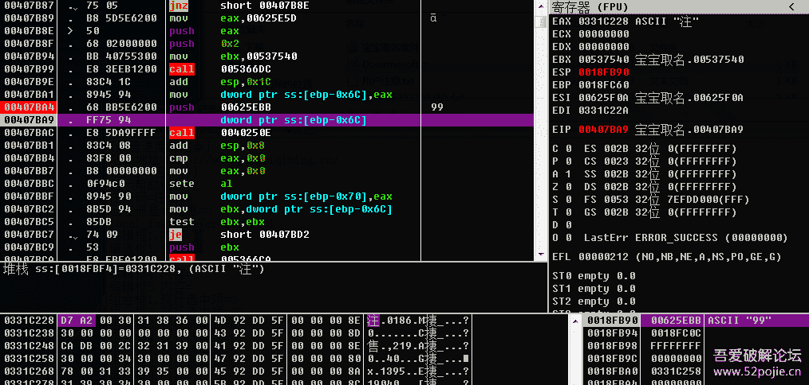
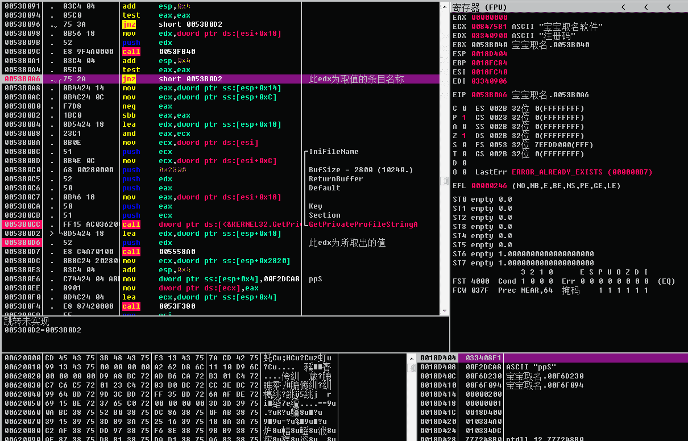
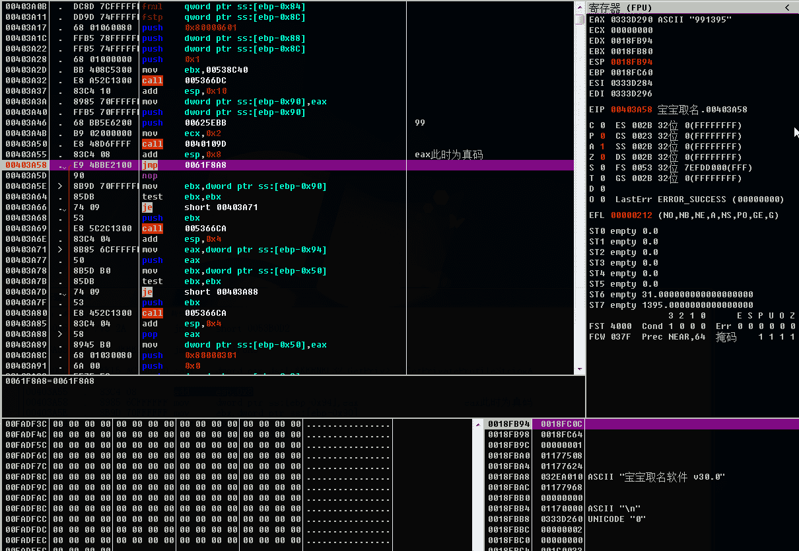
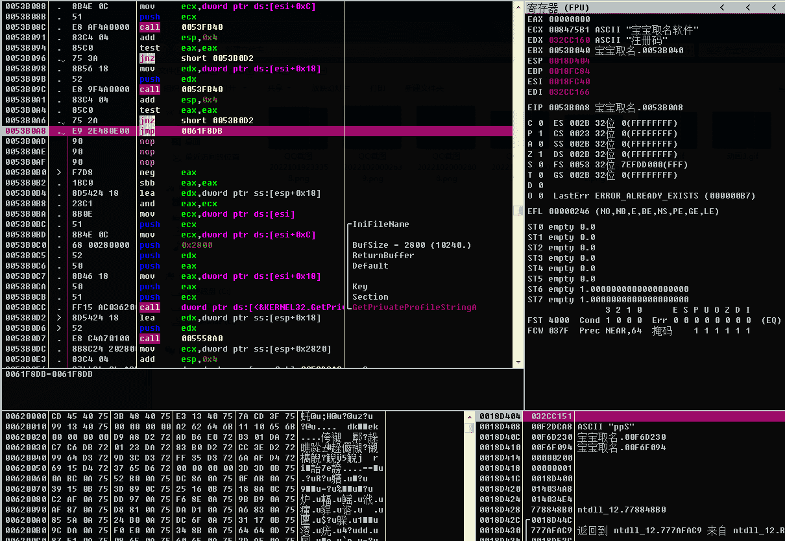
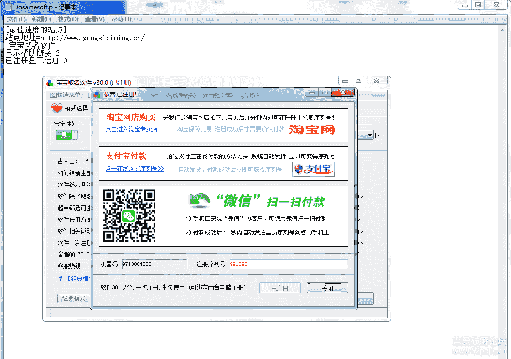

# [原创] 某宝宝起名软件之二：补码破解

- 原帖：https://www.52pojie.cn/forum.php?mod=viewthread&tid=1702646
- 抓取时间：2026-11-01T23:07:46

## 某宝宝起名软件 `v30` 之二

感谢大家的积极回复，很多人问版，没有人出？

因为就算发你，你也不一定用得了！

但是我还是要强调一下：

1. 请不要索要破解版，发帖的目的是大家讨论方法，因我的帖子能自制破解的，也请自用，不要传播。有条件请支持作者，支持正版。
2. 有幸能破解这个软件不是我有多厉害，而是因为我花了比别人更多的时间，更多的耐心，还有一丝丝的运气。
3. 补充一下字符串“99”来源：

   在单步跟的时候，发现软件会取：注册码=注册失败,请检查您的序列号，中的第一个“注”字与“99”进行比较，从这里找到注册码的。



QQ浏览器截图20221022220501.png（83.84 KB，下载次数：0）

[附件下载](https://www.52pojie.cn/forum.php?mod=attachment&aid=MjU2MjQwNXxhZjg2MDM1NXwxNzkzNTc0NDY0fDE2ODA4NnwxNzAyNjQ2&nothumb=yes)

2022-10-22 22:36 上传

通过先前的帖子[https://www.52pojie.cn/thread-1700593-1-1.html](https://www.52pojie.cn/thread-1700593-1-1.html)

有些人应该能顺利破解软件了，但因每台电脑生成的“注册码”都不一样（我实在是没有耐心去找注册码的验证了


），所以单只按贴子中修改软件，当时可用，换台电脑，就算用有“注册码”值的`Dosamesoft.p`，也会出现报错，或者功能没发用的情况。不可能每次都要用`OD`去找，而内存注册机在这并没有用，真码的内存是随时变动的。

本次要说的补码，就是解决这个“注册码”问题：

1. 首先软件运行会生成注册码真码。
2. 软件通过`GetPrivateProfileStringA`进`Dosamesoft.p`文件取值。



动画0.gif（249.01 KB，下载次数：0）

[附件下载](https://www.52pojie.cn/forum.php?mod=attachment&aid=MjU2MjQwMXxkY2UzMGI3NHwxNzkzNTc0NDY0fDE2ODA4NnwxNzAyNjQ2&nothumb=yes)

2022-10-22 22:35 上传

```asm
0053B0A6 jnz short 0053B0D2 ; 此时 edx 为取值的条目名称
0053B0D6 push edx           ; 此时 edx 为所取出的值
```

当要取出条目名称为“注册码”时，取出的值`push edx`（此时`edx`地址中的值就是“991395”）。

当`edx`在文件中条目名称为`NULL`时，软件验证就会奔溃（软件第一次运行时生成的`Dosamesoft.p`里面是没有注册码这个条目的）。

## 补码方法

1. 首先软件运行时会生成注册码真码，我们可以在软件生成真码的时候，找一块空白的内存（一般情况软件不会用到的区域），将真码写入到内存中。
2. 当软件用`GetPrivateProfileStringA`取值前，判断取值条目`edx`地址值是否为“注册码”，当为“注册码”时跳过`API`函数，直接把内存中的真码给`edx`，否则正常取值。

以下补码，只需要有一点汇编代码基础的就能看懂，尽量写得简单了。

当然还有其他的补码方法，大家讨论。

### 1. 写入内存



动画7.gif（279.71 KB，下载次数：0）

[附件下载](https://www.52pojie.cn/forum.php?mod=attachment&aid=MjU2MjQwNHxlYzU3MGI5MXwxNzkzNTc0NDY0fDE2ODA4NnwxNzAyNjQ2&nothumb=yes)

2022-10-22 22:35 上传

### 2. 判断`edx`取值条目，赋真码，否则跳出



动画4.gif（678.52 KB，下载次数：0）

[附件下载](https://www.52pojie.cn/forum.php?mod=attachment&aid=MjU2MjQwMnxkOWQ0OGMwOHwxNzkzNTc0NDY0fDE2ODA4NnwxNzAyNjQ2&nothumb=yes)

2022-10-22 22:35 上传

至此，不管`Dosamesoft.p`文件是否有注册码，软件都能正确获取“注册码”的值。



QQ浏览器截图20221022232412.png（126.83 KB，下载次数：0）

[附件下载](https://www.52pojie.cn/forum.php?mod=attachment&aid=MjU2MjQxNXwyZmRmMWM3MXwxNzkzNTc0NDY0fDE2ODA4NnwxNzAyNjQ2&nothumb=yes)

2022-10-22 23:25 上传

到此该软件彻底结束。

再强调一下，有需要的请支持软件作者。

如觉得有用请给个免费热心。


