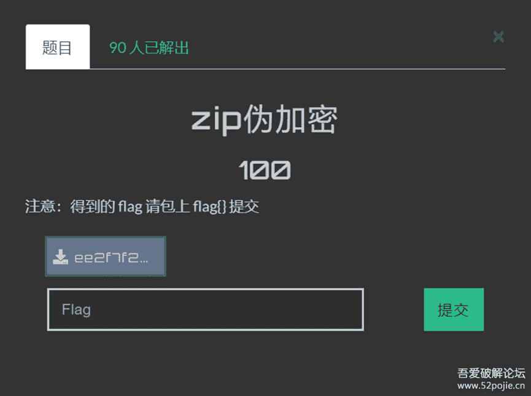
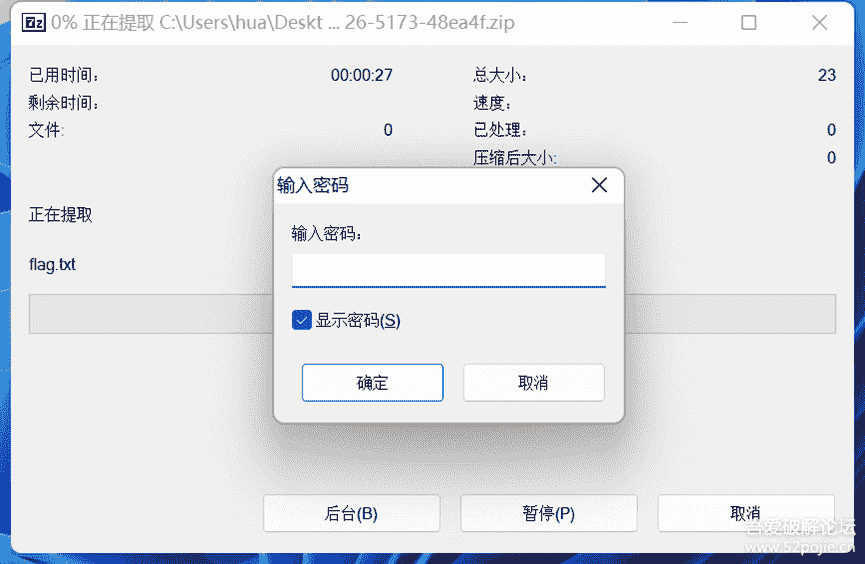
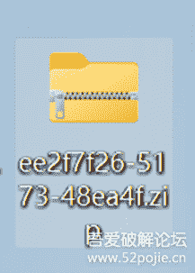
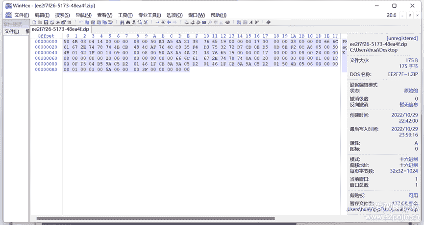
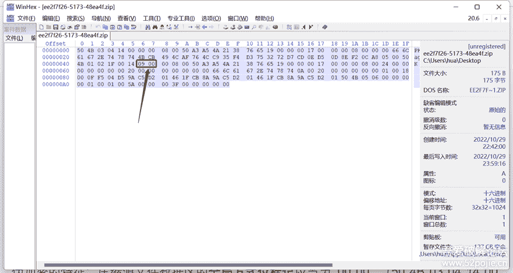
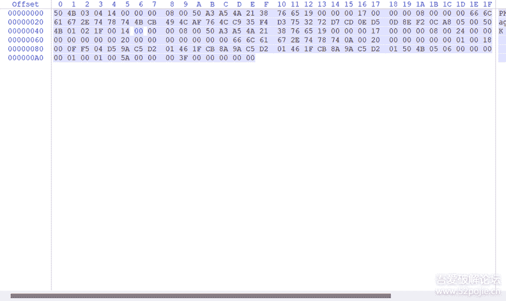
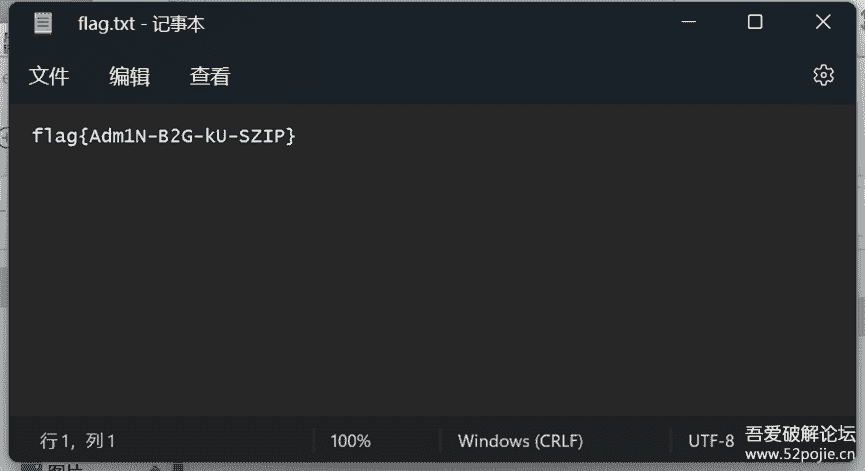

# [CTF] ZIP-伪加密

- 原帖：<https://www.52pojie.cn/forum.php?mod=viewthread&tid=1705633>
- 抓取时间：2026-11-01T23:07:37

## ZIP-伪加密

`image.png` (61.12 KB, 下载次数: 1)；[附件下载](https://www.52pojie.cn/forum.php?mod=attachment&aid=MjU2Mzg3M3w4MzZmODllMXwxNzkzNTc0NDU1fDE2ODA4NnwxNzA1NjMz&nothumb=yes)；2022-10-30 00:10 上传

下载后得到一个`ee2f7f26-5173-48ea4f.zip`，随后尝试解压。

`image.png` (117.63 KB, 下载次数: 1)；[附件下载](https://www.52pojie.cn/forum.php?mod=attachment&aid=MjU2Mzg3NHw3NmQ2MTJmNXwxNzkzNTc0NDU1fDE2ODA4NnwxNzA1NjMz&nothumb=yes)；2022-10-30 00:11 上传

提示输入密码。CTF 中压缩包加密解密一般有三种方法：

1. 暴力破解
2. ZIP 伪加密
3. 已知明文攻击

这里我们着重介绍 ZIP 伪加密（一个简简单单的加密方式，层次深得直接可以用 `Binwalk` 工具的 `binwalk-e` 命令无视伪加密直接打开，Macos 可以直接提取）。

在 ZIP 文件中，文件头和每个文件的核心目录区都有通用标记位。核心目录区的通用标记位距离核心目录区头 `504B0102` 的偏移为 8 字节，其本身占 2 字节，最低位表示这个文件是否被加密，将其改为奇数后，再次打开会提示输入密码。但此时文件的内容并没有真的被加密，所以被称为伪加密，只要将该标志位重新改回 `0` 或偶数后，即可正常打开。

这个地方我们可以用 `010` 或者 `Winhex` 工具，这里我们以 `winhex` 为例。

把

`image.png` (45.07 KB, 下载次数: 1)；[附件下载](https://www.52pojie.cn/forum.php?mod=attachment&aid=MjU2Mzg3NXxmODg5NTFhZnwxNzkzNTc0NDU1fDE2ODA4NnwxNzA1NjMz&nothumb=yes)；2022-10-30 00:12 上传

放进

`image.png` (29.29 KB, 下载次数: 1)；[附件下载](https://www.52pojie.cn/forum.php?mod=attachment&aid=MjU2Mzg3Nnw1NTU1M2FkNHwxNzkzNTc0NDU1fDE2ODA4NnwxNzA1NjMz&nothumb=yes)；2022-10-30 00:12 上传

打开可以看到他的十六进制数据。

`image.png` (178.16 KB, 下载次数: 1)；[附件下载](https://www.52pojie.cn/forum.php?mod=attachment&aid=MjU2Mzg3N3wzZGRkYTM2NXwxNzkzNTc0NDU1fDE2ODA4NnwxNzA1NjMz&nothumb=yes)；2022-10-30 00:13 上传

这里是本文的重点所在，用 `winhex` 判断 `zip` 文件是否为伪加密。

`image.png` (188.2 KB, 下载次数: 0)；[附件下载](https://www.52pojie.cn/forum.php?mod=attachment&aid=MjU2Mzg3OHw4M2JkYjlhY3wxNzkzNTc0NDU1fDE2ODA4NnwxNzA1NjMz&nothumb=yes)；2022-10-30 00:13 上传

## 伪加密的特征

压缩源文件数据区的全局方式位标记应当为 `0000`（`504B 03 04 14 00` 后），且压缩源文件目录区的全局方式位标记应当为 `0900`（`504B 01 02 14 00` 后）。

通过将压缩源文件目录区的 `09 00` 改为 `00 00` 就可以还原伪加密。

`image.png` (109.23 KB, 下载次数: 0)；[附件下载](https://www.52pojie.cn/forum.php?mod=attachment&aid=MjU2Mzg3OXxhNWI5Y2NjNnwxNzkzNTc0NDU1fDE2ODA4NnwxNzA1NjMz&nothumb=yes)；2022-10-30 00:14 上传

接着直接解压就可以直接得到压缩内容。

`image.png` (11.41 KB, 下载次数: 2)；[附件下载](https://www.52pojie.cn/forum.php?mod=attachment&aid=MjU2Mzg4MHw0YmNmNGNjNHwxNzkzNTc0NDU1fDE2ODA4NnwxNzA1NjMz&nothumb=yes)；2022-10-30 00:14 上传

`image.png` (57.3 KB, 下载次数: 2)；[附件下载](https://www.52pojie.cn/forum.php?mod=attachment&aid=MjU2Mzg4MXw3NDEzYTRhZHwxNzkzNTc0NDU1fDE2ODA4NnwxNzA1NjMz&nothumb=yes)；2022-10-30 00:14 上传

打开就看到了。下面补充一下伪加密的知识。

## 伪加密知识补充

### 1. 压缩源文件数据区

- `50 4B 03 04`：这是头文件标记
- `14 00`：解压文件所需 pkware 版本
- `00 00`：全局方式位标记（判断有无加密）
- `08 00`：压缩方式
- `50 A3`：最后修改文件时间
- `A5 4A`：最后修改文件日期

### 2. 压缩源文件目录区

- `50 4B 01 02`：目录中文件文件头标记
- `1F 00`：压缩使用的 pkware 版本
- `14 00`：解压文件所需 pkware 版本
- `00 00`：全局方式位标记（判断是否为伪加密）
- `08 00`：压缩方式
- `50A3`：最后修改文件时间
- `A54A`：最后修改文件日期

### 3. 压缩源文件目录结束标志

- `50 4B 05 06`：目录结束标记
- `00 00`：当前磁盘编号
- `00 00`：目录区开始磁盘编号
- `01 00`：本磁盘上纪录总数
- `01 00`：目录区中纪录总数
- `5A 00 00 00`：目录区尺寸大小
- `3F 00 00 00`：目录区对第一张磁盘的偏移量
- `00 00`：ZIP 文件注释长度
