# [原创] 003-Cruehead-CrackMe-3（Crack练习）

- 原帖：[https://www.52pojie.cn/forum.php?mod=viewthread&tid=1709490](https://www.52pojie.cn/forum.php?mod=viewthread&tid=1709490)
- 抓取时间：2026-11-01T23:07:19

## 分析过程

打开`Cruehead-CrackMe-3.exe`可执行文件。


[附件下载](https://www.52pojie.cn/forum.php?mod=attachment&aid=MjU2NjEzM3xlMmUzMWIxY3wxNzkzNTc0NDM2fDE2ODA4NnwxNzA5NDkw)

(2.69 KB, 下载次数: 14)

2022-11-8 12:11 上传

点击文件名下载附件

下载积分: 吾爱币 -1 CB

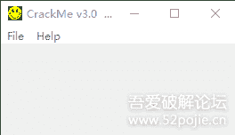

`1.png` (8.75 KB, 下载次数: 4)

[附件下载](https://www.52pojie.cn/forum.php?mod=attachment&aid=MjU2NjExMXwzOTEwMWYwOXwxNzkzNTc0NDM2fDE2ODA4NnwxNzA5NDkw&nothumb=yes)

2022-11-8 11:56 上传

发现什么内容也没有显示，查一下壳，无壳。

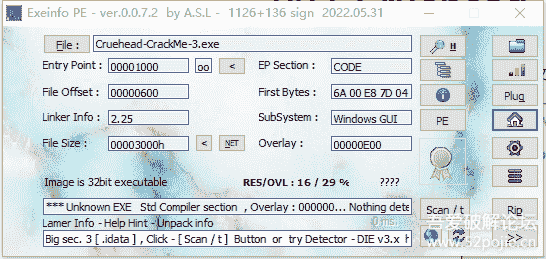

`2.png` (104.97 KB, 下载次数: 2)

[附件下载](https://www.52pojie.cn/forum.php?mod=attachment&aid=MjU2NjExMnwxOWE3ZDk5ZXwxNzkzNTc0NDM2fDE2ODA4NnwxNzA5NDkw&nothumb=yes)

2022-11-8 11:57 上传

打开文件发现右侧注释调用与操作文件相关的函数，推测与文件有关（[相关链接](https://www.52pojie.cn/thread-350397-1-1.html)）。

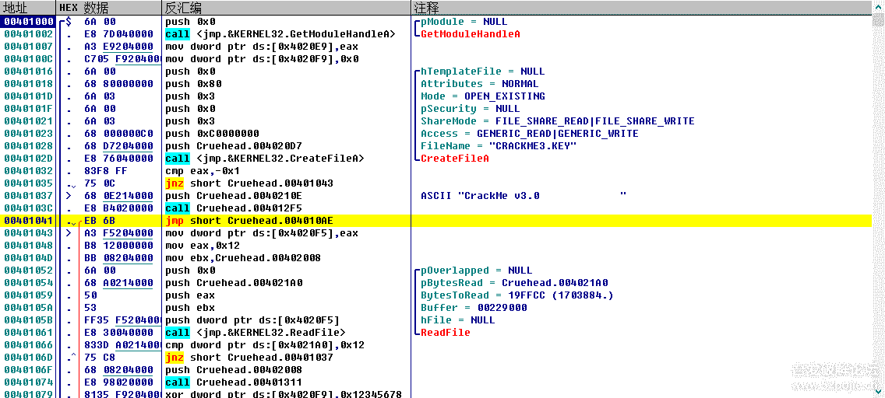

`3.png` (34.64 KB, 下载次数: 4)

[附件下载](https://www.52pojie.cn/forum.php?mod=attachment&aid=MjU2NjExM3w3Mzg5MTcwYnwxNzkzNTc0NDM2fDE2ODA4NnwxNzA5NDkw&nothumb=yes)

2022-11-8 11:57 上传

在入口处打个断点运行程序，通过观察可以看到调用函数`CreateFileA`，栈帧里也出现`CRACKME3.KEY`这个文件名。函数结束后做比对，此时`eax`的值为0，没满足跳转条件再接着运行就直接结束程序了。所以推测`eax`的值与`CRACKME3.KEY`的存在有关。

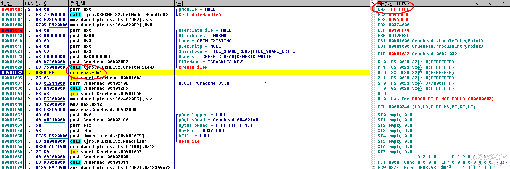

`4.png` (48.98 KB, 下载次数: 5)

[附件下载](https://www.52pojie.cn/forum.php?mod=attachment&aid=MjU2NjExNHxmOGZjMDNiOHwxNzkzNTc0NDM2fDE2ODA4NnwxNzA5NDkw&nothumb=yes)

2022-11-8 11:57 上传

在相同目录下创建`CRACKME3.KEY`文件，随便输入几个数`1234`，重复上一次调试，发现满足跳转条件，继续调试观察后面程序。

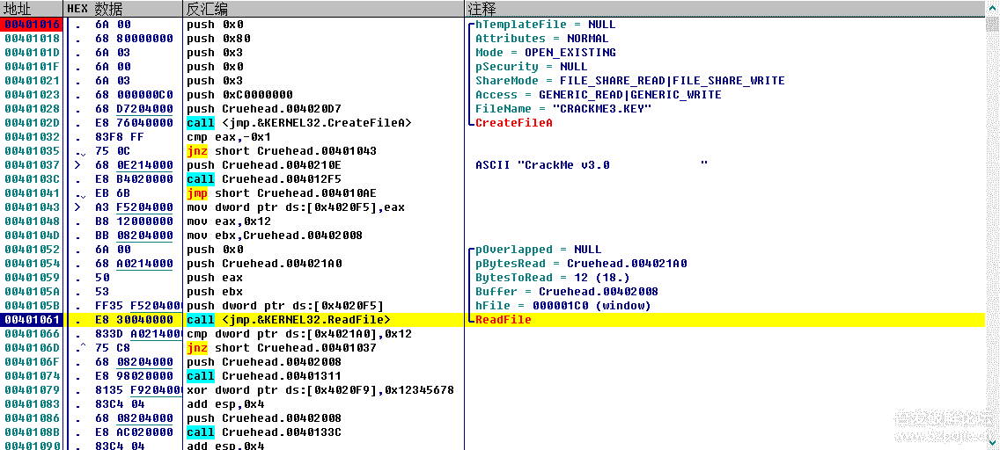

`5.png` (34.15 KB, 下载次数: 5)

[附件下载](https://www.52pojie.cn/forum.php?mod=attachment&aid=MjU2NjExNXwxOTdjZWZkYXwxNzkzNTc0NDM2fDE2ODA4NnwxNzA5NDkw&nothumb=yes)

2022-11-8 11:57 上传

发现函数调用后出现了比对，比对错误就会直接跳转到上面的`jmp`然后跳转到程序结束，那么就失败了（[相关链接](https://www.52pojie.cn)）。所以我查看一下比对内容，发现`0x4021A0`与`0x12`比对，且`0x4021A0`对应上一条函数中的`pBytesRead`，推测`pBytesRead`是文件字节数，等于18。在`CRACKME3.KEY`中输入18个字节再重新调试。

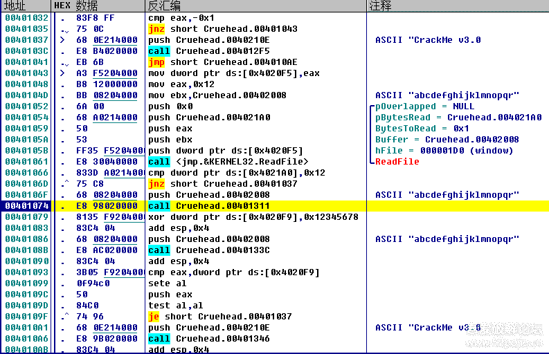

`6.png` (31.64 KB, 下载次数: 4)

[附件下载](https://www.52pojie.cn/forum.php?mod=attachment&aid=MjU2NjEyMHw2MzllZDcyZnwxNzkzNTc0NDM2fDE2ODA4NnwxNzA5NDkw&nothumb=yes)

2022-11-8 11:57 上传

成功跳过`jnz`，调试到下一条函数，按`F7`进入函数内。

观察代码前两行将`ecx`和`eax`归零，然后将地址`00402008`赋值给`esi`，给`bl`赋值`0x41`。

然后便进入`do..while..`循环。

先将地址`esi`赋值给`al`，然后`al`与`bl`进行异或运算后重新赋值`al`，再将`al`的值赋值到`esi`中。

`esi`加一，`bl`加一，`eax`的值（此时`eax`的值为`al`）加到`0x4020F9`。

将`al`与0做对比，如果相等就结束函数，反之继续。

`cl`加一，`bl`与`0x4F`作比较，如果不为0就继续循环。

结束循环后，将`ecx`的值赋值给`0x402149`。

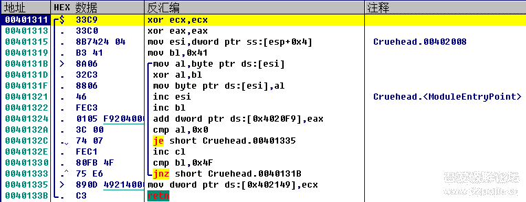

`7.png` (17.87 KB, 下载次数: 4)

[附件下载](https://www.52pojie.cn/forum.php?mod=attachment&aid=MjU2NjEyMXw0M2UyMjk2MXwxNzkzNTc0NDM2fDE2ODA4NnwxNzA5NDkw&nothumb=yes)

2022-11-8 11:57 上传

**总的来说这个函数的作用是：将文件中前14个字符分别与`ABCDEFGHIJKLMN`进行异或运算，每次异或运算后的结果进行累加作检验和。**

循环结束后退出函数，继续调试，下一条指令将`0x4020F9`与`0x12345678`做异或运算，也就是将检验和与`0x12345678`做异或运算。

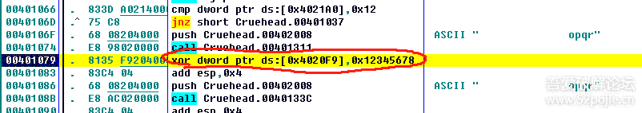

`8.png` (14.52 KB, 下载次数: 4)

[附件下载](https://www.52pojie.cn/forum.php?mod=attachment&aid=MjU2NjEyMnw3YjlkN2VlMnwxNzkzNTc0NDM2fDE2ODA4NnwxNzA5NDkw&nothumb=yes)

2022-11-8 11:57 上传

接着运行到下个函数，按`F8`进入函数，将`esp+0x4`赋值给`esi`，然后`esi`加`0xE`，然后赋值给`eax`。此时`eax`的值为文件18个字节中末尾的4个字节。


`9.png` (8.68 KB, 下载次数: 5)

[附件下载](https://www.52pojie.cn/forum.php?mod=attachment&aid=MjU2NjExNnxhNTliZTMyMnwxNzkzNTc0NDM2fDE2ODA4NnwxNzA5NDkw&nothumb=yes)

2022-11-8 11:57 上传

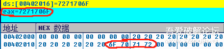

`10.png` (10.56 KB, 下载次数: 3)

[附件下载](https://www.52pojie.cn/forum.php?mod=attachment&aid=MjU2NjExN3wwNTM4MDAzZnwxNzkzNTc0NDM2fDE2ODA4NnwxNzA5NDkw&nothumb=yes)

2022-11-8 11:57 上传

跳出函数后紧接着就进行了比对，`0x4020F9`与`eax`做比对。`0x4020F9`是异或后的检验和，与`eax`中文件末尾4个字节做对比。此时我已经可以分析出程序的算法了。

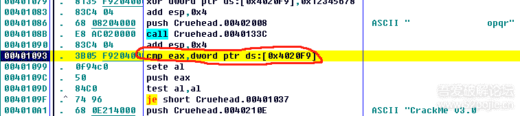

`11.png` (14.61 KB, 下载次数: 4)

[附件下载](https://www.52pojie.cn/forum.php?mod=attachment&aid=MjU2NjExOHw0NGVhMjEzZHwxNzkzNTc0NDM2fDE2ODA4NnwxNzA5NDkw&nothumb=yes)

2022-11-8 11:57 上传

## 算法过程

将文件中前14个字符分别与`ABCDEFGHIJKLMN`进行异或运算，每次异或运算后的结果进行累加作检验和。然后将检验和与`0x12345678`进行异或，最后将检验和异或后的结果与末尾4个字符进行对比，对比正确就成功破解了。

## 验证与实现

现在我们来实现一下，在内存窗口找到`0x4020F9`的位置，数据是`B8 57 34 12`。

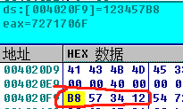

`12.png` (3.53 KB, 下载次数: 2)

[附件下载](https://www.52pojie.cn/forum.php?mod=attachment&aid=MjU2NjExOXwyZjVhZTYwNXwxNzkzNTc0NDM2fDE2ODA4NnwxNzA5NDkw&nothumb=yes)

2022-11-8 11:57 上传

用UE打开本地`CRACKME3.KEY`文件，使用16进制编辑修改后4个字节的值，然后保存。

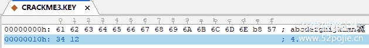

`13.png` (14.03 KB, 下载次数: 5)

[附件下载](https://www.52pojie.cn/forum.php?mod=attachment&aid=MjU2NjEyM3wxODllN2UyN3wxNzkzNTc0NDM2fDE2ODA4NnwxNzA5NDkw&nothumb=yes)

2022-11-8 11:57 上传

保存后运行程序弹出成功窗口！

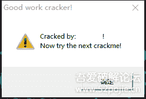

`14.png` (14.17 KB, 下载次数: 4)

[附件下载](https://www.52pojie.cn/forum.php?mod=attachment&aid=MjU2NjEyOHw1YTc2YWU2M3wxNzkzNTc0NDM2fDE2ODA4NnwxNzA5NDkw&nothumb=yes)

2022-11-8 12:07 上传

用C语言对算法进行一个简单实现，代码如下：

```c
```


```c
#include
#include

void crack_003(const char* in_pwd);

int main() {
    const char* inpwd = "howietung@163.com!";
    crack_003(inpwd);
    return 0;
}

void crack_003(const char* in_pwd) {
    char pwd[0x12] = { 0 };
    char bl = 'A';
    unsigned int sum = 0; /* 检验和 */

    memcpy(pwd, in_pwd, 0x12);

    int i;
    i = 0;

    do {
        pwd[i] ^= bl;
        sum += pwd[i];
        bl++;
        i++;

        if (!pwd[i]) {
            break;
        }
    } while (bl != 'O');

    sum ^= 0x12345678;

    *(unsigned int*)&pwd[0xE] = sum;

    unsigned char* tmp = (unsigned char*)&pwd;

    memcpy(tmp, in_pwd, 14);

    for (int k = 0; k
```

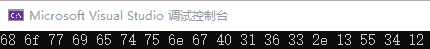

15.png（2.88 KB，下载次数：4）

[href="forum.php?mod=attachment&aid=MjU2NjEyOXw4MTBlN2NiZnwxNzkzNTc0NDM2fDE2ODA4NnwxNzA5NDkw&nothumb=yes" target="_blank"](https://www.52pojie.cn/forum.php?mod=attachment&aid=MjU2NjEyOXw4MTBlN2NiZnwxNzkzNTc0NDM2fDE2ODA4NnwxNzA5NDkw&nothumb=yes)

2022-11-8 12:09 上传

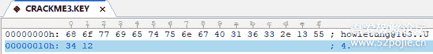

16.png（13.59 KB，下载次数：4）

[href="forum.php?mod=attachment&aid=MjU2NjEzMHxiYmUxOGNmM3wxNzkzNTc0NDM2fDE2ODA4NnwxNzA5NDkw&nothumb=yes" target="_blank"](https://www.52pojie.cn/forum.php?mod=attachment&aid=MjU2NjEzMHxiYmUxOGNmM3wxNzkzNTc0NDM2fDE2ODA4NnwxNzA5NDkw&nothumb=yes)

2022-11-8 12:09 上传

可以正常破解，就是编码有些问题。

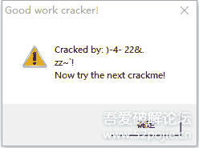

17.png（12.02 KB，下载次数：4）

[href="forum.php?mod=attachment&aid=MjU2NjEzMXxhYzE3ZjMzM3wxNzkzNTc0NDM2fDE2ODA4NnwxNzA5NDkw&nothumb=yes" target="_blank"](https://www.52pojie.cn/forum.php?mod=attachment&aid=MjU2NjEzMXxhYzE3ZjMzM3wxNzkzNTc0NDM2fDE2ODA4NnwxNzA5NDkw&nothumb=yes)

2022-11-8 12:09 上传
