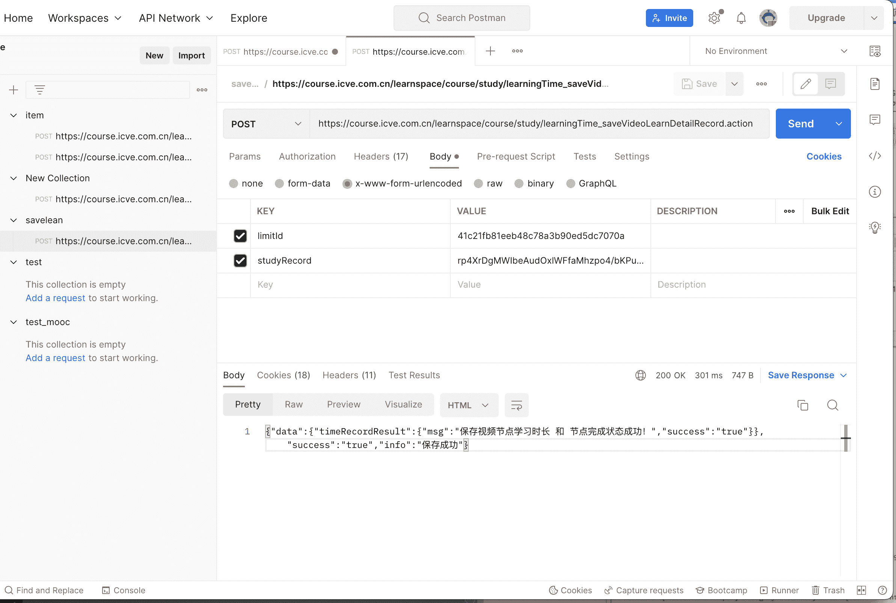
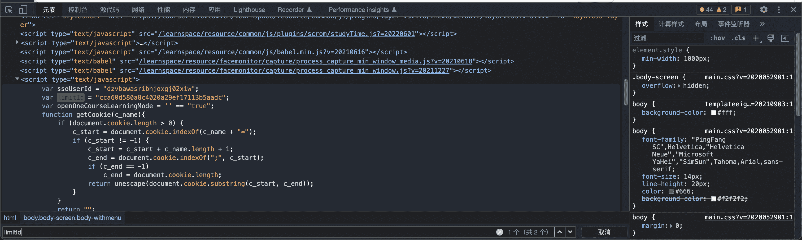
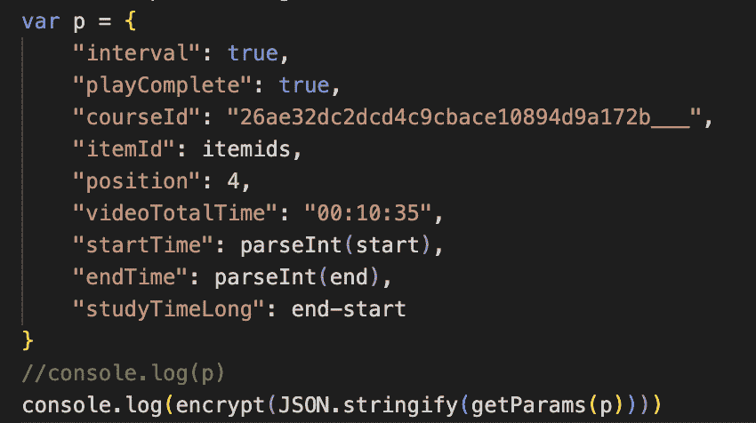
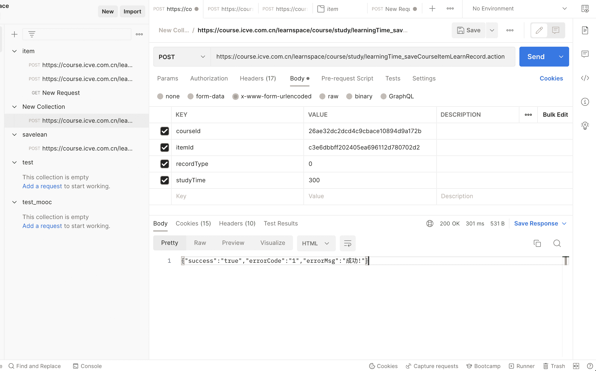
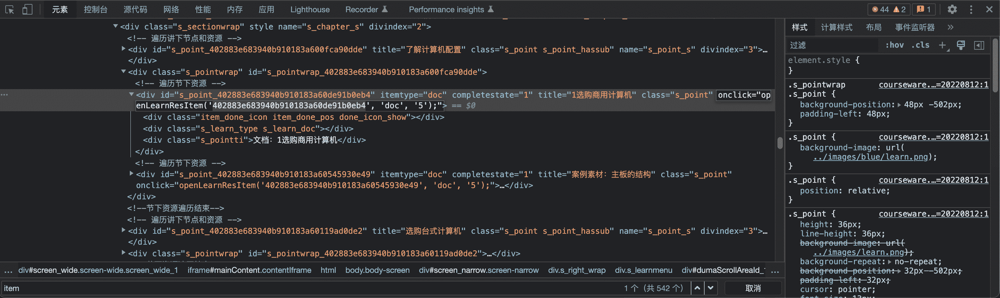
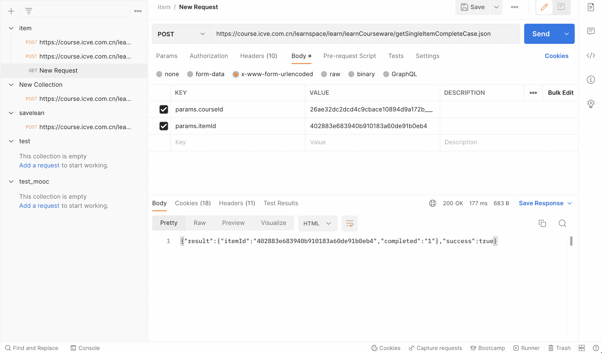
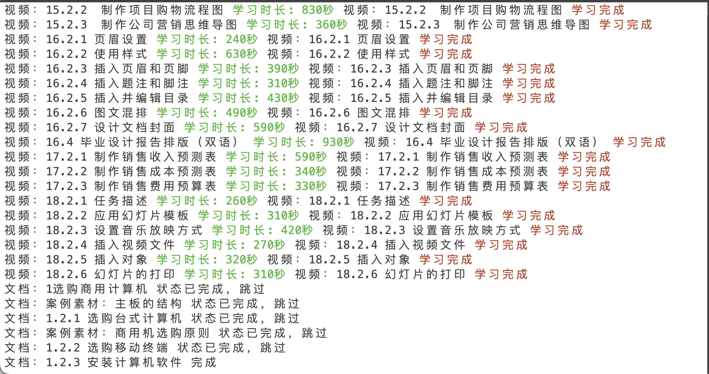
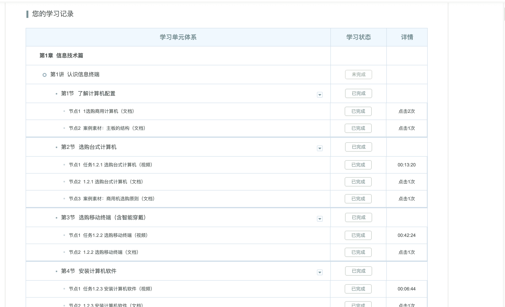

# [Web逆向] 智慧职教Mooc(icve-mooc)API分析

- 原帖: https://www.52pojie.cn/forum.php?mod=viewthread&tid=1710666
- 抓取时间: 2026-11-01T23:07:10

## 适用 `https://icve-mooc.icve.com.cn/cms/`

### 主要刷课API

URL：`https://course.icve.com.cn/learnspace/course/study/learningTime_saveVideoLearnDetailRecord.action`

请求方式：Post

参数：

`limitId`: 包含在网页的`javascript`中，每次刷新页面`limitId`也会刷新，可重复用

`studyRecord`： 通过`crypto-js` AES加密的一串数据，包含课程ID，视频ID，以及学习时长，学习起始秒数和学习结束的秒数。

返回结果：”保存状态成功“或者“参数不合法，超出时长”，学习时长越长，需要等待一定时间才能第再次保存学习状态。学习时长短不需要等待。



### 获取`limitId`

URL:`https://course.icve.com.cn/learnspace/learn/learn/templateeight/index.action?params.courseId=26ae32dc2dcd4c9cbace10894d9a172b___&params.templateType=8&params.templateStyleType=0&params.template=templateeight&params.classId=&params.tplRoot=learn`

请求方式： Get

参数：url里面可以看到，主要包含一个`courseId`，其他的似乎默认就行,可以去浏览器里找到对应的url

返回结果：内容是html网页，直接通过正则搜索找到`limitId`



### `studyRecord` AES加密的学习状态参数



官方加密功能函数和格式化函数的`js`文件URL: `https://course.icve.com.cn/learnspace/resource/common/js/CommonUtil.js?v=2022042401`。

`studyRecord`参数就是将数据格式化后序列化再进行AES加密得到的字符串

主要的参数就只有`courseId`,`itemId`,`stratTime`,`endTime`：

`courseId`: 代表当前学习课程的16进制id

`itemId`: 对应课程中的每个视频或者文档也有一个16进制id

`startTime`: 对应视频时长进度

`endTime`: 对应视频的时长，表示当前视频从`startTime`秒学习到了`endTime`的秒数

### 文档内容完成学习API

url:`https://course.icve.com.cn/learnspace/course/study/learningTime_saveCourseItemLearnRecord.action`

参数：课程id，视频id，其他的参数固定即可



### 获取`itemId`

url:`https://course.icve.com.cn/learnspace/learn/learn/templateeight/courseware_index.action?params.courseId=26ae32dc2dcd4c9cbace10894d9a172b___`

返回的html中包含`itmeId`，可以通过`BeautifulSoup`搜索`id=s_point_.*` 获得对对应的标签



### 判断内容是否已经完成

url:`https://course.icve.com.cn/learnspace/learn/learnCourseware/getSingleItemCompleteCase.json`

返回json,`completed`等于1表示学习完成，2表示部分学习，0表示内容没有学习过。



### 效果图





### 完整py+nodejs代码

py需要安装库: `requests` `bs4`

nodejs需要安装库: `crypto-js`

自行替换python代码中的Cookie，`test.js`主要是做参数加密，运行python文件即可

```python
import requests
from bs4 import BeautifulSoup
import re
import os
import json
import sys

header = {
'User-Agent':'Mozilla/5.0 (Macintosh; Intel Mac OS X 10_15_7) AppleWebKit/537.36 (KHTML, like Gecko) Chrome/106.0.0.0 Safari/537.36',
'Accept':"text/html,application/xhtml+xml,application/xml;q=0.9,image/avif,image/webp,image/apng,*/*;q=0.8,application/signed-exchange;v=b3;q=0.9",
'Accept-Encodign':'gzip, deflate, br',
'Cookie':''
}
header['Cookie'] = ''

#获得limitId
res = requests.get(url='https://course.icve.com.cn/learnspace/learn/learn/templateeight/index.action?params.courseId=26ae32dc2dcd4c9cbace10894d9a172b___&params.templateType=8&params.templateStyleType=0&params.template=templateeight&params.classId=&params.tplRoot=learn',headers=header)
patter=re.compile('limitId.*;')
try:
    limitId=patter.search(res.content.decode()).group().split('"')[1]
except:
    print('\033[31m获取limitId失败，检查Cookie\033[0m')
    exit()

#获得itemId
res = requests.get('https://course.icve.com.cn/learnspace/learn/learn/templateeight/courseware_index.action?params.courseId=26ae32dc2dcd4c9cbace10894d9a172b___',headers=header)
soup = BeautifulSoup(res.content,'lxml')
divs = soup.find_all(id=re.compile("s_point_.*"),itemtype="video")
itemids = {}
for i in divs:
    itemids[i.find(class_="s_pointti").text]=i['id'].strip("s_point_")

#开始刷课
for key in itemids.keys():
    itemid=itemids[key]
    data2={
        'itemId':itemid,
        'videoTotalTime':'00:10:00'
    }
    total = requests.post(url='https://course.icve.com.cn/learnspace/course/plugins/cloud_updateVideoTotalTime.action',headers=header,data=data2)

    #判断视频是否学习完成
    data2={
        'params.courseId':'26ae32dc2dcd4c9cbace10894d9a172b___',
        'params.itemId':itemid
    }
    complete = requests.post(url='https://course.icve.com.cn/learnspace/learn/learnCourseware/getSingleItemCompleteCase.json',headers=header,data=data2)
    if json.loads(complete.content.decode())['result']['completed'] == '1':
        print(key,'视频状态已完成，跳过')
        continue

    start=0
    end=0
    #轮询片段
    while True:
        start=end
        end=start+10
        #单个视频片段状态保存循环
        while True:
            cmd = os.popen('node ./test.js %s %s %s' % (itemid,start,end))
            studyrecord=cmd.read().strip('\n')
            cmd.close()
            data={
                'limitId':limitId,
                'studyRecord':studyrecord
            }
            res2 = requests.post(url='https://course.icve.com.cn/learnspace/course/study/learningTime_saveVideoLearnDetailRecord.action',headers=header,data=data)
            if '保存成功' in res2.content.decode() or '总时长' in res2.content.decode():
                print("\r", end="")
                print(key,"\033[32m学习时长: {}秒 \033[0m".format(end), end="")
                sys.stdout.flush()
                break
            else:
                pass

        if '总时长' in res2.content.decode():
            break
    print(key,'\033[31m学习完成\033[0m')

#刷文档内容

#取出itemid
divs = soup.find_all(id=re.compile("s_point_.*"),itemtype="doc")
itemids = {}
for i in divs:
    itemids[i.find(class_="s_pointti").text]=i['id'].strip("s_point_")

#轮询item
for key in itemids.keys():
    itemid=itemids[key]

    #判断文档是否学习完成
    data2={
        'params.courseId':'26ae32dc2dcd4c9cbace10894d9a172b___',
        'params.itemId':itemid
    }
    complete = requests.post(url='https://course.icve.com.cn/learnspace/learn/learnCourseware/getSingleItemCompleteCase.json',headers=header,data=data2)
    if json.loads(complete.content.decode())['result']['completed'] == '1':
        print(key,'状态已完成，跳过')
        continue

    #保存文档
    doc_data={
        'courseId':'26ae32dc2dcd4c9cbace10894d9a172b',
        'itemId':itemid,
        'recordType':0,
        'studyTime':300
    }
    response = requests.post(url='https://course.icve.com.cn/learnspace/course/study/learningTime_saveCourseItemLearnRecord.action',headers=header,data=doc_data)
    if '成功' in response.content.decode():
        print(key,'完成')
    else:
        print(key,'保存失败')
        set_trace()
```

`test.js`:

```


# 示例代码

```javascript
const CryptoJS = require("crypto-js");

const encrypt = function (e) {

    var f = CryptoJS.enc.Utf8.parse("learnspaceaes123");

    var d = CryptoJS.AES.encrypt(e, f, {

        mode: CryptoJS.mode.ECB,

        padding: CryptoJS.pad.Pkcs7

    });

    return d.toString()

};

const decrypt = function (e) {

    var cipherParams = CryptoJS.lib.CipherParams.create({

        ciphertext: CryptoJS.enc.Base64.parse(e)

   });

    var f = CryptoJS.enc.Utf8.parse("learnspaceaes123");

    var res = CryptoJS.AES.decrypt(cipherParams,f,{

        mode: CryptoJS.mode.ECB,

        padding: CryptoJS.pad.Pkcs7

    });

    return res.toString(CryptoJS.enc.Utf8);

}

const timeToSeconds = function (f) {

    var b = f.split(":");

    var d = parseInt(b[0]);

    var a = parseInt(b[1]);

    var c = parseInt(b[2]);

    var e = d * 3600 + a * 60 + c;

    return e

};

const formatStr = function (c, a) {

    var l = "";

    var k = (c + "").length;

    if (k > 0) {

        if (k + 2 > a) {

            return c + ""

        } else {

            var g = a - k - 2;

            var h = 1;

            for (var e = 0; e = 10) {

                l += k

            } else {

                l += "0" + k

            } l += c + (b + "")

        }

    } else {

        return c + ""

    }

    return l

};

const getParams=function (p) {

    var q = {

        courseId: p.courseId,

        itemId: p.itemId,

        time1: formatStr(

            (new Date()).getTime(),

            20

        ),

        time2: formatStr(parseInt(p.startTime), 20),

        time3: formatStr(timeToSeconds(p.videoTotalTime), 20),

        time4: formatStr(parseInt(p.endTime), 20),

        videoIndex: p.videoIndex || 0,

        time5: formatStr(p.studyTimeLong, 20),

        terminalType: p.terminalType || 0

    };

    return q

}

var itemids = process.argv[2];

var start = process.argv[3]

var end = process.argv[4]

var p = {

    "interval": true,

    "playComplete": true,

    "courseId": "26ae32dc2dcd4c9cbace10894d9a172b___",

    "itemId": itemids,

    "position": 4,

    "videoTotalTime": "00:10:35",

    "startTime": parseInt(start),

    "endTime": parseInt(end),

    "studyTimeLong": end-start

}

//console.log(p)

console.log(encrypt(JSON.stringify(getParams(p))))
```
