# [Web逆向] [新人试投]某云音乐前端播放器逆向

- 原帖: https://www.52pojie.cn/forum.php?mod=viewthread&tid=1713067
- 抓取时间: 2026-11-01T23:05:40

## 0x00 前言

声明：仅作技术交流，请勿恶意利用

逆向背景：现在我有某第三方音乐接口，需要制作用户脚本，利用此接口将音乐资源注入到某云音乐的前端播放器逻辑中，实现直接播放VIP歌曲的效果

目标网址：`https://music.163.com/#/song?id=\d+`

以一首VIP歌曲为例：`https://music.163.com/#/song?id=18794244`

对照组：一首可以直接播放的普通单曲：`https://music.163.com/#/song?id=1470919891`

逆向目标：播放按钮点击直接播放

环境/工具：Chrome，Tampermonkey

目标页面截图：

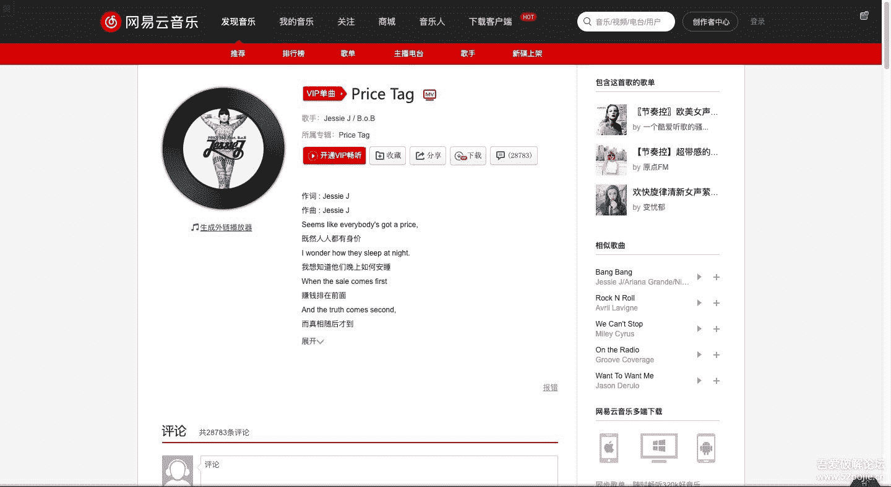

[截屏2022-11-15 下午1.23.30.jpg (110.91 KB, 下载次数: 2)](https://www.52pojie.cn/forum.php?mod=attachment&aid=MjU2ODkzMnw5YWExMTE4MnwxNzkzNTc0MzM3fDE2ODA4NnwxNzEzMDY3&nothumb=yes) · 2022-11-15 13:23 上传

对照页面截图：

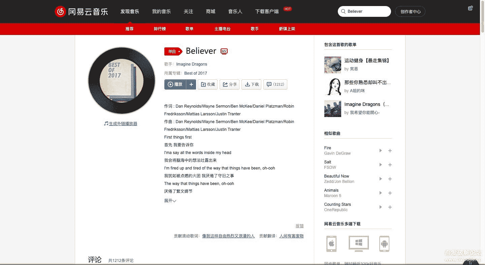

[截屏2022-11-15 下午1.24.16.jpg (114.67 KB, 下载次数: 1)](https://www.52pojie.cn/forum.php?mod=attachment&aid=MjU2ODkzM3w2ZjgyNjlhMXwxNzkzNTc0MzM3fDE2ODA4NnwxNzEzMDY3&nothumb=yes) · 2022-11-15 13:24 上传

PS：题外话，这是我第一次写文，各个方面把握不当，还请大家指导。如有错误之处，还请大家指出。

## 0x01 初探

### 0x010 第一次尝试：从事件监听器入手

首先想到的第一个思路是从页面本身的事件监听器入手，看一看点击播放以后的代码逻辑是什么

控制台定位到播放按钮，查看事件监听器，发现按钮上没有事件监听器；又发现播放和收藏等按钮都直接有Attribute写明`res-id`等等信息，怀疑是把事件监听器放在了某级祖先元素上；向上定位到这个事件监听器，就在父元素`#content-operation`上。

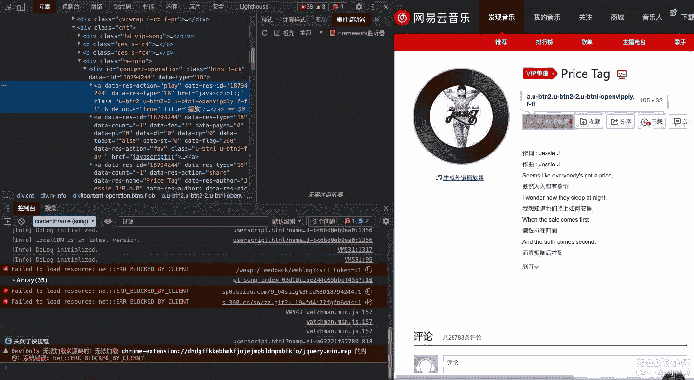

[截屏2022-11-15 下午1.25.57.jpg (207.72 KB, 下载次数: 0)](https://www.52pojie.cn/forum.php?mod=attachment&aid=MjU2ODkzN3w4MGM2YTI1NnwxNzkzNTc0MzM3fDE2ODA4NnwxNzEzMDY3&nothumb=yes) · 2022-11-15 13:25 上传

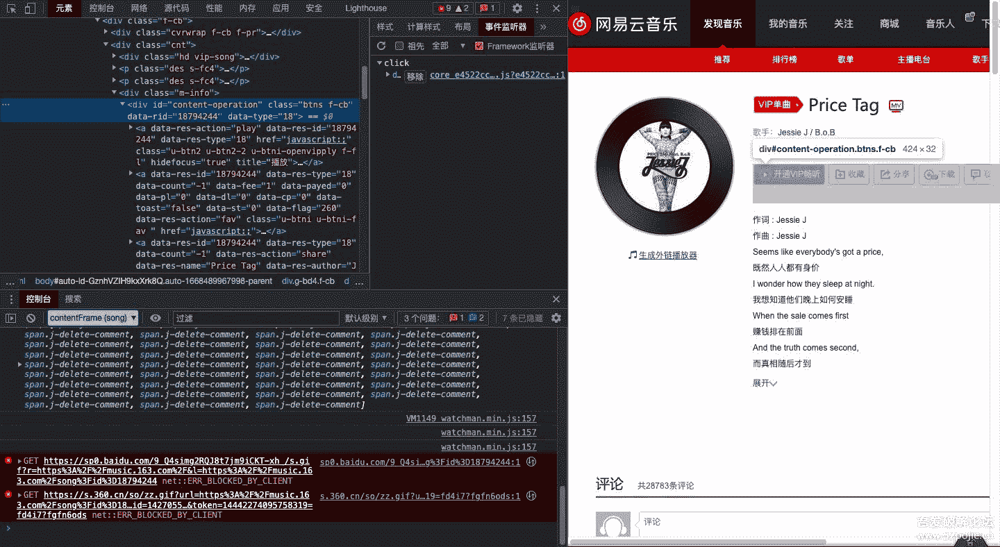

[截屏2022-11-15 下午1.26.22.jpg (223.16 KB, 下载次数: 0)](https://www.52pojie.cn/forum.php?mod=attachment&aid=MjU2ODkzOHxlMjNkOWRmNnwxNzkzNTc0MzM3fDE2ODA4NnwxNzEzMDY3&nothumb=yes) · 2022-11-15 13:26 上传

定位到相关源代码，格式化后下断点，点击播放

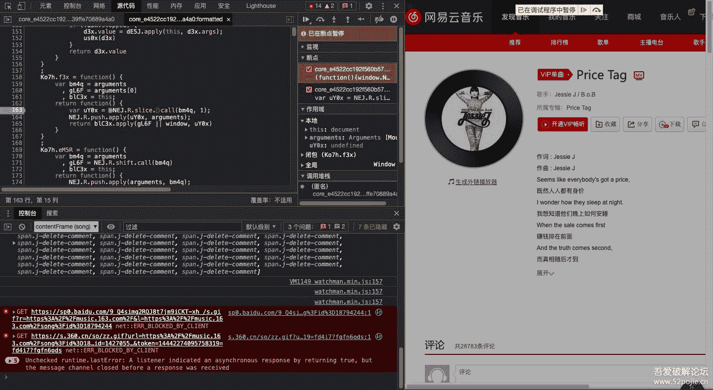

[截屏2022-11-15 下午1.26.58.jpg (213.58 KB, 下载次数: 1)](https://www.52pojie.cn/forum.php?mod=attachment&aid=MjU2ODkzOXw0NGM0OWMwNHwxNzkzNTc0MzM3fDE2ODA4NnwxNzEzMDY3&nothumb=yes) · 2022-11-15 13:26 上传

很好，断下来了，跟进

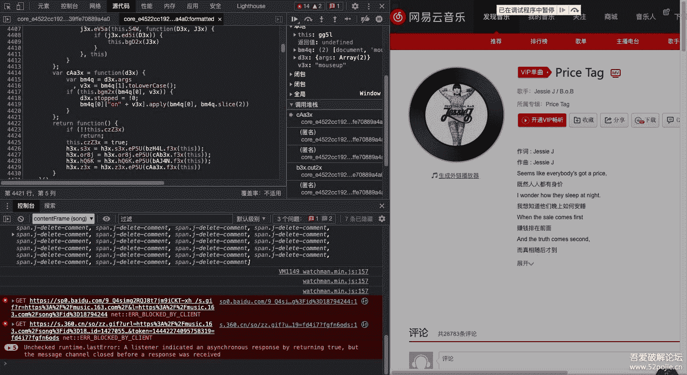

[截屏2022-11-15 下午1.28.05.jpg (218.95 KB, 下载次数: 2)](https://www.52pojie.cn/forum.php?mod=attachment&aid=MjU2ODk0MHxlYTdhNTI1OXwxNzkzNTc0MzM3fDE2ODA4NnwxNzEzMDY3&nothumb=yes) · 2022-11-15 13:28 上传

很可惜的是，跟踪了好几个堆栈，一直是这样的前端事件分发相关的代码，没有看到有关播放的逻辑部分。当然，一直跟踪下去肯定是能看到有关播放的代码的，但是可以预见到相当的麻烦，是时候换个思路了。

### 0x011 第二次尝试：从网络请求入手

#### 0x0110 歌曲信息

从网络请求入手，看一看前端是怎么从服务器获取歌曲信息的，又是如何播放的

打开控制台-网络，点击播放按钮，可惜没有看到有关歌曲信息的请求

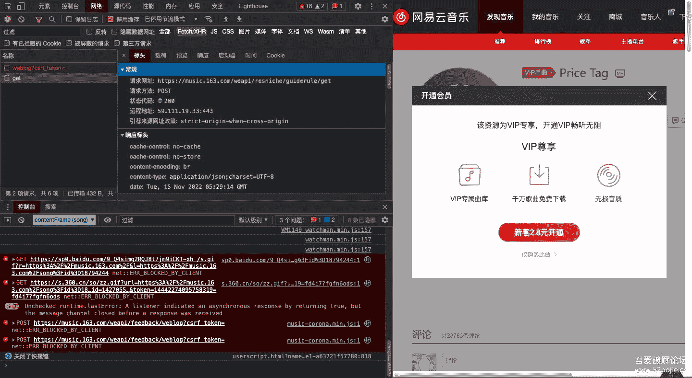

[截屏2022-11-15 下午1.29.34.jpg (187.95 KB, 下载次数: 1)](https://www.52pojie.cn/forum.php?mod=attachment&aid=MjU2ODk0MXxlOWQzYTkyMHwxNzkzNTc0MzM3fDE2ODA4NnwxNzEzMDY3&nothumb=yes) · 2022-11-15 13:29 上传

这种情况不要着急，前端要播放歌曲，要么通过`xhr`从服务器请求歌曲，要么就是歌曲信息已经写在了js/html等等预加载的资源里，出于性能和资源安全性等考虑，前者可能性更大；点击按钮没有请求，很可能是在之前一次点击按钮时就已经请求过了，被js前端缓存了。刷新页面再播放试试看：

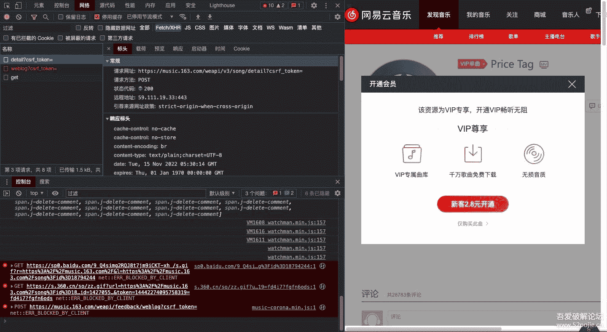

[截屏2022-11-15 下午1.30.23.jpg (185.18 KB, 下载次数: 0)](https://www.52pojie.cn/forum.php?mod=attachment&aid=MjU2ODk0MnwxNjM0Y2U1Y3wxNzkzNTc0MzM3fDE2ODA4NnwxNzEzMDY3&nothumb=yes) · 2022-11-15 13:30 上传

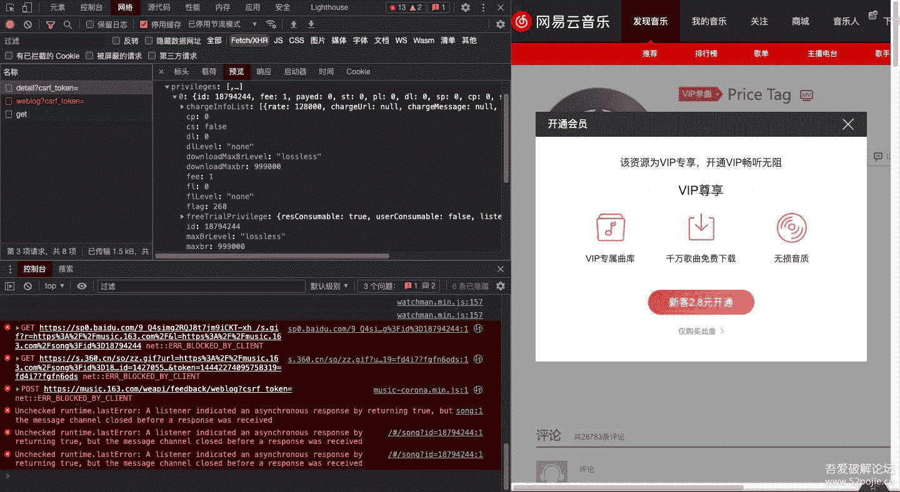

[截屏2022-11-15 下午1.30.39.jpg (191.29 KB, 下载次数: 0)](https://www.52pojie.cn/forum.php?mod=attachment&aid=MjU2ODk0M3xkODJmYjJlNnwxNzkzNTc0MzM3fDE2ODA4NnwxNzEzMDY3&nothumb=yes) · 2022-11-15 13:30 上传

很好，看到我们需要的请求（`weapi/v3/song/detail`）了，展开看了一下响应，确定就是这首歌的信息。但是，在这些信息里，并没有看到播放的音乐本身的`url`。两种可能：

- 因为是vip单曲，无权播放，所以不返回`url`

- 播放歌曲的`url`信息有一个单独的api，在`detail`请求以后判断是否有播放权限，有播放权限再请求这个播放api

打开对照单曲页面，点击播放，查看网络请求

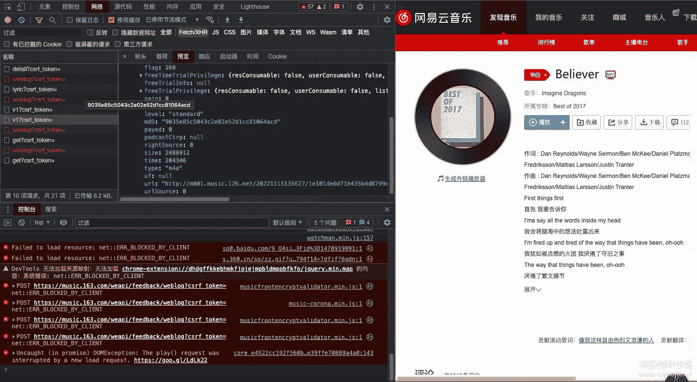

[截屏2022-11-15 下午1.32.14.jpg (227.07 KB, 下载次数: 1)](https://www.52pojie.cn/forum.php?mod=attachment&aid=MjU2ODk0N3xmZGQ5ZDk3NXwxNzkzNTc0MzM3fDE2ODA4NnwxNzEzMDY3&nothumb=yes) · 2022-11-15 13:32 上传

确定是2（`weapi/song/enhance/player/url/v1`）

自此明确请求逻辑：请求`detail` -> 判断播放权限 ->

- 有播放权限，请求`url/v1`，播放

- 没有播放权限，不请求，弹出提示

注意：由于发现前端js有请求缓存机制，以后每次对请求进行抓包/调试时要记得先刷新页面。

## 0x02 请求分析

### 0x020 `detail`

响应为json，格式如下：

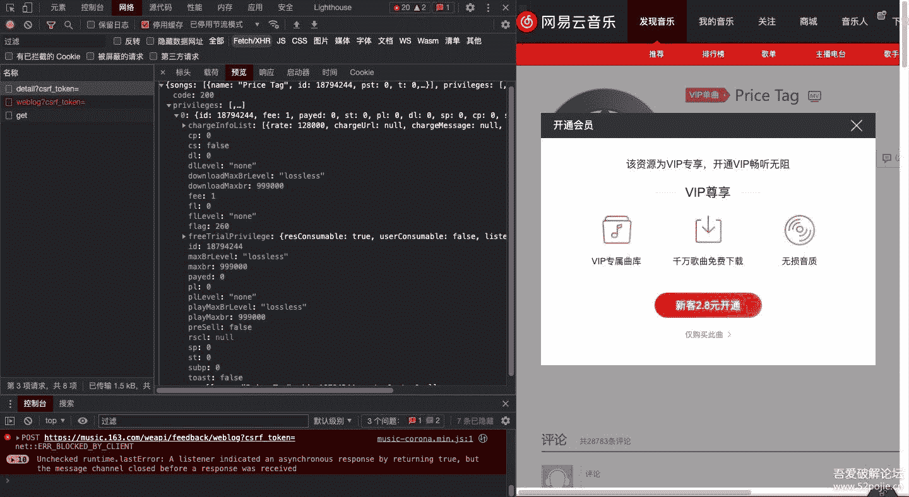

[截屏2022-11-15 下午1.33.02.jpg (155.94 KB, 下载次数: 2)](https://www.52pojie.cn/forum.php?mod=attachment&aid=MjU2ODk0OHw5YjMzMmRmMnwxNzkzNTc0MzM3fDE2ODA4NnwxNzEzMDY3&nothumb=yes) · 2022-11-15 13:33 上传

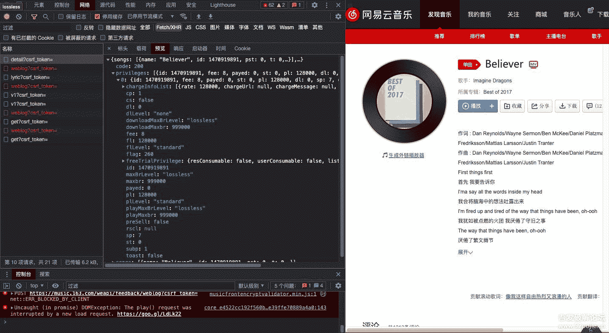

[截屏2022-11-15 下午1.33.26.jpg (185.54 KB, 下载次数: 3)](https://www.52pojie.cn/forum.php?mod=attachment&aid=MjU2ODk0OXwxZWQ0YjA1ZHwxNzkzNTc0MzM3fDE2ODA4NnwxNzEzMDY3&nothumb=yes) · 2022-11-15 13:33 上传

```
{
        "code": 200,
        "privileges": [{...}],
        "songs": [{...}]
}
```

对比响应体，不难发现其中关键字段`json.privileges.dl`, `json.privileges.dlLevel`, `json.privileges.pl`, `json.privileges.plLevel`，根据名字不难猜测其直接控制了下载和播放的音质等级（其实还有`json.privileges.fl`, `json.privileges.flLevel`，但是这个看不出来有什么用，事实证明到后面也用不到），其分别与响应体的`json.privileges.downloadMaxbr`, `json.privileges.downloadMaxBrLevel`, `json.privileges.playMaxbr`, `json.privileges.playMaxBrLevel`对应。前者表示当前用户拥有的音质等级，后者表示该歌曲最高的音质等级

### 0x021 `url/v1`

响应为json，格式如下：

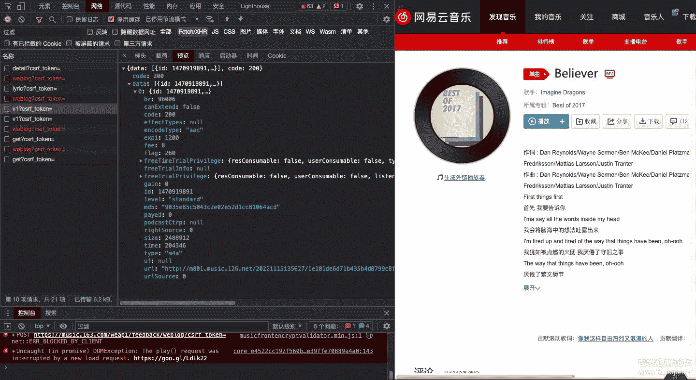

[截屏2022-11-15 下午1.34.25.jpg (181.62 KB, 下载次数: 2)](https://www.52pojie.cn/forum.php?mod=attachment&aid=MjU2ODk1MHwzNTk2YjA3M3wxNzkzNTc0MzM3fDE2ODA4NnwxNzEzMDY3&nothumb=yes) · 2022-11-15 13:34 上传

目测关键键值为`json.data[0].url`，可能有关的键值有`json.data[0].md5`、`json.data[0].fee`、`json.data[0].payed`等等，但是因为`detail`显示权限不足，前端页面没有请求VIP歌曲的`url/v1`接口，所以可能还有其他关键键值需要通过对照才能得到

## 0x03 调试请求

### 0x030 hook函数

有了前面的分析，（理论上）现在我们只需更改请求的响应数据，将音乐接口获取的音乐资源注入到响应即可实现点击播放。

容易想到hook掉`window.XMLHttpRequest`来拦截请求，关键在于如何hook。

hook的目标为：

- 可以拦截、断点调试每一次请求
- 可以根据请求url筛选请求

想到的几种方案：

- 直接hook `XMLHttpRequest`本身
- hook `XMLHttpRequest.prototype.open`
- hook `XMLHttpRequest.prototype.send`
- 同时hook `open`和`send`

首先，`XMLHttpRequest`本身是一个构造函数，直接hook `XMLHttpRequest`本身是不可行的。

仅仅hook `XMLHttpRequest.prototype.open`可以筛选url，但是不能获取请求体（虽然用不到），不方便添加事件监听器（实践中发现页面前端代码本身就有对`open`和`send`的hook，会对事件监听器有拦截和包装）；仅仅hook `XMLHttpRequest.prototype.send`不可筛选url；所以选择方案4

利用到我自己写的一个`Hooker`（只能hook函数）

```
(function () {

        window.hooker = new Hooker();

        function Hooker() {

                const H = this;

                const makeid = idmaker();

                const map = H.map = {};
```


## `hook` 函数与参数说明

```
H.hook = hook;
H.unhook = unhook;

function hook(base, path, log=false, apply_debugger=false, hook_return=false) {
    // target
    path = arrPath(path);
    let parent = base;
    for (let i = 0; i
```

```
hooker.hook(window.XMLHttpRequest.prototype, 'open', true, true);
hooker.hook(window.XMLHttpRequest.prototype, 'send', true, true);
```

第一个参数是 `hook` 目标的父 object，第二个参数是 `hook` 目标函数在父对象上的属性名（就是函数名），第三个参数为是否在 `hook` 函数被调用后在 `console.log` 一条消息，第四个参数为是否在 `hook` 函数被调用后触发 `debugger` 进入调试，第五个参数用于替换目标函数（此处只需要下断点，第五个参数未使用）。

## 初次 `hook` 尝试

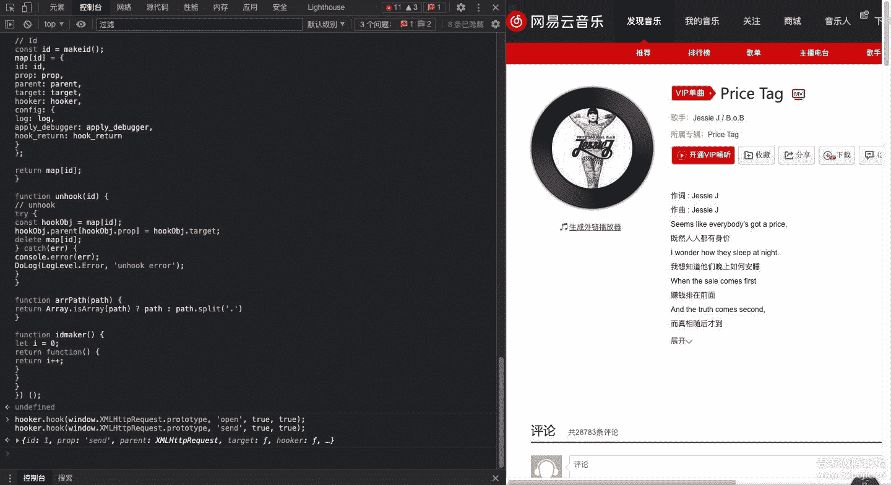

刷新页面，控制台执行，点击播放按钮：

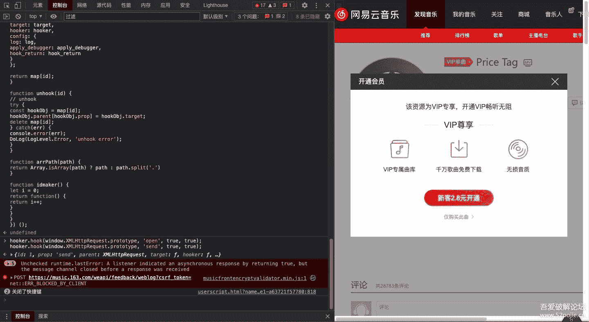

断下来了，诶，还没断下来呢，咋回事？查看页面 DOM 结构：

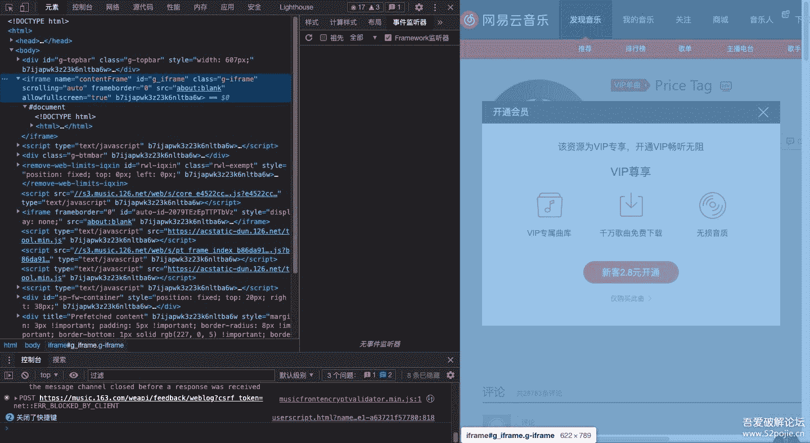

## `iframe` 导致未断下

原来还有一个 `iframe`，所以我们 `hook` 不止要 `hook` top window，还要 `hook` `iframe.contentWindow`。

所以代码改进成这样：

```
// hook top window
hooker.hook(window.XMLHttpRequest.prototype, 'open', true, true);
hooker.hook(window.XMLHttpRequest.prototype, 'send', true, true);

// iframe.contentWindow
hooker.hook(document.querySelector('#g_iframe').contentWindow.XMLHttpRequest.prototype, 'open', true, true);
hooker.hook(document.querySelector('#g_iframe').contentWindow.XMLHttpRequest.prototype, 'send', true, true);
```

## 定位 detail api 的 `xhr`

刷新，控制台执行，点击播放：

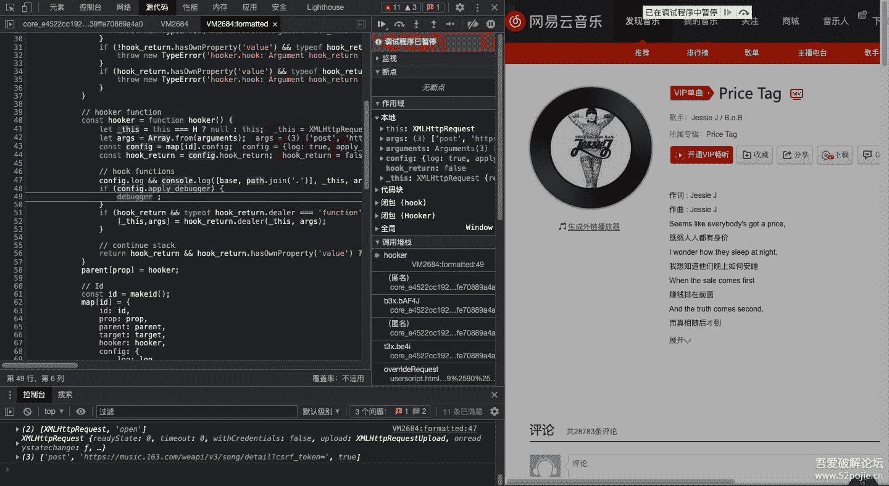

这次断下来了。

可以看到 `open` 的第二个参数 `args[1] === "https://music.163.com/weapi/v3/song/detail?csrf_token="`，就是 detail api。

这里先用全局变量（`temp1`）把 `xhr` 保存下来，然后 `f8` 继续执行，等到 `send` 函数断下来。

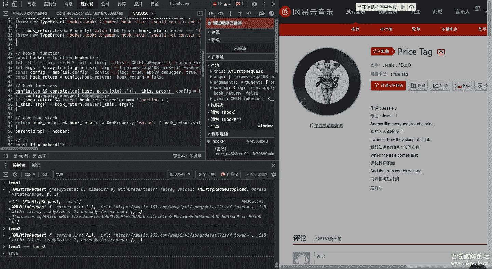

比对 `send` 的 `xhr` 和之前保存的 `temp1`，定位到 detail api 的 `xhr` 的 `send` 调用，然后再注册 `load` 事件监听器，监听 `load` 事件。

## 绕过前端对 `addEventListener` 的 Hook

这里有个问题：这里我直接调用 `temp2.addEventListener` 一直调用不成功，后来发现前端页面 js 已经将 `XMLHttpRequest.prototype.addEventListener` 提前 `hook` 掉了。

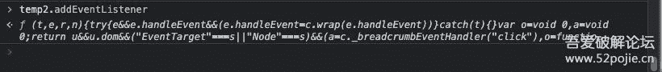

解决方法：创建一个 `iframe`，取出其 `contentWindow.XMLHttpRequest.prototype.addEventListener`，再用 `call` 或者 `apply` 方法给当前 `xhr` 调用。

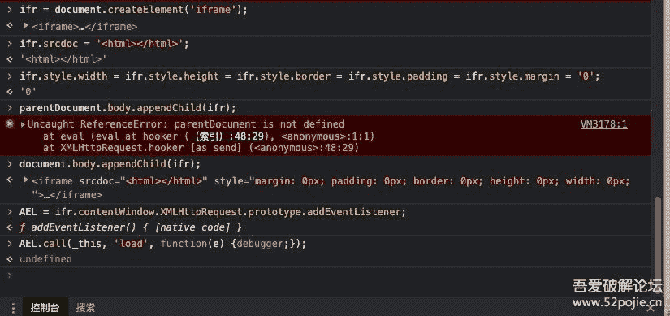

这样就绕过了 `hook` 的前端函数。

## 请求被 `abort`

但是很可惜，这样添加的 `load` 事件的监听器还是断不下来，到网络面板一看：

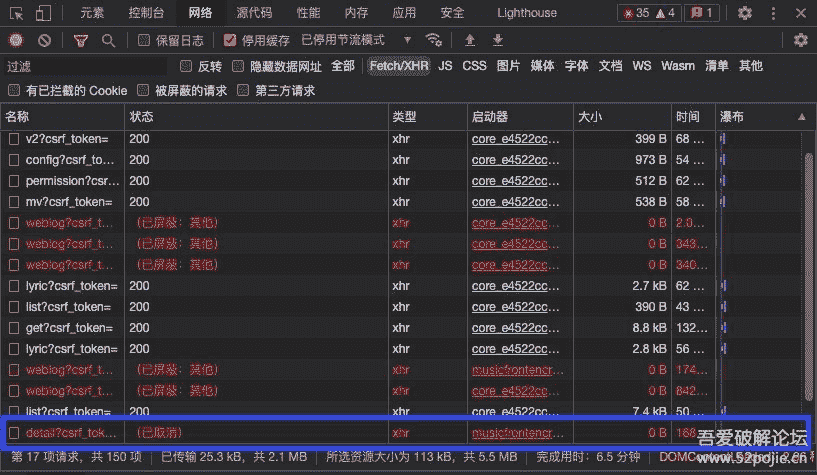

已经被 `abort` 掉了，怀疑是调试用时太长，前端页面以为 `xhr` `timeout` 就 `abort` 了。

## 合并 `hook` 代码

把之前的 `hook` 代码结合起来一次执行完毕：


```javascript
(function() {
        let xhr;
        const AEL = getPureAEL();

        // hook top window
        hooker.hook(window.XMLHttpRequest.prototype, 'open', false, false, {
                dealer: onOpen
        });
        hooker.hook(window.XMLHttpRequest.prototype, 'send', false, false, {
                dealer: onSend
        });

        // iframe.contentWindow
        hooker.hook(document.querySelector('#g_iframe').contentWindow.XMLHttpRequest.prototype, 'open', false, false, {
                dealer: onOpen
        });
        hooker.hook(document.querySelector('#g_iframe').contentWindow.XMLHttpRequest.prototype, 'send', false, false, {
                dealer: onSend
        });

        function onOpen(_this, args) {
                if (args[1].includes('/weapi/v3/song/detail')) {
                        // 记录detail api的xhr
                        xhr = _this;
                }
                return [_this, args];
        }

        function onSend(_this, args) {
                if (xhr === _this) {
                        AEL.call(_this, 'load', function(e) {
                                debugger;
                        });
                }
                return [_this, args];
        }

        // Get unpolluted addEventListener
        function getPureAEL(parentDocument=document) {
                const ifr = makeIfr(parentDocument);

                const oWin = ifr.contentWindow;
                const oDoc = ifr.contentDocument;

                const AEL = oWin.XMLHttpRequest.prototype.addEventListener;
                return AEL;
        }

        // Get unpolluted removeEventListener
        function getPureREL(parentDocument=document) {
                const ifr = makeIfr(parentDocument);

                const oWin = ifr.contentWindow;
                const oDoc = ifr.contentDocument;

                const REL = oWin.XMLHttpRequest.prototype.removeEventListener;
                return REL;
        }

        function makeIfr(parentDocument=document) {
                const ifr = parentDocument.createElement('iframe');
                ifr.srcdoc = '';
                ifr.style.width = ifr.style.height = ifr.style.border = ifr.style.padding = ifr.style.margin = '0';
                parentDocument.body.appendChild(ifr);
                return ifr;
        }
}) ();
```

点击播放：

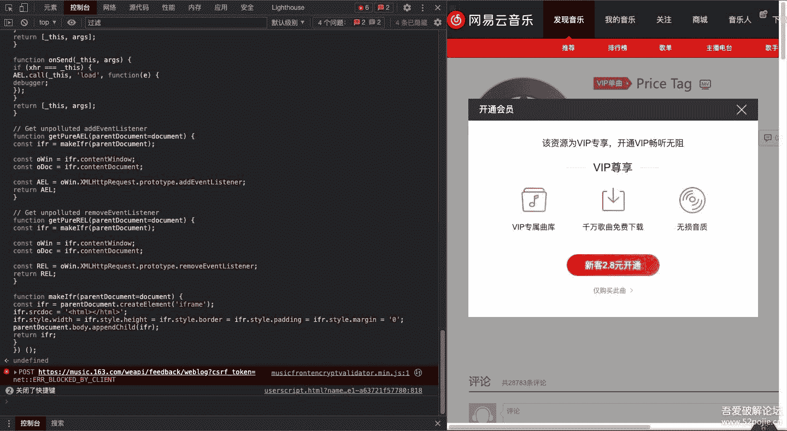
`截屏2022-11-15 下午1.55.03.jpg` (142.85 KB, 下载次数: 1)
[href="forum.php?mod=attachment&aid=MjU2ODk2MnwzYzQyYzYxOHwxNzkzNTc0MzM3fDE2ODA4NnwxNzEzMDY3&nothumb=yes" target="_blank"](https://www.52pojie.cn/forum.php?mod=attachment&aid=MjU2ODk2MnwzYzQyYzYxOHwxNzkzNTc0MzM3fDE2ODA4NnwxNzEzMDY3&nothumb=yes)
2022-11-15 13:55 上传

很可惜，还是没有在 `load` 事件成功断下来，而看网络面板

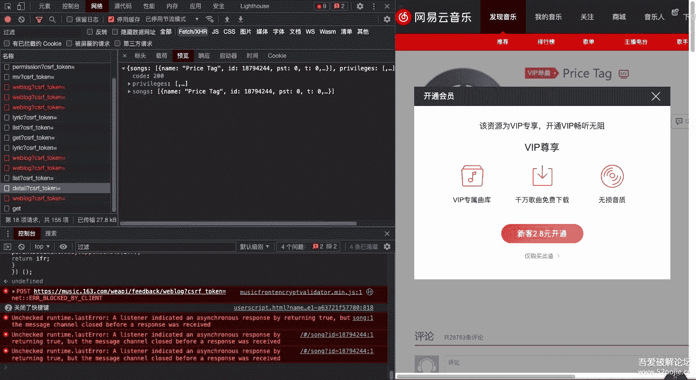
`截屏2022-11-15 下午1.55.17.jpg` (167.71 KB, 下载次数: 2)
[href="forum.php?mod=attachment&aid=MjU2ODk2M3w5MjUwMGEwMnwxNzkzNTc0MzM3fDE2ODA4NnwxNzEzMDY3&nothumb=yes" target="_blank"](https://www.52pojie.cn/forum.php?mod=attachment&aid=MjU2ODk2M3w5MjUwMGEwMnwxNzkzNTc0MzM3fDE2ODA4NnwxNzEzMDY3&nothumb=yes)
2022-11-15 13:55 上传

`detail` API 的请求确实已经发送出去并收到了响应

到这里我的内心os已经开始大喊mmp了，但其实越是到这种时候越是不能慌不能急。很喜欢维术的一句话：“世界上没有鬼，如果你见了鬼，那是你认为你看见了鬼；写代码不要相信自己的眼睛，要相信代码”，还有福尔摩斯的一句话：“如果所有其他可能都已经排除，那么剩下的这种可能，就算再离谱，也一定是真相”。到这里我反复查了好几遍我的代码，是没有问题的，那么就只有一种可能：在我的事件监听器触发前，有其他的事件监听器先一步触发执行了，并且调用了 `e.stopImmediatePropagation` 阻止了我的事件监听器触发。后面我又自己尝试了在 `open` 里面注册监听器等方法试图提前事件监听器的次序，但均以失败告终。没办法，只能单步跟踪看看被前端页面 `hook` 的 `open` 和 `send` 函数干了些什么了。

## 0x031 前端跟踪

`open` 和 `send` 都有可能导致我的 `eventListener` 失效的情况下，我盲选先跟踪 `send` 函数，因为我感觉 `send` 函数在我的 `onSend` 后执行，更改 `xhr` 导致 `onload` 无法触发的可能性更大（事实证明我蒙对了，不过这都是后话）

在刚才的 `onSend` 函数里添加 `debugger`：

```javascript
function onSend(_this, args) {

        if (xhr === _this) {

                AEL.call(_this, 'load', function(e) {

                        debugger;

                });

                debugger;

        }

        return [_this, args];

}
```

刷新执行，点击播放：

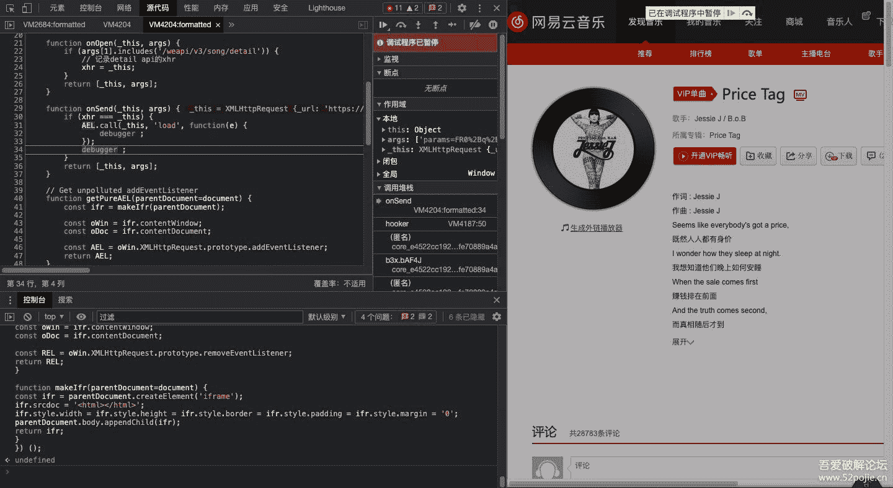
`截屏2022-11-15 下午1.56.36.jpg` (172.8 KB, 下载次数: 0)
[href="forum.php?mod=attachment&aid=MjU2ODk2NHxhY2RmZTA2Y3wxNzkzNTc0MzM3fDE2ODA4NnwxNzEzMDY3&nothumb=yes" target="_blank"](https://www.52pojie.cn/forum.php?mod=attachment&aid=MjU2ODk2NHxhY2RmZTA2Y3wxNzkzNTc0MzM3fDE2ODA4NnwxNzEzMDY3&nothumb=yes)
2022-11-15 13:56 上传

单步跟踪到 js 前端 `hook` `send` 的代码里

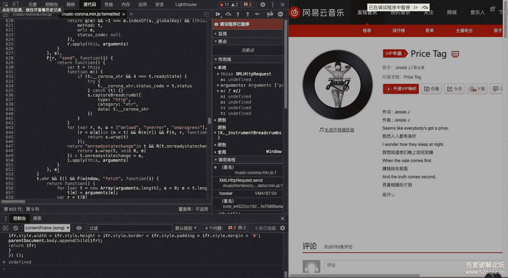
`截屏2022-11-15 下午2.00.18.jpg` (177.17 KB, 下载次数: 0)
[href="forum.php?mod=attachment&aid=MjU2ODk2NXw4NzdkNzIxYnwxNzkzNTc0MzM3fDE2ODA4NnwxNzEzMDY3&nothumb=yes" target="_blank"](https://www.52pojie.cn/forum.php?mod=attachment&aid=MjU2ODk2NXw4NzdkNzIxYnwxNzkzNTc0MzM3fDE2ODA4NnwxNzEzMDY3&nothumb=yes)
2022-11-15 14:00 上传

单步跟踪可以厘清这段代码中的结构：

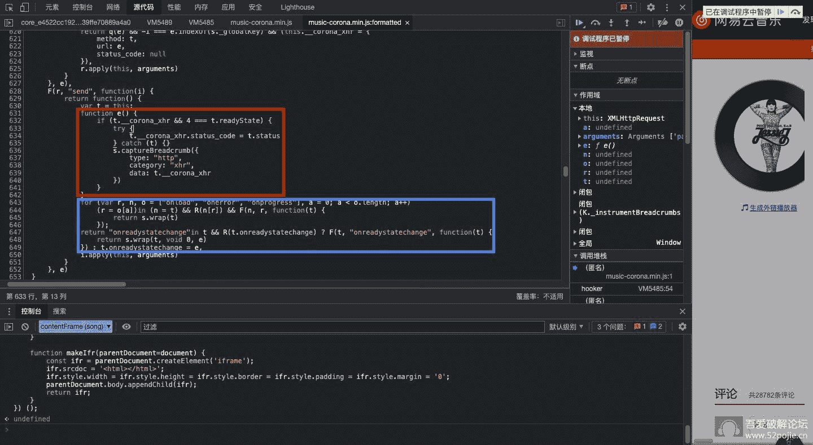
`截屏2022-11-14 下午6.21.05.jpg` (160.57 KB, 下载次数: 0)
[href="forum.php?mod=attachment&aid=MjU2ODk2Nnw3YTBjNDQ5MHwxNzkzNTc0MzM3fDE2ODA4NnwxNzEzMDY3&nothumb=yes" target="_blank"](https://www.52pojie.cn/forum.php?mod=attachment&aid=MjU2ODk2Nnw3YTBjNDQ5MHwxNzkzNTc0MzM3fDE2ODA4NnwxNzEzMDY3&nothumb=yes)
2022-11-15 14:00 上传

蓝色部分检查所有 `onload`、`onerror`、`onprogress` 属性所对应的函数（如果此属性已设置），并进行了一系列处理。关键在于蓝色下半部分，将 `onreadystatechange` 设置为橙色部分的 `e` 函数

在 `e` 函数中，判断如果 `xhr.readState === 4`（即 `xhr` 加载完毕），则进一步分发事件到各个之前设置的事件处理器；如果不是 `xhr.readState === 4`，就什么都不做。我并不知道分发事件的内部逻辑是什么样的，但是也没有必要继续跟踪了，直接改为监听 `readystatechange` 事件，在 `xhr.readState` 时，将 `onreadystatechange` 也 `hook` 掉就可以提前拦截到 `xhr` 响应了。

`hook` 代码：

```javascript
function onSend(_this, args) {
        if (xhr === _this) {
                AEL.call(_this, 'readystatechange', function(e) {
                        _onreadystatechange = _this.onreadystatechange;
                        _this.onreadystatechange = onProgress;
                        debugger;
                }, {once: true}); // once参数指定事件监听器仅仅触发一次
        }
        return [_this, args];
}

function onProgress(e) {
        debugger;
}
```

控制台执行，点击播放：

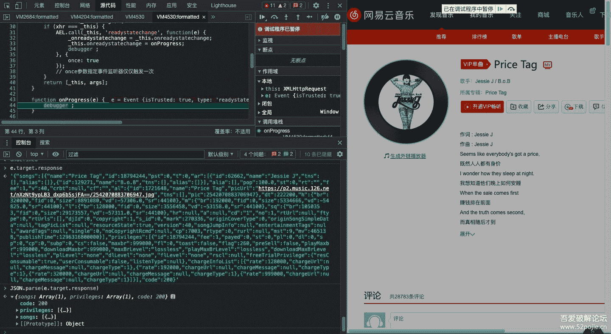
`截屏2022-11-15 下午2.02.37.jpg` (236.66 KB, 下载次数: 1)
[href="forum.php?mod=attachment&aid=MjU2ODk2N3wzZTc2YTc4NXwxNzkzNTc0MzM3fDE2ODA4NnwxNzEzMDY3&nothumb=yes" target="_blank"](https://www.52pojie.cn/forum.php?mod=attachment&aid=MjU2ODk2N3wzZTc2YTc4NXwxNzkzNTc0MzM3fDE2ODA4NnwxNzEzMDY3&nothumb=yes)
2022-11-15 14:02 上传

这次终于成功了，在前端代码执行前断了下来，并且可以获取到返回值

改一下 `xhr` 返回值试试（因为不知道页面前端代码中用的是 `xhr.response` 还是 `xhr.responseText`，就一次都改了）

```javascript
function onProgress(e) {

        const xhr = e.target;

        if (xhr.readyState === 4) {

                const RATES = {

                        'none': 0,

                        'standard': 128000,

                        'exhigh': 320000,'lossless': 999000,

                }; // br-level 对照表，可从普通单曲的请求中收集到

                const json = JSON.parse(xhr.response);

                const privilege = json['privileges'][0];

                dlLevel = privilege['downloadMaxBrLevel'];

                dlRate = RATES[dlLevel];

                plLevel = privilege['playMaxBrLevel'];

                plRate = RATES[plLevel];

                privilege['dlLevel'] = dlLevel; // Download

                privilege['dl'] = dlRate; // Download

                privilege['plLevel'] = plLevel; // Play

                privilege['pl'] = plRate; // Play

                const response = JSON.stringify(json)

                const propDesc = {

                        value: response,

                        writable: false,

                        configurable: false,

                        enumerable: true

                }

                Object.defineProperties(xhr, {

                        'response': propDesc,

                        'responseText': propDesc

                });

        }

        // 别忘了继续执行页面前端js

        _onreadystatechange(e);

}
```

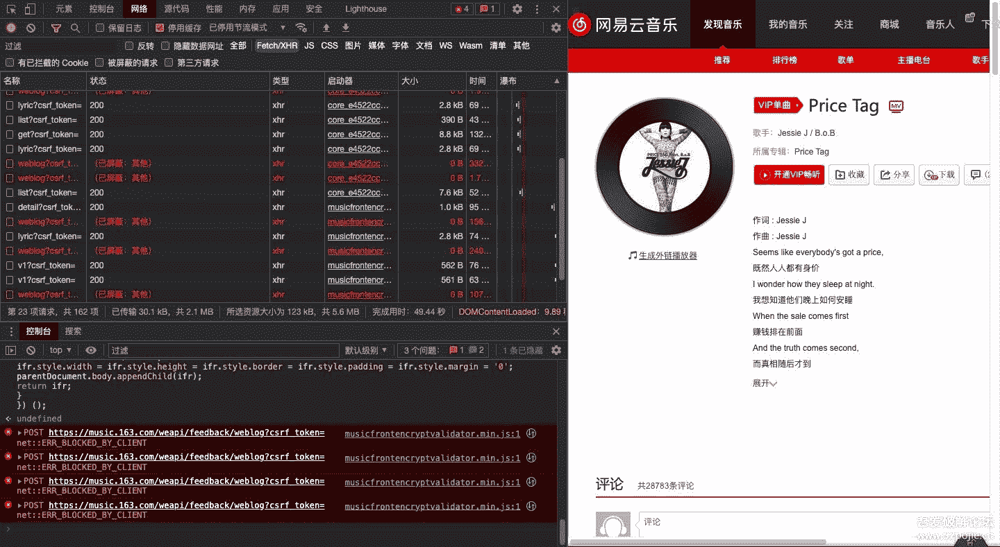


截屏2022-11-15 下午2.10.41.jpg (205.6 KB, 下载次数: 2)

[href="forum.php?mod=attachment&aid=MjU2ODk2OHxkMDU4NmZjMXwxNzkzNTc0MzM3fDE2ODA4NnwxNzEzMDY3&nothumb=yes" target="_blank"](https://www.52pojie.cn/forum.php?mod=attachment&aid=MjU2ODk2OHxkMDU4NmZjMXwxNzkzNTc0MzM3fDE2ODA4NnwxNzEzMDY3&nothumb=yes)

2022-11-15 14:10 上传

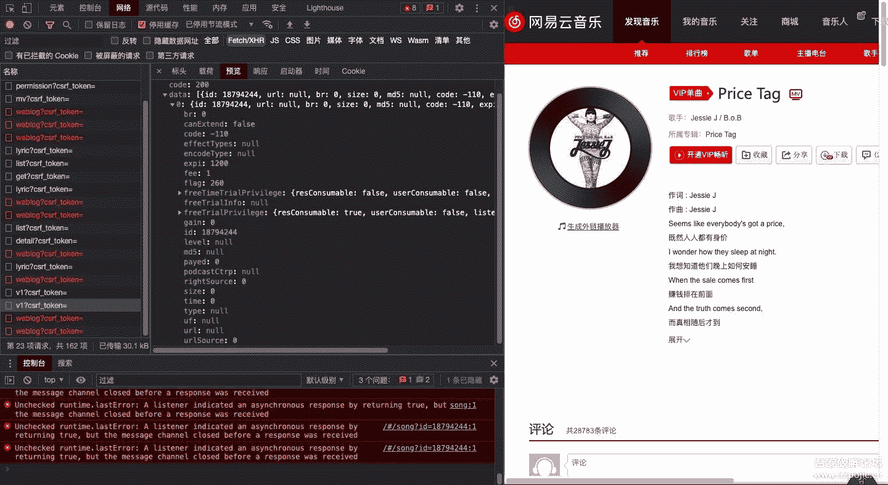

截屏2022-11-15 下午2.11.00.jpg (194.67 KB, 下载次数: 3)

[href="forum.php?mod=attachment&aid=MjU2ODk3MHw2MmE4MDA1Y3wxNzkzNTc0MzM3fDE2ODA4NnwxNzEzMDY3&nothumb=yes" target="_blank"](https://www.52pojie.cn/forum.php?mod=attachment&aid=MjU2ODk3MHw2MmE4MDA1Y3wxNzkzNTc0MzM3fDE2ODA4NnwxNzEzMDY3&nothumb=yes)

2022-11-15 14:11 上传

可以看到，`detail` api后，`url/v1` api也紧接着请求了，同时页面也没有再弹出VIP提示弹窗，说明我们已经成功地“骗过”了页面前端js，更改了页面前端js收到的响应，接下来只需要再对`url/v1` api如法炮制即可，需要注意的是，这次需要将第三方音乐接口嵌进来。

## 0x032 url/v1

hook的方法和上面的detail接口一样，嵌入第三方接口的方法也很简单：在`onProgress`里对第三方接口进行请求，请求到播放地址后填入`json.data[0].url`即可，在此不再赘述。

这里简单说一下可能遇到的几个坑：

- 不止需要填入`url`：`json.data[0].code`、`json.data[0].br`、`json.data[0].level`、`json.data[0].type`也都是需要的，分别代表请求状态（实测填200就行）、音质数值、音质字符串名称、音频编码（实测填"mp3"就行）
- 第三方接口返回的音频`url`的跨域问题：第三方接口如果返回的音频`url`不是某云音乐自身的域名下的`url`，又没有cors头信息，则可能会因为跨域而无法播放；这时候充分发挥用户脚本的跨域能力，使用`GM_xmlhttpRequest`访问后，再用`URL.createObjectURL`转换成可以播放的链接即可，但在实测中我用的第三方接口返回的链接虽然不是某云音乐自身的域名下的`url`，但是经过一串302跳转以后最终地址还是转回了某云音乐自身的域名下，所以只需要[JavaScript] 纯文本查看 复制代码

```
GM_xmlhttpRequest({
        method: "GET",
        url: api_got_url, // 第三方接口返回的url
        onprogress: function(e) {
                json.data[0].url = e.finalUrl;
                // 填入其他属性
                onreadystatechange.apply(_this, args); // 继续执行页面前端代码
        }
})
```

这样获取到最终`url`即可

## 0x04 编写userscript

这里就用户脚本把刚才在控制台手动做过的步骤自动化一下就可以了。

本来想在这里贴一下代码或者链接的，但是怕违反版规（同时也是我写累了，偷个懒），就不贴了。完整的优化过的代码已经开源在GreasyFork了，欢迎各位大佬前来交流。

### 最终效果

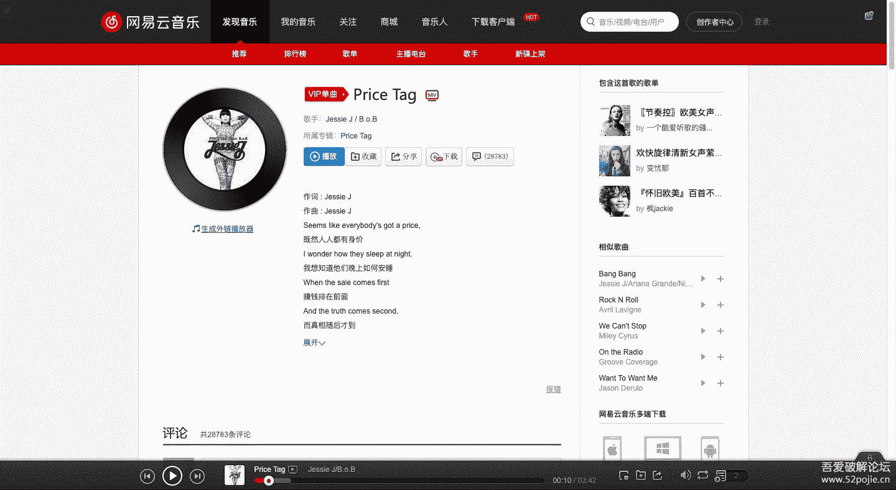

截屏2022-11-15 下午2.12.40.jpg (118.2 KB, 下载次数: 1)

[href="forum.php?mod=attachment&aid=MjU2ODk3M3xkMTM3YjM0OXwxNzkzNTc0MzM3fDE2ODA4NnwxNzEzMDY3&nothumb=yes" target="_blank"](https://www.52pojie.cn/forum.php?mod=attachment&aid=MjU2ODk3M3xkMTM3YjM0OXwxNzkzNTc0MzM3fDE2ODA4NnwxNzEzMDY3&nothumb=yes)

2022-11-15 14:12 上传

PS：新人第一次写文，个人感觉还是用了不少心思的，如有不当一定改正，如有可以改进处请务必提出。
