# [原创] license文件JAVA逆向记录

- 原帖: https://www.52pojie.cn/forum.php?mod=viewthread&tid=1714560
- 抓取时间: 2026-11-01T23:05:28

## 初步分析

记录一款软件授权信息逆向的过程。这个软件先是在网上找的PJ包，但是PJ包与我的软件版本不一致，所以用不了。随后尝试根据现有PJ包的明文授权文件自己逆向。

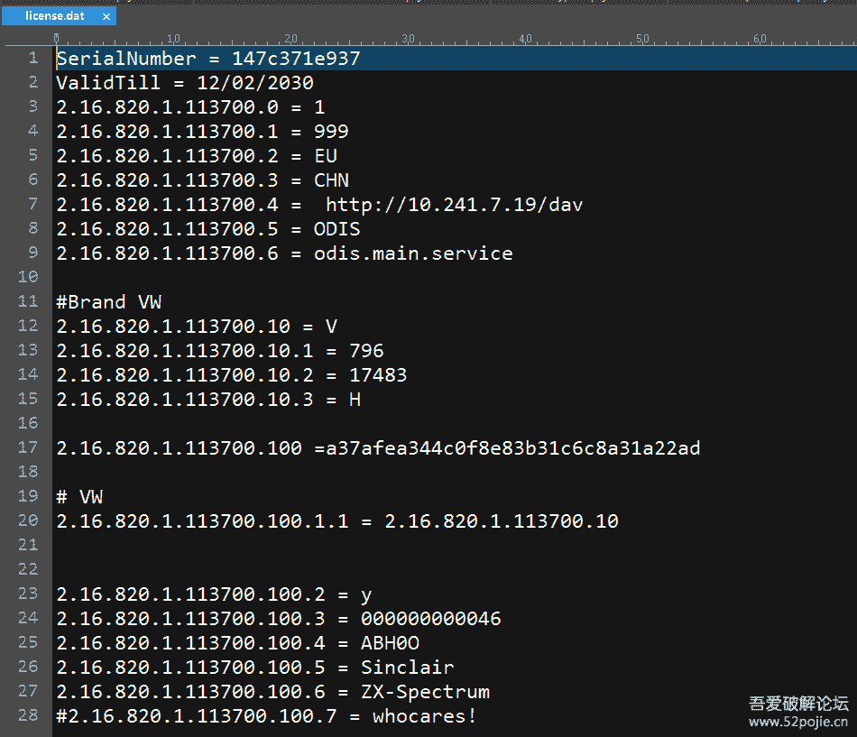

[`1.png`](https://www.52pojie.cn/forum.php?mod=attachment&aid=MjU2OTk3OHxkNzZiYzk5NHwxNzkzNTc0MzI2fDE2ODA4NnwxNzE0NTYw&nothumb=yes)（62.79 KB，下载次数: 0），2022-11-17 15:51 上传

把授权文件放到对应的目录打开软件，提示授权文件解析错误。把EXE拖入IDA看看，发现有JAVA相关的字符串。

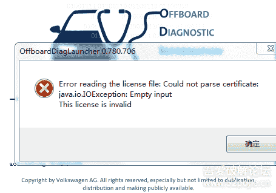

[`2.png`](https://www.52pojie.cn/forum.php?mod=attachment&aid=MjU2OTk3OXxmZmEzZmM4ZnwxNzkzNTc0MzI2fDE2ODA4NnwxNzE0NTYw&nothumb=yes)（47.2 KB，下载次数: 2），2022-11-17 15:51 上传

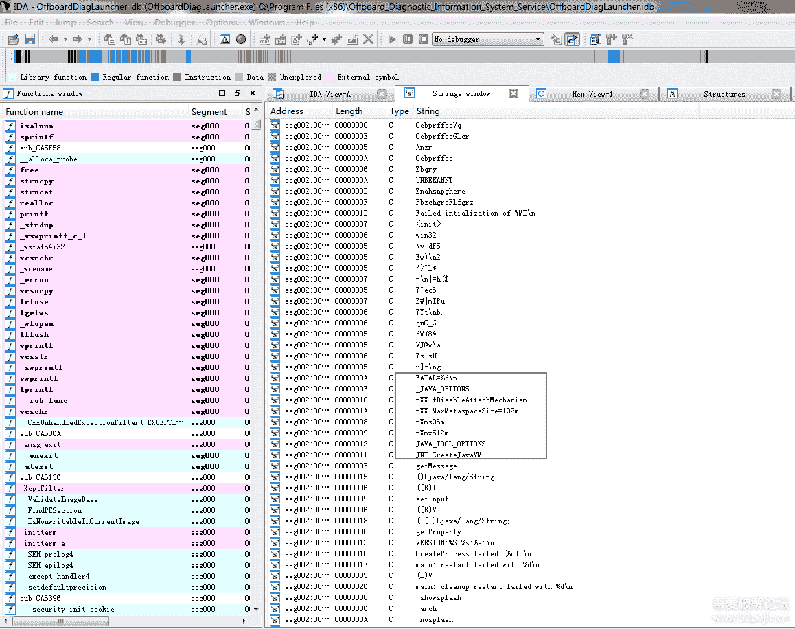

[`3.png`](https://www.52pojie.cn/forum.php?mod=attachment&aid=MjU2OTk4MHxiMzY2ZjQ0ZXwxNzkzNTc0MzI2fDE2ODA4NnwxNzE0NTYw&nothumb=yes)（146.24 KB，下载次数: 1），2022-11-17 15:51 上传

用IDA导入`JNI.h`，大体看了下流程，应该就是创建[`JVM`](https://www.52pojie.cn/thread-661779-1-1.html)载入`classloader`，然后加载所需`class`启动JAVA程序。

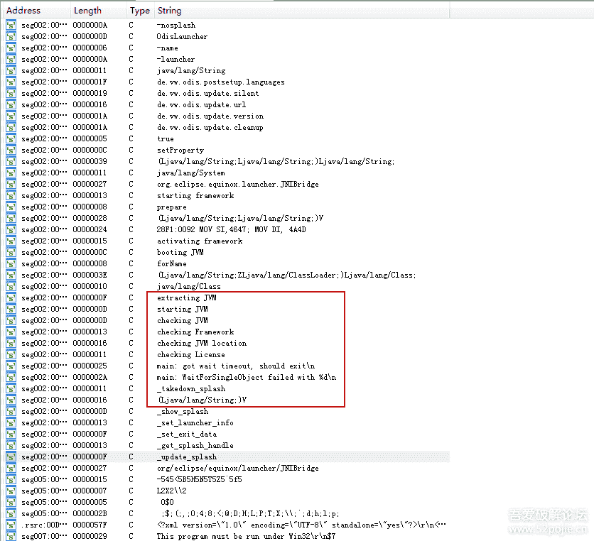

[`4.png`](https://www.52pojie.cn/forum.php?mod=attachment&aid=MjU2OTk4MXwyMTUxYmY4N3wxNzkzNTc0MzI2fDE2ODA4NnwxNzE0NTYw&nothumb=yes)（61.43 KB，下载次数: 1），2022-11-17 15:51 上传

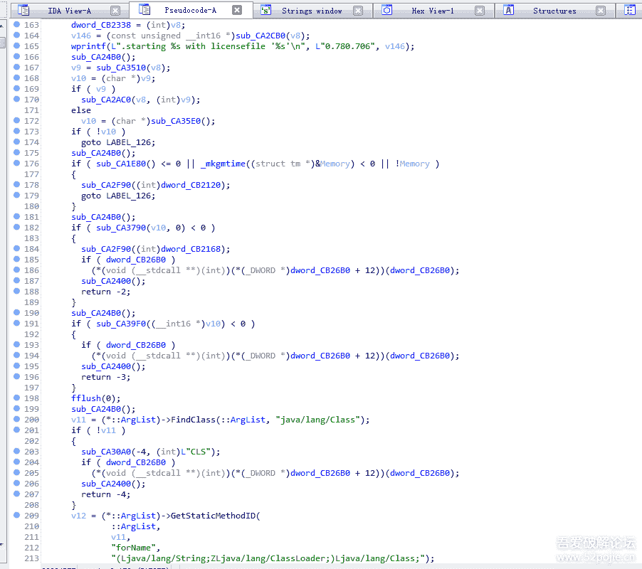

[`5.png`](https://www.52pojie.cn/forum.php?mod=attachment&aid=MjU2OTk4MnwwZjIzZDRiMHwxNzkzNTc0MzI2fDE2ODA4NnwxNzE0NTYw&nothumb=yes)（106.62 KB，下载次数: 2），2022-11-17 15:51 上传

## 定位授权解析逻辑

OD调试起来，在`sub_CA3CA0()`看到了`ZIP`相关的`CLASS`，以及`DefineClass()`函数。

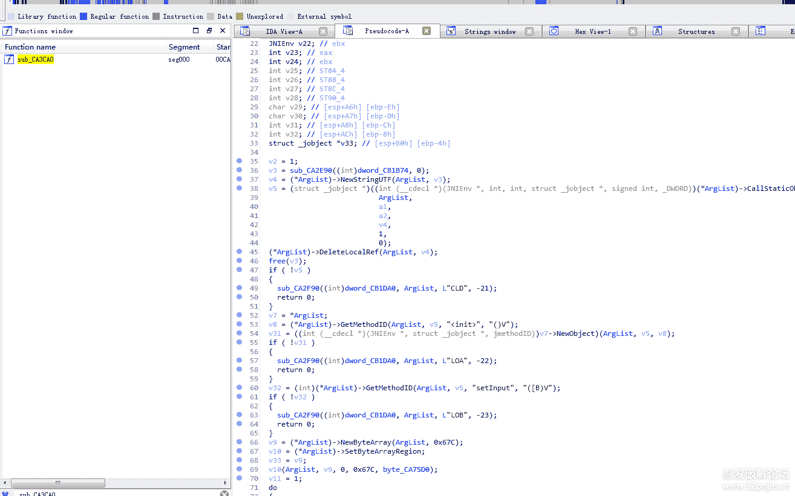

[`6.png`](https://www.52pojie.cn/forum.php?mod=attachment&aid=MjU2OTk4M3xjNjRiYzkwNXwxNzkzNTc0MzI2fDE2ODA4NnwxNzE0NTYw&nothumb=yes)（107.67 KB，下载次数: 2），2022-11-17 15:51 上传

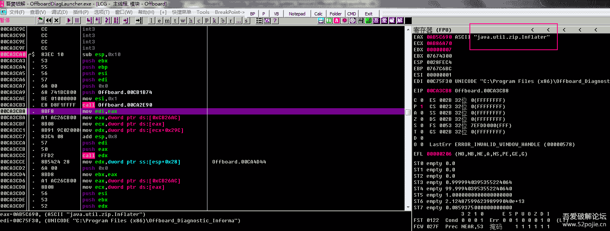

[`7.png`](https://www.52pojie.cn/forum.php?mod=attachment&aid=MjU2OTk4NHxkNzM2MzE0MnwxNzkzNTc0MzI2fDE2ODA4NnwxNzE0NTYw&nothumb=yes)（91.05 KB，下载次数: 0），2022-11-17 15:51 上传

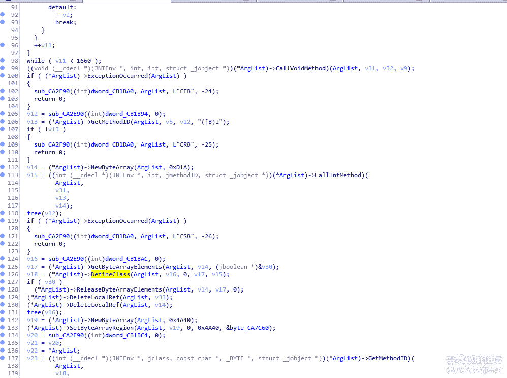

[`8.png`](https://www.52pojie.cn/forum.php?mod=attachment&aid=MjU2OTk4NXw4ZTU2MzMxMXwxNzkzNTc0MzI2fDE2ODA4NnwxNzE0NTYw&nothumb=yes)（100.21 KB，下载次数: 0），2022-11-17 15:51 上传

OD中看下这个`DefineClass()`加载的是`bootloader`，这个loader解密加载了其他`JAR`。

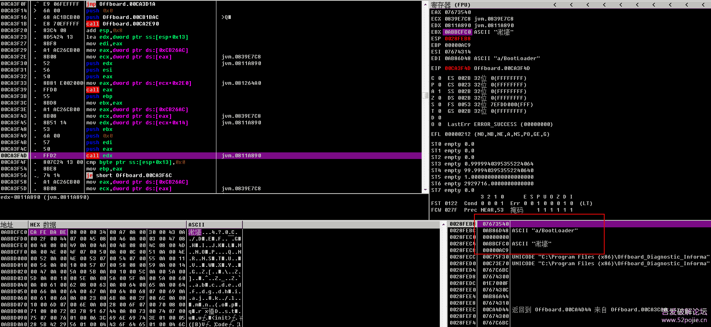

[`9.png`](https://www.52pojie.cn/forum.php?mod=attachment&aid=MjU2OTk4Nnw0MTBlZWRlYXwxNzkzNTc0MzI2fDE2ODA4NnwxNzE0NTYw&nothumb=yes)（62.7 KB，下载次数: 0），2022-11-17 15:51 上传

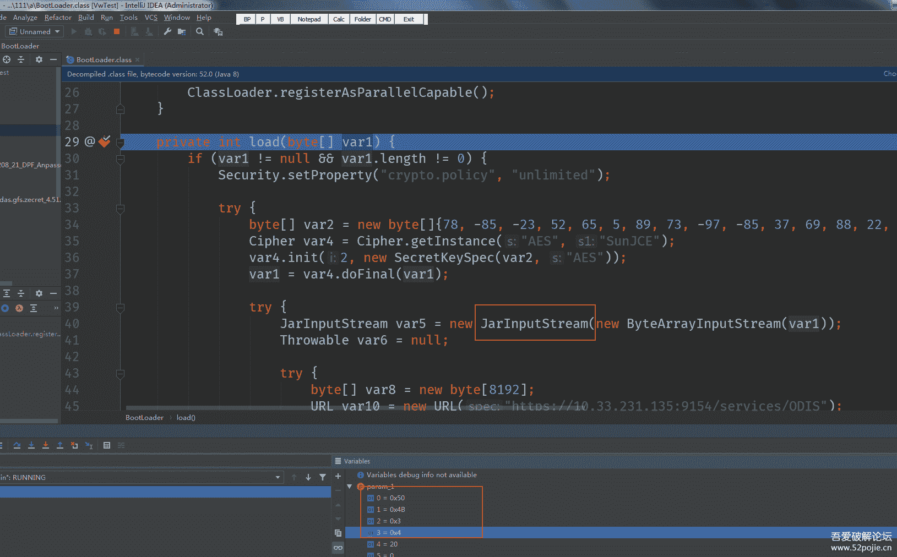

[`10.png`](https://www.52pojie.cn/forum.php?mod=attachment&aid=MjU2OTk4N3xkNDgxMzEwZXwxNzkzNTc0MzI2fDE2ODA4NnwxNzE0NTYw&nothumb=yes)（195.61 KB，下载次数: 1），2022-11-17 15:51 上传

把`JAR` DUMP出来，可以看到里面有个`Activator`类。`Activator`类里面就是解析授权文件的。

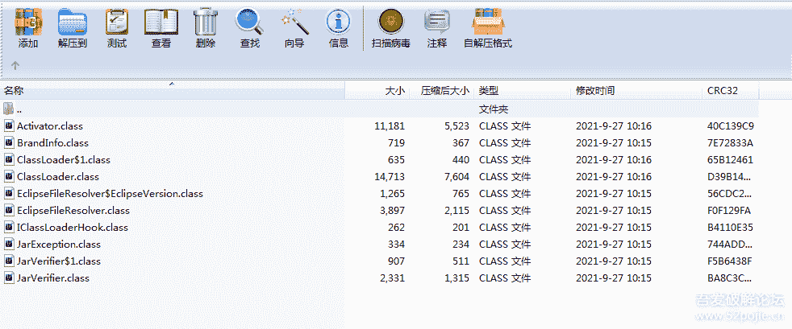

[`11.png`](https://www.52pojie.cn/forum.php?mod=attachment&aid=MjU2OTk4OXxjZjRlNzY0ZXwxNzkzNTc0MzI2fDE2ODA4NnwxNzE0NTYw&nothumb=yes)（73.32 KB，下载次数: 2），2022-11-17 15:51 上传

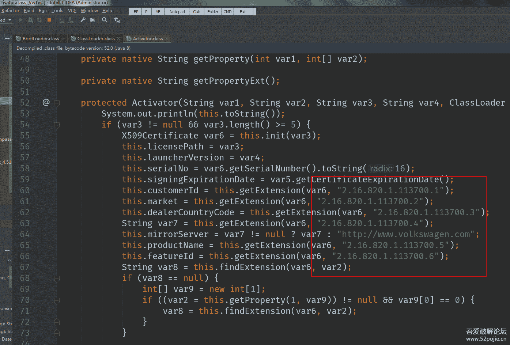

[`12.png`](https://www.52pojie.cn/forum.php?mod=attachment&aid=MjU2OTk5MHxjMWVkNWMyMXwxNzkzNTc0MzI2fDE2ODA4NnwxNzE0NTYw&nothumb=yes)（259.38 KB，下载次数: 0），2022-11-17 15:51 上传

## 修改授权解析逻辑

可以看到构造函数里面有`X509Certificate`验证，而我下载的PJ包授权文件是明文的。所以这里我们把`X509Certificate`相关的直接删除掉，然后读取授权文件方式直接换成`properties`，这样就可以直接解析成功了。

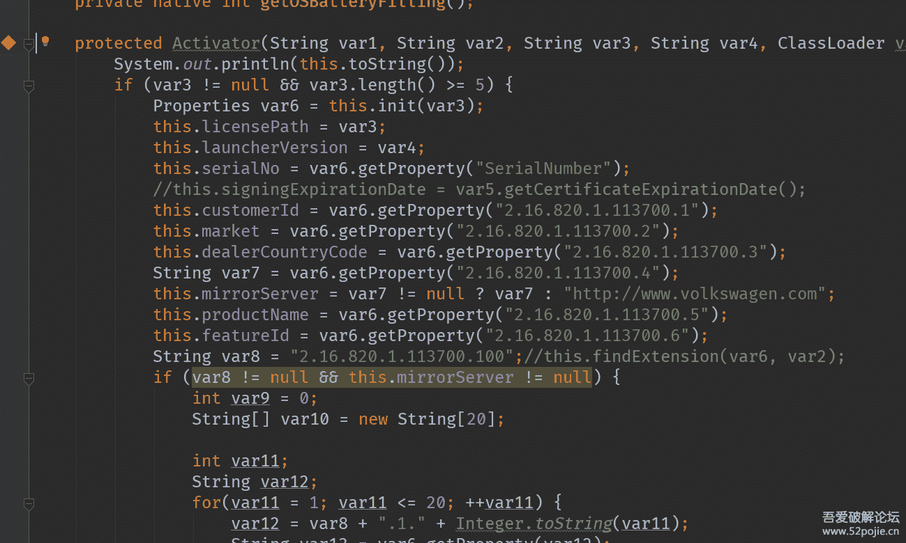

[`13.png`](https://www.52pojie.cn/forum.php?mod=attachment&aid=MjU2OTk5MXwxMTNjNWI0YXwxNzkzNTc0MzI2fDE2ODA4NnwxNzE0NTYw&nothumb=yes)（211.01 KB，下载次数: 1），2022-11-17 15:52 上传

## 修复签名校验

改完后发现还是报错，花了些时间调试了下，发现`plugin`目录中的`launcherJAR`包加载`Activator`签名不通过导致的，需要把这里的`getSigners()`以及这个包中`JAdapter`类`findHook()`中的`getSigners()`去掉就OK了。

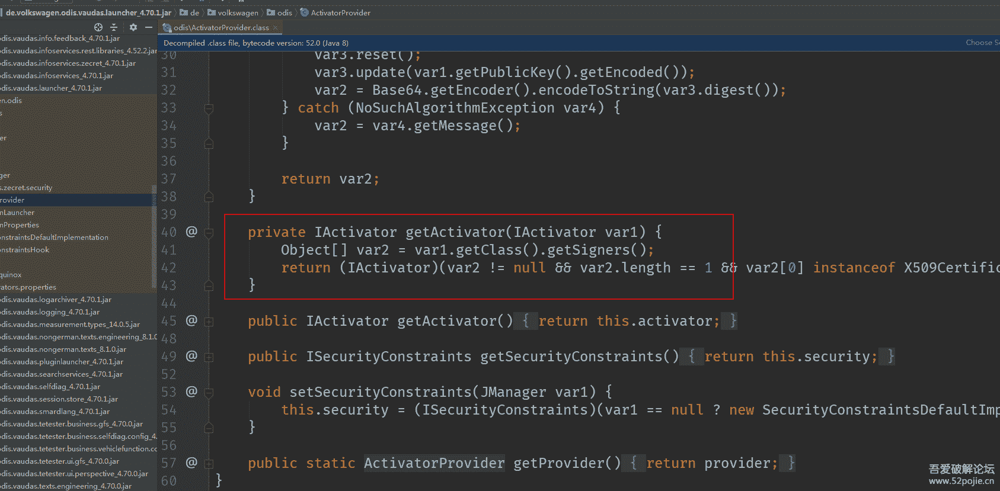

[`14.png`](https://www.52pojie.cn/forum.php?mod=attachment&aid=MjU2OTk5MnxmNDI0NWVjZXwxNzkzNTc0MzI2fDE2ODA4NnwxNzE0NTYw&nothumb=yes)（209.62 KB，下载次数: 0），2022-11-17 15:52 上传

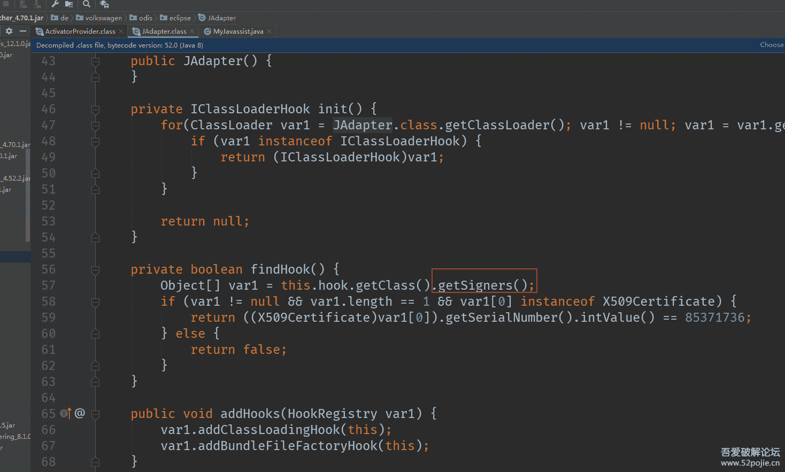

[`15.png`](https://www.52pojie.cn/forum.php?mod=attachment&aid=MjU2OTk5M3xiYWI3MDQwOHwxNzkzNTc0MzI2fDE2ODA4NnwxNzE0NTYw&nothumb=yes)（164.35 KB，下载次数: 1），2022-11-17 15:52 上传

## 验证结果

最后修改`CLASS`替换试一下，启动成功了，可以正常进入软件了。

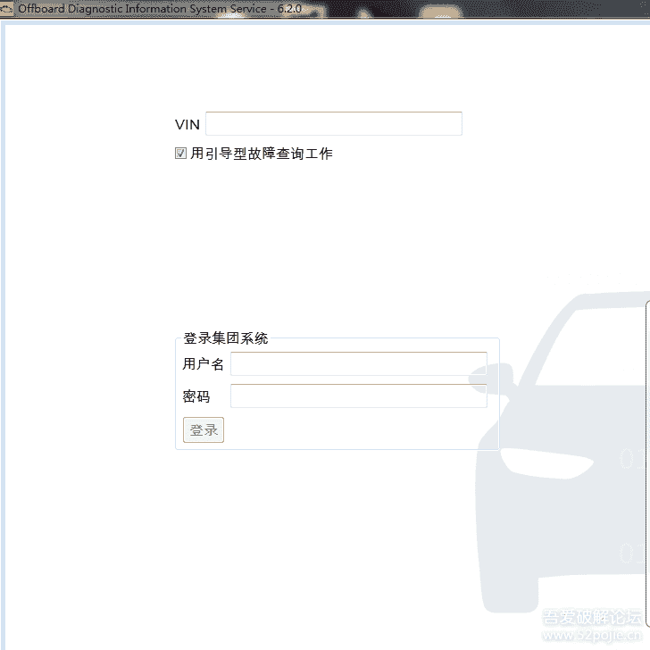

[`16.png`](https://www.52pojie.cn/forum.php?mod=attachment&aid=MjU2OTk3N3xmOTY2NjU4M3wxNzkzNTc0MzI2fDE2ODA4NnwxNzE0NTYw&nothumb=yes)（41.59 KB，下载次数: 0），2022-11-17 15:51 上传
