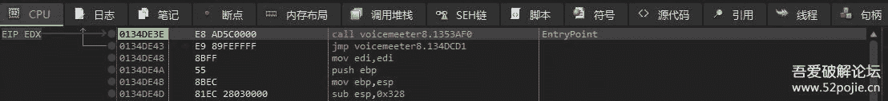
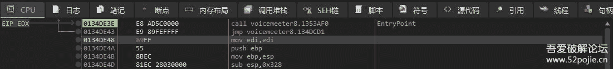
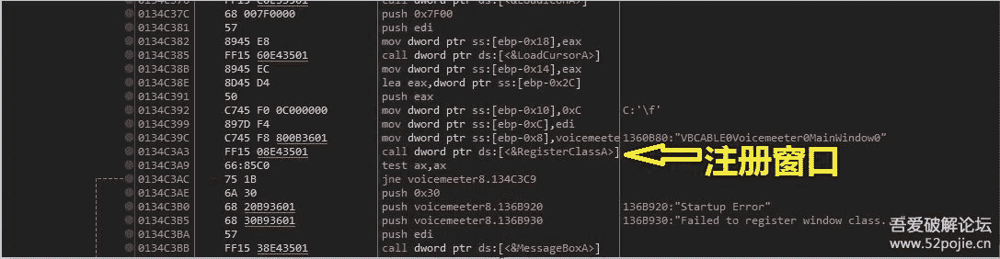
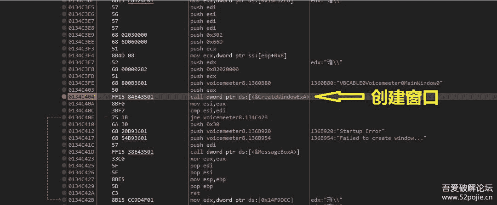
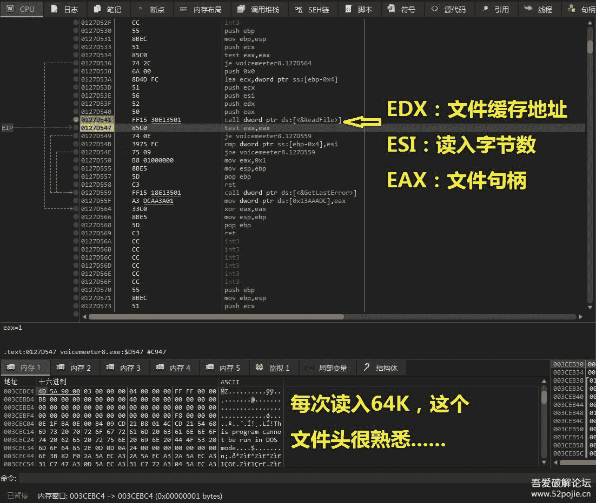
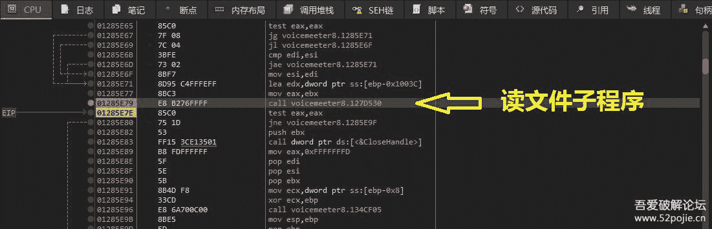
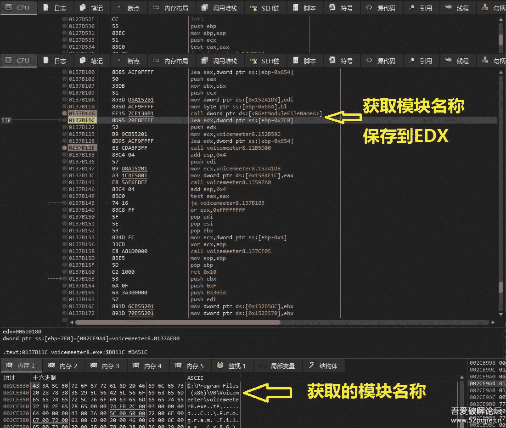
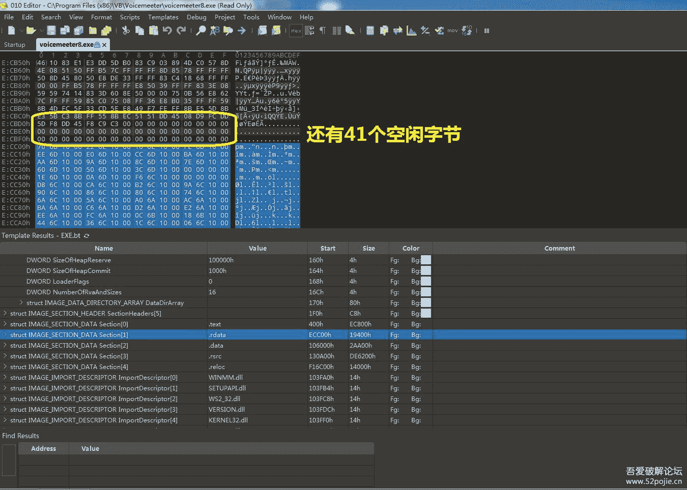
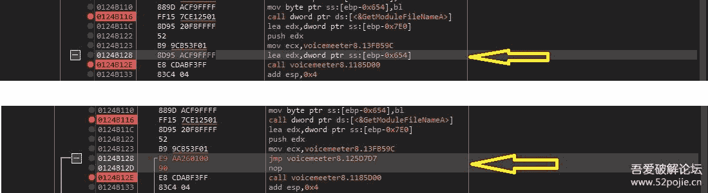
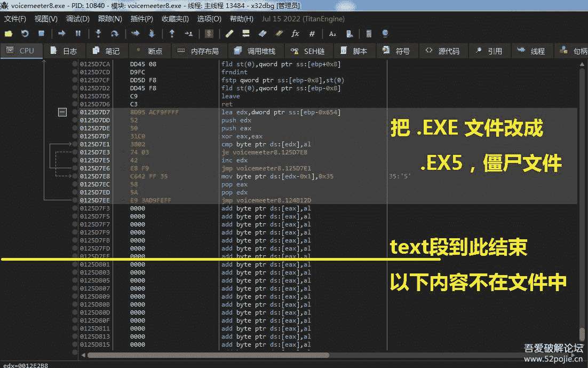

# [原创] Voicemeeter Potato 3.0.2.8 新加密方式破解

- 原帖：https://www.52pojie.cn/forum.php?mod=viewthread&tid=1714945
- 抓取时间：2026-11-01T23:05:25

前段时间发了一个“[//www.52pojie.cn/thread-1647606-1-1.html" target="_blank"](https://www.52pojie.cn/thread-1647606-1-1.html:href="https)”帖子，然后有网友留言说软件升级到`3.0.2.6`了，能不能[//www.52pojie.cn" target="_blank" class="relatedlink"](https://www.52pojie.cn:href="https)一下。我心想就是个小版本号的升级，依葫芦画瓢不就行了嘛，结果出乎意料，修改完后运行主程序，连主界面都没有弹出，直接就`Game Over`了，隐约感觉这个“小”升级不简单，应该是软件的保护方式升级了。

经过几个小版本升级，官方网站正式推出`Voicemeeter Potato 3.0.2.8`，就以这个版本为例，跟大家分享一下它的最新保护方式和破解办法。调试工具：`x96dbg`（`x64dbg` + `x32dbg`），辅助工具：`010 Editor`。

## 32 位版本主程序

先调试 32 位版本的主程序。

由于修改主程序后不能运行，首先观察了一下新版本的变化，发现新版本主程序大小为`15.1M`，上次破解的旧版本主程序为`10.1M`，主程序大小增加了二分之一，这么大的变化居然只是一个小版本升级！~

用`x32dbg`加载主程序，按照以前方面修改，然后在加载状态下运行，出现正常界面，而且已经是破解状态！打好补丁，退出`X32dbg`，在正常状态下运行，没有主界面，直接结束，破解失败。

### 验证主程序完整性

这是什么原因呢？

在`x32dbg`中加载主程序，修改后正常运行，说明主程序没有对内存中的代码段是否改动进行校验。

而打了补丁之后的主程序不能运行，很有可能是主程序对磁盘上的`EXE`文件是否改动进行校验，发现有改动后直接退出。

为了验证这个想法，重新用`x32dbg`加载主程序，做如下测试：

#### 修改前

`01.JPG`（28.81 KB，下载次数：0）

[下载附件](https://www.52pojie.cn/forum.php?mod=attachment&aid=MjU3MDE1OHxiOGI4NDkxMnwxNzkzNTc0MzIzfDE2ODA4NnwxNzE0OTQ1&nothumb=yes)

2022-11-18 09:37 上传

#### 修改后

`02.JPG`（28.66 KB，下载次数：0）

[下载附件](https://www.52pojie.cn/forum.php?mod=attachment&aid=MjU3MDE1OXwwYTExYWNlMnwxNzkzNTc0MzIzfDE2ODA4NnwxNzE0OTQ1&nothumb=yes)

2022-11-18 09:37 上传

利用`X86`指令系统中，一条指令可以对应多个机器码的特性，随便找一条指令，如入口处的`mov edi, edi`，原机器码是：`8BFF`，修改为：`89FF`，这两个机器码对应同一条指令，相当于对程序功能没有任何影响。打完补丁后，运行修改后的主程序，果然无法运行。这表明软件中肯定存在对主程序进行校验的部分，对主程序的任何修改都会被发现，导致无法运行。

对主程序文件进行校验，防止被非法修改，这是软件保护中常用的一类方法，常用的方式大概有三种：

1. `PE`文件头有一个`CheckSum`字段，保存了文件的校验和，通过 API 函数`MapFileAndCheckSum`可以校验文件是否有改动。例如某“彩票霸主”软件，就是用这种方式检测主程序是否被修改。在主程序中搜索“跨模块调用”，未发现`MapFileAndCheckSum`函数，同时把文件头的`CheckSum`字段清零后，主程序依然能正常运行，说明这个软件没有采用这种保护方式。
2. 验证`PE`文件的签名。微软官方网站给出了验证签名的源程序：https://learn.microsoft.com/zh-cn/windows/win32/seccrypto/example-c-program--verifying-the-signature-of-a-pe-file?redirectedfrom=MSDN

   按照这个方法，同样在主程序中搜索“跨模块调用”，未发现`WinVerifyTrust` API 函数，同时用软件把主程序的`PE`签名删除后，仍然可以正常运行，这种情况也排除了。
3. 把主程序读入内存，进行校验。这是最基础的方法，也是最通用的方法。

通过上面分析，对软件的保护方法有了一个大概了解：主程序首先将`EXE`文件读入内存，对主程序的完整性进行校验，校验通过才显示主窗口，否则直接退出。

### 定位主窗口创建代码

用`x32dbg`加载主程序，寻找弹出主窗口的程序段，可以用`F8`一路跟踪，或者在主程序中搜索“跨模块调用”，查找 API 函数：`CreateWindowEx`，对该函数调用设断点，最终找到弹出主窗口的代码段：

`03.JPG`（63.35 KB，下载次数：0）

[下载附件](https://www.52pojie.cn/forum.php?mod=attachment&aid=MjU3MDI1Nnw3MjM4NDAxZnwxNzkzNTc0MzIzfDE2ODA4NnwxNzE0OTQ1&nothumb=yes)

2022-11-18 12:35 上传

`04.JPG`（73.29 KB，下载次数：0）

[下载附件](https://www.52pojie.cn/forum.php?mod=attachment&aid=MjU3MDI1N3xiNzIwODViOXwxNzkzNTc0MzIzfDE2ODA4NnwxNzE0OTQ1&nothumb=yes)

2022-11-18 12:35 上传

通过对比原始主程序和打补丁后的主程序，都能运行到上面的 API 函数`CreateWindowExA`断点处，但是原始主程序创建窗口成功，打补丁的主程序创建窗口失败，这说明问题就出在这个创建窗口的函数上。

有人会问：`CreateWindowExA`是 Windows 的 API 系统函数，它怎么会实现校验文件的功能呢？

实际上，熟悉 Windows 窗口工作机制的程序员都知道，窗口建立之前，要先用 API 函数`RegisterClass`注册窗口类，而`RegisterClass`函数的参数中，有一个回调函数，是应用程序提供给操作系统调用的，用于处理各类消息，用`CreateWindowExA`创建窗口时，会有几个消息需要处理，控制权会由操作系统交给回调函数，应用软件可以在回调函数中进行各种操作，这些工作完成后，`CreateWindowExA`才会返回，虽然仅仅是执行一条`CALL CreateWindowExA`的指令，但中间既有操作系统的代码，又有应用程序的回调函数，应用程序同样能完成各种操作！

在主程序中搜索“跨模块调用”，查找“file”，会出现所有与 file 有关的 API 调用，其中`ReadFile`这个函数作用是把文件读到内存中，总共有 4 处，全部下断点。重新运行主程序，按`F9`一路到`CreateWindowExA`断点，然后按`F8`单步跟踪，可以看到并没有跳过这个`CALL`，而是在下面中断：

`05.JPG`（184.82 KB，下载次数：0）

[下载附件](https://www.52pojie.cn/forum.php?mod=attachment&aid=MjU3MDI1OHxlOWYxZGI5OXwxNzkzNTc0MzIzfDE2ODA4NnwxNzE0OTQ1&nothumb=yes)

2022-11-18 12:35 上传

这段子程序负责读出文件，每次读`0x10000`（`64K`）字节，对比文件内容，就是`EXE`主程序的内容。

## 绕过主程序校验

回到调用它的地方：

`06.JPG`（68.63 KB，下载次数：0）

[下载附件](https://www.52pojie.cn/forum.php?mod=attachment&aid=MjU3MDI1OXxkNjJiMjdmNXwxNzkzNTc0MzIzfDE2ODA4NnwxNzE0OTQ1&nothumb=yes)

2022-11-18 12:35 上传

通过分析，创建窗口过程中，先在这里读取磁盘上的`EXE`主程序，然后进行验证，继续跟踪下去，可以分析怎么处理、对比数据，技术上没什么难度了，然而对比数据比较耗时，有没有一个懒省事的办法呢？

当然有。如果在磁盘上建立一个“僵尸文件”，每次都读出正确数据，不就解决问题了嘛。也就是说，让原始主程序当“僵尸文件”，让破解后的主程序去读它就行了。

那就根据文件句柄向前回溯，来到这里：

`07.JPG`（196.69 KB，下载次数：0）

[下载附件](https://www.52pojie.cn/forum.php?mod=attachment&aid=MjU3MDI2MHw5ZDU3ODkzYnwxNzkzNTc0MzIzfDE2ODA4NnwxNzE0OTQ1&nothumb=yes)

2022-11-18 12:35 上传

通过 API 函数`GetModuleFileNameA`获取当前模块的完整路径，想办法把文件名改成“僵尸文件”，例如：`voicemeeter8.ex5`，需要附加一段汇编代码，放在`text`段末尾。用`010 Editor`查看一下`text`段末尾还有多少空闲空间：

`08.JPG`（234.79 KB，下载次数：0）

[下载附件](https://www.52pojie.cn/forum.php?mod=attachment&aid=MjU3MDI2MXw3NGRlZWFjMnwxNzkzNTc0MzIzfDE2ODA4NnwxNzE0OTQ1&nothumb=yes)

2022-11-18 12:36 上传

还剩下 41 个空闲字节，够用了。修改如下：

`09.jpg`（62.34 KB，下载次数：0）

[下载附件](https://www.52pojie.cn/forum.php?mod=attachment&aid=MjU3MDI2Mnw4ZTFjOWQxOHwxNzkzNTc0MzIzfDE2ODA4NnwxNzE0OTQ1&nothumb=yes)

2022-11-18 12:36 上传

`10.jpg`（146.56 KB，下载次数：0）

[下载附件](https://www.52pojie.cn/forum.php?mod=attachment&aid=MjU3MDI2M3w3MDU1MGY1MHwxNzkzNTc0MzIzfDE2ODA4NnwxNzE0OTQ1&nothumb=yes)

2022-11-18 12:36 上传

按上述方法修改后，软件的自我校验功能就破解掉了，然后再按照我上一个帖子的方法进行破解，不再赘述。

所有补丁完成后，先在程序目录下面，把原始主程序复制一份，更名为：`voicemeeter8.ex5`，然后对主程序打补丁，打完补丁，将破解程序更名为：`voicemeeter8.exe`，至此破解完成。

## 64 位版本与补丁

64 位主程序破解思路相同，有兴趣的请自行调试。

下面给出`x96dbg`（`x64dbg` + `x32dbg`）破解补丁，需要强调一下：进入主界面后，是否还有保护措施？因为我不用这个软件，也不清楚是否有其它保护措施，如果运行中发现问题，请在帖子中留言，多谢。

[下载附件](https://www.52pojie.cn/forum.php?mod=attachment&aid=MjU3MDI2NHwyNDEyNzgwMXwxNzkzNTc0MzIzfDE2ODA4NnwxNzE0OTQ1)

（594 Bytes，下载次数：853）

2022-11-18 12:40 上传

点击文件名下载附件。

下载积分：吾爱币 -1 CB
