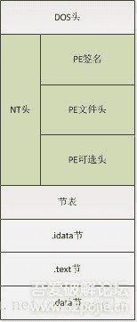
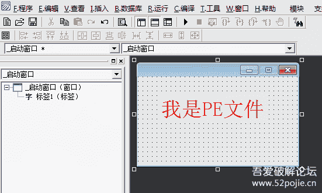
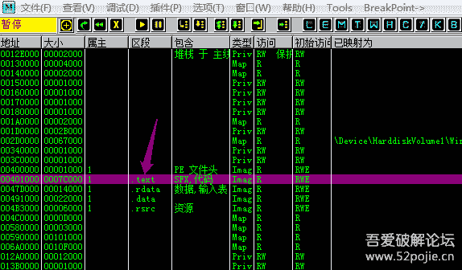
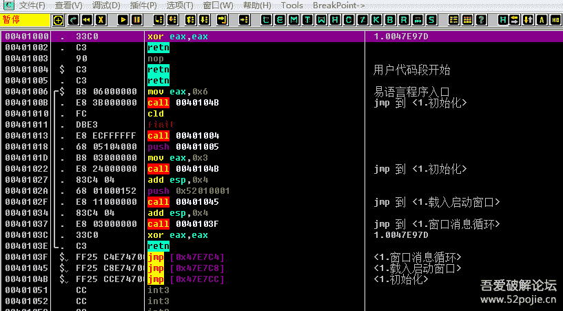
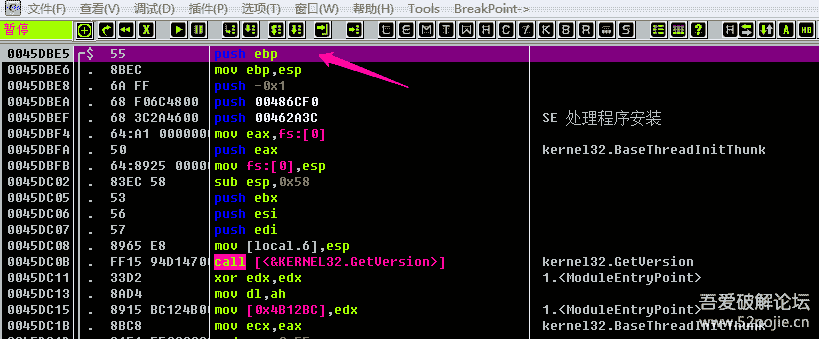
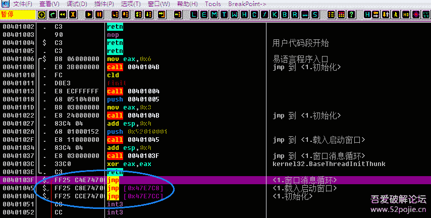
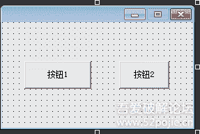
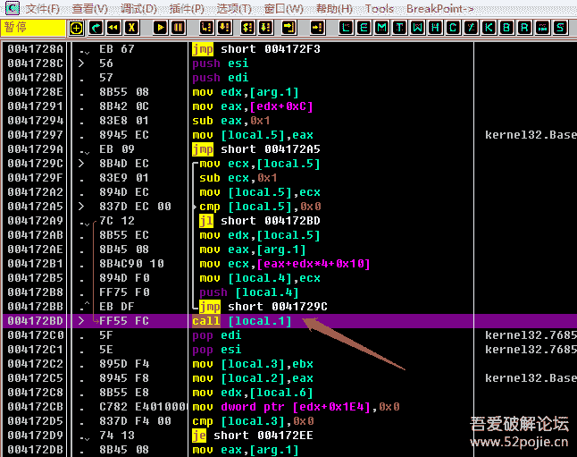

# [原创] 闲谈集——破解基础思维之二

- 原帖：https://www.52pojie.cn/forum.php?mod=viewthread&tid=1716854
- 抓取时间：2026-11-01T23:05:13

之所以命名为闲谈集，就是因为所讲内容均为闲谈，没有技术含量，也不精准，或许还错误百出，但唯一的好处就是通俗易懂，便于新人们理解。

感谢大家对第一集的支持，废话不说了，我接着继续以下的闲话，希望新人朋友们继续有收获。

今天，我们就聊聊软件的运行机制。

## 一、用户如何能够操作软件的运行？

我们这里只谈`windows`系统下的`exe`格式的文件。

我们玩[www.52pojie.cn](https://www.52pojie.cn)，破的就是`exe`文件，对吧？

`exe`文件也叫做可执行文件。

首先我们要明白，什么叫做可执行文件。

你可能笑了，这还要问吗？

可执行文件就是扩展名为`exe`的文件，当然还有`com`、`bat`等格式，我们这里只谈`exe`格式。

如果你的答案就是这个，那还真需要继续看下去。

所谓可执行文件，是指用户用鼠标双击后直接可以运行的文件，它不需要先启动其他的软件。

比如计算器这个小软件，我们双击就直接打开了，对吧。

但是，如果你写了一篇`wps`文档，比如《关于[www.52pojie.cn](https://www.52pojie.cn)论坛的现状和发展路径》，那么这个文档是可执行文件吗？

呵呵，当然不是，你会说这个文档的扩展名不是`exe`。

之所以说它不是可执行文件，不在于扩展名，而在于这个文件的打开必须依赖于先打开`wps`这个软件。

我们可以总结一下：

- `exe`文件是可执行文件，它的启动不依赖其他软件。
- 不可执行文件，它的启动必须依赖其他软件。

那么，你可能要问了，区分是不是可执行文件有什么意义吗？

当然有，意义重大。

你先想一想，为什么有些文件可以是可执行文件，有些文件是不可执行文件？

显然，这两类文件一定是有区别的。

这个区别就在于可执行文件有专门的文件结构。我们把可执行文件简称为`PE`文件。

凡是`PE`文件，必须有以下图示的结构：

附件：[下载](https://www.52pojie.cn/forum.php?mod=attachment&aid=MjU3MTY1N3xiMTZlMjk3ZHwxNzkzNTc0MzEwfDE2ODA4NnwxNzE2ODU0&nothumb=yes)
`20130914221950000.jpg` (10.1 KB, 下载次数: 0) 2022-11-22 09:58 上传

看到吗？熟悉吗？还记得我在上一集说的内存分区吗？

当我们双击一个`PE`文件，操作系统就会按照`PE`文件的结构把相应的数据拷贝到内存的不同区域中。尤其是`text`这节区，里面存放着软件执行的程序代码。

如果是非`PE`文件，就不是上面的结构。

现在问题来了，我们的操作系统把`PE`文件相关的数据已经放在内存中了，那么接下来怎么执行代码呢？

答案就是，操作系统会根据`PE`文件结构，找到这个程序的第一句代码的位置，这个位置就是`main`函数的位置，还记得`main`函数吗？上一集也说过。这个位置也叫做程序入口点，或者叫`OEP`。

一般而言，正常`PE`程序的入口点大多在`401000`这个起始地址以后的`text`区段内。

下面给大家直观的看一下：

我用易语言编写了一个最简单的程序。

附件：[下载](https://www.52pojie.cn/forum.php?mod=attachment&aid=MjU3MTY2MHw2NWYzNzFiOHwxNzkzNTc0MzEwfDE2ODA4NnwxNzE2ODU0&nothumb=yes)
`image.png` (32.81 KB, 下载次数: 0) 2022-11-22 10:21 上传

我们现在用`OD`打开，然后看一下分区：

附件：[下载](https://www.52pojie.cn/forum.php?mod=attachment&aid=MjU3MTY2NHw0MjNhZjU3OXwxNzkzNTc0MzEwfDE2ODA4NnwxNzE2ODU0&nothumb=yes)
`image.png` (26.03 KB, 下载次数: 0) 2022-11-22 10:22 上传

看到吗？`text`代码区是从`401000`开始的。

如果我们进一步用易语言分析工具来看，

附件：[下载](https://www.52pojie.cn/forum.php?mod=attachment&aid=MjU3MTY2NXw0MTYzZTZkZnwxNzkzNTc0MzEwfDE2ODA4NnwxNzE2ODU0&nothumb=yes)
`image.png` (36.14 KB, 下载次数: 0) 2022-11-22 10:24 上传

`401006`这个地址就是刚才写的易语言程序的入口点，或者叫`OEP`，我们自写的代码是从`OEP`以后才真正开始执行的。

那你可能会继续问，既然软件代码是在`OEP`以后才真正开始执行，那为什么我用`OD`打开软件后，显示的第一句代码不是`OEP`的位置？

比如，还是这个软件，如果你用`OD`直接打开，会出现下图：

附件：[下载](https://www.52pojie.cn/forum.php?mod=attachment&aid=MjU3MTY2NnwxNzRlM2RmZHwxNzkzNTc0MzEwfDE2ODA4NnwxNzE2ODU0&nothumb=yes)
`image.png` (32.7 KB, 下载次数: 0) 2022-11-22 10:30 上传

明明第一句的代码地址是`0045DBE5`。

这是因为程序在执行你写的代码之前，还要做一些初始化的相关工作，或者说要先执行一些基础性的、准备性的代码，这些代码是系统自动生成的。

等执行完这些基础性的工作后，才会转到`OEP`那里，开始执行你自己写的代码。

你应该基本懂了，但是你还会继续问，我知道这些有什么意义呢？

意义就在于，你要清楚破解破的是软件作者自写的代码，而这些代码的位置一定是在真正的`OEP`之后。

比如易语言编写的软件，为什么我们要用`FF25`去找易语言体，就是因为这个位置区域就是`OEP`所在的位置。

附件：[下载](https://www.52pojie.cn/forum.php?mod=attachment&aid=MjU3MTY2OXxiNjdjZjcyZnwxNzkzNTc0MzEwfDE2ODA4NnwxNzE2ODU0&nothumb=yes)
`image.png` (41.32 KB, 下载次数: 0) 2022-11-22 10:39 上传

这下更清楚一些了吧。

我们再接着分析。

当可执行文件被双击后，它的相关数据都存放到了不同分区，也找到了`OEP`，那么程序是不是就一句一句的顺序执行？

当然不是。

假设这个程序作者写了1000行代码，我们假定从1开始编号，第一句代码的地址是1，第二句是2，最后一句是1000。

那么，程序在运行过程中，会先停到地址1这个位置。

然后等待用户对这个软件的操作。

假定，我们有如下图的一个软件

附件：[下载](https://www.52pojie.cn/forum.php?mod=attachment&aid=MjU3MTY4M3xkYzhhYzI2MHwxNzkzNTc0MzEwfDE2ODA4NnwxNzE2ODU0&nothumb=yes)
`image.png` (13.3 KB, 下载次数: 1) 2022-11-22 10:50 上传

这个软件很简单，有两个按钮，分别是按钮1和按钮2，用户点击按钮1会弹出一个“欢迎您光临”的对话框，点击按钮2会弹出一个窗口。

那么当用户点击按钮1时，代码怎么执行呢？

首先你要明白，代码现在都在内存里，决定执行哪个地址的代码是操作系统来负责的，用户只是做了一个点击按钮的动作。

或者这么说，

用户点击了按钮1——操作系统看到了用户的动作——操作系统选择执行某个地址的代码

可见，程序的代码不是从`OEP`开始顺序执行的，而是由操作系统选择不同的地址进行执行。

那么，操作系统怎么看到用户的动作呢？又怎么知道该执行哪一句代码呢？

如果你是操作系统的开发者，你会想出什么办法解决这个问题呢？

呵呵，你先休息一下，因为有NB的人已经想到了最好的解决办法。

这个解决办法就是引入操作系统的“消息机制”。

简单来说，就是通过消息通知来完成。

软件被设计成窗口软件，操作系统监控所有的窗口。

每个窗口软件在执行的时候，操作系统都建立了一个专门的消息通道。

这里需要有几个前提：

第一，用户对窗口的任何操作，都会产生一个窗口消息，操作系统会捕获到这个消息，比如用户点击按钮1，操作系统会接收到一个窗口消息，这个消息的内容就是“用户点击了按钮1”。

第二，软件作者在编写软件时，要在编程中有专门的消息处理函数，这个消息处理函数针对不同的消息会执行不同的代码，产生不同的事件。

比如点击按钮1，产生的消息值是1，作者编程时就要写上如果消息值是1，那么就执行弹出对话框的这段代码。

比如点击按钮2，产生的消息值是2，作者编程时就要写上如果消息值是2，那么就执行弹出窗口的那段代码。

这样一来，操作系统只要找到软件作者编写的消息处理函数的地址，然后程序就可以根据不同的消息值来执行不同的代码段。

你基本能理解到这里，也就差不多了。

还是举易语言的例子，易语言编写的程序里的消息派发函数是很容易找到的，就是通过搜索特征码`FF55FC5F5E`来定位。看下图：

附件：[下载](https://www.52pojie.cn/forum.php?mod=attachment&aid=MjU3MTcwNXxhMDk1NTFhNXwxNzkzNTc0MzEwfDE2ODA4NnwxNzE2ODU0&nothumb=yes)
`image.png` (36.62 KB, 下载次数: 0) 2022-11-22 11:34 上传

`004172BD`这个地址上的`CALL`函数就是易语言编写程序的消息派发函数，所有的按钮点击的操作都会通过这个`CALL`后面的地址去执行不同的代码段。

所以在这个地址上设置断点，你就可以很快的找到不同的按钮点击后要执行的关键代码。

以上的内容已经不少了，大家先消化一下，以后接着说。

如果您觉得确实有帮助，请给支持，我会继续努力写下去，谢谢！
