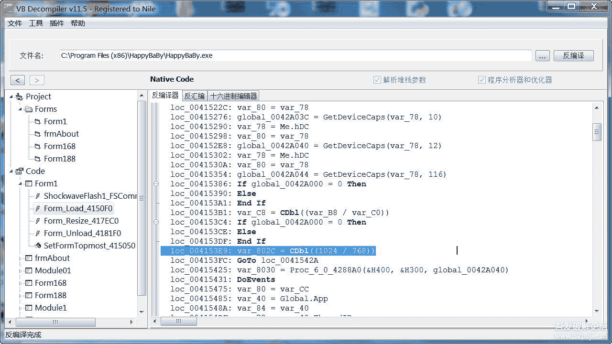
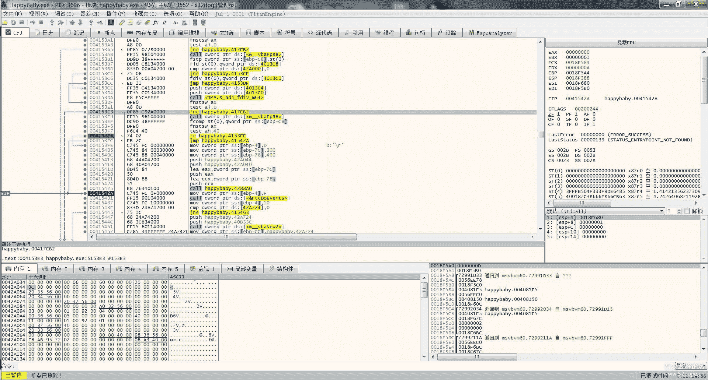
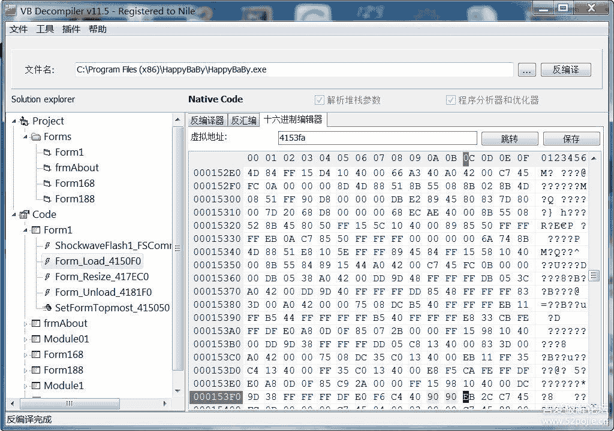
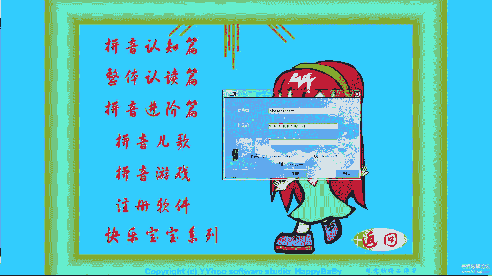
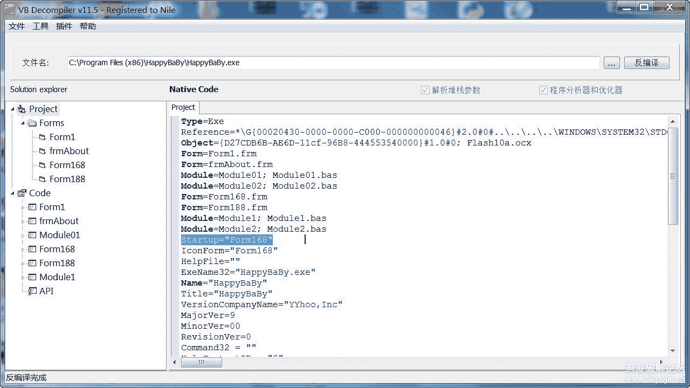
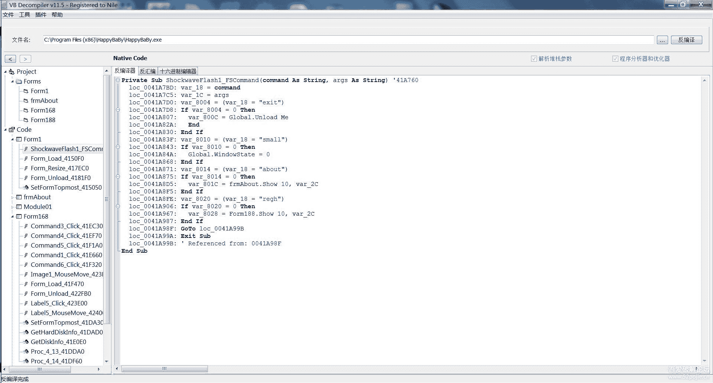
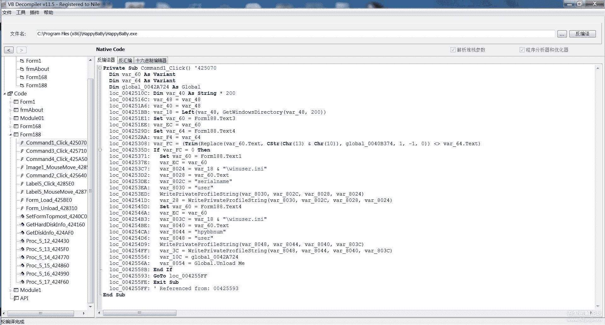
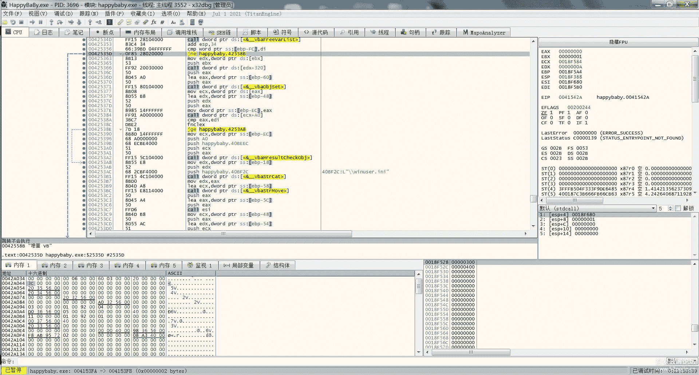
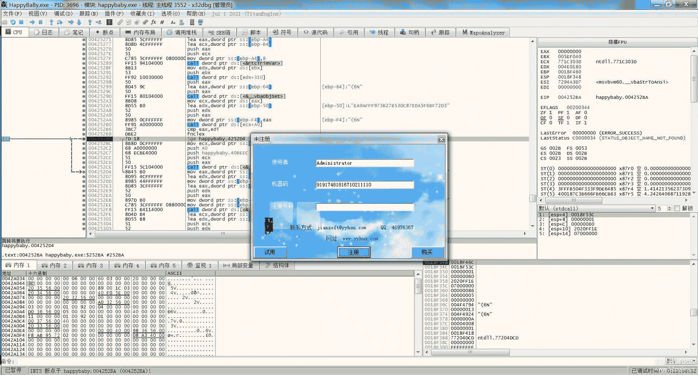

# [原创] 某VB编写的幼儿拼音学习软件简单使用分析

- 原帖：<https://www.52pojie.cn/forum.php?mod=viewthread&tid=1717333>
- 抓取时间：2026-11-01T23:05:10

背景：笔者的认知中，VB作为一种较为古老的语言，由于权限和接口等问题，在编程语言中处于鄙视链的较下游，如今如需VB编写软件，大多会用.NET，VB本尊使用量可能已经比不上VBA了。因此找一个VB编写的软件其实也挺不容易的，但找到了的话，软件的[www.52pojie.cn](https://www.52pojie.cn)难度一般都挺低的。作为新人历程笔记，笔者认为一款VB编写的软件还是需要的。其实VB这方面，论坛里有人发过那个齿轮、轴承等的计算软件很好，软件的注册思路清晰，暴破、读内存、注册码计算算法都非常简单，用于熟悉VB破解软件的使用非常顶，新手的小伙伴建议拿那个练手。这次选择的这款学拼音软件，个人并不推荐使用，主要原因是flash这种形式比较惹人烦，而对于破解来说，这软件也有点莫名其妙，以至于笔者至今未能领悟其注册的思路。然而VB写的软件本来就不多，笔者自身相关的更少，鉴于之后可能再找不到合适的软件，VB这块就试着先放这个，就当熟悉下工具软件操作。由于只为使用的话，软件的破解难度实在有点低，这篇加了权限。

## 〇、准备

- 软件官网：官网下载地址
- 使用工具：`VB Decompiler`，`x32dbg`，可选`VBExplorer`

注意：软件安装完成后会自动进入flash player的安装程序，笔者建议先不要装，直接退出，待确定软件无法运行后再想办法，比如找论坛中一些[无广告版本](https://www.52pojie.cn/thread-1707670-1-1.html)安装。

软件运行需要管理员权限，并且会将分辨率调整为1024×768，这令笔者非常不适，不论使用还是分析都非常不便，所以在准备工作中先干掉分辨率设置。通过`VB Decompiler`反编译，很容易找到分辨率设置是`Form1`加载是进行，查看`Form1`的`Form_Load`，通过1024×768，伪代码很容易找到分辨率设置的地方

`2022-11-22_185137.jpg`（201.51 KB，下载次数：0）

[附件链接](https://www.52pojie.cn/forum.php?mod=attachment&aid=MjU3MTk5M3w2MDhlMDI0MnwxNzkzNTc0MzA3fDE2ODA4NnwxNzE3MzMz&nothumb=yes)

2022-11-23 10:17 上传

不熟练的话可以用`x32dbg`调试一下，`004153FA`处`NOP`掉，就不设分辨率了

`2022-11-22_190548.jpg`（463.27 KB，下载次数：0）

[附件链接](https://www.52pojie.cn/forum.php?mod=attachment&aid=MjU3MTk5NHxmOThjYTU0OHwxNzkzNTc0MzA3fDE2ODA4NnwxNzE3MzMz&nothumb=yes)

2022-11-23 10:18 上传

熟练的话直接`VB Decompiler`反汇编找到代码，在十六进制编辑器中将`7402`改为`9090`，保存就好

`2022-11-22_231258.jpg`（232.84 KB，下载次数：0）

[附件链接](https://www.52pojie.cn/forum.php?mod=attachment&aid=MjU3MTk5NXxjMmYyODhjOHwxNzkzNTc0MzA3fDE2ODA4NnwxNzE3MzMz&nothumb=yes)

2022-11-23 10:18 上传

准备工作完毕。

## 一、软件初步了解

由于软件没有帮助文件，这次的分析完全没有上一篇清晰。

首先还是尝试运行软件，flash点进去后有一个注册软件按钮，点击后会出来一个窗体，显示使用者、机器码、注册号码三个文本框，看起来挺正规的，但也没说没注册会咋样，是功能限制、时间限制还是次数限制。直接点注册没有任何反应，似乎是直接进行验证的。至于flash内容，笔者粗略翻了翻，未发现功能限制。

`2022-11-22_232615.jpg`（210.32 KB，下载次数：0）

[附件链接](https://www.52pojie.cn/forum.php?mod=attachment&aid=MjU3MTk5Nnw2MzE4YTk5ZnwxNzkzNTc0MzA3fDE2ODA4NnwxNzE3MzMz&nothumb=yes)

2022-11-23 10:19 上传

`VB Decompiler`打开程序。这里注意下`VB Decompiler`的选项，注意别勾上只编译窗体，其他按个人喜欢设置就好，另外软件本身是有中文语言包的，需要相应语言的改下语言包文件名称，只要让语言包排序第一就好。

工程中一共4个窗体，2（4）个模块，有一个重要信息，启动对象是`Form168`，这和刚才试运行的感受不一样。`Form168`和`Form188`有一点像，但可以明显看出刚才的注册窗体是`Form188`。`Form1`是软件运行的主窗体，但只是给flash提供个地方，主要内容都是flash嵌入。此外还有个关于窗体。

`2022-11-22_184912.jpg`（156.91 KB，下载次数：0）

[附件链接](https://www.52pojie.cn/forum.php?mod=attachment&aid=MjU3MTk5N3w5NmQ4YTdmOXwxNzkzNTc0MzA3fDE2ODA4NnwxNzE3MzMz&nothumb=yes)

2022-11-23 10:19 上传

`Form1`中也可以看到注册命令打开的确实是`Form188`。

`2022-11-22_193907.jpg`（267.85 KB，下载次数：0）

[附件链接](https://www.52pojie.cn/forum.php?mod=attachment&aid=MjU3MTk5OHwxZDAwYmQwNnwxNzkzNTc0MzA3fDE2ODA4NnwxNzE3MzMz&nothumb=yes)

2022-11-23 10:20 上传

这里可以初步判断，软件先打开`Form168`，对试用是否到期会有个判断，未到期会由`Form168`打开`Form1`，否则会由`Form168`要求注册。

## 二、注册码初步了解

直接打开`Form188`中注册按钮点击事件（`command1_click`），通过伪代码很容易看出，按钮点击后会进行判断，如果文本框`Text3`的文本（也就是用户输入的注册码）将换行回车替换后，与文本框`Text4`的文本相等，就会在`Windows`文件夹中的`winuser.ini`文件中写入注册信息，写入的信息还不是`Text3`中自行填写的信息，而是软件算出来的信息，并且关闭该窗体。这做法就是警告你别逆向我啊，你要逆向我，我就直接告诉你注册码。

`2022-11-22_193944.jpg`（342.23 KB，下载次数：0）

[附件链接](https://www.52pojie.cn/forum.php?mod=attachment&aid=MjU3MTk5OXxkYjE2OTUwNnwxNzkzNTc0MzA3fDE2ODA4NnwxNzE3MzMz&nothumb=yes)

2022-11-23 10:20 上传

所以要暴破注册号码的话，直接把这里`Nop`掉就好，或者调试器里改下`ZF`就行。

`2022-11-22_194046.jpg`（432.5 KB，下载次数：0）

[附件链接](https://www.52pojie.cn/forum.php?mod=attachment&aid=MjU3MjAwMHxlMTg2ZDk1NXwxNzkzNTc0MzA3fDE2ODA4NnwxNzE3MzMz&nothumb=yes)

2022-11-23 10:21 上传

当然VB的字符串比较本来就不太高明，而这个软件也没特别弄这方面，稍微往前一点就可以看到比较的内容。

`2022-11-22_201034.jpg`（463.26 KB，下载次数：0）

[附件链接](https://www.52pojie.cn/forum.php?mod=attachment&aid=MjU3MjAwMXw2NWIwMTU5MHwxNzkzNTc0MzA3fDE2ODA4NnwxNzE3MzMz&nothumb=yes)

2022-11-23 10:21 上传

此外既然注册号码是存在隐藏文本框里的，直接让文本框显形也行，`VBExplorer`里找到`Text4`，可以看到不但不可见，而且位置超出窗体，设完为可见并将`Form188`的高度设为5200，单步保存即可。有心的小伙伴可以对比一下文件改了哪里，笔者个人觉得这个技能不常用，就不比较十六进制了

实际上注册窗体的流程大致是`Form168`/`Form188`载入时获取用户名、硬件信息，填入`Text1`和`Text2`，按下隐藏的按钮3计算注册号，填入隐藏的`Text4`，比较`Text3`与`Text4`判断注册码是否正确。控件的使用可谓眼花缭乱。这里可以在`command3_click`找注册号计算过程，但伪代码有缺，需要自己看汇编，笔者本来想练习一下，可惜发生了意外。

## 三、软件试用初步了解

意外：在第二步操作完成，一段时间后，软件突然不能使用了，打开软件时打开`Form168`，显示已注册所以注册按钮未使能，试用过期所以试用按钮未使能，只能购买或关闭。鉴于之前的注册码获取实在过于简单，笔者开始反思注册的姿势对不对。

找到`Form168`的`Form_Load`，简单分析窗口载入时的操作，代码较长，不上图了，感兴趣小伙伴自己看看：

1. 对注册表进行操作，建删子键，操作不成功则弹出对话框并关闭窗体；
2. 获取用户名、硬件信息，填入`Text1`和`Text2`，按下隐藏的按钮3计算注册号，填入隐藏的`Text4`；
3. 如`Windows`文件夹有`winuser.ini`文件，从中读取信息，如没有，新建该文件；
4. 如`Windows`文件夹有`hpysoft.txt`文件，从中读取信息，如没有，从临时文件夹复制文件，如临时文件夹也没有，新建该文件；
5. 注册表信息更新；
6. `hpysoft.txt`文件信息比较，最后一组信息如等于某一值，认为试用期已到，出现意外中描述的情况，否则正常载入`Form1`。

另外`Form168`的`Form_Unload`中会对`hpysoft.txt`文件信息加一写入`hpysoft.txt`文件。

知道了以上信息，破解的方式就比较多了，笔者将`Windows`和临时文件夹中的`hpysoft.txt`文件删除，待新建后将`Windows`文件夹中的`hpysoft.txt`文件设为只读。

其余方式，包括暴破，做个批处理，修改`EP`等也都有的搞。

所以注册号码有没有貌似关系不大，软件就是个按次试用的软件，做了那眼花缭乱的注册窗口笔者真没看出其意义。

## 四、后记

关于伪代码，有人说比汇编还难看，笔者个人觉得除了变量用栈地址命名外，其实VB的伪代码和原代码其实还是挺像的，笔者多少算写过VB的小计算程序，看伪代码并没有感觉特别吃力。笔者认为，写一写功能性的小程序，对于破解时看懂代码是非常有用的。

最后，这个软件虽然结构简单，可以学的其实也还挺多的，只是笔者水平和接下来时间所限，对该软件的学习暂止于此。
