# [原创] 一个CM简单的逆向

- 原帖：[https://www.52pojie.cn/forum.php?mod=viewthread&tid=1717431](https://www.52pojie.cn/forum.php?mod=viewthread&tid=1717431)
- 抓取时间：2026-11-01T23:05:05

想写个新手教程混点评分，但一直不知道写什么。今天看到一个 CM，就拿这个给新手写个教程，没什么含量，大侠们别喷。伸出友爱的小手给点热心值，谢谢大家。CM 地址：[https://www.52pojie.cn/thread-1716699-1-1.html](https://www.52pojie.cn/thread-1716699-1-1.html)。

## 一、直接追码获取账号和密码

### 1. 测试并定位关键断点

首先打开程序，随便输入账号、密码测试。提示信息为账号错误（注：是账号错误，不是密码错误，说明第一次判断用户，第二次才判断密码）。

把程序拖入 OD，运行程序，输入假的账号和密码。先不点登录，然后按 `CTRL+F` 搜索 `TEST EDX,3`。

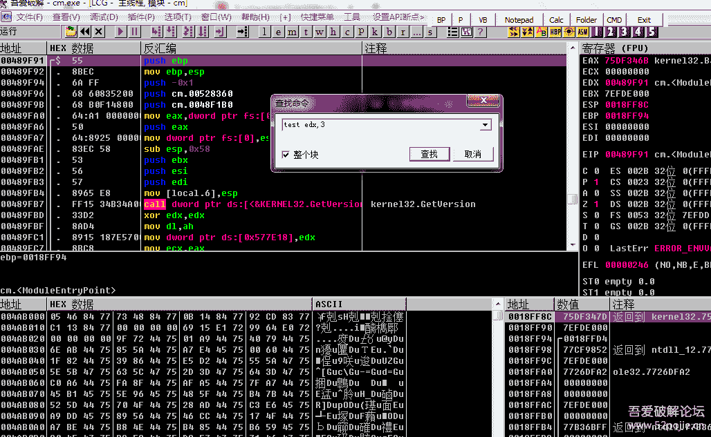

来到此处，在这里按 `F2` 下断点。

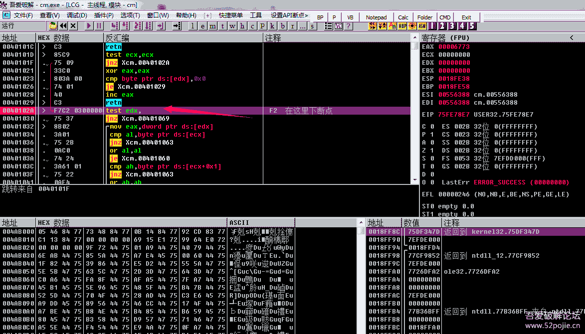

然后点登录，程序在此位置成功断下。接下来一次次按 `F9`，让程序运行比较，最后看到账号的对比。

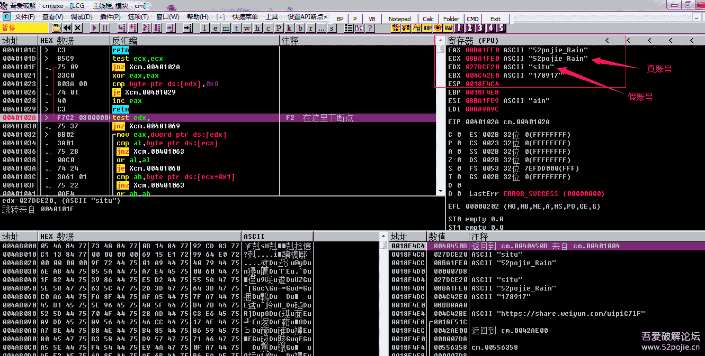

### 2. 查找账号

现在知道账号是 `52pojie_Rain`。接下来重新把程序载入 OD，按 `F9` 运行程序，在账号处输入 `52pojie_Rain`，密码依然输入假码 `123456`。点登录，程序被断在设置过的断点位置。依然一次次按 `F9` 运行，让程序进行真假注册码对比，直到看见假码出现。

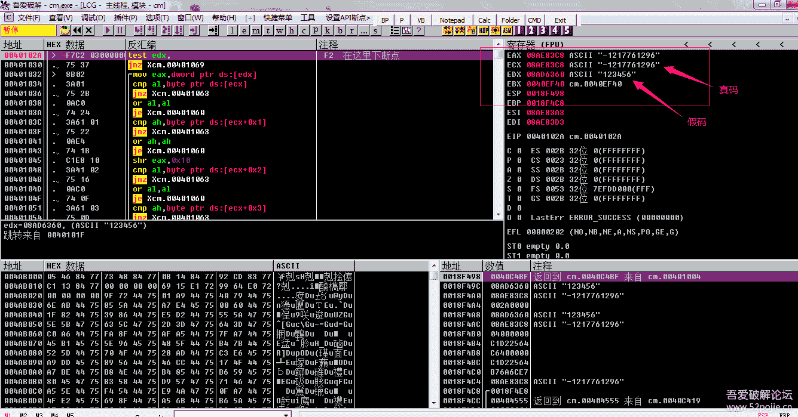

### 3. 查找密码

现在真码出现了：`-1217761296`（你们电脑上的结果和我的不一样，因为机器码不同，所以注册码也不同）。来测试一下。

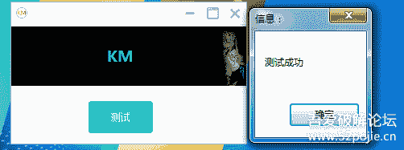

OK，到此程序真正的账号和密码就被我们拿到了。

---

## 二、`PUSH` 法暴破

接下来用第二种 `PUSH` 法。暴破时把两处对比账号和密码的关键位置 `NOP` 掉即可。这里就不展开说了，有兴趣的可以自己尝试。

### 1. 搜索并替换 `PUSH 10001`

首先用 OD 载入程序，按 `CTRL+F` 搜索 `PUSH 10001`。

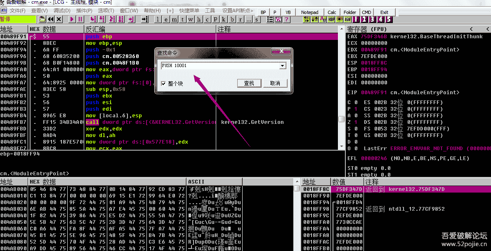

来到此位置。

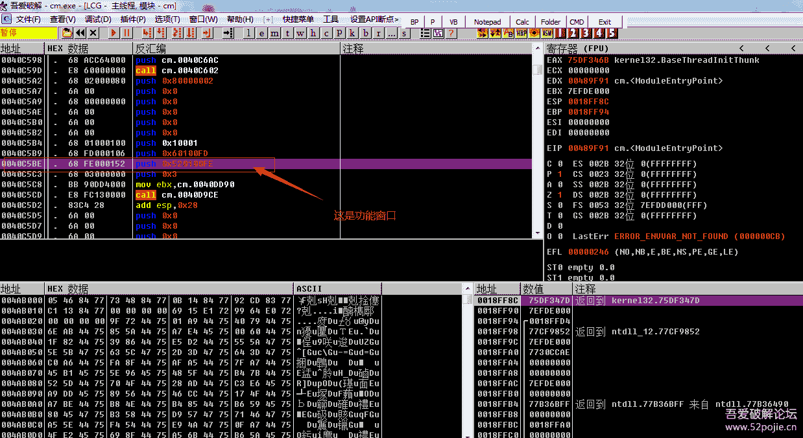

箭头指向为功能窗口，复制下来 `push 0x520100FE`，然后按 `CTRL+B` 搜索二进制 `FF25`，来到此位置。

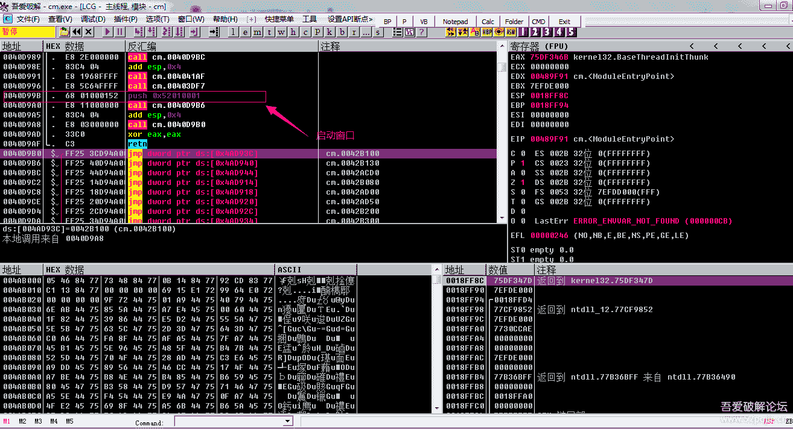

把刚才复制的 `push 0x520100FE` 替换到启动窗口这里，改好后如下图。

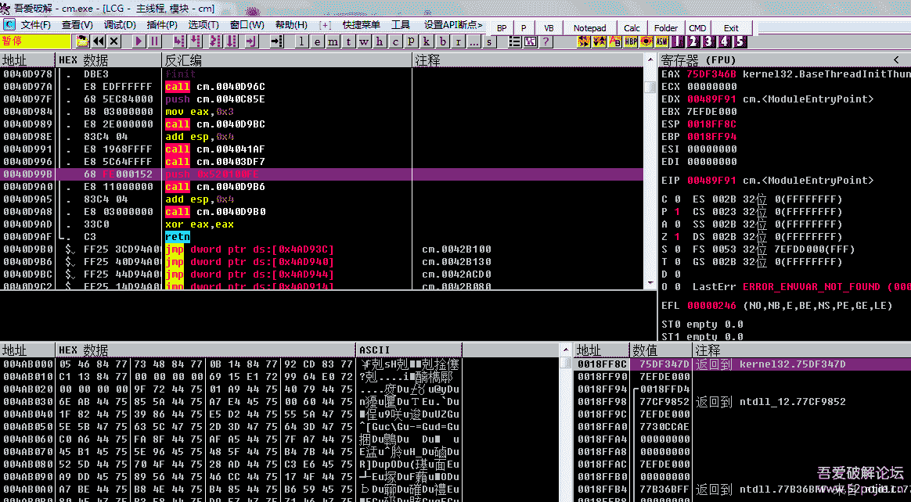

然后右键保存程序。

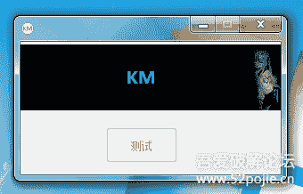

运行后看到 `PUSH` 大法替换出来的程序，测试按钮是灰色，属于阉割版，功能不全。我们继续，把这个保存出来的 CM 拖入 OD 里，点 `插件` → `API断点设置工具` → `常用断点设置`。

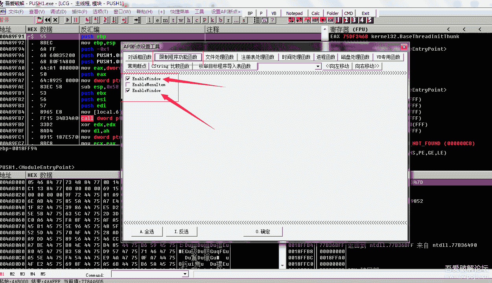

不知道为什么有两个一样的，都选上吧。然后按 `F9` 运行程序，程序果断断下来。

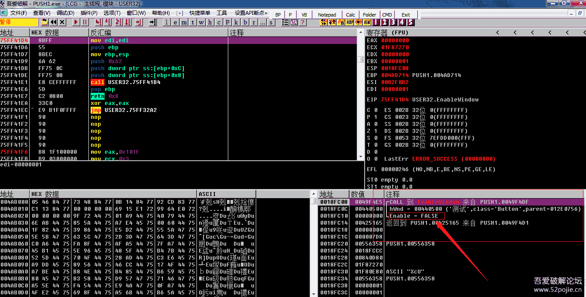

### 2. 修复灰色按钮

看右下角位置，`Enable = FALSE` 返回值为假。如果让返回值为真，按钮肯定就正常了；也就是返回 `0` 为假，返回 `1` 为真。在 `CALL` 到 `EnableWindow`、来自 `PUSH 1.0049F4DF` 处的反汇编窗口中跟随。

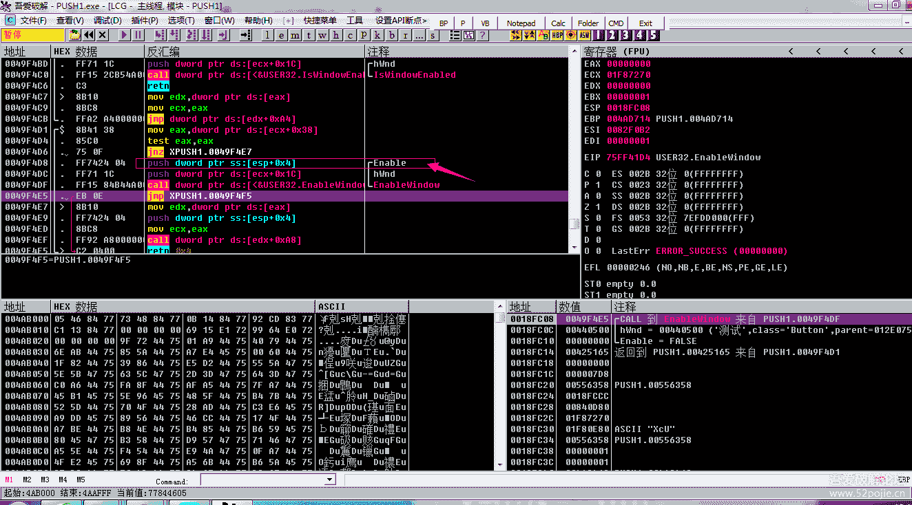

这里应该是压入了一个为 `0` 的值，所以按钮才灰色不可用。

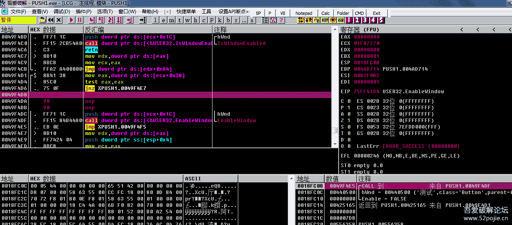

我们改为 `PUSH 1`，然后保存一下程序。接下来运行第二次修改好的程序。

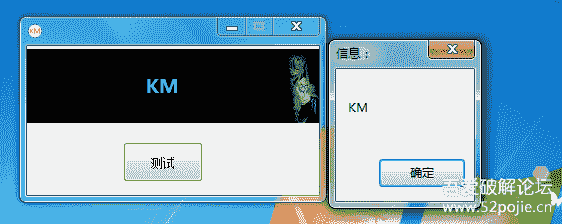

按钮可以用了，但是信息提示 `KM`，却不是测试成功。我们还要再进入 OD 里修改。拖入 OD 后，直接使用 `中文搜索引擎` → `智能搜索`，搜索字符串 `KM`。

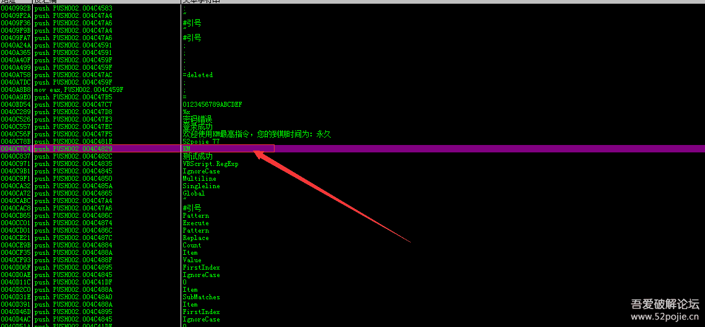

[附件](https://www.52pojie.cn/forum.php?mod=attachment&aid=MjU3MjA2OHw4NGI0M2M1NHwxNzkzNTc0MzAyfDE2ODA4NnwxNzE3NDMx&nothumb=yes)

2022-11-23 12:51 上传

双击来到相关位置处，

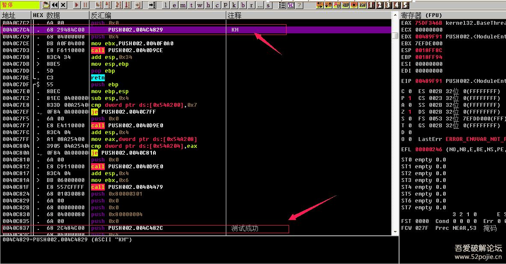

`image.png` (51.5 KB, 下载次数: 2)

[附件](https://www.52pojie.cn/forum.php?mod=attachment&aid=MjU3MjA2OXxlYTI5ZmY1NnwxNzkzNTc0MzAyfDE2ODA4NnwxNzE3NDMx&nothumb=yes)

2022-11-23 12:54 上传

发现下面就是提示的测试成功的字符串。而且对比从此位置往下到`RETN`代码是一样的。那么直接把`push 0x4C4829`修改为`push 0x4C482C`。

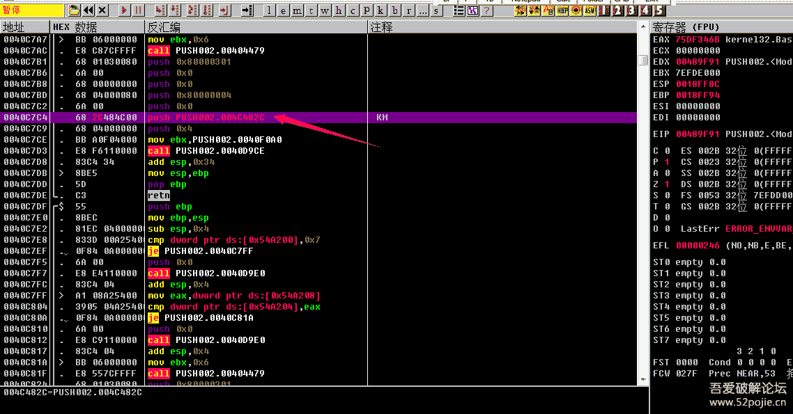

`image.png` (49.77 KB, 下载次数: 1)

[附件](https://www.52pojie.cn/forum.php?mod=attachment&aid=MjU3MjA3MHwyZGE4YWYxN3wxNzkzNTc0MzAyfDE2ODA4NnwxNzE3NDMx&nothumb=yes)

2022-11-23 12:57 上传

修改后再保存下程序。运行修改好的程序测试，这次没问题了。

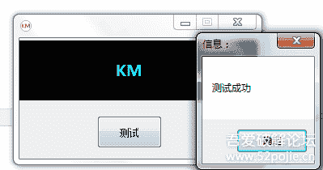

`image.png` (23.13 KB, 下载次数: 0)

[附件](https://www.52pojie.cn/forum.php?mod=attachment&aid=MjU3MjA3MXw3NzY3MzgxMHwxNzkzNTc0MzAyfDE2ODA4NnwxNzE3NDMx&nothumb=yes)

2022-11-23 12:58 上传

到此结束。动动友爱的小手给点免费的评分，爱心值，谢谢大家！
