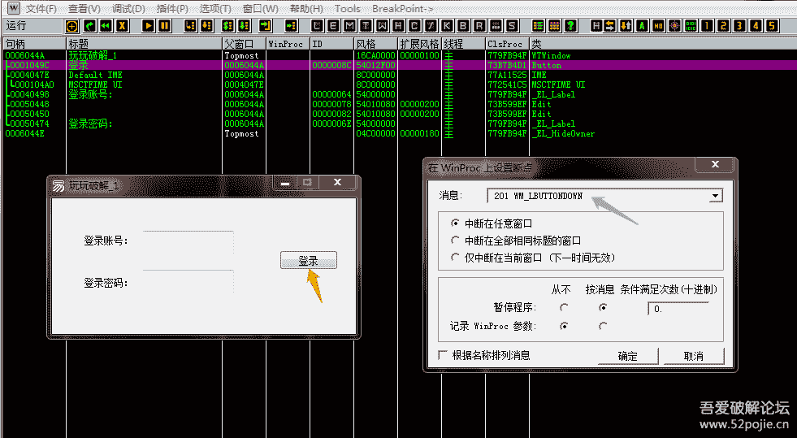
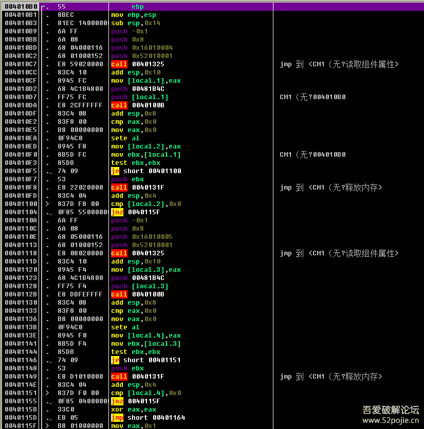
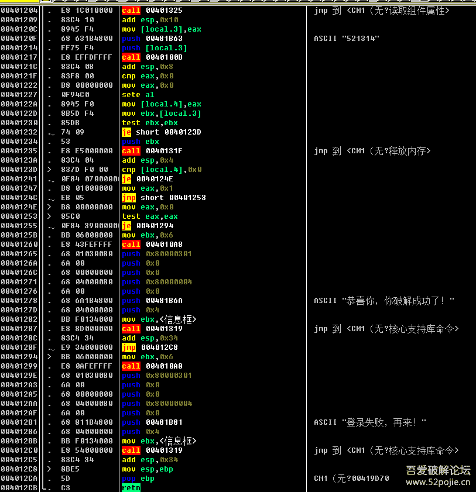
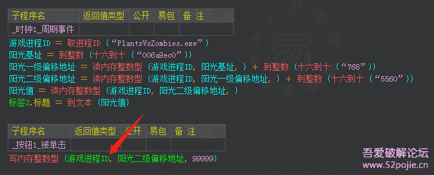
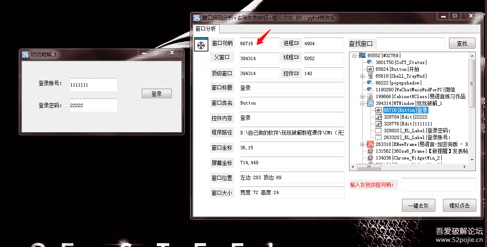

# [原创] 闲谈集——破解基础思维之三

- 原帖：<https://www.52pojie.cn/forum.php?mod=viewthread&tid=1717918>
- 抓取时间：2026-11-01T23:05:02

## 引言

之所以命名为闲谈集，就是因为所讲内容均为闲谈，没有技术含量，也不精准，或许还错误百出，但唯一的好处就是通俗易懂，便于新人们理解。

我们接着闲谈。

## 上一集回顾：PE文件的运行机制

上一集，你应该基本清楚一个可执行文件（PE文件）是如何运行的。

简单归纳一下，就是：

1. PE文件有特殊的结构，其数据是分区放置的，当PE文件执行的时候，操作系统把PE文件的数据对应映射到内存中不同的区域中（代码段、数据段、资源段等）。
2. PE文件运行的时候，操作系统根据PE文件结构，找到文件的`main`函数的位置（程序入口点，或叫OEP），然后等待用户操作。
3. 用户对窗口软件（PE文件格式）进行操作的时候（比如鼠标左键点击按钮、输入文字、窗口变大变小、移动等），就发生了一个事件，然后把这个事件构造成为一个消息的结构体（比如鼠标左键按下的消息常量值是十六进制的`201`，还有鼠标的位置等内容）。

看下图所示：

`image.png`（64.87 KB，下载次数：1）

[附件下载](https://www.52pojie.cn/forum.php?mod=attachment&aid=MjU3MjUzMXw0M2QyZDk5YnwxNzkzNTc0Mjk5fDE2ODA4NnwxNzE3OTE4&nothumb=yes)

2022-11-24 09:23 上传

红色箭头是这个小程序的登录按钮。如果你用鼠标点了一下这个登录按钮，会发生什么呢？

看一下蓝色箭头指的位置。

这时，操作系统就会发送一个消息给这个小程序，通知它有用户点击了你的登录按钮，这个消息是一个结构体，其中的消息常量值是`201`。如果是其他操作，消息的常量值是不一样的数值。

4. 操作系统中有一个消息中心，这个中心的功能就是监控各种窗口事件产生的消息，进行捕获和发送。
5. 用户程序中有专门的消息接收和处理的函数，用于处理对自己的窗口发生的各类事件产生的消息（比如鼠标消息、键盘消息等）。

假设还是上面的小程序，那么当它接收到刚才的消息结构体，它就执行按钮事件的那一段代码。

`image.png`（38.13 KB，下载次数：0）

[附件下载](https://www.52pojie.cn/forum.php?mod=attachment&aid=MjU3MjUzMnxjMjM5Mzc3MXwxNzkzNTc0Mjk5fDE2ODA4NnwxNzE3OTE4&nothumb=yes)

2022-11-24 09:33 上传

`image.png`（39.97 KB，下载次数：0）

[附件下载](https://www.52pojie.cn/forum.php?mod=attachment&aid=MjU3MjUzNHw5NDgwNTkyNnwxNzkzNTc0Mjk5fDE2ODA4NnwxNzE3OTE4&nothumb=yes)

2022-11-24 09:34 上传

这下应该更清楚了吧。

简言之，windows系统上的应用软件的运行机制是：事件驱动——消息传递——消息处理。

好了，我们继续进行。

## 两个问题

如果我们同时打开两个应用软件，比如A和B，在电脑桌面上有两个不同的窗口。

你有没有想过以下两个问题？

### 问题一：不同软件的同一地址数据是否相同

第一个问题是如果我用OD分别分析A软件和B软件，是不是都有可能有`401000`这个地址上的数据，这两个数据是一样的吗？

我们都知道计算机的物理内存，也就是插在计算机的主板上的内存条是固定的，可能是8G、16G、32G或者64G的。

我们以前的课程说过，你运行一个应用程序，操作系统就会把这个应用程序的数据拷贝到内存里。那么如果你打开100个或者更多，那内存条上的数据不就满了吗？

其实，操作系统对内存的管理是有特殊的解决方法的。

因为是新人朋友，我们就不讲这么深入了，你就记得一条，在32位操作系统下，系统给每个应用程序分配的内存空间的大小是4G，这4G空间是公用的，操作系统会根据用户对不同软件的操作自动切换执行。

也就是说，这一刻`401000`处的数据是A程序的，下一刻这个地址上的数据可能是B程序的。

那么操作系统怎么分辨是哪个程序的数据呢？

是根据进程来区分的。

每个应用程序执行后，都会产生一个进程，进程就是这个应用程序在内存中的资源总和，每个进程都有不同的编号，叫做进程ID，根据进程ID就可以访问不同的数据和资源。

举个例子，我现在如果做一个植物大战僵尸的辅助，就是对这个游戏的阳光数量的地址写入`99999`，那么我们可以这么编程。

`image.png`（96.98 KB，下载次数：1）

[附件下载](https://www.52pojie.cn/forum.php?mod=attachment&aid=MjU3MjU0NXxkNDBmNGEyM3wxNzkzNTc0Mjk5fDE2ODA4NnwxNzE3OTE4&nothumb=yes)

2022-11-24 10:04 上传

看红色箭头指的位置，只要我们知道这个游戏的进程ID，就可以在这个进程中的某个地址里读写数据。

### 问题二：操作系统如何知道用户操作了哪个窗口

第二个问题是操作系统如何知道用户操作了哪个窗口？

你可能会说，是不是根据不同窗口在电脑桌面上的位置来区分。

不是，那如果你移动窗口，窗口的位置变了，怎么办？

真实的情况是，操作系统会给当前运行的每个窗口分配一个窗口句柄，也就是窗口的一个编号，这个编号是独一无二的。

我们看下图：

`image.png`（134.58 KB，下载次数：0）

[附件下载](https://www.52pojie.cn/forum.php?mod=attachment&aid=MjU3MjU1NnxhY2RlOWFmMXwxNzkzNTc0Mjk5fDE2ODA4NnwxNzE3OTE4&nothumb=yes)

2022-11-24 10:26 上传

红色箭头指的`66716`就是这个小软件里面的登录按钮（也是窗口）的窗口句柄。

窗口的所有操作都依赖于这个窗口句柄。

不同的窗口句柄，表明是不同的窗口。

如果你想做一个辅助工具，比如鼠标连点器，就是对登录这个按钮进行持续的点击，那么你就需要先获取这个登录按钮控件的窗口句柄。

`image.png`（12.67 KB，下载次数：1）

[附件下载](https://www.52pojie.cn/forum.php?mod=attachment&aid=MjU3MjU2N3xkNjM0Zjk5MHwxNzkzNTc0Mjk5fDE2ODA4NnwxNzE3OTE4&nothumb=yes)

2022-11-24 10:32 上传

如果你用易语言编程，就用这个函数就可以了，把窗口句柄填入。

## 总结

我们再来简单总结下：

1. 操作系统通过进程来区分不同的运行程序，进程ID是做辅助或者是注册机的前提，有了进程ID你就可以对这个进程中的内存地址进行读写操作，也就是可以修改数据。
2. 操作系统通过窗口句柄来区分不同的程序窗口，所有的消息也是基于不同的窗口句柄来实现传递，有了窗口句柄你就可以对这个窗口进行操作，比如模拟点击按钮，或者模拟输入文字。

就先写到这里吧，希望能让大家对软件运行的内部有更清晰的理解。

如果您觉得确实有帮助，请给支持，我会继续努力写下去，谢谢！
