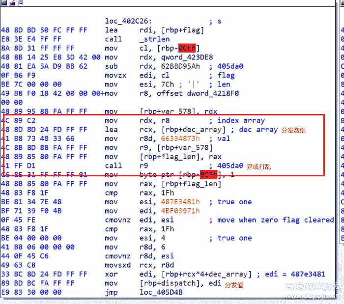
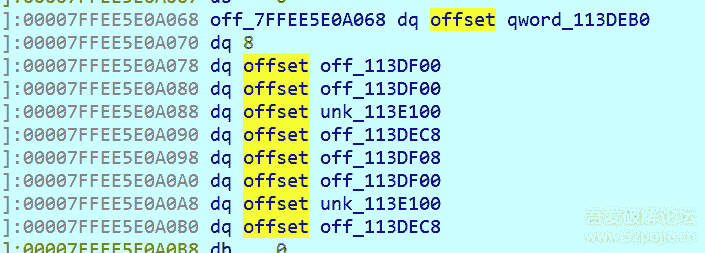
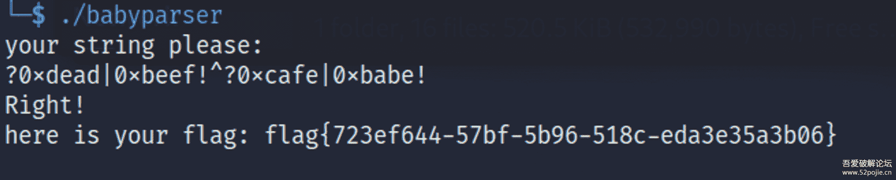

# [CTF] 2022祥云杯CTF 中 babyparser 的题解

- 原帖：<https://www.52pojie.cn/forum.php?mod=viewthread&tid=1718676>
- 抓取时间：2026-11-01T23:05:00

这道题是比赛结束前3小时放出来的，最后是0解。我有理由怀疑这是一道防ak题。

原题附件需要`glibc2.34`，但我的kali版本不够高，所以我`patchelf`成自编译的2.34，也因此搞丢了原题附件，现在上传的是`patchelf`以后的版本，如果有需要可以自己`patch`回去。

## 比赛时的逆向

比赛时候打开一看啊，发现这个程序用了`ollvm`的`deflat`来进行混淆，而且仔细一看是个全混淆，所有能混淆的地方它都混淆了。还好之前有所准备，拿起了之前备好的[`deflat.py`](https://github.com/cq674350529/deflat/blob/master/flat_control_flow/deflat.py)准备一把梭。梭完一看发现失败了，原来是这个`ollvm`改良过，出题人修改了`deflat`的`llvm pass`，分发逻辑增加了一步。其中真实块的样子大概是这样的



`1669376249002.png`（191.75 KB，下载次数：263）

[附件下载](https://www.52pojie.cn/forum.php?mod=attachment&aid=MjU3MzE2OHxmMTdkYTM5NHwxNzkzNTc0Mjk3fDE2ODA4NnwxNzE4Njc2&nothumb=yes)

2022-11-25 20:49 上传

这时候我以为出题人把打乱的函数都用上图中类似的`call rax`间接调用来实现。此时我心态平和，我以为还剩三小时放出来的题必不会很难，于是想尝试修改上面那个基于`angr`的`deflat`脚本。我低估了其中的难度，对于`angr`本身也不熟悉的我根本改不来。所以最后尝试动调加手动`patch binary`。但是只是尝试了一会我就发现这个做不到，因为量太大了。因此最后决定这题先放弃，跑去做别的了。

## 赛后复盘

### 去混淆

赛后当然还是想把这道题`deflat`出来，于是在之前的基础上学习了`angr`的用法，折腾了几天，发现`angr`作为符号执行的工具对于这种去混淆的处理其实并不是很合适。因为`deflat`部分的处理本质上是在模拟执行程序，并且记录真实的控制流，而这部分并不是`angr`所擅长的。那么谁更合适呢？当然是模拟执行的神器`unicorn`！

转头去尝试用`unicorn`完成`deflat`后，这题终于也走上了正轨。找了已有的`unicorn` `deflat`脚本，并在此基础上进行更改，写出了一个`deflat`脚本：


```python
#coding=utf-8

import collections

import angr

import am_graph
from util import * 

# from keystone import *
from unicorn import *
from unicorn.x86_const import *
from capstone import *
from capstone.x86 import *

obfus = [0x405DA0, 0x417610, 0x4149D0]

def reg_ctou(regname:str):
    # This function covert capstone reg name to unicorn reg const.
    # https://github.com/unicorn-engine/unicorn/blob/master/bindings/python/unicorn/x86_const.py
    mp =  { 'INVALID' : 0,  'AH' : 1,  'AL' : 2,  'AX' : 3,  'BH' : 4,  'BL' : 5,  'BP' : 6,  'BPL' : 7,  'BX' : 8,  'CH' : 9,  'CL' : 10,  'CS' : 11,  'CX' : 12,  'DH' : 13,  'DI' : 14,  'DIL' : 15,  'DL' : 16,  'DS' : 17,  'DX' : 18,  'EAX' : 19,  'EBP' : 20,  'EBX' : 21,  'ECX' : 22,  'EDI' : 23,  'EDX' : 24,  'EFLAGS' : 25,  'EIP' : 26,  'ES' : 28,  'ESI' : 29,  'ESP' : 30,  'FPSW' : 31,  'FS' : 32,  'GS' : 33,  'IP' : 34,  'RAX' : 35,  'RBP' : 36,  'RBX' : 37,  'RCX' : 38,  'RDI' : 39,  'RDX' : 40,  'RIP' : 41,  'RSI' : 43,  'RSP' : 44,  'SI' : 45,  'SIL' : 46,  'SP' : 47,  'SPL' : 48,  'SS' : 49,  'CR0' : 50,  'CR1' : 51,  'CR2' : 52,  'CR3' : 53,  'CR4' : 54,  'CR8' : 58,  'DR0' : 66,  'DR1' : 67,  'DR2' : 68,  'DR3' : 69,  'DR4' : 70,  'DR5' : 71,  'DR6' : 72,  'DR7' : 73,  'FP0' : 82,  'FP1' : 83,  'FP2' : 84,  'FP3' : 85,  'FP4' : 86,  'FP5' : 87,  'FP6' : 88,  'FP7' : 89,  'K0' : 90,  'K1' : 91,  'K2' : 92,  'K3' : 93,  'K4' : 94,  'K5' : 95,  'K6' : 96,  'K7' : 97,  'MM0' : 98,  'MM1' : 99,  'MM2' : 100,  'MM3' : 101,  'MM4' : 102,  'MM5' : 103,  'MM6' : 104,  'MM7' : 105,  'R8' : 106,  'R9' : 107,  'R10' : 108,  'R11' : 109,  'R12' : 110,  'R13' : 111,  'R14' : 112,  'R15' : 113,  'ST0' : 114,  'ST1' : 115,  'ST2' : 116,  'ST3' : 117,  'ST4' : 118,  'ST5' : 119,  'ST6' : 120,  'ST7' : 121,  'XMM0' : 122,  'XMM1' : 123,  'XMM2' : 124,  'XMM3' : 125,  'XMM4' : 126,  'XMM5' : 127,  'XMM6' : 128,  'XMM7' : 129,  'XMM8' : 130,  'XMM9' : 131,  'XMM10' : 132,  'XMM11' : 133,  'XMM12' : 134,  'XMM13' : 135,  'XMM14' : 136,  'XMM15' : 137,  'XMM16' : 138,  'XMM17' : 139,  'XMM18' : 140,  'XMM19' : 141,  'XMM20' : 142,  'XMM21' : 143,  'XMM22' : 144,  'XMM23' : 145,  'XMM24' : 146,  'XMM25' : 147,  'XMM26' : 148,  'XMM27' : 149,  'XMM28' : 150,  'XMM29' : 151,  'XMM30' : 152,  'XMM31' : 153,  'YMM0' : 154,  'YMM1' : 155,  'YMM2' : 156,  'YMM3' : 157,  'YMM4' : 158,  'YMM5' : 159,  'YMM6' : 160,  'YMM7' : 161,  'YMM8' : 162,  'YMM9' : 163,  'YMM10' : 164,  'YMM11' : 165,  'YMM12' : 166,  'YMM13' : 167,  'YMM14' : 168,  'YMM15' : 169,  'YMM16' : 170,  'YMM17' : 171,  'YMM18' : 172,  'YMM19' : 173,  'YMM20' : 174,  'YMM21' : 175,  'YMM22' : 176,  'YMM23' : 177,  'YMM24' : 178,  'YMM25' : 179,  'YMM26' : 180,  'YMM27' : 181,  'YMM28' : 182,  'YMM29' : 183,  'YMM30' : 184,  'YMM31' : 185,  'ZMM0' : 186,  'ZMM1' : 187,  'ZMM2' : 188,  'ZMM3' : 189,  'ZMM4' : 190,  'ZMM5' : 191,  'ZMM6' : 192,  'ZMM7' : 193,  'ZMM8' : 194,  'ZMM9' : 195,  'ZMM10' : 196,  'ZMM11' : 197,  'ZMM12' : 198,  'ZMM13' : 199,  'ZMM14' : 200,  'ZMM15' : 201,  'ZMM16' : 202,  'ZMM17' : 203,  'ZMM18' : 204,  'ZMM19' : 205,  'ZMM20' : 206,  'ZMM21' : 207,  'ZMM22' : 208,  'ZMM23' : 209,  'ZMM24' : 210,  'ZMM25' : 211,  'ZMM26' : 212,  'ZMM27' : 213,  'ZMM28' : 214,  'ZMM29' : 215,  'ZMM30' : 216,  'ZMM31' : 217,  'R8B' : 218,  'R9B' : 219,  'R10B' : 220,  'R11B' : 221,  'R12B' : 222,  'R13B' : 223,  'R14B' : 224,  'R15B' : 225,  'R8D' : 226,  'R9D' : 227,  'R10D' : 228,  'R11D' : 229,  'R12D' : 230,  'R13D' : 231,  'R14D' : 232,  'R15D' : 233,  'R8W' : 234,  'R9W' : 235,  'R10W' : 236,  'R11W' : 237,  'R12W' : 238,  'R13W' : 239,  'R14W' : 240,  'R15W' : 241,  'IDTR' : 242,  'GDTR' : 243,  'LDTR' : 244,  'TR' : 245,  'FPCW' : 246,  'FPTAG' : 247,  'MSR' : 248,  'MXCSR' : 249,  'FS_BASE' : 250,  'GS_BASE' : 251,  'FLAGS' : 252,  'RFLAGS' : 253,  'FIP' : 254,  'FCS' : 255,  'FDP' : 256,  'FDS' : 257,  'FOP' : 258,  'ENDING' : 259,  }
    regname = regname.upper()
    return mp[regname]

def get_context(): # record all X86/64 regs  
    global mu
    return mu.context_save()

def set_context(context:bytes):
    global mu
    if context == None :
        return
    else:
        mu.context_restore(context)
    return 

# callback for memory exception
def hook_mem_access(uc,type,address,size,value,userdata):
    pc = uc.reg_read(UC_X86_REG_RIP)
    print ('pc:%x type:%d addr:%x size:%x' % (pc,type,address,size))

def hook_code(uc, address, size, user_data):

    global base
    global is_success
    global list_trace
    global relevants
    global next_real_block_addr
    global block_start_addr
    global branch_control
    global instrs_size
    global memset_count
    global nop_instruc
    instrs_size = size 
    if is_success:
        uc.emu_stop()
        return

    # if address > end:  
    #     uc.emu_stop()
    #     return

    for ins in md.disasm(bin[address-base:address -base + size], address-base):
        #print(">>> Tracing instruction at 0x%x, instruction size = 0x%x" % (address, size))
        #print(">>> 0x%x:\t%s\t%s" % (ins.address, ins.mnemonic, ins.op_str))

        #  bfs 的visit array  防止陷入循环
        if address in relevants:
            if address in list_trace:
                print("sssssss")
                uc.emu_stop()
            else:
                list_trace[address] = 1

        # 找到了下一个块
        if address in relevants and address != block_start_addr:
            is_success = True
            next_real_block_addr = address
            #print 'find:%x' % address
            uc.emu_stop()
            return

        #是否跳过指令
        flag_pass = False
        if ins.mnemonic.startswith("call") :
            if(ins.op_str  == '0x2090' and memset_count > 12 
```

对于好几个关键函数进行去混淆以后，终于可以开始着手逆向了！

## C++ STL 逆向

接下来就是逆向的问题了。先简单逆一下能知道，程序要求的输入是符号和数字，其中数字必须是 `0x[a-f][a-f][a-f][a-f]`，符号只能是 `?!^|`；再加上题目说这是一个 `parser`，我们可以猜到这是一个算式的解析。那么肯定代码里会出现 `stack` 这个 STL 的数据结构，而我对此并不是很熟悉。果然我在动调的时候发现了 `sub_4151B0()` 是一个 `parser` 功能的函数，其中它的第一个参数是这样的结构：



`1669377798312.png`（39.99 KB，下载次数：269）

[附件下载](https://www.52pojie.cn/forum.php?mod=attachment&aid=MjU3MzE2OXw2NTE4NGQwMnwxNzkzNTc0Mjk3fDE2ODA4NnwxNzE4Njc2&nothumb=yes)

2022-11-25 20:49 上传

很有可能这就是栈的结构。我们都知道栈的默认底层容器是 `deque`，因此去查了一下 C++ 里 `deque` 的实现：[博客](https://zhuanlan.zhihu.com/p/494261593)。通过这篇博客，我们可以写出 `deque` 的结构体。当然，`vector` 也是逆向中很重要的数据结构：

```
struct deque_iter{

        obj*  cur;

        obj* begin;

        obj* end;

        obj* cur_node;

};

struct deque{

        ptr  M_map;

        size_t M_map_size;

        deque_iter  start;

        deque_iter  finish;

};

struct vector{

        obj  begin[vector.size];

        obj*  obj_end;

        obj*  capacity_end;

};
```

在 `IDA` 里加入这些结构体以后再逆向，整个逻辑就清楚了很多。`?!` 相当于是 `()`，只有 `^` 和 `|` 是运算符。又根据明显的先序后序遍历能知道最后 `parser` 出来的是一个二叉树。因此知道了输入的结构是 `?0x|0x!^?0x|0x!`。

## 加密部分的处理

我们把上面处理结果的四个未知量从左到右设为 `a`、`b`、`c`、`d`，最终的比对流程简化为：

```
sub_40F5B("hello123", d) ^ sub_40F5B("hello456", c) == cmp1
sub_411DE0("smithsmith666666", cmp1) ^ sub_411DE0("smithsmith777777", sub_40F5B(hello123, b) ^ sub_40F5B(hello456, a)) == cmp2
```

通过对 `sbox` 的分析，以及密钥里 `smith` 的读音，可以直接猜出 `sub_411DE0()` 其实是 `SM4` 加密，但是我没有看出 `sub_40F5B()` 是什么加密。

由于 `a`、`b`、`c`、`d` 四个未知量中，每个未知量都只有 `6^4` 种可能，而且由于 `sub_40F5B()` 是 ECB 模式的块加密，每一个未知量又可以分为两个部分，可能性进一步退化到 `6^2`。因此可以采用爆破的方法。虽然我们不知道 `sub_40F5B()` 是什么加密，但是也可以用 `Unicorn` 来进行模拟执行。

最终的解密代码如下：


```python
from unicorn import *
from unicorn.x86_const import *
from capstone import *
from capstone.x86 import *
from itertools import product
from tqdm import tqdm

base = 0x3ff000
def trans(a)->bytes:
    ret = [0]*(len(a)*4)
    for i in range(len(a)):
        ret[i*4] = ord(a[i])
    return bytes(ret)

candi = []
for c in product('abcdef',repeat=2):
    candi.append(trans(c))

a = list(0xB997FEA9D35F1491.to_bytes(8,'little') + 0xF199D36FCF4A12C7.to_bytes(8,'little'))

# --------------------bruteforce enc--------------------
# with open("./babyparser", 'rb') as fp:
#     bin = fp.read()

# def hook_code(uc, address, size, user_data):
#     for ins in md.disasm(bin[address-base:address -base + size], address-base):
#         # print(">>> Tracing instruction at 0x%x, instruction size = 0x%x" % (address, size))
#         # print(">>> 0x%x:\t%s\t%s" % (ins.address, ins.mnemonic, ins.op_str))

#         if ins.mnemonic.startswith("call") :
#             if(ins.op_str  == '0x2090'):  # hook memset twice
#                 ptr = uc.reg_read(UC_X86_REG_RDI)
#                 val = uc.reg_read(UC_X86_REG_ESI).to_bytes(1,'little')
#                 siz = uc.reg_read(UC_X86_REG_EDX)
#                 uc.mem_write(ptr,val*siz)
#                 uc.reg_write(UC_X86_REG_RIP, address + size)

# md = Cs(CS_ARCH_X86,CS_MODE_64)
# md.detail = True
# mu = Uc(UC_ARCH_X86, UC_MODE_64)
# #init stack
# mu.mem_map(0x80000000,0x10000 * 8)
# # map 4MB memory for this emulation
# mu.mem_map(base, 16 * 1024 * 1024)

# # write machine code to be emulated to memory
# mu.mem_write(0x401000, bin[0x2000:0x2000+0x19559])  # code segment
# mu.mem_write(0x420dd0,bin[0x20dd0:0x20dd0+0x6270])  # data segment
# mu.reg_write(UC_X86_REG_RSP, 0x80000000 + 0x10000 * 6)
# mu.hook_add(UC_HOOK_CODE, hook_code) # 对每条指令hook
# initial = mu.context_save()
# for key in [b"hello123",b"hello456"]: # b"hello123"
#     f = open(key.decode(), 'wb')
#     for can in tqdm(candi):
#         mu.context_restore(initial)
#         mu.mem_write(0x80000010,key)
#         mu.reg_write(UC_X86_REG_RDI,0x80000010)

#         mu.mem_write(0x80000020,can)
#         mu.reg_write(UC_X86_REG_RSI,0x80000020)

#         mu.reg_write(UC_X86_REG_RDX,0x80000030)
#         mu.reg_write(UC_X86_REG_ECX,8)

#         mu.emu_start(0x40F5B0, 0x40F5F1)

#         enced = mu.mem_read(0x80000030,8)

#         f.write(can+enced)
#     f.close()

b = list(0x26F04376032014A3.to_bytes(8,'little') + 0x4744333708D0E9AC.to_bytes(8,'little'))

with open("hello123",'rb') as f:
    con = f.read()
h123 = {}
for i in range(0,len(con),0x20):
    h123[con[i+0x10:i+0x20]] = con[i:i+0x10]
h456 = {}
with open("hello456",'rb') as f:
    con = f.read()
for i in range(0,len(con),0x10):
    h456[con[i+0x8:i+0x10]] = con[i:i+0x8]

def  brute(cmp:list):
    for n123 in tqdm(h123):
        for n456_1 in h456:
            for n456_2 in h456:
                n456 = n456_1+n456_2
                tmp = [n123[i]^n456[i] for i in range(16)]
                if(tmp == list(cmp)):
                    print(h123[n123],h456[n456[0:8]],h456[n456[8:16]]) #babe   cafe
                    return

# ?0xdead|0xbeef!^?0xcafe|0xbabe!
import sm4
k1 = sm4.SM4Key(b'smithsmith666666')
tmp = k1.encrypt(bytes(a))
print(tmp)
cmp2 = [tmp[i]^b[i] for i in range(16)]
k2 = sm4.SM4Key(b'smithsmith777777')
cmp2 = k2.decrypt(bytes(cmp2))
brute(cmp2) # beef   dead
```



`Untitled.png` (336.72 KB, 下载次数: 275)

[`forum.php?mod=attachment&aid=MjU3MzE3MHwxMzdhZGI5M3wxNzkzNTc0Mjk3fDE2ODA4NnwxNzE4Njc2&nothumb=yes`](https://www.52pojie.cn/forum.php?mod=attachment&aid=MjU3MzE3MHwxMzdhZGI5M3wxNzkzNTc0Mjk3fDE2ODA4NnwxNzE4Njc2&nothumb=yes)

2022-11-25 20:49 上传


[`forum.php?mod=attachment&aid=MjU3MzE3MnxmMzBhNTIzYnwxNzkzNTc0Mjk3fDE2ODA4NnwxNzE4Njc2`](https://www.52pojie.cn/forum.php?mod=attachment&aid=MjU3MzE3MnxmMzBhNTIzYnwxNzkzNTc0Mjk3fDE2ODA4NnwxNzE4Njc2)

(158.27 KB, 下载次数: 5)

2022-11-25 20:51 上传

点击文件名下载附件

去混淆后

下载积分: 吾爱币 -1 CB


[`forum.php?mod=attachment&aid=MjU3MzE3MXxmMWFlMjQxOHwxNzkzNTc0Mjk3fDE2ODA4NnwxNzE4Njc2`](https://www.52pojie.cn/forum.php?mod=attachment&aid=MjU3MzE3MXxmMWFlMjQxOHwxNzkzNTc0Mjk3fDE2ODA4NnwxNzE4Njc2)

(158.27 KB, 下载次数: 4)

2022-11-25 20:51 上传

点击文件名下载附件

原题目文件

下载积分: 吾爱币 -1 CB
