# [Web逆向] 记昨天一次分析某站的加签过程

- 原帖：https://www.52pojie.cn/forum.php?mod=viewthread&tid=1720585
- 抓取时间：2026-11-01T23:04:47

## 起因

由于工作需要，懒症发作，需要做一些工作。

`post` 途中发现一些需要前面。

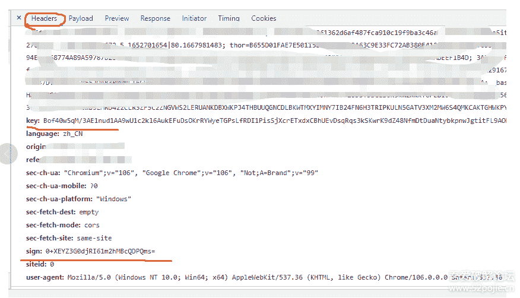

## 过程

一般情况下，就是搜索 `url` 路径、签名字符串来进行。因为这类数据一定是在 `post` 发包前进行整合，如 `setHeader()`、`setParm()` 等。

本例中先搜索了 `url` 路径。一般搜索会出现多个结果，那就是每个结果点进去看一下，觉得可能是就下一个断点。

结果太多时，试试签名字符串 `sign`。这里有个技巧可以减小查找范围：一般这种可以搜索 `sign:`，因为这类赋值一般都是这样的。

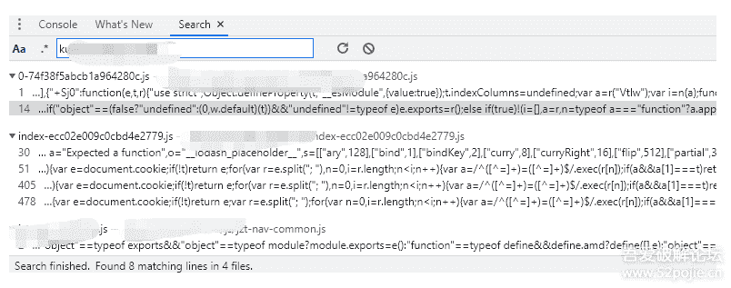
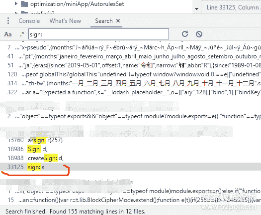

很明显 `33125` 这行有个最接近的，点进去看看。

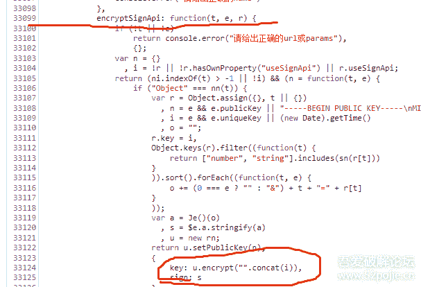

非常明显是这个，刚好是两个需要的签名数据。

如何判断确定是不是，可以在段首下断点，断下来就可以。当然也可以在堆栈或者直接跟出跟进再确认。

经确认是这里，那么就是对如何加密进行确认了。

读代码，就可以去加密了。一般情况只需要调试一遍，我们只管结果就可以了。不过大多数情况代码都被格式化压缩，变量名代替，所以需要确认。

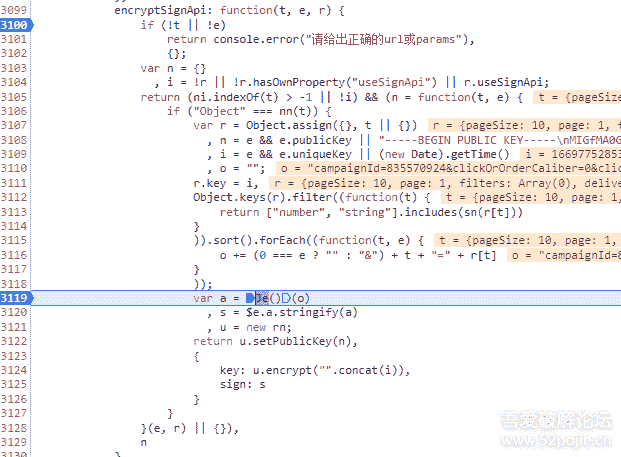

通过读代码可以知道：

通过 `i = !r || !r.hasOwnProperty("useSignApi") || r.useSignApi` 确认是否需要加密。

文中给出了公钥或固定公钥：

```
n = e && e.publicKey || "-----BEGIN PU
```

此段意思就是：根据 `JSON` 的 `key` 值过滤非数字、字符串的值，并以 `a=xxx` 形式、用 `&` 连接。

```
Object.keys(r).filter((function(t) {
    return ["number", "string"].includes(sn(r[t]))
})).sort().forEach((function(t, e) {
    o += (0 === e ? "" : "&") + t + "=" + r[t]
}));
```

关键点加密算法来了：

```
var a = Je()(o)
  , s = $e.a.stringify(a)
  , u = new rn;
return u.setPublicKey(n),
{
  key: u.encrypt("".concat(i)),
  sign: s
}
```

`a = Je()(o)`

通过断点调试可以发现，这里可以打个断点，然后在 `console` 中打印一下 `Je()` 看看是什么，熟手也不用。熟悉的可以知道这其实就是 `cryptojs` 加密。不懂的话其实就要多百度，百度一下出来的就可以了。

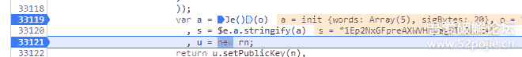
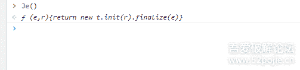
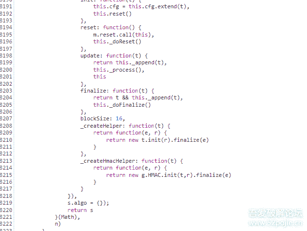
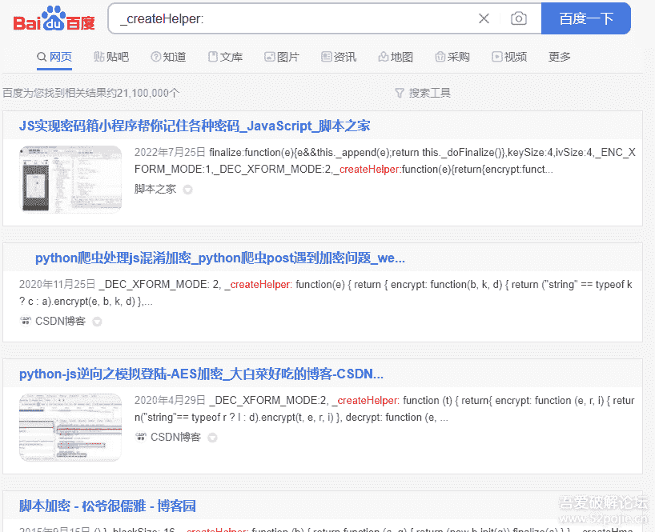

知道了加密方式：`cryptojs` 有很多种方式，这里只知道是 `cryptojs` `base64` 输出。

```
var a = Je()(o)
  , s = $e.a.stringify(a)
```

所以我们可以把 `o` 字符串拿出来做黑箱碰撞，其实就是瞎几把试。当然也可以跟进去一下就知道了，看看 `$e` 是什么就可以快速知道了。

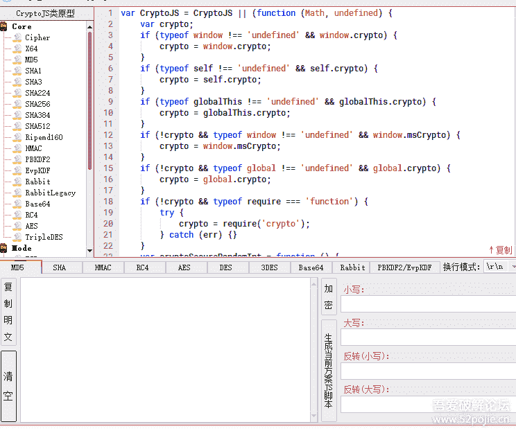

很幸运知道，该处用的是 `SHA1` `BASE64` 输出。

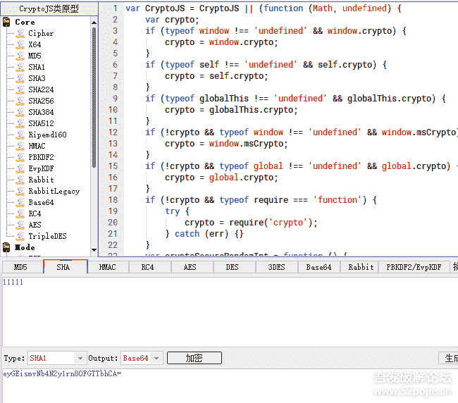

看看另外一个：

```
return u.setPublicKey(n),
{
  key: u.encrypt("".concat(i)),
```

经调试并重复上述过程发现，这其实是 `RSA` 加密，`js` 用的一般叫 `JScrypto`。一样不懂的重复上述步骤就可以知道了。

只是这个 `i` 其实就是上文的一个 13 位时间戳字符串，严重怀疑偷懒。

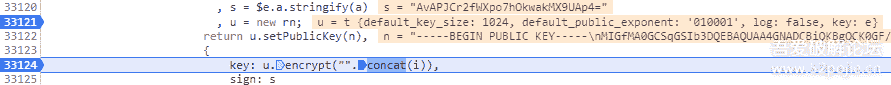

## 用自己的语言还原

这里用的 `python`。

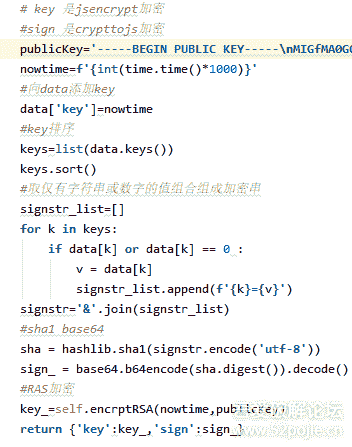

## 结语

多试多搞多百度。

没事多百度。
