# [原创] 新手破解 Delphi 编写某字典软件

- 原帖：[https://www.52pojie.cn/forum.php?mod=viewthread&tid=1720872](https://www.52pojie.cn/forum.php?mod=viewthread&tid=1720872)
- 抓取时间：2026-11-01T23:04:39

## 〇.〇 最前面的口嗨

很久很久以前，有两种主流的编程语言，一种叫 BASIC，一种叫 Pascal，前者发展成了 VB，后者则发展成了 Delphi。

VB 很快被 C++ 打败，而 Delphi 还坚挺了一会，直到其主设被微软挖走整 C#。

曾经有一种说法，勤奋的程序员用 C，聪明的程序员用 Delphi，大概是说 C 更全能，Delphi 更智能（杰出？卓越？）。

笔者曾经也想学学 Delphi，想看看聪明人的世界，奈何等笔者工作生活稳定（知道自己没啥上升空间）后，人们说聪明人都用 Lisp 编程，于是，笔者只能呵呵。

由于笔者从未用 Delphi 写过任何程序，对其基本没有了解，文中软件也是勉强算 [52pojie](https://www.52pojie.cn) 的第一个 Delphi 软件，各方面来说笔者都是个新手，自然谈不上水平，大佬看见请随意指教。

## 〇.一 背景

笔者的媳妇平时会经常翻阅字典，看着支离破碎的第 12 版新华字典，笔者心疼 3 秒之后，决定给她找个电脑上能用的字典软件，于是找到了这款软件。

软件未发现使用时间和次数的限制，但对功能做了限制，为了笔者的媳妇使用更方便（虽然笔者媳妇说笔者只是闲出屁了），笔者决定破解下。

论坛中有前辈发过软件 2009 版破解，2014 版暴破，然而笔者愚钝，窃以为 2014 版暴破那篇文章没有实用意义，而且新华字典第 12 版是 2020 年出版的，使用最新 2020 版软件比较放心点。

笔者这篇所谓的破解完全没有注册码之类的事情，仅仅是启用一些功能，而且破解的在线辞海功能有瑕疵，笔者认为能称为破解，如有小伙伴不认同也可以来交流，你们的回复我都会阅读，但能力所限，未必会回复。

如涉及重复发帖或侵权，劳烦管理删此贴。

## 一、准备工作

- 软件下载：软件官网
- 使用工具：IDR、X32DBG、Resource Hacker

## 二、软件基础了解

### 1. 运行软件

软件没有帮助文档，笔者发现的功能限制大体有三种：

1. 搜索功能无法使用，包括字典、英汉、成语等等各处的搜索功能；
2. 新华词典功能无法使用；
3. 在线辞海功能无法使用。

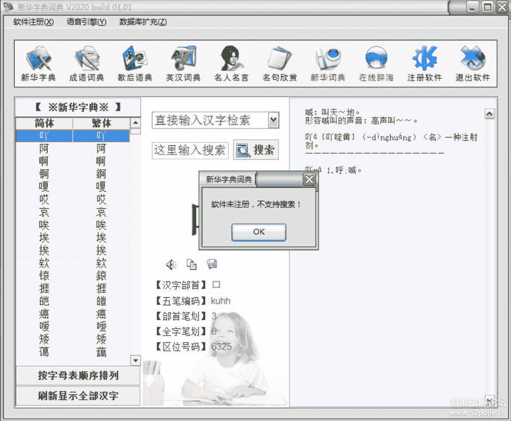

附件：[2022-11-30_121154.jpg](https://www.52pojie.cn/forum.php?mod=attachment&aid=MjU3NDg2MXwyZTliMDM1Y3wxNzkzNTc0Mjc2fDE2ODA4NnwxNzIwODcy&nothumb=yes)（129.3 KB，下载次数：1；2022-11-30 18:07 上传）

### 2. Die 查壳

无壳，Delphi 编写，笔者这是本区第三贴了，就不上图了。这里说一下，软件之前版本是有 ASPack 壳的，但是 [虚拟机](https://www.52pojie.cn/forum-5-1.html) 秒脱，这版本的软件或许是不在乎那 2-3M 空间了，是真的没壳。

### 3. 使用 IDR 反编译

论坛也有不少用 DeDe 的，不过笔者的 [虚拟机](https://www.52pojie.cn/thread-661779-1-1.html) 跑 DeDe 老报错，主系统 11 倒是不报错，但破解这种活总是虚拟机有安全感，而且相比 DeDe，笔者也确实推荐新人使用 IDR。软件主窗体是 `Form1`，其中大多数功能是由面板实现，打开窗体，双击组件对应一下很容易得知，具体为：

- `flatpanel4`：字典，`ffbtn4Click`
- `flatpanel14`：词典，按钮为 `ffbtn5`，但 `ffbtn5Click` 命令非该功能
- `flatpanel8`：英汉，`ffbtn8Click`
- `flatpanel12`：名句，`ffbtn9Click`
- `flatpanel2`：名人名言，`ffbtn12Click`
- `flatpanel7`：歇后语，`ffbtn7Click`
- `flatpanel1`：成语，`ffbtn6Click`
- `flatpanel16`：关于

以上大多按钮通过控制相应面板是否可见（即需要那个面板可见，其余面板不可见）来实现相应功能，`ffbtn5Click` 则仅仅是弹出对话框，无相应功能。

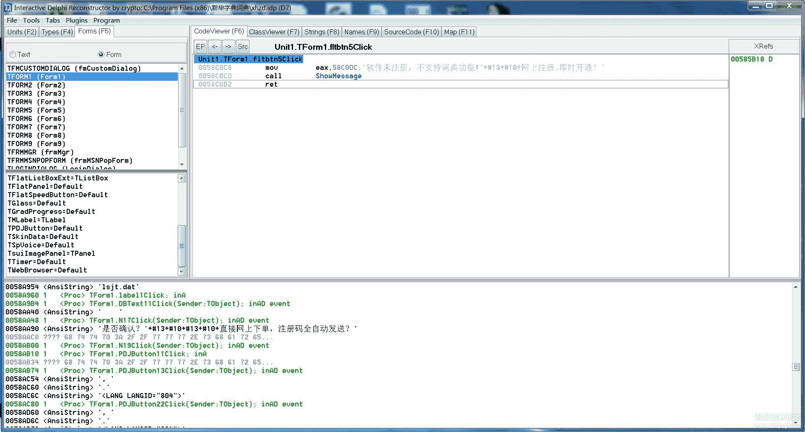

附件：[2022-11-30_180847.jpg](https://www.52pojie.cn/forum.php?mod=attachment&aid=MjU3NDg2MnxlMGQxOGQ4ZHwxNzkzNTc0Mjc2fDE2ODA4NnwxNzIwODcy&nothumb=yes)（297.77 KB，下载次数：1；2022-11-30 18:09 上传）

### 4. 注册窗体

注册窗体是 `Form8`，确认注册按钮按下后仅仅弹出对话框。这里笔者一开始以为是笔者对 Delphi 的结构理解不深刻，在调用按钮点击事件之前就进行了判断，毕竟笔者的汇编水平仅止于 15 年前大学本科必修的汇编基础，这些语句三行五行能看懂，三五十行就看不懂了，直到调试了一轮后根本没发现读取文本框数据，才认识到自己和大佬的差距。不过笔者不是太轴的人，也没有非要看到注册成功的执念，就没在注册码这下功夫。另外题外话两句，2014 版这里也是个假按钮，而运行时的判断标准是 `data` 文件夹是否有 `xho.db` 这个文件，没这个文件就显示已注册，这个当然也有点坑，只能说聪明的程序员用 Delphi 未必完全正确，但用 Delphi 的程序员都是有点厉害的。

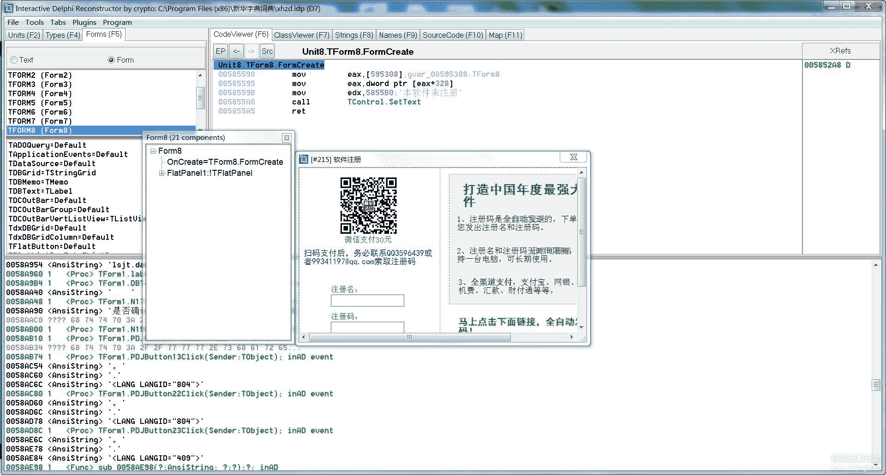

附件：[2022-11-30_132957.jpg](https://www.52pojie.cn/forum.php?mod=attachment&aid=MjU3NDg2M3xiODNhOWI3Y3wxNzkzNTc0Mjc2fDE2ODA4NnwxNzIwODcy&nothumb=yes)（351.78 KB，下载次数：1；2022-11-30 18:09 上传）

软件基础了解告一段落，当然还有一些需要看的，也有一些可以看的，要用到的之后会有说明，和我一样的新手这里多翻翻掌握下方法就好。

## 三、软件功能实现

### 1. 搜索功能

IDR 中查阅搜索按钮按下后事件（有很多，这里随便贴一个）的反汇编代码，通过将注册窗体 `Form8` 里面确认注册那个按钮的标题（`Caption`）文字与 `"本软件已注册"` 对比，如不等就弹对话框，相等就实现功能。

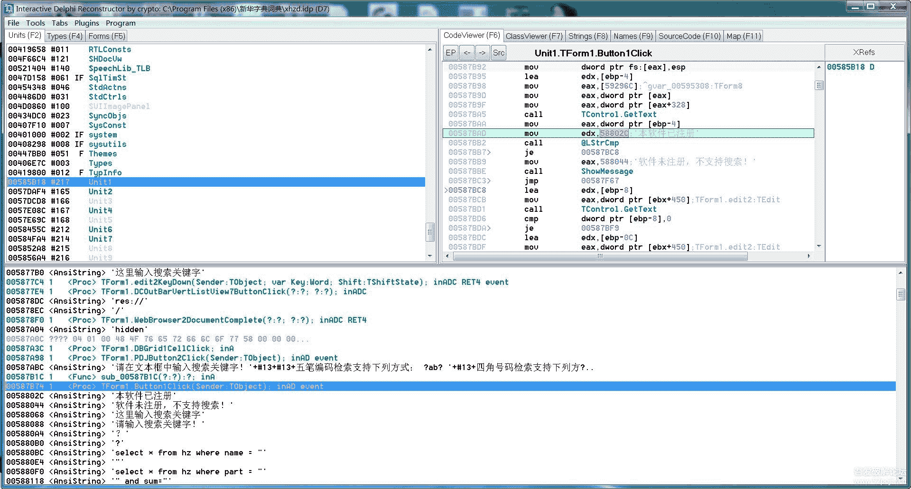

附件：[2022-11-30_123254.jpg](https://www.52pojie.cn/forum.php?mod=attachment&aid=MjU3NDg2NHw1MmQxYjdiMnwxNzkzNTc0Mjc2fDE2ODA4NnwxNzIwODcy&nothumb=yes)（392.09 KB，下载次数：1；2022-11-30 18:10 上传）

注册窗体 `Form8` 里面确认注册那个按钮的标题在创建窗体时进行设置，直接设置成 `"本软件未注册"`。

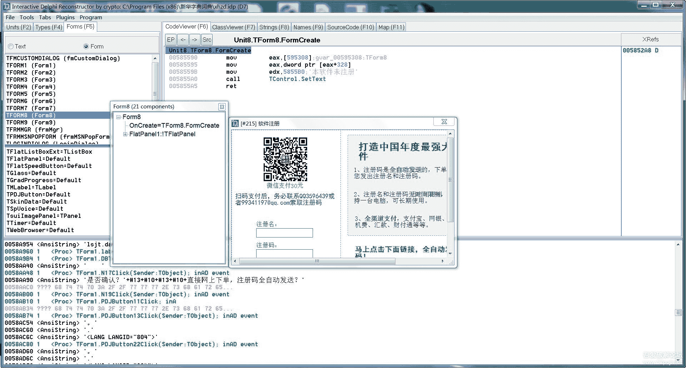

附件：[2022-11-30_181118.jpg](https://www.52pojie.cn/forum.php?mod=attachment&aid=MjU3NDg2NXwzZjcyY2NmMHwxNzkzNTc0Mjc2fDE2ODA4NnwxNzIwODcy&nothumb=yes)（360.21 KB，下载次数：0；2022-11-30 18:11 上传）

所以要实现搜索功能只需让创建窗体时将按钮标题设置成 `"本软件已注册"` 即可，这里将 `5855B0` 处的字符串设为 `"本软件已注册"`，或者将 `58559B` 这里的 `5855B0` 改为 `58C980` 都行。

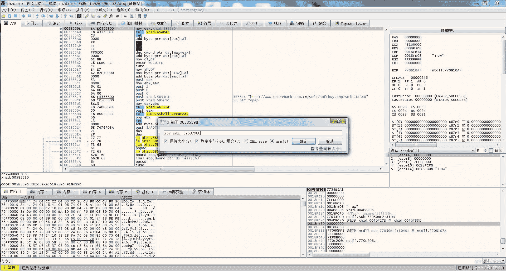

附件：[2022-11-30_133311.jpg](https://www.52pojie.cn/forum.php?mod=attachment&aid=MjU3NDg2NnxlODljM2VmMXwxNzkzNTc0Mjc2fDE2ODA4NnwxNzIwODcy&nothumb=yes)（438.73 KB，下载次数：0；2022-11-30 18:12 上传）

搜索功能实现。

### 2. 新华词典功能

如第二章第三节，`ffbtn5Click` 仅仅是弹出对话框，笔者在软件中未发现直接实现词典功能的命令，检查下上下文，`58C0C8` 至 `58C0D2` 为 `ffbtn5Click` 事件，其上下都有代码，这么短的区间，哪怕引用其他按钮事件后，仅设置两个面板的是否可见，也写不下，所以笔者这里用下注入，先检查下软件的代码区间，入口 `1000`，大小 `18D400`，也就是代码最多可以写到 `58E399`，检查下代码段末尾处，看到有空余空间。

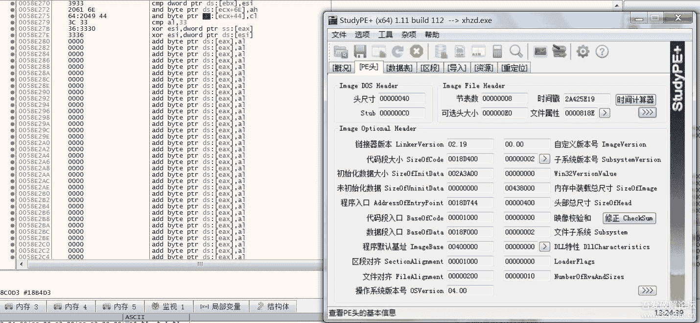

附件：[2022-11-30_132448.jpg](https://www.52pojie.cn/forum.php?mod=attachment&aid=MjU3NDg2N3wyMGQ2NDQ5OXwxNzkzNTc0Mjc2fDE2ODA4NnwxNzIwODcy&nothumb=yes)（266.86 KB，下载次数：1；2022-11-30 18:13 上传）

将 `58C0C8` 处做个大跳转，跳到空余空间处，顺手把之后的调用干掉。

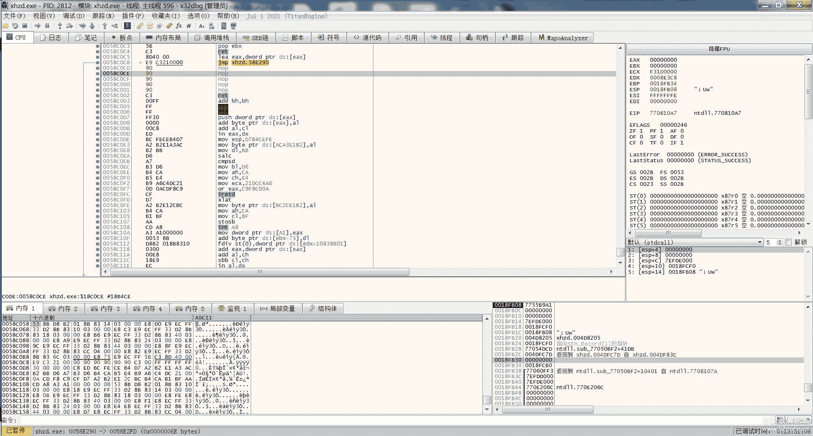

附件：[2022-11-30_134813.jpg](https://www.52pojie.cn/forum.php?mod=attachment&aid=MjU3NDg2OHxiYzNiYjE4NXwxNzkzNTc0Mjc2fDE2ODA4NnwxNzIwODcy&nothumb=yes)（408.9 KB，下载次数：0；2022-11-30 18:13 上传）

在空余空间写入代码，就是控制 `flatpanel14` 面板可见，其余面板不可见。

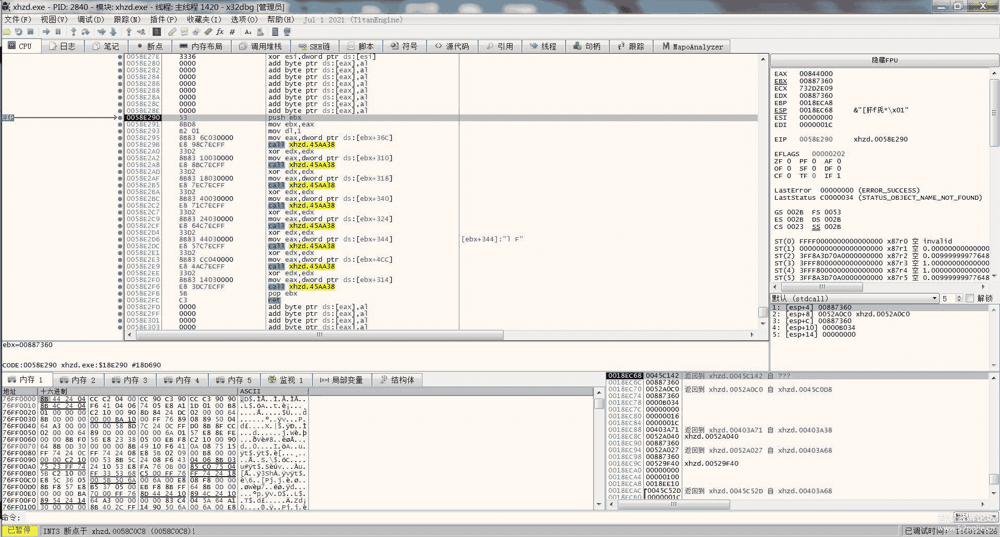

附件：[2022-11-30_142135.jpg](https://www.52pojie.cn/forum.php?mod=attachment&aid=MjU3NDg3MHxmMmViODk0MHwxNzkzNTc0Mjc2fDE2ODA4NnwxNzIwODcy&nothumb=yes)（444.48 KB，下载次数：1；2022-11-30 18:14 上传）

新华词典功能实现。

### 3. 在线辞海功能

IDR 中翻 `Form1` 窗体，发现除了显示的按钮 `FlatButton1` 之外，还有个隐藏的按钮 `ffbtn11` 也是用来控制在线辞海功能，此外还有 `Button4` 也疑似用于辞海功能，所以这里将 `FlatButton1Click` 事件替换下就好。这里笔者测试 `Button4Click` 事件没反应，`ffbtn11Click` 事件按下后功能实现也有问题，会显示乱码，但这确实是软件本身的功能，或许是这块功能没做好，也或许是笔者水平不足，总之有瑕疵。

事件替换方法（取巧）：

Resource Hacker 中打开程序文件，双击打开 `Form1`，`Ctrl+F` 查找 `FlatButton1`，将其事件 `OnClick` 设置为 `ffbtn11Click`，编译，保存即可。

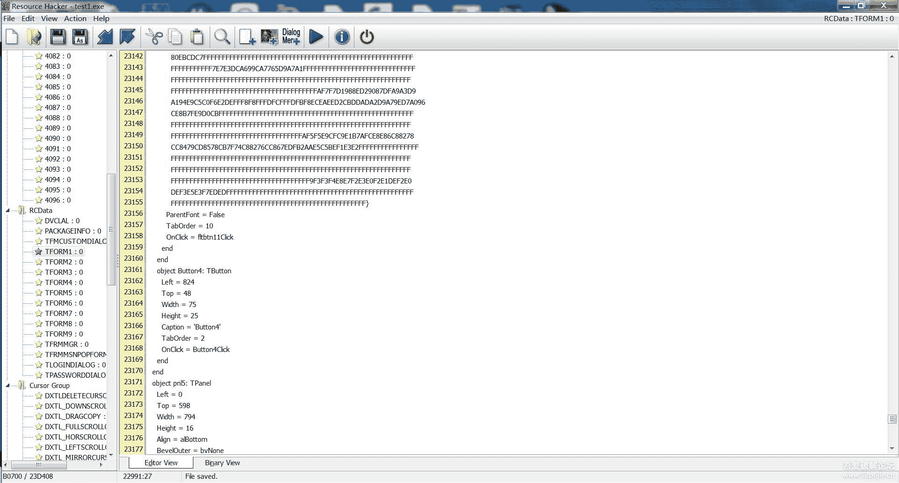

附件：[2022-11-30_131108.jpg](https://www.52pojie.cn/forum.php?mod=attachment&aid=MjU3NDg3MXxhNDljNTZmOHwxNzkzNTc0Mjc2fDE2ODA4NnwxNzIwODcy&nothumb=yes)（274.55 KB，下载次数：1；2022-11-30 18:15 上传）

强迫症患者也可以修改下按钮的字体颜色，将 `Font.Color` 设为 `16384`。

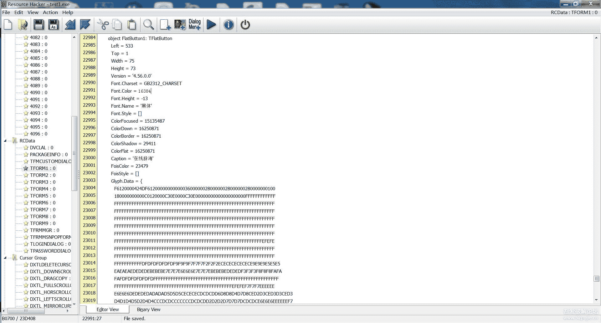

附件：[2022-11-30_131058.jpg](https://www.52pojie.cn/forum.php?mod=attachment&aid=MjU3NDg3MnxjOWIyNGU2ZHwxNzkzNTc0Mjc2fDE2ODA4NnwxNzIwODcy&nothumb=yes)（295.69 KB，下载次数：1；2022-11-30 18:15 上传）

本次新手破解完成。

## 四、后记

Delphi 的程序反编译后感觉像夺命连环 Call，以笔者的水平看起来是非常费劲的，但笔者认为新手还是要见见世面，放一篇 Delphi 的软件是有必要的，虽然这个属于取巧破解。其实笔者也有尝试过汉语大词典，不过那个太欢乐了，脱个壳给笔者虚拟机关机 5-6 次，动态调试调注册那块就死机，注册按钮按下的事件反编译出好像三百行，简直可以成为笔者一个月的快乐源泉，笔者决定升升级再来欢乐，就放了这个。

上一篇时笔者以为快要去上班了，结果现在还没去，但这个可能真就是本年度最后一次本版的玩耍了，就是这样。
