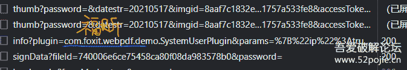
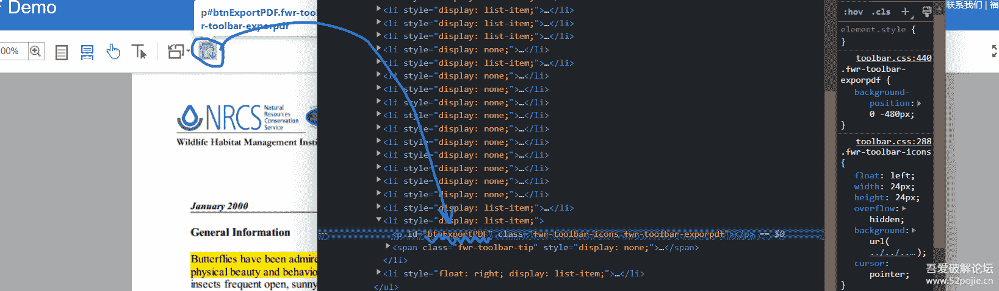
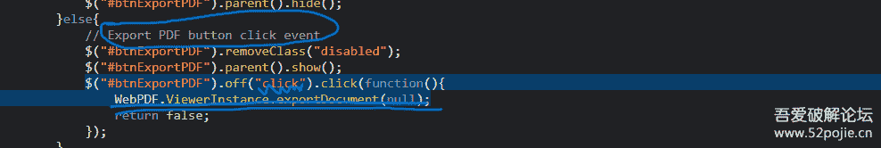
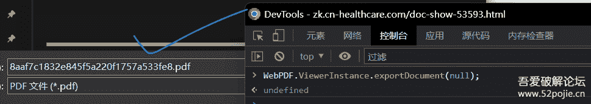

# [Web逆向] 健康界智库下载方式

- 原帖：[https://www.52pojie.cn/forum.php?mod=viewthread&tid=1720897](https://www.52pojie.cn/forum.php?mod=viewthread&tid=1720897)
- 抓取时间：2026-11-01T23:04:37

大家最近留意悬赏区，应该会看见有坛友求助一个叫“健康界智库”的东西，如何下载pdf  
咱稍微着手分析下

以 -> [https://zk.cn-healthcare.com/doc-show-53593.htm](https://zk.cn-healthcare.com/doc-show-53593.htm) 为例子



`屏幕截图(4).png` (31.12 KB, 下载次数: 1)  
<https://www.52pojie.cn/forum.php?mod=attachment&aid=MjU3NDg4OXw4MjhhNzJjN3wxNzkzNTc0Mjc0fDE2ODA4NnwxNzIwODk3&nothumb=yes>  
2022-11-30 19:04 上传

欸显然，福昕的pdf，Science文库同理


`屏幕截图(5).png` (22.36 KB, 下载次数: 1)  
<https://www.52pojie.cn/forum.php?mod=attachment&aid=MjU3NDg5MHwzNWY5ZGIzYXwxNzkzNTc0Mjc0fDE2ODA4NnwxNzIwODk3&nothumb=yes>  
2022-11-30 19:05 上传

从链接可看出，这个是阅读器网址，打开：[https://zk.cn-healthcare.com/foxit-webpdf-web/pc/demo.html](https://zk.cn-healthcare.com/foxit-webpdf-web/pc/demo.html)



`屏幕截图(6).png` (178.35 KB, 下载次数: 1)  
<https://www.52pojie.cn/forum.php?mod=attachment&aid=MjU3NDg5MXwzNDAyNzMwMXwxNzkzNTc0Mjc0fDE2ODA4NnwxNzIwODk3&nothumb=yes>  
2022-11-30 19:07 上传

找到这个“`btnExportPDF`”，可以发现在`doc-show`网址中，并没有这个可爱的玩意

因为他用的都是一个JS，可以推断出一定是被屏蔽了，所以我们去找`doc-show`网页中的这个`btnExportPDF`



`屏幕截图(7).png` (35.4 KB, 下载次数: 1)  
<https://www.52pojie.cn/forum.php?mod=attachment&aid=MjU3NDg5Mnw2Zjk3YTQxY3wxNzkzNTc0Mjc0fDE2ODA4NnwxNzIwODk3&nothumb=yes>  
2022-11-30 19:12 上传

一下子发现点击这个不存在的玩意，他会执行

```
WebPDF.ViewerInstance.exportDocument(null);
```

这个东西  
我们直接运行看看



`屏幕截图(8).png` (31.39 KB, 下载次数: 1)  
<https://www.52pojie.cn/forum.php?mod=attachment&aid=MjU3NDg5M3wyNzliZDVhM3wxNzkzNTc0Mjc0fDE2ODA4NnwxNzIwODk3&nothumb=yes>  
2022-11-30 19:15 上传

愉快解决  

