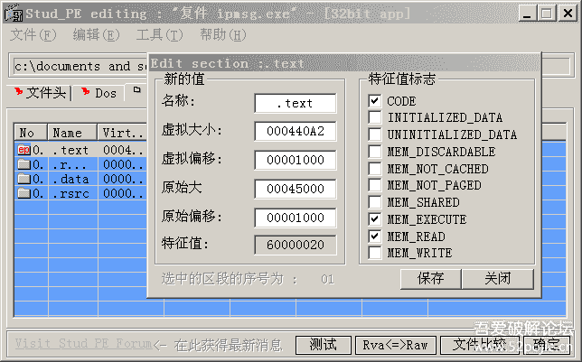
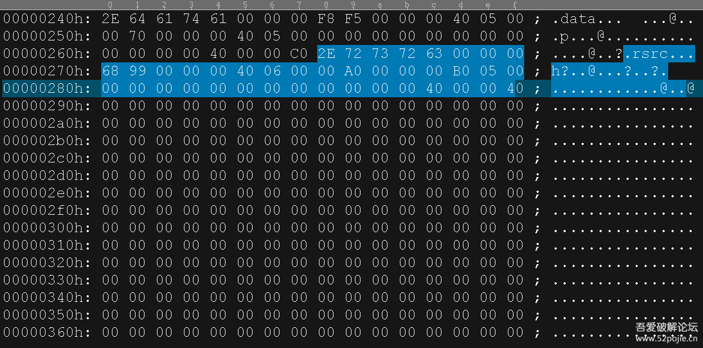
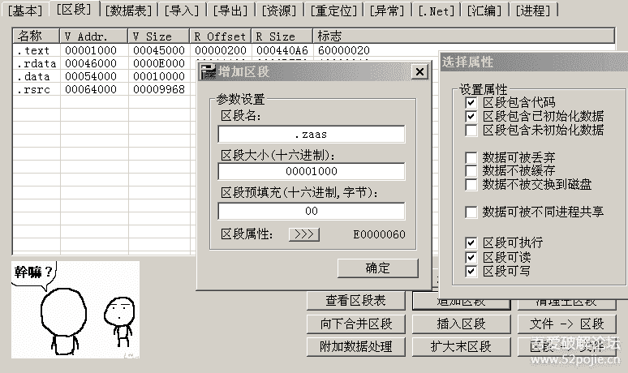
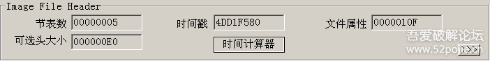
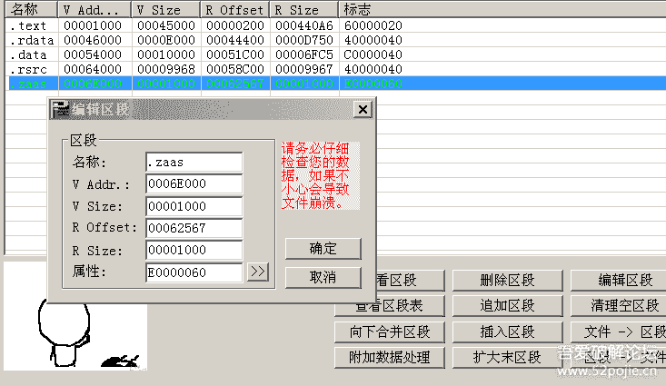
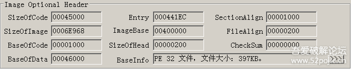
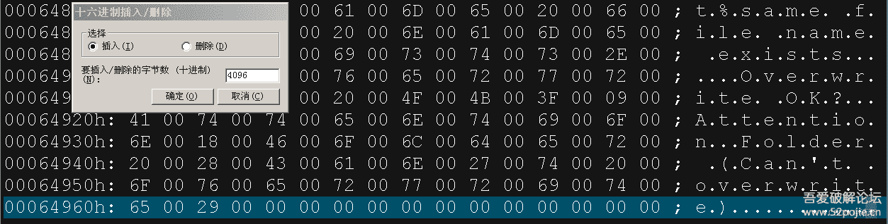
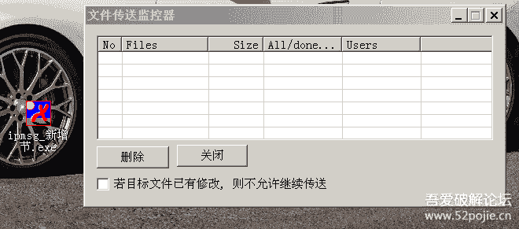

# [原创] PE文件新增节

- 原帖: https://www.52pojie.cn/forum.php?mod=viewthread&tid=1722491
- 抓取时间: 2026-11-01T23:04:22

## 新增节的目的

和扩大节一样，添加空白区来容纳更多代码，只不过新增节后可以改变节的权限问题，每个节都有自己的任务和功能，不建议随便修改其他节的权限。因为执行代码需要`IMAGE_SCN_CNT_CODE`权限，除此之外，扩大节会使代码和原来的代码混在一起，不易识别。如图，可以看到有四个节表：

2022-12-04 16_46_14-Stud_PE editing _ _复件 ipmsg.exe_ - [32bit app].png (27.88 KB, 下载次数: 2)
[href="forum.php?mod=attachment&aid=MjU3NjIwOXxlYThlYzI4NXwxNzkzNTc0MjU5fDE2ODA4NnwxNzIyNDkx&nothumb=yes" target="_blank"](https://www.52pojie.cn/forum.php?mod=attachment&aid=MjU3NjIwOXxlYThlYzI4NXwxNzkzNTc0MjU5fDE2ODA4NnwxNzIyNDkx&nothumb=yes)
2022-12-4 22:56 上传

## 新增节的步骤：

1. 判断节表是否有空间添加一个新节（需要40个字节）；
2. 在最后一个节后新增一个节并修改`NumberOfSections`的值（节的数量）；
3. 修改节表参数中的`VirtualAddress`、`VirtualSize`（节的实际大小）、`SizeOfRawData`（节在文件中对齐后的大小）和`PointerToRawData`（节区在文件中的偏移）；
4. 修改`SizeOfImage`的值并开辟新的空间；

## 流程：

1. 选中的是最后一个节，可以判断有空间；

2022-12-04 17_09_47-.png (23.54 KB, 下载次数: 2)
[href="forum.php?mod=attachment&aid=MjU3NjIxMHw5YzhmNGJjZHwxNzkzNTc0MjU5fDE2ODA4NnwxNzIyNDkx&nothumb=yes" target="_blank"](https://www.52pojie.cn/forum.php?mod=attachment&aid=MjU3NjIxMHw5YzhmNGJjZHwxNzkzNTc0MjU5fDE2ODA4NnwxNzIyNDkx&nothumb=yes)
2022-12-4 22:56 上传

2. 增加区段，节表数改为5，工具（StudyPE+)

2022-12-04 17_14_29-StudyPE (x86) 1.07 beta 1 --_ 复件 ipmsg.exe.png (30.65 KB, 下载次数: 2)
[href="forum.php?mod=attachment&aid=MjU3NjIxMXxhM2FiZWVlN3wxNzkzNTc0MjU5fDE2ODA4NnwxNzIyNDkx&nothumb=yes" target="_blank"](https://www.52pojie.cn/forum.php?mod=attachment&aid=MjU3NjIxMXxhM2FiZWVlN3wxNzkzNTc0MjU5fDE2ODA4NnwxNzIyNDkx&nothumb=yes)
2022-12-4 22:57 上传

2022-12-04 17_20_09-.png (11.2 KB, 下载次数: 2)
[href="forum.php?mod=attachment&aid=MjU3NjIxMnwxMjg1ZTFjOXwxNzkzNTc0MjU5fDE2ODA4NnwxNzIyNDkx&nothumb=yes" target="_blank"](https://www.52pojie.cn/forum.php?mod=attachment&aid=MjU3NjIxMnwxMjg1ZTFjOXwxNzkzNTc0MjU5fDE2ODA4NnwxNzIyNDkx&nothumb=yes)
2022-12-4 22:57 上传

3.

2022-12-04 17_30_30-StudyPE (x86) 1.07 beta 1 --_ 复件 ipmsg.exe.png (25.48 KB, 下载次数: 2)
[href="forum.php?mod=attachment&aid=MjU3NjIxM3xkNTkzMjUxYnwxNzkzNTc0MjU5fDE2ODA4NnwxNzIyNDkx&nothumb=yes" target="_blank"](https://www.52pojie.cn/forum.php?mod=attachment&aid=MjU3NjIxM3xkNTkzMjUxYnwxNzkzNTc0MjU5fDE2ODA4NnwxNzIyNDkx&nothumb=yes)
2022-12-4 22:57 上传

> `V.Address=上一个节.VirtualAddress+上一个节内存对齐后的大小=64000+A000=6E000`
> `PointerToRawData = 上一个节.PointerToRawData + 上一个节.SizeOfRawData = 58C00+9967=62567`

4.

2022-12-04 17_44_22-.png (14.02 KB, 下载次数: 2)
[href="forum.php?mod=attachment&aid=MjU3NjIxNHw0YTA4MGRjY3wxNzkzNTc0MjU5fDE2ODA4NnwxNzIyNDkx&nothumb=yes" target="_blank"](https://www.52pojie.cn/forum.php?mod=attachment&aid=MjU3NjIxNHw0YTA4MGRjY3wxNzkzNTc0MjU5fDE2ODA4NnwxNzIyNDkx&nothumb=yes)
2022-12-4 22:57 上传

> `SizeOfImage=6D968+A000=6E968`

开辟新空间：

image.png (27.19 KB, 下载次数: 1)
[href="forum.php?mod=attachment&aid=MjU3NjIxN3xjNTNiNDU5ZnwxNzkzNTc0MjU5fDE2ODA4NnwxNzIyNDkx&nothumb=yes" target="_blank"](https://www.52pojie.cn/forum.php?mod=attachment&aid=MjU3NjIxN3xjNTNiNDU5ZnwxNzkzNTc0MjU5fDE2ODA4NnwxNzIyNDkx&nothumb=yes)
2022-12-4 22:59 上传

结果：

2022-12-04 17_49_34-Program Manager.png (131.98 KB, 下载次数: 2)
[href="forum.php?mod=attachment&aid=MjU3NjIxNnw5Y2RkOWViZHwxNzkzNTc0MjU5fDE2ODA4NnwxNzIyNDkx&nothumb=yes" target="_blank"](https://www.52pojie.cn/forum.php?mod=attachment&aid=MjU3NjIxNnw5Y2RkOWViZHwxNzkzNTc0MjU5fDE2ODA4NnwxNzIyNDkx&nothumb=yes)
2022-12-4 22:58 上传

程序正常运行。
