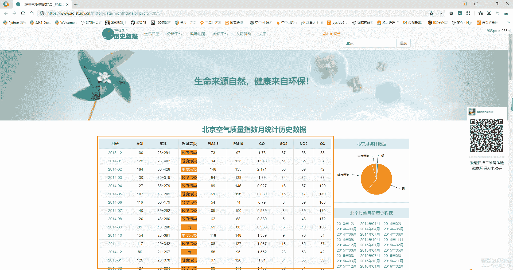
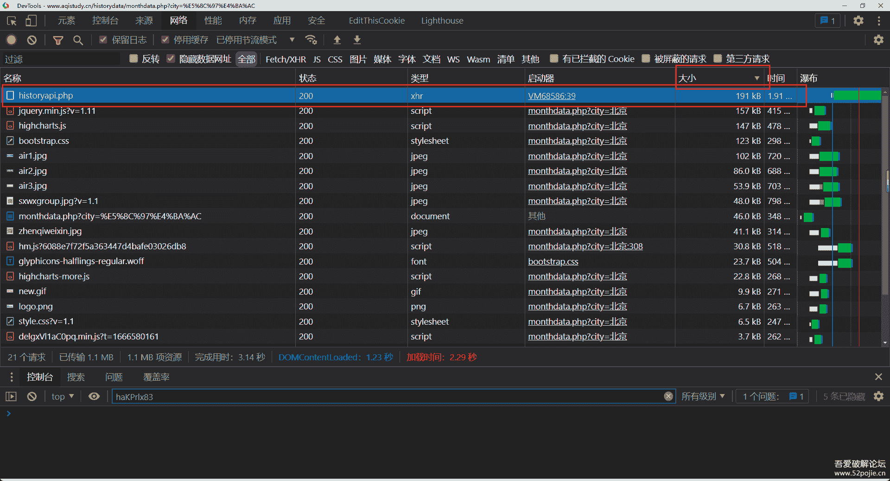
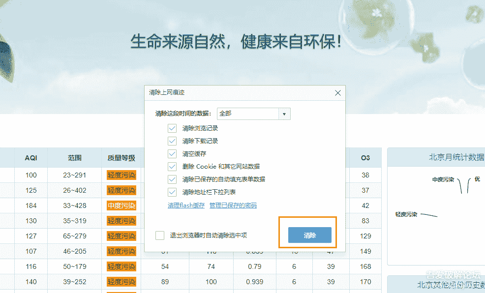
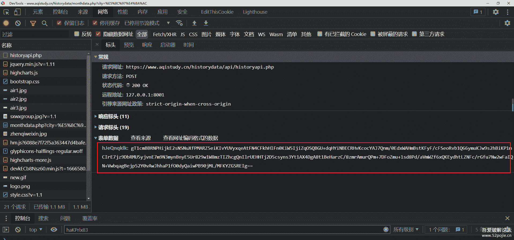
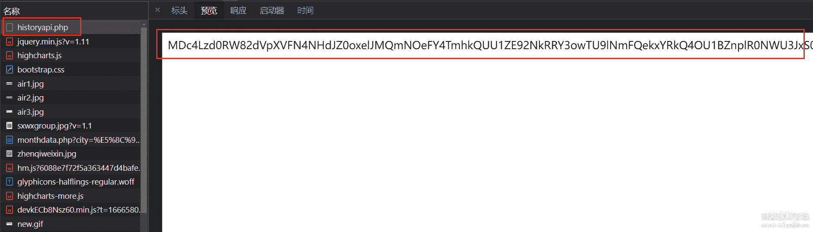
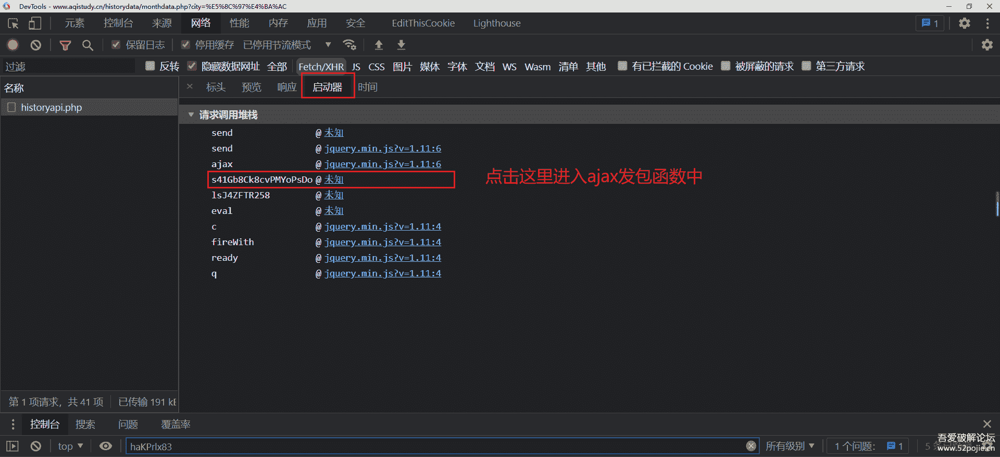
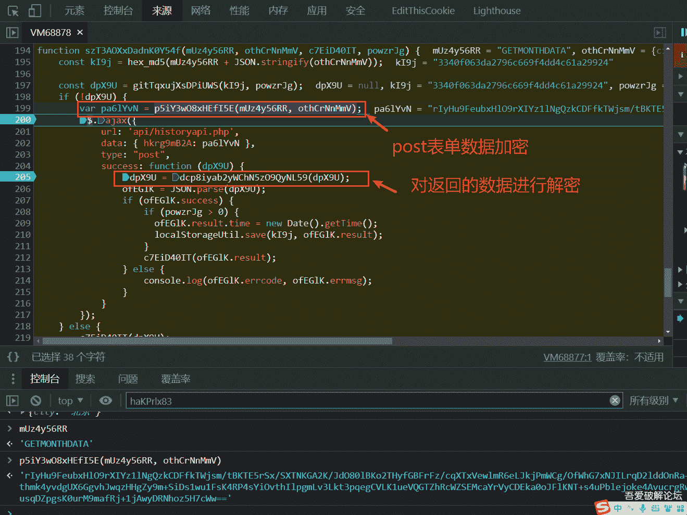
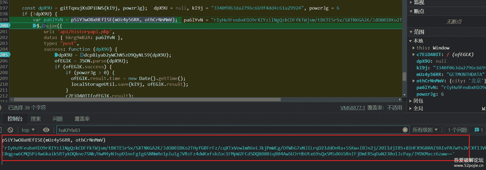

# [Web逆向] 221024【js逆向百例】PM2.5动态混淆代码调试060

- 原帖：<https://www.52pojie.cn/forum.php?mod=viewthread&tid=1722677>
- 抓取时间：2026-11-01T23:04:18

## 1、免责声明

- 本视频供学习交流使用，不用于其他任何目的。
- 本视频未经许可，禁止转载、下载、剪辑或任何修改，擅自使用导致的任何损失，作者均不负责。
- 本视频若涉及侵犯他人知识产权，请联系作者删除。
- 爬虫基本准则：可见即可爬，不可见不可爬。
- 本文章中所有内容仅供学习交流，严禁用于商业用途和非法用途，否则由此产生的一切后果均与作者无关！

## 2、逆向目标

- 目标：PM2.5动态混淆代码调试
- 主页：<https://www.aqistudy.cn/historydata/monthdata.php?city=%E5%8C%97%E4%BA%AC>



`image-20221024105150903.png`（447.78 KB，下载次数：0）  
[附件下载](https://www.52pojie.cn/forum.php?mod=attachment&aid=MjU3NjI2NXw1ZWM5NGY5NXwxNzkzNTc0MjU2fDE2ODA4NnwxNzIyNjc3&nothumb=yes)  
2022-12-5 09:11 上传

## 3、抓包分析

- 通过点击网络面板中的大小选项卡，对数据包进行排序，得到数据包从大到小的排序，最大的包说明就是返回的数据包。



`image-20221024110516121.png`（175.18 KB，下载次数：3）  
[附件下载](https://www.52pojie.cn/forum.php?mod=attachment&aid=MjU3NjI3MHxmMzNhMWQ2MXwxNzkzNTc0MjU2fDE2ODA4NnwxNzIyNjc3&nothumb=yes)  
2022-12-5 09:12 上传

- 如果刷新页面没出来数据，就清除一下缓存，`ctrl+shift+del`：



`image-20221024110632411.png`（168.43 KB，下载次数：0）  
[附件下载](https://www.52pojie.cn/forum.php?mod=attachment&aid=MjU3NjI3MXwwYTEyOTM0MnwxNzkzNTc0MjU2fDE2ODA4NnwxNzIyNjc3&nothumb=yes)  
2022-12-5 09:12 上传

- 请求的表单数据有加密，返回的数据也有加密。



`image-20221024110737022.png`（168.76 KB，下载次数：0）  
[附件下载](https://www.52pojie.cn/forum.php?mod=attachment&aid=MjU3NjI3MnxlYTVkYTc0MHwxNzkzNTc0MjU2fDE2ODA4NnwxNzIyNjc3&nothumb=yes)  
2022-12-5 09:12 上传



`image-20221024110810218.png`（74.59 KB，下载次数：2）  
[附件下载](https://www.52pojie.cn/forum.php?mod=attachment&aid=MjU3NjI2Nnw4MDAwNjM5MnwxNzkzNTc0MjU2fDE2ODA4NnwxNzIyNjc3&nothumb=yes)  
2022-12-5 09:12 上传

## 4、逆向参数

- 进入 `ajax` 发包函数



`image-20221024111546492.png`（114.58 KB，下载次数：1）  
[附件下载](https://www.52pojie.cn/forum.php?mod=attachment&aid=MjU3NjI2N3xjYTE2YzRmZXwxNzkzNTc0MjU2fDE2ODA4NnwxNzIyNjc3&nothumb=yes)  
2022-12-5 09:12 上传



`image-20221024112002755.png`（187.37 KB，下载次数：1）  
[附件下载](https://www.52pojie.cn/forum.php?mod=attachment&aid=MjU3NjI2OHwzZTMwMzI4MXwxNzkzNTc0MjU2fDE2ODA4NnwxNzIyNjc3&nothumb=yes)  
2022-12-5 09:12 上传

### 4.1 表单数据解密

- `var pa6lYvN = p5iY3wO8xHEfI5E(mUz4y56RR, othCrNnMmV)`
- `p5iY3wO8xHEfI5E()`：加密的函数，每次刷新页面都会动态变化
- `mUz4y56RR`：参数，`'GETMONTHDATA'`
- `othCrNnMmV`：参数，`{city: '北京'}`



`image-20221024112303616.png`（156.24 KB，下载次数：1）  
[附件下载](https://www.52pojie.cn/forum.php?mod=attachment&aid=MjU3NjI2OXwwZTBlOTU3NXwxNzkzNTc0MjU2fDE2ODA4NnwxNzIyNjc3&nothumb=yes)  
2022-12-5 09:12 上传

- 进入 `p5iY3wO8xHEfI5E()` 函数，

```javascript
const askLUsbSQBEI = "adU5ZykNdeMhweNG";//AESkey，可自定义
const asiEw4u1MRaa = "bJh2iDQ426nBZCpu";//密钥偏移量IV，可自定义

const ackUg77x4UKa = "d2tsVa04fKQrdKMV";//AESkey，可自定义
const aciyc7VYHWUK = "fQPwUbUkjnW7yLBW";//密钥偏移量IV，可自定义

const dskS0yz8Kv4p = "hh3MPhKCaqBMcUFH";//DESkey，可自定义
const dsi8D0PTy3Tz = "xHnHFi7jV2FEANV2";//密钥偏移量IV，可自定义

const dckXiaIL7x7u = "omvcl4zNEnSUl1ez";//DESkey，可自定义
const dciWrdnnAkPb = "pAV4We6Ye7sK2wYu";//密钥偏移量IV，可自定义

const aes_local_key = 'emhlbnFpcGFsbWtleQ==';
const aes_local_iv = 'emhlbnFpcGFsbWl2';

var BASE64 = {
    encrypt: function(text) {
        var b = new Base64();
        return b.encode(text);
    },
    decrypt: function(text) {
        var b = new Base64();
        return b.decode(text);
    }
};

var DES = {
    encrypt: function(text, key, iv){
        var secretkey = (CryptoJS.MD5(key).toString()).substr(0, 16);
        var secretiv = (CryptoJS.MD5(iv).toString()).substr(24, 8);
        secretkey = CryptoJS.enc.Utf8.parse(secretkey);
        secretiv = CryptoJS.enc.Utf8.parse(secretiv);
        var result = CryptoJS.DES.encrypt(text, secretkey, {
            iv: secretiv,
            mode: CryptoJS.mode.CBC,
            padding: CryptoJS.pad.Pkcs7
        });
        return result.toString();
    },
    decrypt: function(text, key, iv){
        var secretkey = (CryptoJS.MD5(key).toString()).substr(0, 16);
        var secretiv = (CryptoJS.MD5(iv).toString()).substr(24, 8);
        secretkey = CryptoJS.enc.Utf8.parse(secretkey);
        secretiv = CryptoJS.enc.Utf8.parse(secretiv);
        var result = CryptoJS.DES.decrypt(text, secretkey, {
            iv: secretiv,
            mode: CryptoJS.mode.CBC,
            padding: CryptoJS.pad.Pkcs7
        });
        return result.toString(CryptoJS.enc.Utf8);
    }
};

var AES = {
    encrypt: function(text, key, iv) {
        var secretkey = (CryptoJS.MD5(key).toString()).substr(16, 16);
        var secretiv = (CryptoJS.MD5(iv).toString()).substr(0, 16);
        // console.log('real key:', secretkey);
        // console.log('real iv:', secretiv);
        secretkey = CryptoJS.enc.Utf8.parse(secretkey);
        secretiv = CryptoJS.enc.Utf8.parse(secretiv);
        var result = CryptoJS.AES.encrypt(text, secretkey, {
            iv: secretiv,
            mode: CryptoJS.mode.CBC,
            padding: CryptoJS.pad.Pkcs7
        });
        return result.toString();
    },
    decrypt: function(text, key, iv) {
        var secretkey = (CryptoJS.MD5(key).toString()).substr(16, 16);
        var secretiv = (CryptoJS.MD5(iv).toString()).substr(0, 16);
        secretkey = CryptoJS.enc.Utf8.parse(secretkey);
        secretiv = CryptoJS.enc.Utf8.parse(secretiv);
        var result = CryptoJS.AES.decrypt(text, secretkey, {
            iv: secretiv,
            mode: CryptoJS.mode.CBC,
            padding: CryptoJS.pad.Pkcs7
        });
        return result.toString(CryptoJS.enc.Utf8);
    }
};

var localStorageUtil = {
    save: function(name, value) {
        var text = JSON.stringify(value);
        text = BASE64.encrypt(text);
        text = AES.encrypt(text, aes_local_key, aes_local_iv);
        try {
            localStorage.setItem(name, text);
        } catch (oException) {
            if (oException.name === 'QuotaExceededError') {
                console.log('Local limit exceeded');
                localStorage.clear();
                localStorage.setItem(name, text);
            }
        }
    },
    check: function(name) {
        return localStorage.getItem(name);
    },
    getValue: function(name) {
        var text = localStorage.getItem(name);
        var result = null;
        if (text) {
            text = AES.decrypt(text, aes_local_key, aes_local_iv);
            text = BASE64.decrypt(text);
            result = JSON.parse(text);
        }
        return result;
    },
    remove: function(name) {
        localStorage.removeItem(name);
    }
};

// console.log('base64', BASE64.encrypt('key'));

function dHmbcjRKf2b(pEDie1v) {
    pEDie1v = DES.decrypt(pEDie1v, dskS0yz8Kv4p, dsi8D0PTy3Tz);
    return pEDie1v;
}

function djkQjTtEV9(pEDie1v) {
    pEDie1v = AES.decrypt(pEDie1v, askLUsbSQBEI, asiEw4u1MRaa);
    return pEDie1v;
}

function gRcWJlHeOYlFXmzA(key, period) {
    if (typeof period === 'undefined') {
        period = 0;
    }
    var d = DES.encrypt(key);
    d = BASE64.encrypt(key);
    var data = localStorageUtil.getValue(key);
    if (data) { // 判断是否过期
        const time = data.time;
        const current = new Date().getTime();
        if (new Date().getHours() >= 0 && new Date().getHours() 1) {
            period = 1;
        }
```


```
if (current - (period * 60 * 60 * 1000) > time) { // 更新

data = null;

}

// 防止1-5点用户不打开页面，跨天的情况

if (new Date().getHours() >= 5 && new Date(time).getDate() !== new Date().getDate() && period === 24) {

data = null;

}

}

return data;

}

function osPVUjOycA(obj) {

var newObject = {};

Object.keys(obj).sort().map(function(key){

newObject[key] = obj[key];

});

return newObject;

}

function dCYCjxL1pD1S2b(data) {

data = BASE64.decrypt(data);

data = DES.decrypt(data, dskS0yz8Kv4p, dsi8D0PTy3Tz);

data = AES.decrypt(data, askLUsbSQBEI, asiEw4u1MRaa);

data = BASE64.decrypt(data);

return data;

}

var p47vmYDtcC = (function(){

function osPVUjOycA(obj){

var newObject = {};

Object.keys(obj).sort().map(function(key){

newObject[key] = obj[key];

});

return newObject;

}

return function(m2DDNdhO2, ou7kZ4){

var aGsw = '564e8a7e9b3e03f0b254a894b3de5dae';

var cOvOJ = 'WEB';

var tHrqLyD = new Date().getTime();

var pEDie1v = {

appId: aGsw,

method: m2DDNdhO2,

timestamp: tHrqLyD,

clienttype: cOvOJ,

object: ou7kZ4,

secret: hex_md5(aGsw + m2DDNdhO2 + tHrqLyD + cOvOJ + JSON.stringify(osPVUjOycA(ou7kZ4)))

};

pEDie1v = BASE64.encrypt(JSON.stringify(pEDie1v));

pEDie1v = DES.encrypt(pEDie1v, dckXiaIL7x7u, dciWrdnnAkPb);

return pEDie1v;

};

})();

function sj90Qy5s16uz9J4f(m2DDNdhO2, omS5Hw6YYC, cKmarb7AZ, pQ54lZk) {

const kXIQ = hex_md5(m2DDNdhO2 + JSON.stringify(omS5Hw6YYC));

const dVMdM = gRcWJlHeOYlFXmzA(kXIQ, pQ54lZk);

if (!dVMdM) {

var pEDie1v = p47vmYDtcC(m2DDNdhO2, omS5Hw6YYC);

$.ajax({

url: 'api/historyapi.php',

data: { hzsi2iyB0: pEDie1v },

type: "post",

success: function (dVMdM) {

dVMdM = dCYCjxL1pD1S2b(dVMdM);

ou7kZ4 = JSON.parse(dVMdM);

if (ou7kZ4.success) {

if (pQ54lZk > 0) {

ou7kZ4.result.time = new Date().getTime();

localStorageUtil.save(kXIQ, ou7kZ4.result);

}

cKmarb7AZ(ou7kZ4.result);

} else {

console.log(ou7kZ4.errcode, ou7kZ4.errmsg);

}

}

});

} else {

cKmarb7AZ(dVMdM);

}

}
```

```
"C:\Program Files\Python39\python.exe" D:/220705【JS逆向百例】/221024【js逆向百例】PM2.5历史数据爬取049/test.py

>>>>>>调用JS代码加密后的密码为: Ek3vJti3x+5SvzmgulZH+G46lwpXbRT4uTxghb4oA/adJ8a4z2wZbk4h/ylx/8A/2EjebGI9hcoa6C0SoifZNePl0u675eG1ET2Kq0EFQo2AWOSKqsWdKC69kIu1M1hPXbIyaFFwToR8/2besaTg26X0LXTXHeBqYT/rdQQmAquT2Ws0lJEuk8DmovJYuNt7G0k8gY2YoCrBZf0dlhA2op/McAxVsdOy28g+J24tdj/+5SsFEWywaIU+prGUNMDkc4c0N2bbniEt7pUTi35JJhO21FFGFS4v/3V5xZyythgKjGTImpqlVHMwPjKTE9NcYzhv71zvuT+BTdQxSPxJzg==

>>>>>>调用JS代码加密后的密码为: {'success': False, 'errcode': 1001, 'errmsg': 'invalid param'}
```
