# [原创] 某文进度计划编制软件XX过程

- 原帖: https://www.52pojie.cn/forum.php?mod=viewthread&tid=1722870
- 抓取时间: 2026-11-01T23:04:16

## 前言

工程行业制作甘特图软件有很多，但是用下来，还是这个某文出的软件比较便捷，该XX过程是20年年底还在工程行业的时候做的，新版本软件已经修复了该过程所需要一些关键`call`，我最开始尝试过很多办法来修改，但大多容易造成程序崩溃，所以这里我挑选最容易让新手理解的方法，技术负责人和总共用过都说好的方法来讲述。

我是个逆向小白，以下内容如有过错，还望各位高手指点。

xx方法适用于有一定基础的坛友，毫无基础可以看看[基础教程](https://www.52pojie.cn/home.php?mod=space&uid=396495&do=thread&view=me&from=space)所出的基础教程

## DIE查壳

查壳显示是Delphi的程序，这个软件还有加密狗，看DIE的显示应该是深思的加密狗，但是实际使用起来并没有提示需要插入加密狗的提示框。

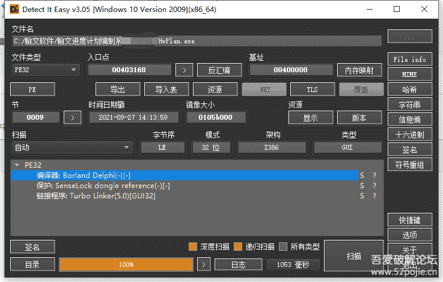

查壳.jpg (40.59 KB, 下载次数: 0)

[附件](https://www.52pojie.cn/forum.php?mod=attachment&aid=MjU3NjM5MHxmMWZmM2Q0OXwxNzkzNTc0MjUzfDE2ODA4NnwxNzIyODcw&nothumb=yes)

2022-12-5 15:07 上传

我们启动软件，打开附带的例子，点 文件 -> 打印 或者 文件 -> 导出为图片/xls文件，因为是免费版都会提示“该版本只能输出横道图30行!”，看过论坛破解基础教程的应该都能想到接下来是要用这个提示框来做什么，就不废话了，直接上`x32dbg`附加程序

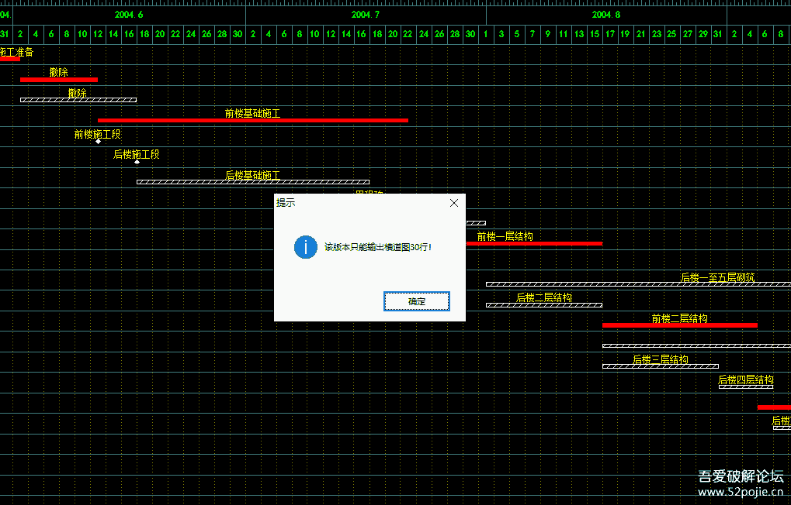

1.jpg (27.73 KB, 下载次数: 1)

[附件](https://www.52pojie.cn/forum.php?mod=attachment&aid=MjU3NjM5NXxhNGU5MGZiMXwxNzkzNTc0MjUzfDE2ODA4NnwxNzIyODcw&nothumb=yes)

2022-12-5 15:07 上传

## X32DBG

附加完成第一步，我们先进入程序领空，不然待会搜出来的字符串无法找到我们所需要的。

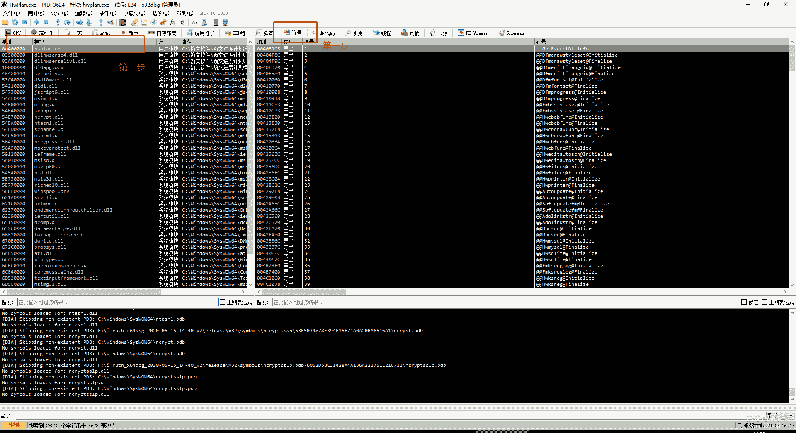

2.jpg (226.55 KB, 下载次数: 1)

[附件](https://www.52pojie.cn/forum.php?mod=attachment&aid=MjU3NjM5N3xjMTM2MjgyNnwxNzkzNTc0MjUzfDE2ODA4NnwxNzIyODcw&nothumb=yes)

2022-12-5 15:07 上传

接下来搜索当前模块的字符串，搜索“该版本只能输出横道图”

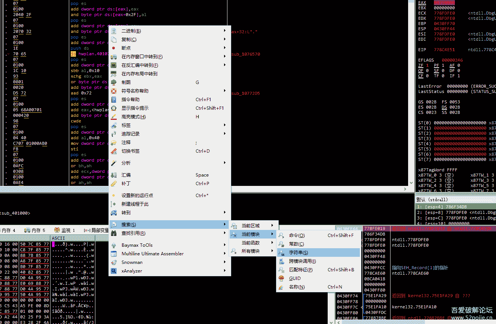

3.png (162.83 KB, 下载次数: 1)

[附件](https://www.52pojie.cn/forum.php?mod=attachment&aid=MjU3NjM4N3w2ZmVkNDAzOHwxNzkzNTc0MjUzfDE2ODA4NnwxNzIyODcw&nothumb=yes)

2022-12-5 15:07 上传

有很多结果，不要慌，我们右键第一个结果选择“转到反汇编”，按`F2`打一个断点，对应地址的背景变成红色，就是已经打上了断点

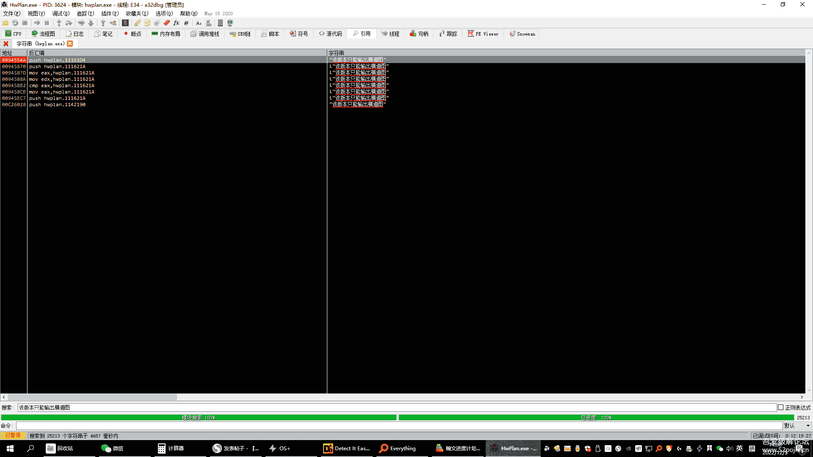

4.jpg (112.71 KB, 下载次数: 0)

[附件](https://www.52pojie.cn/forum.php?mod=attachment&aid=MjU3NjQwNXwzNmI1Y2QxZHwxNzkzNTc0MjUzfDE2ODA4NnwxNzIyODcw&nothumb=yes)

2022-12-5 15:08 上传

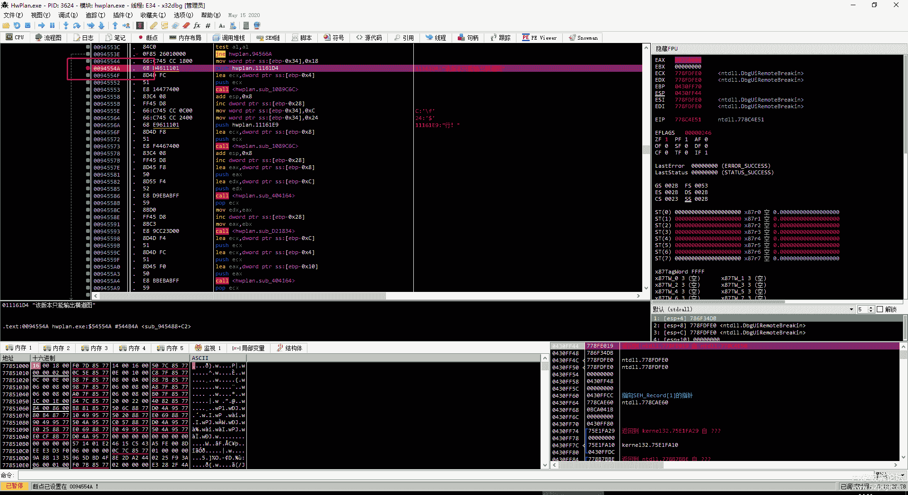

5.jpg (216.7 KB, 下载次数: 0)

[附件](https://www.52pojie.cn/forum.php?mod=attachment&aid=MjU3NjM4OHxjMTQ4MDcxM3wxNzkzNTc0MjUzfDE2ODA4NnwxNzIyODcw&nothumb=yes)

2022-12-5 15:07 上传

接着我们切到程序，点击“文件 -> 导出XLS”，然后看调试器，发现程序断在了我们之前打断点的位置，此时我们按`F9`，弹出了之前看到的提示框，那么我们此时就算找对了关键`call`。

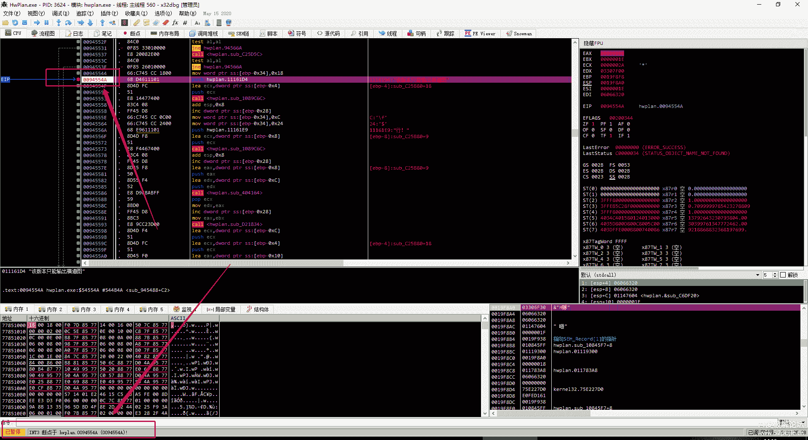

6.jpg (233.43 KB, 下载次数: 1)

[附件](https://www.52pojie.cn/forum.php?mod=attachment&aid=MjU3NjM5MXw3YzAwNWQzZnwxNzkzNTc0MjUzfDE2ODA4NnwxNzIyODcw&nothumb=yes)

2022-12-5 15:07 上传

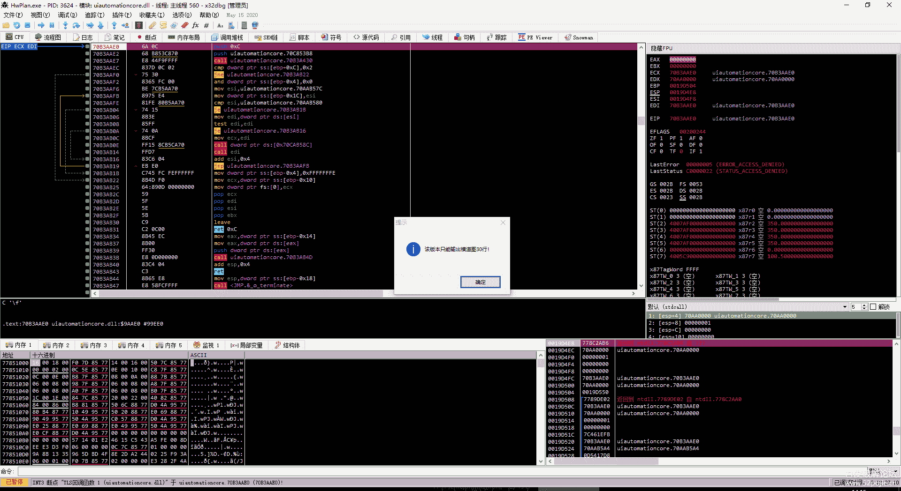

7.jpg (220.85 KB, 下载次数: 1)

[附件](https://www.52pojie.cn/forum.php?mod=attachment&aid=MjU3NjM4OXwzZmQ4NzMyMHwxNzkzNTc0MjUzfDE2ODA4NnwxNzIyODcw&nothumb=yes)

2022-12-5 15:07 上传

从断点处往上找，找到第一个`JMP`，发现这个跳转能跳过我们打断点的位置，并且他还在一个`JE`的跳转下，那我们就从这个`JE`下手，

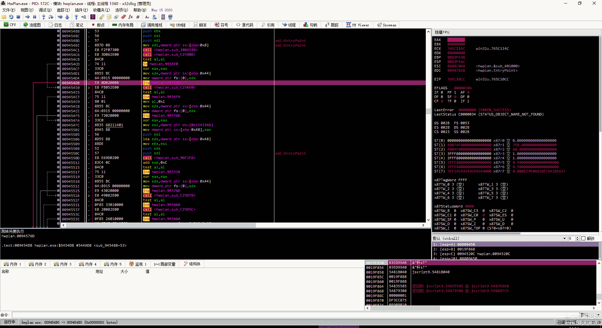

9.jpg (202.21 KB, 下载次数: 1)

[附件](https://www.52pojie.cn/forum.php?mod=attachment&aid=MjU3NjM5M3w0MmI3MmIxN3wxNzkzNTc0MjUzfDE2ODA4NnwxNzIyODcw&nothumb=yes)

2022-12-5 15:07 上传

`JE`的上方是`test al, al`，`al`值来自该句上方的`call 0x00C25B08`，我们进入`call 0x00C25B08`，发现其中跟`al`赋值相关的部分上方还有一个`call 0x00C25A98`，猜想`al`的值为1，程序就会判定软件不是免费版，而`cmp eax, 0x71`中`eax`的值来自`call 0x00C25A98`，那我们再进入这个`call`

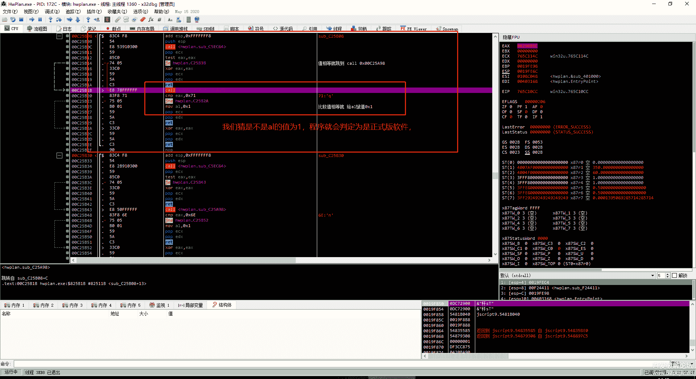

10.jpg (193.78 KB, 下载次数: 1)

[附件](https://www.52pojie.cn/forum.php?mod=attachment&aid=MjU3NjM5NHwzYjZlZWY4MnwxNzkzNTc0MjUzfDE2ODA4NnwxNzIyODcw&nothumb=yes)

2022-12-5 15:07 上传

### 修改关键位置代码

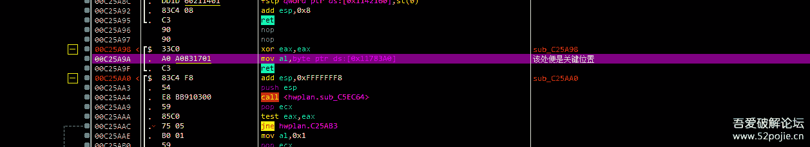

11.jpg (34.93 KB, 下载次数: 2)

[附件](https://www.52pojie.cn/forum.php?mod=attachment&aid=MjU3NjM5OHxhZjc0ZmUzMnwxNzkzNTc0MjUzfDE2ODA4NnwxNzIyODcw&nothumb=yes)

2022-12-5 15:07 上传

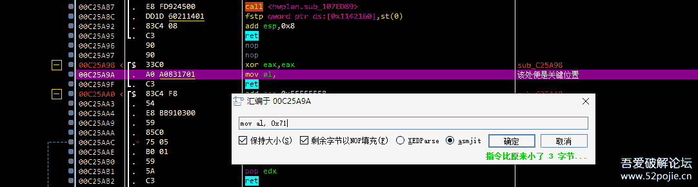

12.jpg (43.05 KB, 下载次数: 0)

[附件](https://www.52pojie.cn/forum.php?mod=attachment&aid=MjU3NjM5OXwzNmJmYTQwZHwxNzkzNTc0MjUzfDE2ODA4NnwxNzIyODcw&nothumb=yes)

2022-12-5 15:07 上传

保存补丁，再将补丁后的文件替换到安装目录打开，版本已经成为横道图版

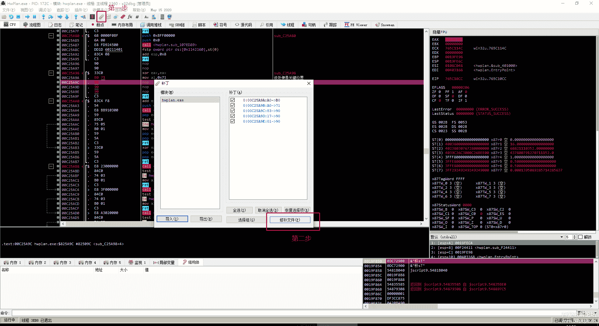

13.jpg (196.55 KB, 下载次数: 1)

[附件](https://www.52pojie.cn/forum.php?mod=attachment&aid=MjU3NjQwMHw0ODQ1ZGM2NHwxNzkzNTc0MjUzfDE2ODA4NnwxNzIyODcw&nothumb=yes)

2022-12-5 15:07 上传

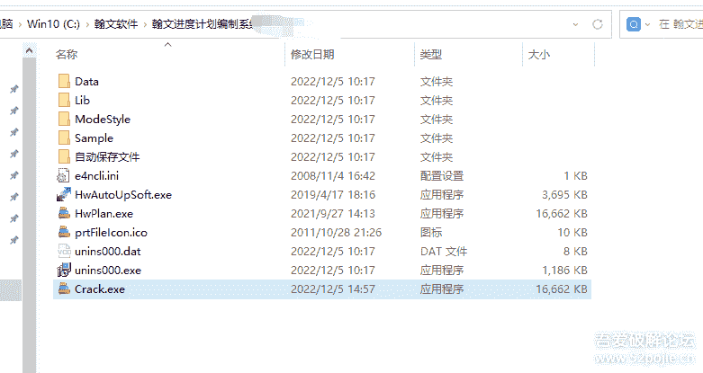

14.jpg (46.92 KB, 下载次数: 1)

[附件](https://www.52pojie.cn/forum.php?mod=attachment&aid=MjU3NjQwMXxmZDQ4Y2M3OXwxNzkzNTc0MjUzfDE2ODA4NnwxNzIyODcw&nothumb=yes)

2022-12-5 15:07 上传

15.jpg (496.94 KB, 下载次数: 2)

[附件](https://www.52pojie.cn/forum.php?mod=attachment&aid=MjU3NjQwMnxkNjM4OWE4MXwxNzkzNTc0MjUzfDE2ODA4NnwxNzIyODcw&nothumb=yes)

2022-12-5 15:07 上传

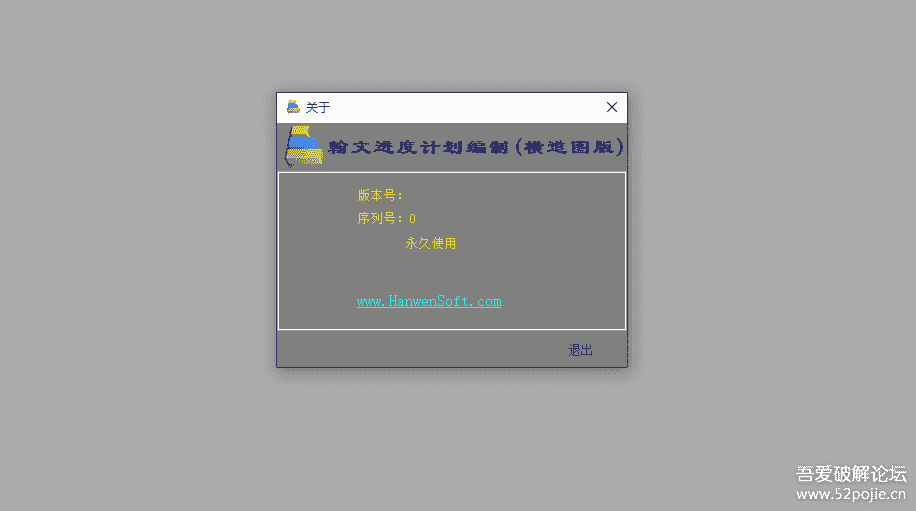

16.jpg (21.36 KB, 下载次数: 0)

[附件](https://www.52pojie.cn/forum.php?mod=attachment&aid=MjU3NjQwM3w3YTc3NzI1ZHwxNzkzNTc0MjUzfDE2ODA4NnwxNzIyODcw&nothumb=yes)

2022-12-5 15:07 上传

测试能成功输出表格文件，打印和导出图片偶尔会有内存错误，这个bug无法解决，望论坛大佬指点。

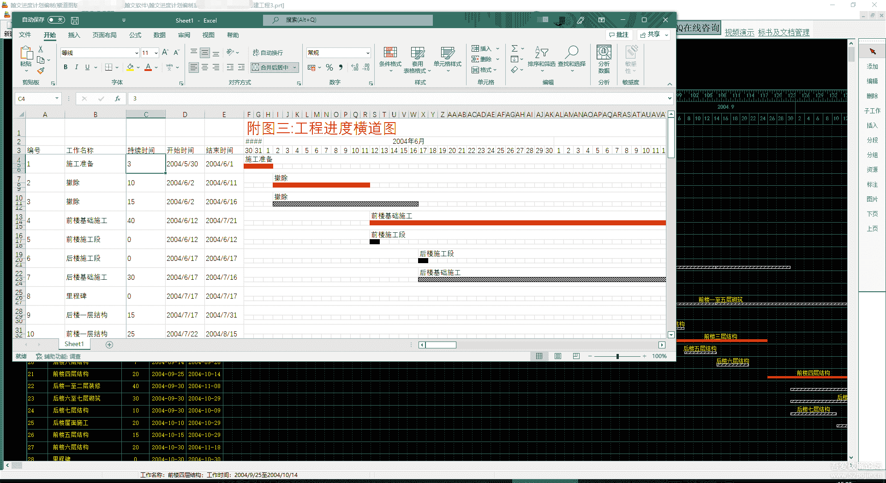

18.jpg (169.94 KB, 下载次数: 1)

[附件](https://www.52pojie.cn/forum.php?mod=attachment&aid=MjU3NjM5NnwxMzNiMjBmNnwxNzkzNTc0MjUzfDE2ODA4NnwxNzIyODcw&nothumb=yes)

2022-12-5 15:07 上传

## 结语

该xx过程，新版本软件已经修复，能适用该方法的旧版本文件因版权问题故不在此提供，需要学习的用户可以自行百度搜索该软件旧版本。

祝52破解的所有工程人今后都不被收费软件所困扰，52破解论坛越办越好！

至于新版修复了确实该方法的前面几个关键`call`，但这几个`call`现在仔细分析也应该只是处于验证逻辑的中间，对于新版大家可以继续通过此办法找出验证的源头位置进行修改即可达到导出表格的目的，至于打印和导出图片，有没有内存错误其实对实际使用没太大影响，能导出表格文件就能实现导出图片和打印这两个功能了。

## 免责声明

根据我国《计算机软件保护条例》第十七条规定：“为了学习和研究软件内含的设计思想和原理，通过安装、显示、传输或者存储软件等方式使用软件的，可以不经软件著作权人许可，不向其支付报酬。” 您需知晓本站所有内容资源均来源于网络，仅供用户交流学习与研究使用，版权归属原版权方所有，版权争议与本人、论坛无关，用户本人下载后不能用作商业或非法用途，需在 24 小时之内删除，否则后果均由用户承担责任。
