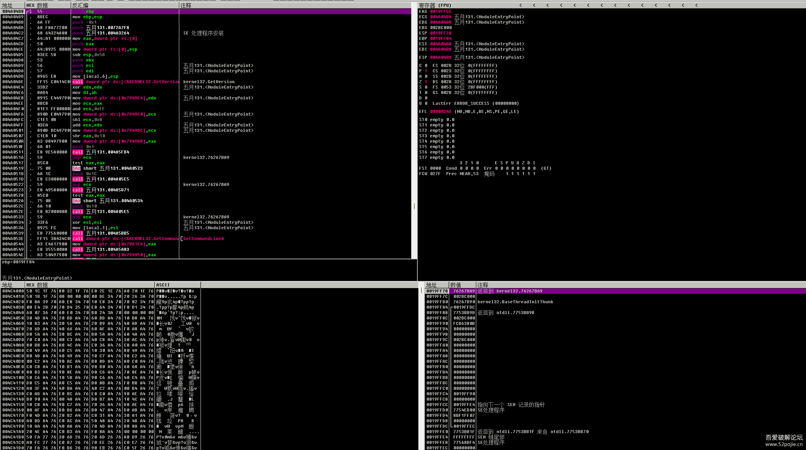
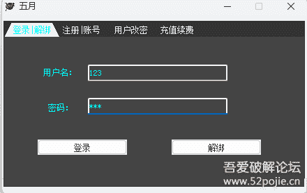
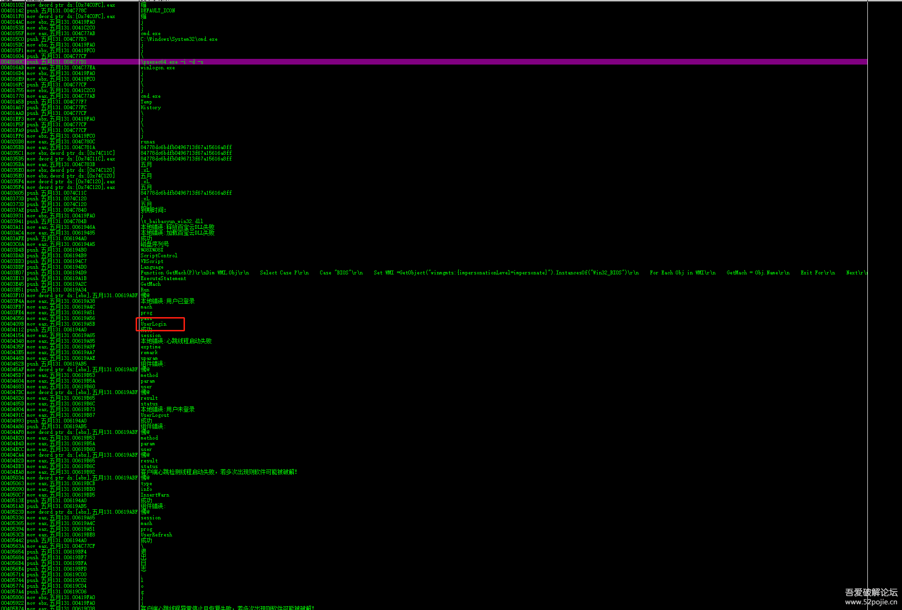
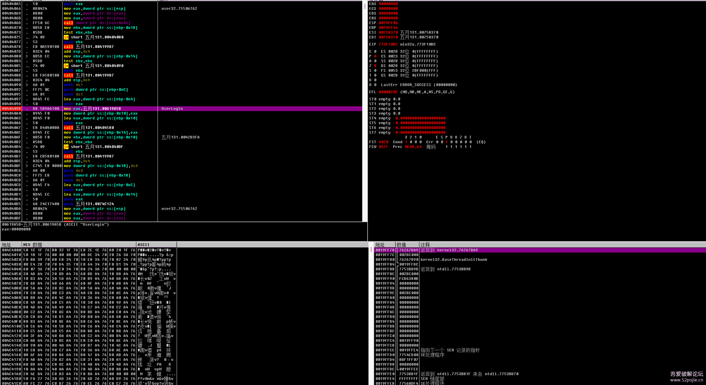
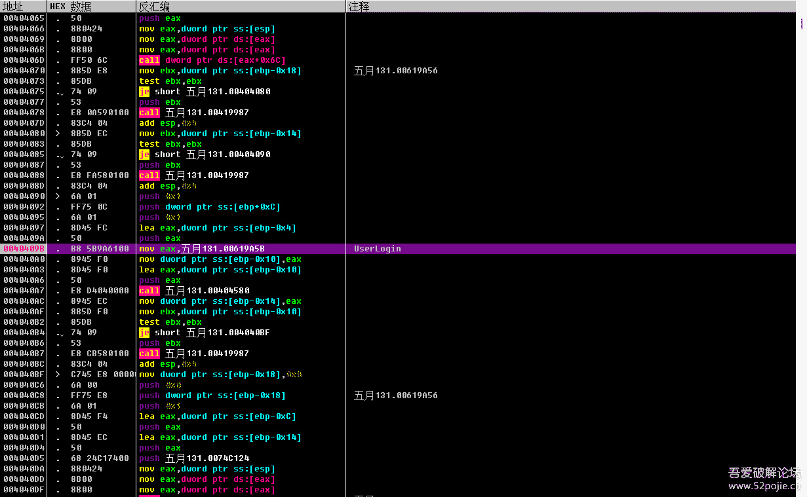
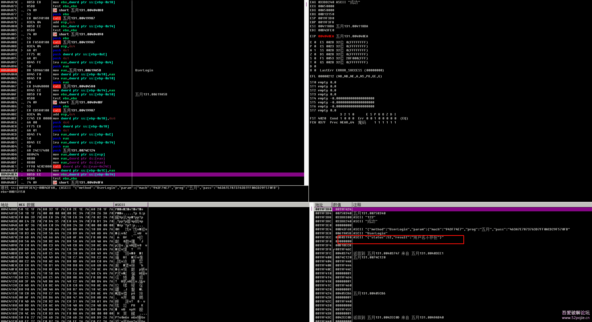
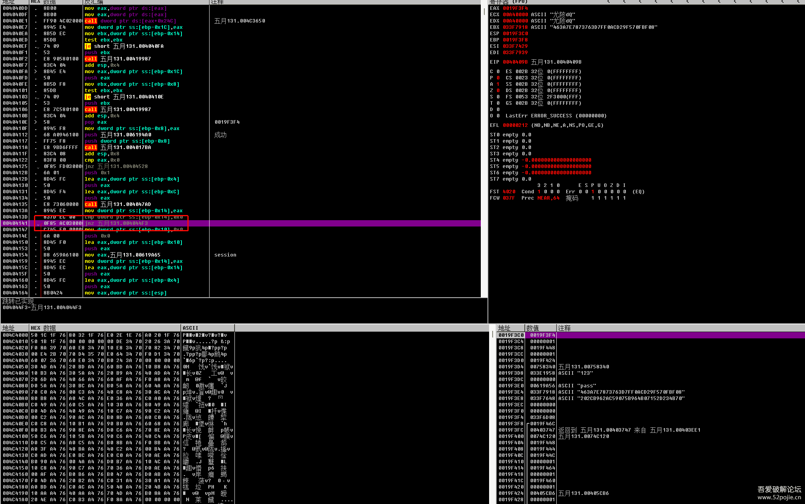

# [原创] 一个dnf辅助破解过程

- 原帖：<https://www.52pojie.cn/forum.php?mod=viewthread&tid=1724650>
- 抓取时间：2026-11-01T23:04:00

大家好，很久没发帖子了。

今天发一个简单的 dnf 辅助教程。废话不多说，下面开始。

## 查壳

首先查壳。

可以看到是 C++ 或者 e 语言编写的程序，也就是作者没有装壳。

## 打开 `OD` 并运行程序

然后打开 `OD`，左上角“文件” → “打开” → “选择辅助文件”。

没有壳的辅助比较简单，我们首先运行下看看。

## 搜索字符串

思路是想办法让程序先断下来。输入账号密码，点击登录后无提示，我们右键 > “中文搜索引擎”，搜索 `ASCII` 看下。

可以看出来是通过 `psexec64.exe` 来进行提权，并附加给父进程 `winlogon`，从而达到跨进程读写内存的目的。

## 定位 `userLogin` 并下断点

这里有一个 `userLogin`，双击进去看下。

在这里下断点后，点击登录下试试。

## 单步调试

果然断下来了。`f8` 单步调试几下看看。

这里看上去是登录回调了。在登录 `call` 修改也是可以的，但是比较麻烦。我们先走走看看，继续单步向下走。

## 修改跳转

这里这个跳转很长，上面还有一个 `cmp`，有点疑似。我们把这里的 `jnz` 改成 `je` 试下。

`jnz`：不等于则跳转；`je`：等于则跳转。

哦吼，功能窗口出来了。

## 结束

由于 12 月 8 号刚更新的基址，这个是 12 月 4 号发的，猜测基址已经过期了，就不测试了，到此结束了。文件放附件里了，有需要的小伙伴可以自行下载，有疑问也可以私信我。
