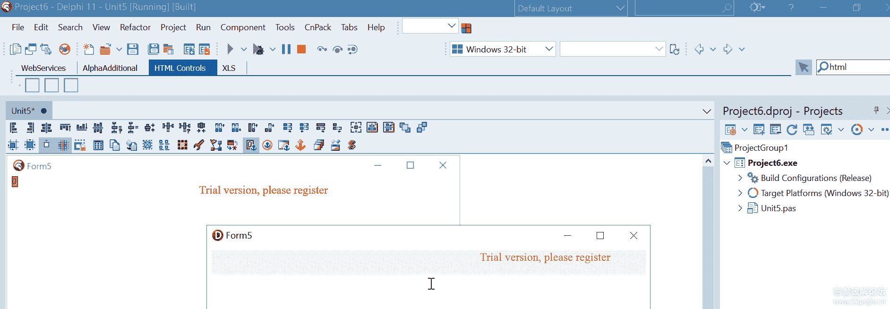
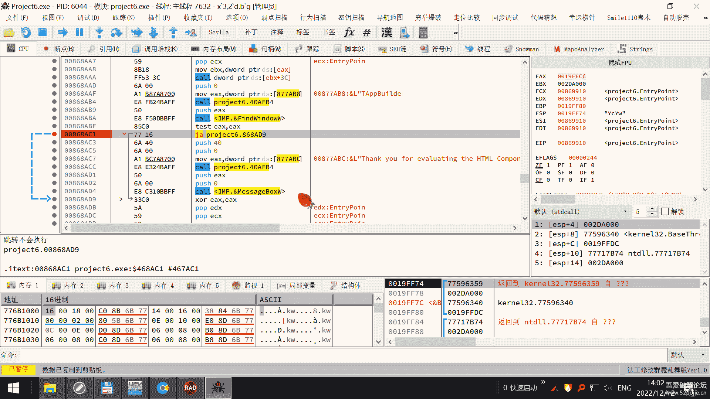
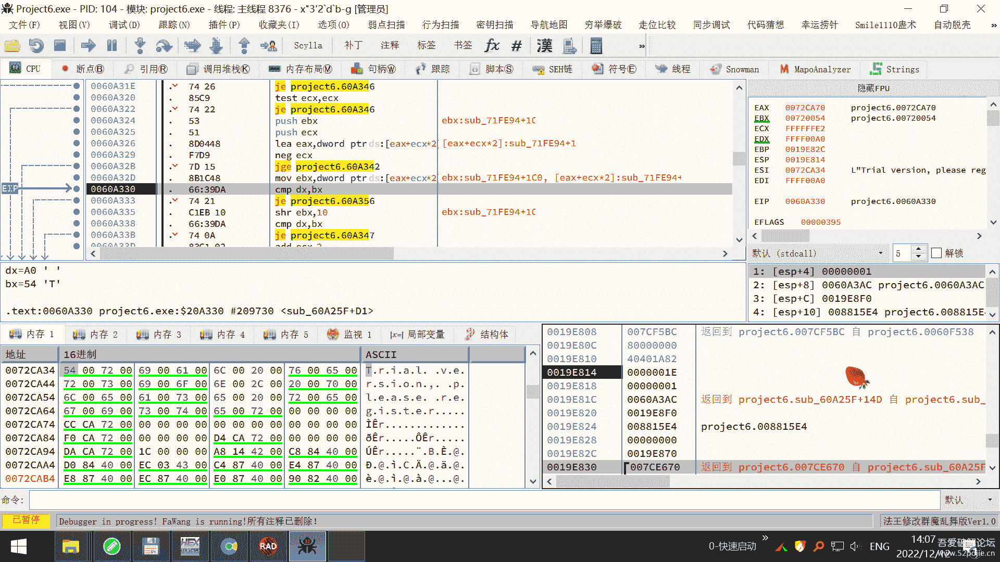
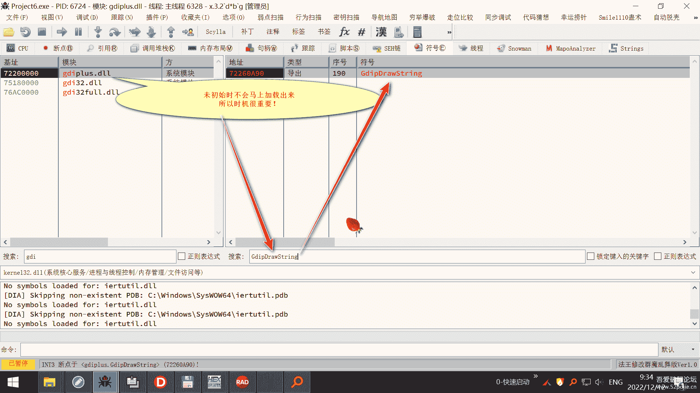
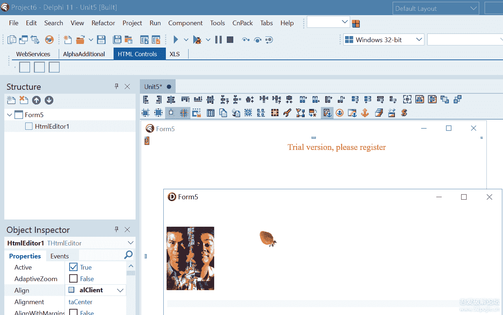

# [原创] 水印大作战

- 原帖：https://www.52pojie.cn/forum.php?mod=viewthread&tid=1725831
- 抓取时间：2026-11-01T23:03:46

如图所示：已知：某款 Delphi 控件；随便编译一个 `EXE`；输出就会



`image.png` (122.71 KB, 下载次数: 2)

[附件下载](https://www.52pojie.cn/forum.php?mod=attachment&aid=MjU3ODY4MHw5YWY3OTZhNXwxNzkzNTc0MjI0fDE2ODA4NnwxNzI1ODMx&nothumb=yes)

2022-12-12 15:01 上传

## 症状

症状1：全屏都是大水印；

症状2：偶尔弹框 Thank you for evaluating the

求证：去掉限制；找到对应的控件相关文件一次给多个版本的所有文件打补丁。



`image.png` (362.91 KB, 下载次数: 2)

[附件下载](https://www.52pojie.cn/forum.php?mod=attachment&aid=MjU3ODY4MXw5YzVkNWViZHwxNzkzNTc0MjI0fDE2ODA4NnwxNzI1ODMx&nothumb=yes)

2022-12-12 15:01 上传

## 调试

再到这个 `EXE` 文件中用 `winhex` 修改 1 个字节，看是否被调用了？是的。变了吧？

接下来就可调试了。

第 1 处的位置没难度，直接爆破 `JMP` 跳过就可以了。

注意看红线，默认本次是跳过的，但是有时则不会，所以安全起见 `jmp` 伺候

接下来水印限制就是考你基本功和经验值的问题了。

通常定位到该字符串下个硬件访问断点



`image.png` (359.73 KB, 下载次数: 2)

[附件下载](https://www.52pojie.cn/forum.php?mod=attachment&aid=MjU3ODY4MnwzNGNhMDA3MXwxNzkzNTc0MjI0fDE2ODA4NnwxNzI1ODMx&nothumb=yes)

2022-12-12 15:02 上传

注意看成功断下了，但是已经晚了八春了。

为啥会这样呢？

- 因为产生此水印的文件有好多个（`*.bpl`；`*.dcu`；`*.obj`），会产生干扰因素
- 时机晚了！为啥呢？因为是动态渲染出来的



`image.png` (298.11 KB, 下载次数: 1)

[附件下载](https://www.52pojie.cn/forum.php?mod=attachment&aid=MjU3ODY3OXw0ZDRjMWQzMXwxNzkzNTc0MjI0fDE2ODA4NnwxNzI1ODMx&nothumb=yes)

2022-12-12 15:00 上传

## 正确解法

所以正确的解法是：

看到了吧？水印就是这么来的。

`Ctrl+A`、`Ctrl-`

图中的代码很很长很长，只粘最有意义的部分：

[Asm] 纯文本查看 复制代码


## 水印产生原因

```
007CE66B     | E8 F0BCE3FF          | call project6.60A360            |
007CE670     | 85C0                 | test eax,eax                    |
007CE672     | EB 5B                | jmp project6.7CE6CF             | 还得JMP
007CE674     | 8B45 0C              | mov eax,dword ptr ss:[ebp+C]    |
007CE677     | 8B55 EC              | mov edx,dword ptr ss:[ebp-14]   |
007CE67A     | 48                   | dec eax                         |
007CE67B     | 85D2                 | test edx,edx                    |
007CE67D     | 74 05                | je project6.7CE684              |
007CE67F     | 3B42 FC              | cmp eax,dword ptr ds:[edx-4]    |
007CE682     | 72 05                | jb project6.7CE689              |
007CE684     | E8 2799C3FF          | call                            |
007CE689     | 40                   | inc eax                         |
007CE68A     | 8D4442 FE            | lea eax,dword ptr ds:[edx+eax*2 |
007CE68E     | 8945 E8              | mov dword ptr ss:[ebp-18],eax   |
007CE691     | 8B45 14              | mov eax,dword ptr ss:[ebp+14]   |
007CE694     | 8B50 54              | mov edx,dword ptr ds:[eax+54]   |
007CE697     | 8B52 04              | mov edx,dword ptr ds:[edx+4]    |
007CE69A     | 52                   | push edx                        |
007CE69B     | 8B55 E4              | mov edx,dword ptr ss:[ebp-1C]   |
007CE69E     | 8B92 F0000000        | mov edx,dword ptr ds:[edx+F0]   |
007CE6A4     | 8B52 04              | mov edx,dword ptr ds:[edx+4]    |
007CE6A7     | 52                   | push edx                        |
007CE6A8     | 8D55 F0              | lea edx,dword ptr ss:[ebp-10]   |
007CE6AB     | 52                   | push edx                        |
007CE6AC     | 8B40 50              | mov eax,dword ptr ds:[eax+50]   |
007CE6AF     | 8B40 04              | mov eax,dword ptr ds:[eax+4]    |
007CE6B2     | 50                   | push eax                        |
007CE6B3     | 8B45 08              | mov eax,dword ptr ss:[ebp+8]    |
007CE6B6     | 50                   | push eax                        |
007CE6B7     | 8B45 E8              | mov eax,dword ptr ss:[ebp-18]   |
007CE6BA     | 50                   | push eax                        |
007CE6BB     | 8B45 E4              | mov eax,dword ptr ss:[ebp-1C]   |
007CE6BE     | 8B80 E8000000        | mov eax,dword ptr ds:[eax+E8]   |
007CE6C4     | 8B40 04              | mov eax,dword ptr ds:[eax+4]    |
007CE6C7     | 50                   | push eax                        |
007CE6C8     | E8 3B87FDFF          | call                            |
007CE6CD     | EB 07                | jmp project6.7CE6D6             |
007CE6CF     | 55                   | push ebp                        |
007CE6D0     | 90                   | nop                             | 从段首出来
007CE6D1     | 90                   | nop                             |
007CE6D2     | 90                   | nop                             |
007CE6D3     | 90                   | nop                             |
007CE6D4     | 90                   | nop                             |
007CE6D5     | 59                   | pop ecx                         |
007CE6D6     | 8B45 14              | mov eax,dword ptr ss:[ebp+14]   |
007CE6D9     | F640 24 04           | test byte ptr ds:[eax+24],4     |
007CE6DD     | 0F84 EB000000        | je project6.7CE7CE              |
007CE6E3     | 33D2                 | xor edx,edx                     |
007CE6E5     | 8B45 E4              | mov eax,dword ptr ss:[ebp-1C]   |
007CE6E8     | 8B08                 | mov ecx,dword ptr ds:[eax]      |
007CE6EA     | FF51 74              | call dword ptr ds:[ecx+74]      |
007CE6ED     | 8B45 E0              | mov eax,dword ptr ss:[ebp-20]   |
007CE6F0     | FF30                 | push dword ptr ds:[eax]         |
007CE6F2     | 8B45 14              | mov eax,dword ptr ss:[ebp+14]   |
007CE6F5     | D940 14              | fld st(0),dword ptr ds:[eax+14] |
007CE6F8     | D9E1                 | fabs                            |
007CE6FA     | D835 F4E77C00        | fdiv st(0),dword ptr ds:[7CE7F4 |
007CE700     | 83C4 F4              | add esp,FFFFFFF4                |
007CE703     | DB3C24               | fstp tword ptr ss:[esp],st(0)   |
007CE706     | 9B                   | fwait                           |
007CE707     | E8 C4A8C7FF          | call                            |
007CE70C     | 8945 D4              | mov dword ptr ss:[ebp-2C],eax   |
007CE70F     | DB45 D4              | fild st(0),dword ptr ss:[ebp-2C |
007CE712     | 8B45 14              | mov eax,dword ptr ss:[ebp+14]   |
007CE715     | D840 14              | fadd st(0),dword ptr ds:[eax+14 |
007CE718     | 83C4 F4              | add esp,FFFFFFF4                |
007CE71B     | DB3C24               | fstp tword ptr ss:[esp],st(0)   |
007CE71E     | 9B                   | fwait                           |
007CE71F     | 8B45 14              | mov eax,dword ptr ss:[ebp+14]   |
007CE722     | D940 14              | fld st(0),dword ptr ds:[eax+14] |
007CE725     | D9E1                 | fabs                            |
007CE727     | D835 F8E77C00        | fdiv st(0),dword ptr ds:[      |
007CE732     | 8945 D8              | mov dword ptr ss:[ebp-28],eax   |
007CE735     | 8955 DC              | mov dword ptr ss:[ebp-24],edx   |
007CE738     | DF6D D8              | fild st(0),qword ptr ss:[ebp-28 |
007CE73B     | D835 FCE77C00        | fdiv st(0),dword ptr ds:[7CE7FC |
007CE741     | 8B45 14              | mov eax,dword ptr ss:[ebp+14]   |
007CE744     | D940 48              | fld st(0),dword ptr ds:[eax+48] |
007CE747     | D835 FCE77C00        | fdiv st(0),dword ptr ds:[7CE7FC |
007CE74D     | 8B45 14              | mov eax,dword ptr ss:[ebp+14]   |
007CE750     | D840 44              | fadd st(0),dword ptr ds:[eax+44 |
007CE753     | DEE1                 | fsubrp st(1),st(0)              |
007CE755     | 83C4 F4              | add esp,FFFFFFF4                |
007CE758     | DB3C24               | fstp tword ptr ss:[esp],st(0)   |
007CE75B     | 9B                   | fwait                           |
007CE75C     | E8 BFA9C7FF          | call                            |
007CE761     | D845 F4              | fadd st(0),dword ptr ss:[ebp-C] |
007CE764     | D95D D4              | fstp dword ptr ss:[ebp-2C],st(0 |
007CE767     | 9B                   | fwait                           |
007CE768     | FF75 D4              | push dword ptr ss:[ebp-2C]      |
007CE76B     | 8B45 E4              | mov eax,dword ptr ss:[ebp-1C]   |
007CE76E     | E8 0D0E0000          | call                            |
007CE773     | 83C4 FC              | add esp,FFFFFFFC                |
007CE776     | D91C24               | fstp dword ptr ss:[esp],st(0)   |
007CE779     | 9B                   | fwait                           |
007CE77A     | 8B45 E0              | mov eax,dword ptr ss:[ebp-20]   |
007CE77D     | E8 5625E4FF          | call                            |
007CE782     | 83C4 FC              | add esp,FFFFFFFC                |
007CE785     | D91C24               | fstp dword ptr ss:[esp],st(0)   |
007CE788     | 9B                   | fwait                           |
007CE789     | 8B45 14              | mov eax,dword ptr ss:[ebp+14]   |
007CE78C     | D940 14              | fld st(0),dword ptr ds:[eax+14] |
007CE78F     | D9E1                 | fabs                            |
007CE791     | D835 F8E77C00        | fdiv st(0),dword ptr ds:[      |
007CE7A3     | 8945 D4              | mov dword ptr ss:[ebp-2C],eax   |
007CE7A6     | DB45 D4              | fild st(0),dword ptr ss:[ebp-2C |
007CE7A9     | D95D D0              | fstp dword ptr ss:[ebp-30],st(0 |
007CE7AC     | 9B                   | fwait                           |
007CE7AD     | FF75 D0              | push dword ptr ss:[ebp-30]      |
007CE7B0     | 8B45 14              | mov eax,dword ptr ss:[ebp+14]   |
007CE7B3     | 8B50 54              | mov edx,dword ptr ds:[eax+54]   |
007CE7B6     | 8B45 E4              | mov eax,dword ptr ss:[ebp-1C]   |
007CE7B9     | 8B80 E8000000        | mov eax,dword ptr ds:[eax+E8]   |
007CE7BF     | E8 30D8FEFF          | call project6.7BBFF4            |
007CE7C4     | B2 01                | mov dl,1                        |
007CE7C6     | 8B45 E4              | mov eax,dword ptr ss:[ebp-1C]   |
007CE7C9     | 8B08                 | mov ecx,dword ptr ds:[eax]      |
007CE7CB     | FF51 74              | call dword ptr ds:[ecx+74]      |
007CE7CE     | 80FB 01              | cmp bl,1                        |
007CE7D1     | 75 10                | jne project6.7CE7E3             |
007CE7D3     | 8B45 E4              | mov eax,dword ptr ss:[ebp-1C]   |
007CE7D6     | 8B80 F0000000        | mov eax,dword ptr ds:[eax+F0]   |
007CE7DC     | 33D2                 | xor edx,edx                     |
007CE7DE     | E8 2D8AFEFF          | call                            |
007CE7E3     | 5F                   | pop edi                         |
007CE7E4     | 5E                   | pop esi                         |
007CE7E5     | 5B                   | pop ebx                         |
007CE7E6     | 8BE5                 | mov esp,ebp                     |
007CE7E8     | 5D                   | pop ebp                         |
007CE7E9     | C2 1000              | ret 10                          |
```

为啥产生了水印呢？因为下面的两个 `call`：

第 1 次：`007CE6C8 | E8 3B87FDFF | call`，这个之后进入我们刚才上面分析的那个代码不远处。

第 2 次：`GdipSetStringFormatT`。

所以明白了原因，问题就简单了。

## 修改点

`007CE672 | 75 5B | jne project6.7CE6CF`，如果不实现，那么下面的 `jmp` 就会自己跳过。

但当你这么做之后，发现修改之后程序还会再执行到，所以下面的那个 `call` 直接 `NOP` 掉。

下面还有一个 `007CE7D1 | 75 10 | jne project6.7CE7E3`。

程序自己会自己跳过 `GdipSetStringFormatT`，所以就没必要修改了。

然后再 `F8` 向下，发现：

```
007CE672     | 75 5B                | jne project6.7CE6CF             | 这句又回来了。。。所以呢，此处还得JMP掉
007CE674     | 8B45 0C              | mov eax,dword ptr ss:[ebp+C]    |
007CE677     | 8B55 EC              | mov edx,dword ptr ss:[ebp-14]   |
007CE67A     | 48                   | dec eax                         |
007CE67B     | 85D2                 | test edx,edx                    |
007CE67D     | 74 05                | je project6.7CE684              |
007CE67F     | 3B42 FC              | cmp eax,dword ptr ds:[edx-4]    |
007CE682     | 72 05                | jb project6.7CE689              |
007CE684     | E8 2799C3FF          | call                            |
007CE689     | 40                   | inc eax                         |
007CE68A     | 8D4442 FE            | lea eax,dword ptr ds:[edx+eax*2 |
007CE68E     | 8945 E8              | mov dword ptr ss:[ebp-18],eax   |
007CE691     | 8B45 14              | mov eax,dword ptr ss:[ebp+14]   |
007CE694     | 8B50 54              | mov edx,dword ptr ds:[eax+54]   |
007CE697     | 8B52 04              | mov edx,dword ptr ds:[edx+4]    |
007CE69A     | 52                   | push edx                        |
007CE69B     | 8B55 E4              | mov edx,dword ptr ss:[ebp-1C]   |
007CE69E     | 8B92 F0000000        | mov edx,dword ptr ds:[edx+F0]   |
007CE6A4     | 8B52 04              | mov edx,dword ptr ds:[edx+4]    |
007CE6A7     | 52                   | push edx                        |
007CE6A8     | 8D55 F0              | lea edx,dword ptr ss:[ebp-10]   |
007CE6AB     | 52                   | push edx                        |
007CE6AC     | 8B40 50              | mov eax,dword ptr ds:[eax+50]   |
007CE6AF     | 8B40 04              | mov eax,dword ptr ds:[eax+4]    |
007CE6B2     | 50                   | push eax                        |
007CE6B3     | 8B45 08              | mov eax,dword ptr ss:[ebp+8]    |
007CE6B6     | 50                   | push eax                        |
007CE6B7     | 8B45 E8              | mov eax,dword ptr ss:[ebp-18]   |
007CE6BA     | 50                   | push eax                        |
007CE6BB     | 8B45 E4              | mov eax,dword ptr ss:[ebp-1C]   |
007CE6BE     | 8B80 E8000000        | mov eax,dword ptr ds:[eax+E8]   |
007CE6C4     | 8B40 04              | mov eax,dword ptr ds:[eax+4]    |
007CE6C7     | 50                   | push eax                        |
007CE6C8     | E8 3B87FDFF          | call                            |
007CE6CD     | EB 07                | jmp project6.7CE6D6             |
007CE6CF     | 55                   | push ebp                        |
007CE6D0     | 90                   | nop                             |
007CE6D1     | 90                   | nop                             |
007CE6D2     | 90                   | nop                             |
007CE6D3     | 90                   | nop                             |
007CE6D4     | 90                   | nop                             |
007CE6D5     | 59                   | pop ecx                         |
007CE6D6     | 8B45 14              | mov eax,dword ptr ss:[ebp+14]   |
007CE6D9     | F640 24 04           | test byte ptr ds:[eax+24],4     |
007CE6DD     | 0F84 EB000000        | je project6.7CE7CE              |
007CE6E3     | 33D2                 | xor edx,edx                     |
007CE6E5     | 8B45 E4              | mov eax,dword ptr ss:[ebp-1C]   |
007CE6E8     | 8B08                 | mov ecx,dword ptr ds:[eax]      |
007CE6EA     | FF51 74              | call dword ptr ds:[ecx+74]      |
007CE6ED     | 8B45 E0              | mov eax,dword ptr ss:[ebp-20]   |
007CE6F0     | FF30                 | push dword ptr ds:[eax]         |
007CE6F2     | 8B45 14              | mov eax,dword ptr ss:[ebp+14]   |
007CE6F5     | D940 14              | fld st(0),dword ptr ds:[eax+14] |
007CE6F8     | D9E1                 | fabs                            |
007CE6FA     | D835 F4E77C00        | fdiv st(0),dword ptr ds:[7CE7F4 |
007CE700     | 83C4 F4              | add esp,FFFFFFF4                |
007CE703     | DB3C24               | fstp tword ptr ss:[esp],st(0)   |
007CE706     | 9B                   | fwait                           |
007CE707     | E8 C4A8C7FF          | call                            |
007CE70C     | 8945 D4              | mov dword ptr ss:[ebp-2C],eax   |
007CE70F     | DB45 D4              | fild st(0),dword ptr ss:[ebp-2C |
007CE712     | 8B45 14              | mov eax,dword ptr ss:[ebp+14]   |
007CE715     | D840 14              | fadd st(0),dword ptr ds:[eax+14 |
007CE718     | 83C4 F4              | add esp,FFFFFFF4                |
007CE71B     | DB3C24               | fstp tword ptr ss:[esp],st(0)   |
007CE71E     | 9B                   | fwait                           |
007CE71F     | 8B45 14              | mov eax,dword ptr ss:[ebp+14]   |
007CE722     | D940 14              | fld st(0),dword ptr ds:[eax+14] |
007CE725     | D9E1                 | fabs                            |
007CE727     | D835 F8E77C00        | fdiv st(0),dword ptr ds:[      |
007CE732     | 8945 D8              | mov dword ptr ss:[ebp-28],eax   |
007CE735     | 8955 DC              | mov dword ptr ss:[ebp-24],edx   |
007CE738     | DF6D D8              | fild st(0),qword ptr ss:[ebp-28 |
007CE73B     | D835 FCE77C00        | fdiv st(0),dword ptr ds:[7CE7FC |
007CE741     | 8B45 14              | mov eax,dword ptr ss:[ebp+14]   |
007CE744     | D940 48              | fld st(0),dword ptr ds:[eax+48] |
007CE747     | D835 FCE77C00        | fdiv st(0),dword ptr ds:[7CE7FC |
007CE74D     | 8B45 14              | mov eax,dword ptr ss:[ebp+14]   |
007CE750     | D840 44              | fadd st(0),dword ptr ds:[eax+44 |
007CE753     | DEE1                 | fsubrp st(1),st(0)              |
007CE755     | 83C4 F4              | add esp,FFFFFFF4                |
007CE758     | DB3C24               | fstp tword ptr ss:[esp],st(0)   |
007CE75B     | 9B                   | fwait                           |
007CE75C     | E8 BFA9C7FF          | call                            |
007CE761     | D845 F4              | fadd st(0),dword ptr ss:[ebp-C] |
007CE764     | D95D D4              | fstp dword ptr ss:[ebp-2C],st(0 |
007CE767     | 9B                   | fwait                           |
007CE768     | FF75 D4              | push dword ptr ss:[ebp-2C]      |
007CE76B     | 8B45 E4              | mov eax,dword ptr ss:[ebp-1C]   |
007CE76E     | E8 0D0E0000          | call                            |
007CE773     | 83C4 FC              | add esp,FFFFFFFC                |
007CE776     | D91C24               | fstp dword ptr ss:[esp],st(0)   |
007CE779     | 9B                   | fwait                           |
007CE77A     | 8B45 E0              | mov eax,dword ptr ss:[ebp-20]   |
007CE77D     | E8 5625E4FF          | call                            |
007CE782     | 83C4 FC              | add esp,FFFFFFFC                |
007CE785     | D91C24               | fstp dword ptr ss:[esp],st(0)   |
007CE788     | 9B                   | fwait                           |
007CE789     | 8B45 14              | mov eax,dword ptr ss:[ebp+14]   |
007CE78C     | D940 14              | fld st(0),dword ptr ds:[eax+14] |
007CE78F     | D9E1                 | fabs                            |
007CE791     | D835 F8E77C00        | fdiv st(0),dword ptr ds:[      |
007CE7A3     | 8945 D4              | mov dword ptr ss:[ebp-2C],eax   |
007CE7A6     | DB45 D4              | fild st(0),dword ptr ss:[ebp-2C |
007CE7A9     | D95D D0              | fstp dword ptr ss:[ebp-30],st(0 |
007CE7AC     | 9B                   | fwait                           |
007CE7AD     | FF75 D0              | push dword ptr ss:[ebp-30]      |
007CE7B0     | 8B45 14              | mov eax,dword ptr ss:[ebp+14]   |
007CE7B3     | 8B50 54              | mov edx,dword ptr ds:[eax+54]   |
007CE7B6     | 8B45 E4              | mov eax,dword ptr ss:[ebp-1C]   |
007CE7B9     | 8B80 E8000000        | mov eax,dword ptr ds:[eax+E8]   |
007CE7BF     | E8 30D8FEFF          | call project6.7BBFF4            |
007CE7C4     | B2 01                | mov dl,1                        |
007CE7C6     | 8B45 E4              | mov eax,dword ptr ss:[ebp-1C]   |
007CE7C9     | 8B08                 | mov ecx,dword ptr ds:[eax]      |
007CE7CB     | FF51 74              | call dword ptr ds:[ecx+74]      |
007CE7CE     | 80FB 01              | cmp bl,1                        |
007CE7D1     | 75 10                | jne project6.7CE7E3             |
007CE7D3     | 8B45 E4              | mov eax,dword ptr ss:[ebp-1C]   |
007CE7D6     | 8B80 F0000000        | mov eax,dword ptr ds:[eax+F0]   |
007CE7DC     | 33D2                 | xor edx,edx                     |
007CE7DE     | E8 2D8AFEFF          | call                            |
007CE7E3     | 5F                   | pop edi                         |
007CE7E4     | 5E                   | pop esi                         |
007CE7E5     | 5B                   | pop ebx                         |
007CE7E6     | 8BE5                 | mov esp,ebp                     |
007CE7E8     | 5D                   | pop ebp                         |
007CE7E9     | C2 1000              | ret 10                          |
```



image.png (185.41 KB, 下载次数: 2)

[forum.php?mod=attachment&aid=MjU3ODY2NHwwMzI0NGQzNHwxNzkzNTc0MjI0fDE2ODA4NnwxNzI1ODMx&nothumb=yes](https://www.52pojie.cn/forum.php?mod=attachment&aid=MjU3ODY2NHwwMzI0NGQzNHwxNzkzNTc0MjI0fDE2ODA4NnwxNzI1ODMx&nothumb=yes)

2022-12-12 14:38 上传

这样就不会有水印产生了。

## 批量补丁命令

接着 `TC` 搜索下字符串所在的插件目录；就会得到一大波相关的文件；然后用 `WinHEX` 把可疑的若干文件修改掉。

批量打补丁与命令行一劳永逸制作：可以参考

```
:::Change display text

sfk replace -binary "/4500760061006C0075006100740069006F006E002000760065007200730069006F006E002E00200057006F0072006B00730020006F006E006C007900200069006E002000490044004500/43007200610063006B00650064002000760065007200730069006F006E002E002000200068007400740070003A002F002F00350031007800690061007A00610069002E0063006F006D00/" -dir "%cd%" -yes -file *.dcu

:::Disable RED message on splash screen

sfk replace -binary "/536A016840/536A006840/" -dir "%cd%" -yes -file Splash.dcu

:::Delete wateremark

:sfk replace -binary "/FFFFFFFF3E000000450068004C00690062002000/FFFFFFFF00000000450068004C00690062002000/" -dir "%cd%" -yes -file Gh.dcu

:sfk replace -binary "/FFFFFFFF3E00000045684C696220/FFFFFFFF0000000045684C696220/" -dir "%cd%" -yes -file Gh.dcu

:sfk replace -binary "/FFFFFFFF3F000000450068004C00690062002000/FFFFFFFF00000000450068004C00690062002000/" -dir "%cd%" -yes -file Gh.dcu

:sfk replace -binary "/FFFFFFFF3F00000045684C696220/FFFFFFFF0000000045684C696220/" -dir "%cd%" -yes -file Gh.dcu

sfk replace -binary "/3F00000045/0000000045/" -dir "%cd%" -yes -file Gh.dcu
```
