# [原创] 纯爆破流强制去水印、对比走位去时间、授权的流程、强制干翻`ReportForm`异常、文档为只读

- 原帖：https://www.52pojie.cn/forum.php?mod=viewthread&tid=1725952
- 抓取时间：2026-11-01T23:03:44

## 前言

本帖不能让你一次性成为[大侠](https://www.52pojie.cn)。

但是我们通过各种实验来推演各种复杂的变化、落点，制造不同的结局。

就像玩五子棋一样，等跳转的运用、落子的时机、顺序、棋型、走位，最终影响胜率的不同变数。

最终我们可以总结出各种公式化、实例化，具有某种特性和规律的东西，从中享受到破解带来的奇趣艺术体验。无论学思路，还是编程，都能从中得到最大的启示。

- 强制去水印输出、随机字符串乱码、随机禁用超链接
- 大力暴力改
- 二力暴力改（前两种方式简单暴力，但是！经不起时间的考验）
- 轻微暴力改（慢慢细跟，根据输出慢慢修改；亦可针对16进制文件直接下刀）
- 对比走位法去时间（利用`x64dbg`的插件）——扩展分支：编程实现文件夹、文件、注册表键值的监控新技能和升级《法王版`x64dbg`走火入魔2.0版》
- 授权的流程——扩展分支：编程实现《对比走位三度比较器报告器2.0版》
- 启动过程中授权注册的奥秘
- 授权文件藏身地点与真假授权文件
- 注册始终无法成功的4个原因与干扰因素
- 强制干翻`ReportForm`异常（利用软件的`bug`）
- 解除文档为只读（编程抽码法）
- 去恶心提醒`label`（让软件崩溃）
- 意外获得的宝藏（伯乐识宝马篇）
- 额外的启迪与思考

> `CR = width`，best wishes from crack
>
> 对破解者最好的祝福

里边竟有这句话，可见该软件收关注程度还是比较高的，功能还是可圈可点的。

每天晚上继续更新传奇故事：

这是老毛子PJ网站上极其牛逼的软件；作为为数极其少的所见所得的CHM编辑软件，它是唯一的一款完整版的。

另外我知道的那款叫`CHMEditor`，不少坑爹网站都用Demo版修改而成的。而今天咱们说的这个主角，则是完全版的哟~~

另外再给大家科普下，CHM编辑类软件无非分为3种：

- 第1种是解包后编辑，诸如国内知名的`SuperCHM`、`EasyCHM`……太多了。
- 第2种就是咱们上面提到的，像`EasyCHM`、`HelpAndManual8`、`WinCHM Pro`。
- 第3种编辑转码或另存输出的，像`My Notes Keeper`这类的。

但是前面说的该网站上面给出的不少爆破品不少是坑爹的，是经不起时间的考验的。

我下载的算是比较新的版本吧，但是安装输出一个`chm`之后就会发现注册成功是假的；因为输出有乱码字符+随机水印。

于是又找零下七度表哥要了一个比较老的绿色注册版的6.0的测试；结果发现一旦输出同样有上述问题，所以，还是自己动手的最靠谱。

毕竟又有乐子，还有成就感，那自己做主的感觉就是好啊，想怎么修改就怎么修改。下面截图请出今天的主角来吧。

这个软件比较拖沓地研究了几个月时间吧，算是一个总结和交待吧，几天是不太可能全部交待明白的。所以边编辑、边修改、边总结、边说明吧。

## 第1章 功能限制汇总与`Delphi`编程实现的遐想


`image.png`（119.21 KB，下载次数：1）

[附件链接](https://www.52pojie.cn/forum.php?mod=attachment&aid=MjU3OTAxNHw4YmE5NDZjMnwxNzkzNTc0MjIxfDE2ODA4NnwxNzI1OTUy&nothumb=yes)

2022-12-13 19:28 上传

粉圈1、2、3：授权`key`、试用过期、未注册评估字样（其中圈3又与“关于”中调用的内容相同）。

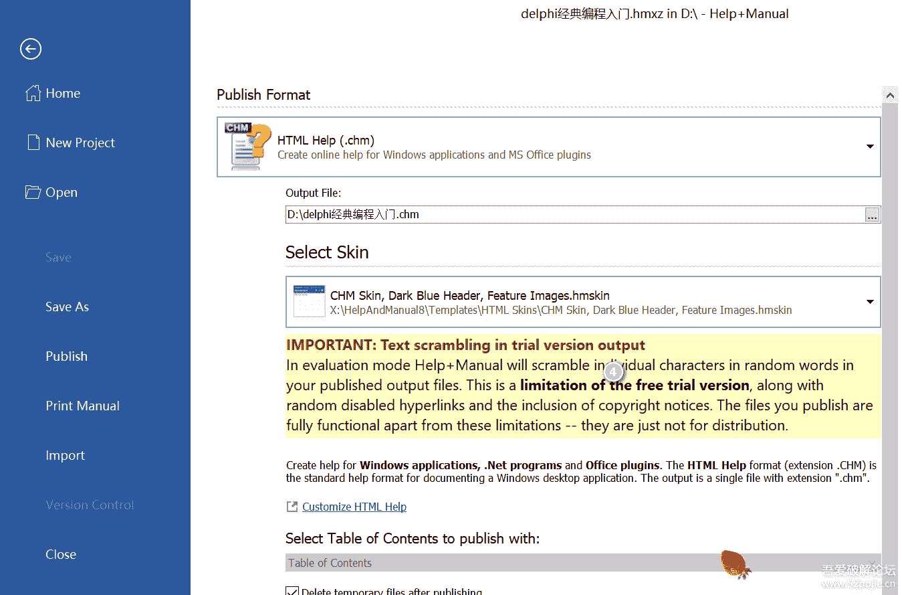

`image.png`（96.12 KB，下载次数：0）

[附件链接](https://www.52pojie.cn/forum.php?mod=attachment&aid=MjU3OTAxNnw3NWZmOTg5ZHwxNzkzNTc0MjIxfDE2ODA4NnwxNzI1OTUy&nothumb=yes)

2022-12-13 19:31 上传

未注册发布的页面，圈4。

图圈5（以发布`*.chm`文件为例）。

发布后的文档。

输出后的随机水印+随机字符串限制。

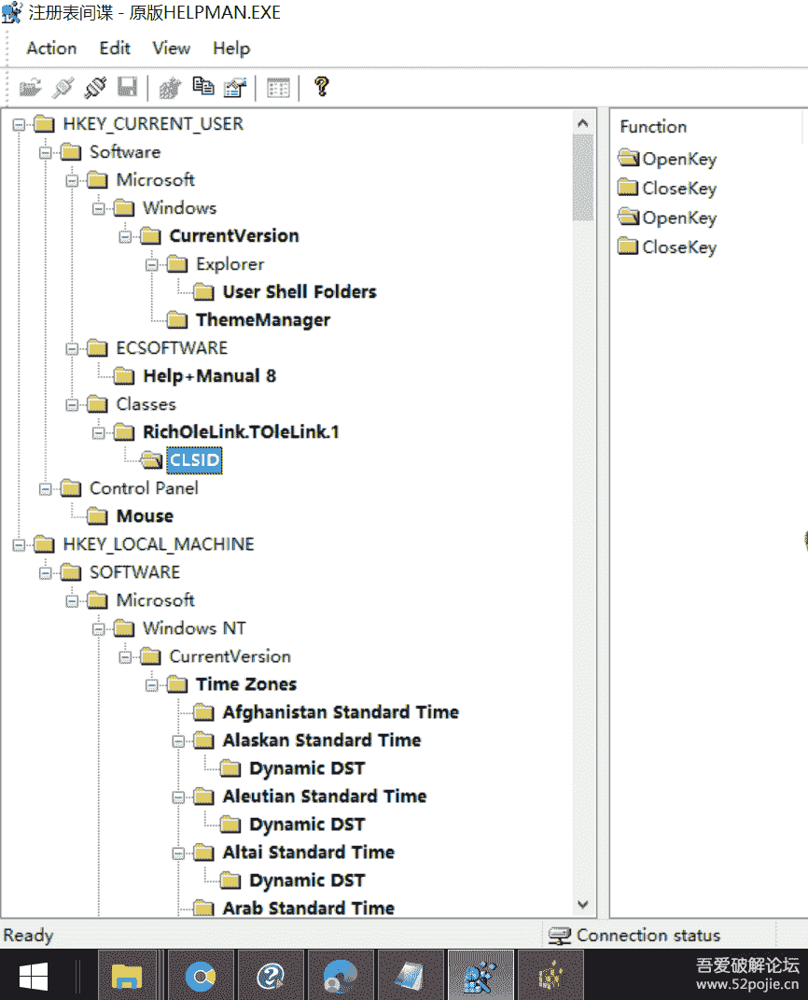

`image.png`（235.88 KB，下载次数：1）

[附件链接](https://www.52pojie.cn/forum.php?mod=attachment&aid=MjU3OTAyN3w0ZWMyOTVkOXwxNzkzNTc0MjIxfDE2ODA4NnwxNzI1OTUy&nothumb=yes)

2022-12-13 20:26 上传

打开`RegSPY`一眼我就知道过期的标志是哪一个，楼下的你能说出为什么吗？

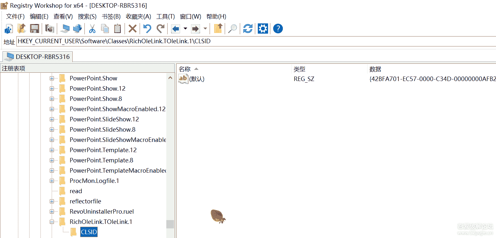

`image.png`（105.41 KB，下载次数：0）

[附件链接](https://www.52pojie.cn/forum.php?mod=attachment&aid=MjU3OTAyOHw1OTFkZGMzNnwxNzkzNTc0MjIxfDE2ODA4NnwxNzI1OTUy&nothumb=yes)

2022-12-13 20:27 上传

上来还是四处搜集信息，这些你都能说出个所以然来，后面的就更易理解。

## 第2章 输出后的随机水印+随机字符串限制

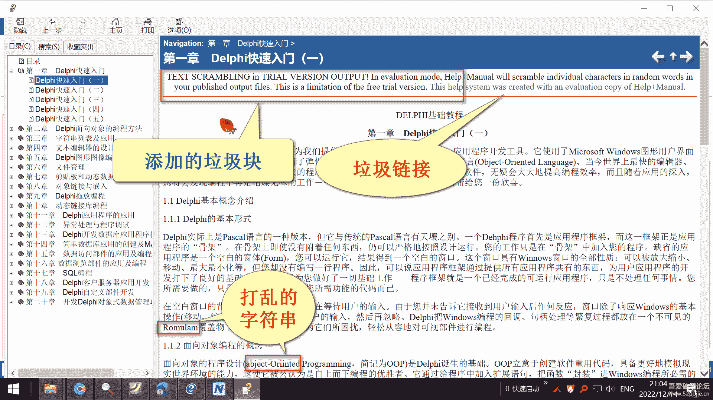

`image.png`（697.04 KB，下载次数：1）

[附件链接](https://www.52pojie.cn/forum.php?mod=attachment&aid=MjU3OTI0NnxmNDBjMDlkOHwxNzkzNTc0MjIxfDE2ODA4NnwxNzI1OTUy&nothumb=yes)

2022-12-14 21:07 上传

先来解决时间过期问题吧。

### 干掉时间限制

- 能想到的传统方式：`inc`变`dec`
- 找到源头永远重置为空
- 使用大白补丁注入或`HOOK`
- 论坛`bester`姥爷的玩法：`HOOK GetLocalTime`补丁（内嵌补丁）
- 找到过期的地方修改
- 法王姥爷最爱的方式，把注册表写记号的动作干掉

### 可疑的几个`API`

- `FileTimeToLocalFileTime`
- `FileTimeToSystemTime`
- `GetLocalTime`

利用插件、脚本、跟踪3种方法来对比走势和最终的分水岭。

都需要用到1个开始的`VA`和结束的`VA`。

猜测哪种方式更少、更快、更好？

- 开始`VA`、结束`VA`+跟踪窗对比
- 开始`VA`、结束`VA`+插件对比
- 开始`VA`、结束`VA`+脚本对比

先是`GetLocalTime`。

接着：

```text
01C8F255 | E8 9A9F78FE | call
```

接着：

```text
01C8F280 | E8 6F9F78FE | call
```

后面就是下面的流程了：

过期原因：`HKEY_CURRENT_USER\Software\Classes\RichOleLink.TOleLink.1\CLSID`检测此记号。


# Help+Manual 试用限制修改记录

## 过期限制的修改

```
01B15431   | B2 01                     | mov dl,1                                       
01B15433   | A1 D41B5900               | mov eax,dword ptr ds:[591BD4]                   |
01B15438   | E8 A3E8A7FE               | call patch_bester_helpman1.593CE0               |
01B1543D   | 8945 EC                   | mov dword ptr ss:[ebp-14],eax                   |
01B15440   | BA 01000080               | mov edx,80000001                                |
01B15445   | 8B45 EC                   | mov eax,dword ptr ss:[ebp-14]                   |
01B15448   | E8 37E9A7FE               | call patch_bester_helpman1.593D84               |
01B1544D   | C645 EB 00                | mov byte ptr ss:[ebp-15],0                      |
01B15451   | 837D F8 00                | cmp dword ptr ss:[ebp-8],0                      |
```

### 改法1

```
01B15455   | 0F8E 0B010000             | jle patch_bester_helpman1.1B15566====>这里跳过
01B1545B   | BA 3056B101               | mov edx,patch_bester_helpman1.1B15630           | 利用字串搜索扩展插件，全局搜索那个地址常量定位到这里L"Software\\Classes\\RichOleLink.TOleLink.1"
01B15460   | 8B45 EC                   | mov eax,dword ptr ss:[ebp-14]                   |
01B15463   | E8 48FDA7FE               | call patch_bester_helpman1.5951B0               |
01B15468   | 84C0                      | test al,al                                      |
01B1546A   | 0F84 F6000000             | je patch_bester_helpman1.1B15566                |
01B15470   | 33C0                      | xor eax,eax                                     |
01B15472   | 55                        | push ebp                                        |
01B15473   | 68 5C55B101               | push patch_bester_helpman1.1B1555C              |
01B15478   | 64:FF30                   | push dword ptr fs:[eax]                         |
01B1547B   | 64:8920                   | mov dword ptr fs:[eax],esp                      |
01B1547E   | BA 8C56B101               | mov edx,patch_bester_helpman1.1B1568C   ==>1B1568C:L"Software\\Classes\\RichOleLink.TOleLink.1\\CLSID"
01B15483   | 8B45 EC                   | mov eax,dword ptr ss:[ebp-14]                   |
01B15486   | E8 25FDA7FE               | call patch_bester_helpman1.5951B0               |
01B1548B   | 84C0                      | test al,al                                      |
01B1548D   | 0F84 BF000000             | je patch_bester_helpman1.1B15552                |
01B15493   | 33C9                      | xor ecx,ecx                                     |
01B15495   | BA 8C56B101               | mov edx,patch_bester_helpman1.1B1568C           | 1B1568C:L"Software\\Classes\\RichOleLink.TOleLink.1\\CLSID"
01B1549A   | 8B45 EC                   | mov eax,dword ptr ss:[ebp-14]                   |
01B1549D   | E8 3AEAA7FE               | call patch_bester_helpman1.593EDC               |
01B154A2   | 84C0                      | test al,al                                      |
01B154A4   | 0F84 A8000000             | je patch_bester_helpman1.1B15552                |
01B154AA   | 8D4D F4                   | lea ecx,dword ptr ss:[ebp-C]                    |
01B154AD   | 33D2                      | xor edx,edx                                     |
01B154AF   | 8B45 EC                   | mov eax,dword ptr ss:[ebp-14]                   |
01B154B2   | E8 E1F3A7FE               | call patch_bester_helpman1.594898               |
01B154B7   | 33C0                      | xor eax,eax                                     |
01B154B9   | 55                        | push ebp                                        |
01B154BA   | 68 4055B101               | push patch_bester_helpman1.1B15540              |
01B154BF   | 64:FF30                   | push dword ptr fs:[eax]                         |
01B154C2   | 64:8920                   | mov dword ptr fs:[eax],esp                      |
01B154C5   | 8D45 E0                   | lea eax,dword ptr ss:[ebp-20]                   |
01B154C8   | 50                        | push eax                                        |
01B154C9   | B9 0C000000               | mov ecx,C                                       | C:'\f'
01B154CE   | BA 1A000000               | mov edx,1A                                      |
01B154D3   | 8B45 F4                   | mov eax,dword ptr ss:[ebp-C]                    |
01B154D6   | E8 C1758FFE               | call patch_bester_helpman1.40CA9C               |
01B154DB   | 8B4D E0                   | mov ecx,dword ptr ss:[ebp-20]                   |
01B154DE   | 8D45 E4                   | lea eax,dword ptr ss:[ebp-1C]                   |
01B154E1   | BA F456B101               | mov edx,patch_bester_helpman1.1B156F4           |
01B154E6   | E8 E1738FFE               | call patch_bester_helpman1.40C8CC               |
01B154EB   | 8B45 E4                   | mov eax,dword ptr ss:[ebp-1C]                   |
01B154EE   | E8 E13394FE               | call patch_bester_helpman1.4588D4               |
01B154F3   | 83E8 46                   | sub eax,46                                      |
01B154F6   | 2B45 F8                   | sub eax,dword ptr ss:[ebp-8]                    |
01B154F9   | 8945 F0                   | mov dword ptr ss:[ebp-10],eax                   |
01B154FC   | 8D45 D8                   | lea eax,dword ptr ss:[ebp-28]                   |
01B154FF   | 50                        | push eax                                        |
01B15500   | B9 04000000               | mov ecx,4                                       |
01B15505   | BA 15000000               | mov edx,15                                      |
01B1550A   | 8B45 F4                   | mov eax,dword ptr ss:[ebp-C]                    |
01B1550D   | E8 8A758FFE               | call patch_bester_helpman1.40CA9C               |
01B15512   | 8B4D D8                   | mov ecx,dword ptr ss:[ebp-28]                   |
01B15515   | 8D45 DC                   | lea eax,dword ptr ss:[ebp-24]                   |
01B15518   | BA F456B101               | mov edx,patch_bester_helpman1.1B156F4           |
01B1551D   | E8 AA738FFE               | call patch_bester_helpman1.40C8CC               |
01B15522   | 8B45 DC                   | mov eax,dword ptr ss:[ebp-24]                   |
01B15525   | E8 AA3394FE               | call patch_bester_helpman1.4588D4               |
01B1552A   | 2D 01C00000               | sub eax,C001                                    |
01B1552F   | 3B45 FC                   | cmp eax,dword ptr ss:[ebp-4]                    |
01B15532   | 0F9D45 EB                 | setge byte ptr ss:[ebp-15]                      |
01B15536   | 33C0                      | xor eax,eax                                     |
01B15538   | 5A                        | pop edx                                         |
01B15539   | 59                        | pop ecx                                         |
01B1553A   | 59                        | pop ecx                                         |
01B1553B   | 64:8910                   | mov dword ptr fs:[eax],edx                      |
01B1553E   | EB 0A                     | jmp patch_bester_helpman1.1B1554A               |
01B15540   | E9 B7508FFE               | jmp patch_bester_helpman1.40A5FC                |
01B15545   | E8 CE558FFE               | call patch_bester_helpman1.40AB18               |
01B1554A   | 8B45 EC                   | mov eax,dword ptr ss:[ebp-14]                   |
01B1554D   | E8 02E8A7FE               | call patch_bester_helpman1.593D54               |
01B15552   | 33C0                      | xor eax,eax                                     |
01B15554   | 5A                        | pop edx                                         |
01B15555   | 59                        | pop ecx                                         |
01B15556   | 59                        | pop ecx                                         |
01B15557   | 64:8910                   | mov dword ptr fs:[eax],edx                      |
01B1555A   | EB 0A                     | jmp patch_bester_helpman1.1B15566               |
01B1555C   | E9 9B508FFE               | jmp patch_bester_helpman1.40A5FC                |
01B15561   | E8 B2558FFE               | call patch_bester_helpman1.40AB18               |
01B15566   | 807D EB 00                | cmp byte ptr ss:[ebp-15],0                      |
01B1556A   | 75 73                     | jne patch_bester_helpman1.1B155DF    ===> 这里跳过！
```

### 改法2

```
01C8F2AA   | E8 5161E8FF               | call             | 当然NOP上一级这个call也是成立的
```

效果是永远剩余：`44822+x` 天


`image.png` (13.08 KB, 下载次数: 1)

<https://www.52pojie.cn/forum.php?mod=attachment&aid=MjU3OTA1OXxmM2Y2MDllZnwxNzkzNTc0MjIxfDE2ODA4NnwxNzI1OTUy&nothumb=yes>

2022-12-13 22:23 上传

### 改法3

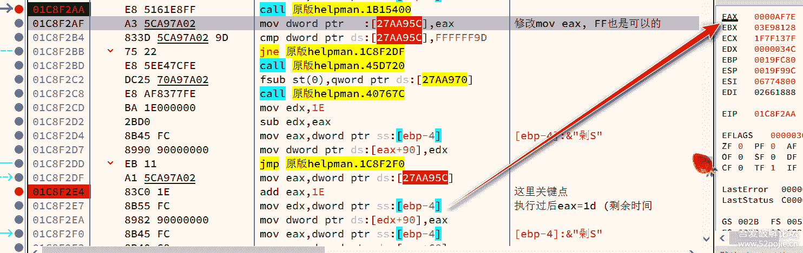

`image.png` (152.02 KB, 下载次数: 0)

<https://www.52pojie.cn/forum.php?mod=attachment&aid=MjU3OTA2MHwwNzkxODE2YnwxNzkzNTc0MjIxfDE2ODA4NnwxNzI1OTUy&nothumb=yes>

2022-12-13 22:24 上传

因为：

```
01C8F2E4 | 83C0 1E                  | add eax,1E       执行过后eax=剩余天数
```

所以 `0x027AA95C` 里存的是天数。

上边高亮后，看到3处。

### 改法4

用大白补丁给 `01C8F2E7` 这里的 `eax` 进行修改。

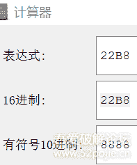

`image.png` (12.89 KB, 下载次数: 1)

<https://www.52pojie.cn/forum.php?mod=attachment&aid=MjU3OTA2MXw5MTUyZmU2OHwxNzkzNTc0MjIxfDE2ODA4NnwxNzI1OTUy&nothumb=yes>

2022-12-13 22:24 上传

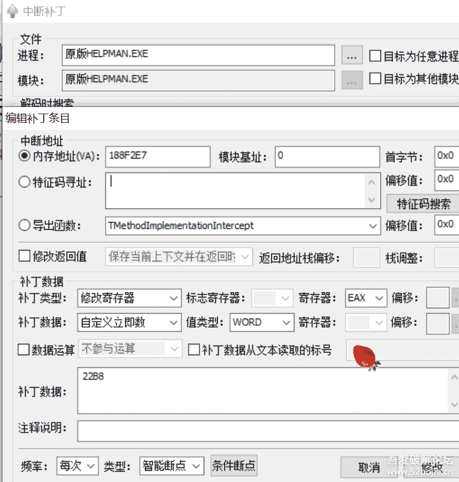

`image.png` (156.87 KB, 下载次数: 0)

<https://www.52pojie.cn/forum.php?mod=attachment&aid=MjU3OTA2MnxkNzlkZDA2OHwxNzkzNTc0MjIxfDE2ODA4NnwxNzI1OTUy&nothumb=yes>

2022-12-13 22:25 上传


`image.png` (68.97 KB, 下载次数: 0)

<https://www.52pojie.cn/forum.php?mod=attachment&aid=MjU3OTA2M3w0NjYxZmIwOXwxNzkzNTc0MjIxfDE2ODA4NnwxNzI1OTUy&nothumb=yes>

2022-12-13 22:25 上传

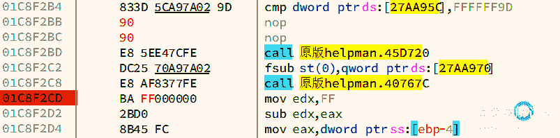

`image.png` (41.76 KB, 下载次数: 0)

<https://www.52pojie.cn/forum.php?mod=attachment&aid=MjU3OTA2NHxmOWEwYjE1YnwxNzkzNTc0MjIxfDE2ODA4NnwxNzI1OTUy&nothumb=yes>

2022-12-13 22:25 上传

载入软件后，先 `bp GetLocalTime`。

跟踪窗口，开始跟踪：

`Shift+F9` 断下来，取消断点。

`Ctrl+F8` 让它单步步过方式运行到【未过期时的】注册窗口处。

这样做的缺陷，走的太慢了。

优点是不容易错过（比 `Ctrl+F7` 更快些）。

这次，我们改变下策略：

- 不取消 `GetLocalTime` 断点
- `Shift+F9`
- `Ctrl+F9` 两次
- `Ctrl+F8`

如果再遇到 `GetLocalTime` 断下时，再次 `Ctrl+F9` ... `Ctrl+F8` 伺候，不再赘述。

效果有改善，还是行进速度太慢！

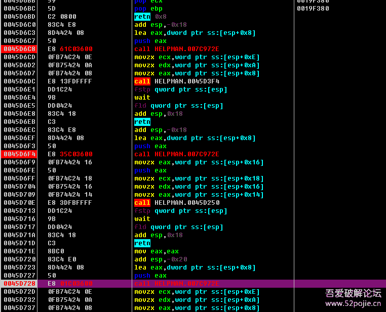

`image.png` (30.14 KB, 下载次数: 0)

<https://www.52pojie.cn/forum.php?mod=attachment&aid=MjU3OTgzNnxiZGEwZDFlZnwxNzkzNTc0MjIxfDE2ODA4NnwxNzI1OTUy&nothumb=yes>

2022-12-17 21:38 上传

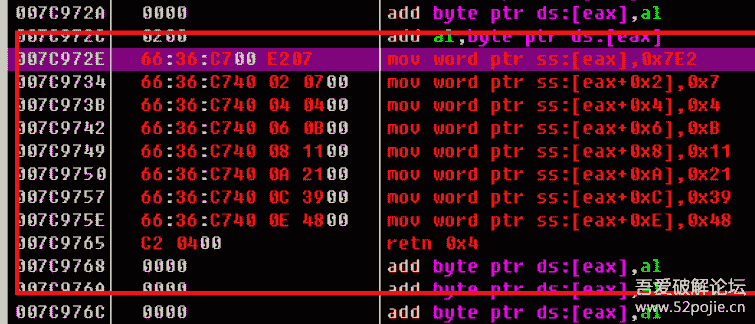

`image.png` (109.66 KB, 下载次数: 0)

<https://www.52pojie.cn/forum.php?mod=attachment&aid=MjU3OTgzN3wxNjlmYjQ3ZXwxNzkzNTc0MjIxfDE2ODA4NnwxNzI1OTUy&nothumb=yes>

2022-12-17 21:38 上传

## 去除水印和随机字符串限制

### 论坛好友 bester 老大的修改方法

其实这里各位看观可以自己发挥，应该存在更多的修改方法。

比如禁止注册表 `classID` 类标识符的写入 `call` 找到后 `NOP` 也肯定是成功的，这里就说到这里吧。

### 定位写入文件的关键地带

`Alt+E` ==> `WriteFile` 下断。

断到之后来到 `027AF9F8  kernel32.WriteFile`。

`Ctrl+F9` 之后来到：

```
00459020  | E8 6309FCFF         | call                             | 就来到了这个关键地带
```

然后 `Ctrl+F8`。

用 `IDR` 解出来的是：`23F6F4C  push ebp`

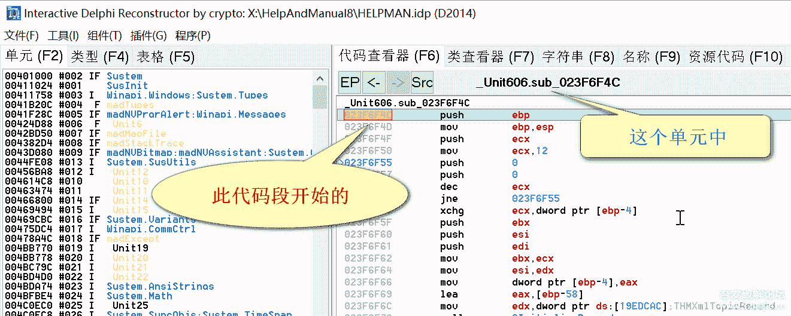

`image.png` (82.79 KB, 下载次数: 1)

<https://www.52pojie.cn/forum.php?mod=attachment&aid=MjU3OTA2NXxkYmRkMWEzOHwxNzkzNTc0MjIxfDE2ODA4NnwxNzI1OTUy&nothumb=yes>

2022-12-13 22:28 上传

到 `23F7652` 这结束的：

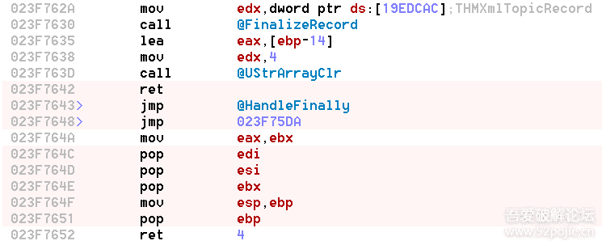

`image.png` (16.82 KB, 下载次数: 0)

<https://www.52pojie.cn/forum.php?mod=attachment&aid=MjU3OTA2NnxlNWEwMDliMnwxNzkzNTc0MjIxfDE2ODA4NnwxNzI1OTUy&nothumb=yes>

2022-12-13 22:28 上传

### 解禁思路

- 要么传送全局注册成功标志的状态
- 要么 `NOP` 掉不好的 `call`

这里为你演示两种成功的玩法：


### 先思考：随机输出的垃圾字符串 + 垃圾块 + 随机禁用超链接

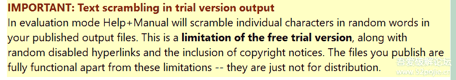

`image.png` (27.56 KB, 下载次数: 0)

<https://www.52pojie.cn/forum.php?mod=attachment&aid=MjU3OTI0N3xiZGZiMmFmNHwxNzkzNTc0MjIxfDE2ODA4NnwxNzI1OTUy&nothumb=yes>

2022-12-14 21:10 上传

### 到底是什么？

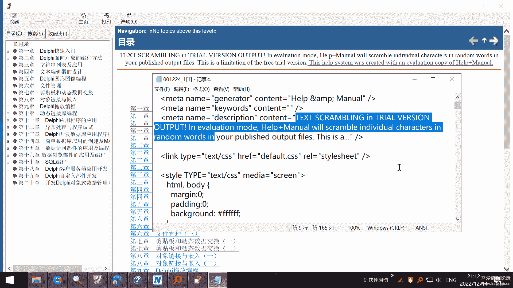

`image.png` (411.72 KB, 下载次数: 0)

<https://www.52pojie.cn/forum.php?mod=attachment&aid=MjU3OTI0OHwwYmRiMDQ1NXwxNzkzNTc0MjIxfDE2ODA4NnwxNzI1OTUy&nothumb=yes>

2022-12-14 21:12 上传

无非就是 `*.html` 的源代码，或进一步说就是 `html` 标签。

要学会进一步看到本质。

到这里垃圾块的问题是不是就想通了？

随机输出的垃圾字符串？又是啥呢？无非是 `Delphi` 编程过程中作者设计的一个函数。

随机禁用超链接呢？其实意思差不多。

这里把它们全部理解为：不友好的子程序（`call` 就 OK 了）。

先下一个写入文件的断点。

慢慢 `F8` 单步向下跟踪。

直到……垃圾 `html` 标签的字符串现身，就快到 `NOP` 掉的 `call` 位置了。

先随便输出一个 `*.chm` 文档。

### 比较暴力的改法1

> TEXT SCRAMBLING in TRIAL VERSION OUTPUT! In evaluation mode, Help+Manual will scramble individual characters in random words in your published output files. This is a limitation of the free trial version. [This help system was created with an evaluation copy of Help+Manual.](https://www.)

这是输出 `*.chm` 之后，页面中右击打开的源代码里头的。它们分别能和 `Resource Hacker` 或 `WinHEX` 中的一部分对上；并且我们发现另一部分字串是加密打乱顺序的。

`UNREGISTERED EVALUATION VERSION` => 这个是输出到网页中的内容。

随机乱字符串输出，这个对比图片可以看到。

以及随机禁止链接的输出（这个不好看，只能多对照正常的文档）。

---

```
lbDemoPublish4   1fcedaa
lbDemoPublish     1fcf75b
lbDemoPublish     3c4e8a2
```

断到了！

它们分别是 `Delphi` 中的几个 `label`。

```
0054586F | FF57 14                  | call dword ptr ds:[edi+14]              | 调用Demo的那个Label控件 lbDemoPublish
```

---

`Alt+E`，

```
027AF9F8  kernel32.WriteFile
```

断到之后，堆栈窗口之后：

```
00459020  | E8 6309FCFF           | call                             | 就来到了这个关键地带
```

然后 `Ctrl+F8`。

---

```
023F7296  | 0F85 78020000          | jne 强制去1干掉unregistered evaluation version.23F7514      | 貌似修改这JMP更好吧？
023F729C  | 8B07                   | mov eax,dword ptr ds:[edi]                             |
023F729E  | 8B80 C8030000          | mov eax,dword ptr ds:[eax+3C8]                         |
023F72A4  | 8B80 90000000          | mov eax,dword ptr ds:[eax+90]                          |
023F72AA  | E8 B93A9BFE            | call    ==>右边这里有写入评估水印之类的字符串(粘贴bug过不来)
023F72E0  | 59                    | pop ecx                                         |
023F72E1  | 84C0                  | test al,al                                      |
023F72E3  | 0F84 F1000000         | je patch1_跳过启动注册┼无限试用1.23F73DA                ===>▲修改这里【未注册字符串的写入】NOP掉！
023F72E9  | 8B07                  | mov eax,dword ptr ds:[edi]                      | [edi]:&"\f沶"
023F72EB  | 8B80 C8030000         | mov eax,dword ptr ds:[eax+3C8]                  |
023F72F1  | 8B90 94000000         | mov edx,dword ptr ds:[eax+94]                   |
023F72F7  | 8B52 08               | mov edx,dword ptr ds:[edx+8]                    |
023F72FA  | 8B52 08               | mov edx,dword ptr ds:[edx+8]                    |
023F72FD  | 4A                    | dec edx                                         |
023F72FE  | 52                    | push edx                                        |
023F72FF  | 6A 00                 | push 0                                          |
023F7301  | 8B80 90000000         | mov eax,dword ptr ds:[eax+90]                   |
023F7307  | 8B40 08               | mov eax,dword ptr ds:[eax+8]                    |
023F730A  | 8B48 08               | mov ecx,dword ptr ds:[eax+8]                    |
023F730D  | 49                    | dec ecx                                         |
023F730E  | 8B07                  | mov eax,dword ptr ds:[edi]                      | [edi]:&"\f沶"
023F7310  | 8B80 C0030000         | mov eax,dword ptr ds:[eax+3C0]                  |
023F7316  | 33D2                  | xor edx,edx                                     |
023F7318  | E8 A76395FE           | call            |
023F731D  | 8B07                  | mov eax,dword ptr ds:[edi]                      | [edi]:&"\f沶"
023F731F  | 8BB0 C8030000         | mov esi,dword ptr ds:[eax+3C8]                  | esi:&"劋S"
023F7325  | 8B86 94000000         | mov eax,dword ptr ds:[esi+94]                   |
023F732B  | 8B40 08               | mov eax,dword ptr ds:[eax+8]                    |
023F732E  | 8B40 08               | mov eax,dword ptr ds:[eax+8]                    |
023F7331  | 48                    | dec eax                                         |
023F7332  | 50                    | push eax                                        |
023F7333  | 68 D8773F02           | push patch1_跳过启动注册┼无限试用1.23F77D8                | 23F77D8:L"DISPLAY="
023F7338  | 8D55 98               | lea edx,dword ptr ss:[ebp-68]                   |
023F733B  | 33C0                  | xor eax,eax                                     |
023F733D  | E8 261306FE           | call            |
023F7342  | FF75 98               | push dword ptr ss:[ebp-68]                      |
023F7345  | 68 F8773F02           | push patch1_跳过启动注册┼无限试用1.23F77F8                |
023F734A  | 68 08783F02           | push patch1_跳过启动注册┼无限试用1.23F7808                | 23F7808:L"VALID=1"
023F734F  | 68 F8773F02           | push patch1_跳过启动注册┼无限试用1.23F77F8                |
023F7354  | 68 24783F02           | push patch1_跳过启动注册┼无限试用1.23F7824                | 23F7824:L"TYPE="
023F7359  | 8D55 94               | lea edx,dword ptr ss:[ebp-6C]                   |
023F735C  | B8 01000000           | mov eax,1                                       |
023F7361  | E8 021306FE           | call            |
023F7366  | FF75 94               | push dword ptr ss:[ebp-6C]                      |
023F7369  | 68 F8773F02           | push patch1_跳过启动注册┼无限试用1.23F77F8                |
023F736E  | 68 3C783F02           | push patch1_跳过启动注册┼无限试用1.23F783C                | 23F783C:L"DATA="
023F7373  | 68 54783F02           | push           | 23F7854:L"T=https://www."
023F7378  | 68 A0783F02           | push patch1_跳过启动注册┼无限试用1.23F78A0                | 23F78A0:L"\r\n"
023F737D  | 68 B4783F02           | push patch1_跳过启动注册┼无限试用1.23F78B4                | 23F78B4:L"W=_blank"
023F7382  | 8D45 9C               | lea eax,dword ptr ss:[ebp-64]                   |
023F7385  | BA 0C000000           | mov edx,C                                       | C:'\f'
```

`23F6F1C` 这个 `call` `F7` 进入后，发现：

```
023F6F22  | 8D45 F8               | lea eax,dword ptr ss:[ebp-8]                    | [ebp-8]:L"idh_class_tcustomrvparainfo" 显然是Delphi中的自定义控件类

023F7245  | 85C0                   | test eax,eax                          | eax:&L"TEXT SCRAMBLING in TRIAL VERSION OUTPUT! In evaluation mode, Help+Manual will scramble individual characters in random words in your published output files. This is a limitation of the free trial version. "
```

---

```
02396299  | 8B80 E8010000          | mov eax,dword ptr ds:[eax+1E8]        | eax:&"劋S", [eax+1E8]:"447858949346180"
0239629F  | 33D2                   | xor edx,edx                           |
023962A1  | E8 2A9D3FFE            | call patch1_跳过启动注册.78FFD0             |
023962A6  | 8B45 FC                | mov eax,dword ptr ss:[ebp-4]          | [ebp-4]:&"劋S"
023962A9  | 8B80 E8010000          | mov eax,dword ptr ds:[eax+1E8]        | eax:&"劋S", [eax+1E8]:"447858949346180"
023962AF  | E8 F0723FFE            | call patch1_跳过启动注册.78D5A4             |
023962B4  | 84C0                   | test al,al                            |
023962B6  | 75 1F                  | jne patch1_跳过启动注册.23962D7             |
023962B8  | 8B45 FC                | mov eax,dword ptr ss:[ebp-4]          | [ebp-4]:&"劋S"
023962BB  | 8B80 E8010000          | mov eax,dword ptr ds:[eax+1E8]        | eax:&"劋S", [eax+1E8]:"447858949346180"
023962C1  | E8 C2430CFE            | call patch1_跳过启动注册.45A688             |
023962C6  | 84C0                   | test al,al                            |
023962C8  | 75 0D                  | jne patch1_跳过启动注册.23962D7             |
023962CA  | 8B45 FC                | mov eax,dword ptr ss:[ebp-4]          | [ebp-4]:&"劋S"
023962CD  | 05 E8010000            | add eax,1E8                           | eax:&"劋S"
023962D2  | E8 715107FE            | call patch1_跳过启动注册.40B448             |
023962D7  | 8B45 FC                | mov eax,dword ptr ss:[ebp-4]          | [ebp-4]:&"劋S"
023962DA  | 83B8 E8010000 00       | cmp dword ptr ds:[eax+1E8],0          | [eax+1E8]:"447858949346180"
023962E1  | 0F9585 4FFFFFFF        | setne byte ptr ss:[ebp-B1]            |
023962E8  | 8B45 FC                | mov eax,dword ptr ss:[ebp-4]          | [ebp-4]:&"劋S"
023962EB  | 05 EC010000            | add eax,1EC                           | eax:&"劋S"
023962F0  | 8B55 FC                | mov edx,dword ptr ss:[ebp-4]          | [ebp-4]:&"劋S"
023962F3  | 8B92 E8010000          | mov edx,dword ptr ds:[edx+1E8]        |
023962F9  | E8 2A5507FE            | call patch1_跳过启动注册.40B828             |
023962FE  | 8B45 FC                | mov eax,dword ptr ss:[ebp-4]          | [ebp-4]:&"劋S"
02396301  | 05 F4010000            | add eax,1F4                           | eax:&"劋S"
02396306  | 8B55 FC                | mov edx,dword ptr ss:[ebp-4]          | [ebp-4]:&"劋S"
02396309  | 8B92 E8010000          | mov edx,dword ptr ds:[edx+1E8]        |
0239630F  | E8 145507FE            | call patch1_跳过启动注册.40B828             |
02396314  | 8B45 FC                | mov eax,dword ptr ss:[ebp-4]          | [ebp-4]:&"劋S"
02396317  | 05 F0010000            | add eax,1F0                           | eax:&"劋S"
0239631C  | 8B55 FC                | mov edx,dword ptr ss:[ebp-4]          | [ebp-4]:&"劋S"
0239631F  | 8B92 E8010000          | mov edx,dword ptr ds:[edx+1E8]        |
02396325  | E8 FE5407FE            | call patch1_跳过启动注册.40B828             |
0239632A  | 8B45 FC                | mov eax,dword ptr ss:[ebp-4]          | [ebp-4]:&"劋S"
0239632D  | 8B90 E8010000          | mov edx,dword ptr ds:[eax+1E8]        | [eax+1E8]:"447858949346180"
02396333  | 8B45 FC                | mov eax,dword ptr ss:[ebp-4]          | [ebp-4]:&"劋S"
02396336  | 05 F8010000            | add eax,1F8                           | eax:&"劋S"
0239633B  | B9 FC933902            | mov ecx,patch1_跳过启动注册.23993FC         | ecx:&"劋S", 23993FC:L"\\xplain"
02396340  | E8 876507FE            | call patch1_跳过启动注册.40C8CC             |
02396345  | 80BD 4FFFFFFF 00       | cmp byte ptr ss:[ebp-B1],0            |
0239634C  | 75 32                  | jne patch1_跳过启动注册.2396380             |
0239634E  | 8D85 8CFEFFFF          | lea eax,dword ptr ss:[ebp-174]        |
02396354  | 50                     | push eax                              | eax:&"劋S"
02396355  | 6A FF                  | push FFFFFFFF                         |
02396357  | 6A 00                  | push 0                                |
02396359  | 8D95 34FBFFFF          | lea edx,dword ptr ss:[ebp-4CC]        |
0239635F  | B8 E0423802            | mov eax,patch1_跳过启动注册.23842E0         | eax:&"劋S"
02396364  | E8 D79C07FE            | call patch1_跳过启动注册.410040             |
02396369  | 8B8D 34FBFFFF          | mov ecx,dword ptr ss:[ebp-4CC]        |
0239636F  | A1 10857502            | mov eax,dword ptr ds:[2758510]        | eax:&"劋S"
02396374  | 8B00                   | mov eax,dword ptr ds:[eax]            | eax:&"劋S", [eax]:"劋S"
02396376  | BA B80B0000            | mov edx,BB8                           |
0239637B  | E8 900D0700            | call patch1_跳过启动注册.2407110            | --->关注这里！！！！
02396380  | 80BD 4FFFFFFF 00       | cmp byte ptr ss:[ebp-B1],0            |
02396387  | 0F84 040A0000          | je patch1_跳过启动注册.2396D91              |
0239638D  | 8B45 FC                | mov eax,dword ptr ss:[ebp-4]          | [ebp-4]:&"劋S"
02396390  | C680 D1010000 01       | mov byte ptr ds:[eax+1D1],1           |
02396397  | A1 10857502            | mov eax,dword ptr ds:[2758510]        | eax:&"劋S"
0239639C  | 8B00                   | mov eax,dword ptr ds:[eax]            | eax:&"劋S", [eax]:"劋S"
0239639E  | 8B80 F0030000          | mov eax,dword ptr ds:[eax+3F0]        | eax:&"劋S"
023963A4  | E8 FB9374FF            | call patch1_跳过启动注册.1ADF7A4            |
023963A9  | 8BD8                   | mov ebx,eax                           | eax:&"劋S"
023963AB  | 8B45 FC                | mov eax,dword ptr ss:[ebp-4]          | [ebp-4]:&"劋S"
023963AE  | 8998 CC000000          | mov dword ptr ds:[eax+CC],ebx         |
023963B4  | 8B45 FC                | mov eax,dword ptr ss:[ebp-4]          | [ebp-4]:&"劋S"
023963B7  | 80B8 CB010000 00       | cmp byte ptr ds:[eax+1CB],0           |
023963BE  | 0F84 B4090000          | je patch1_跳过启动注册.2396D78              |
023963C4  | 8BC3                   | mov eax,ebx                           | eax:&"劋S"
023963C6  | E8 8D9774FF            | call patch1_跳过启动注册.1ADFB58            |
023963CB  | 85C0                   | test eax,eax                          | eax:&"劋S"
023963CD  | 0F84 A5090000          | je patch1_跳过启动注册.2396D78              |
023963D3  | 8D85 8CFEFFFF          | lea eax,dword ptr ss:[ebp-174]        |
023963D9  | 50                     | push eax                              | eax:&"劋S"
023963DA  | 6A FF                  | push FFFFFFFF                         |
023963DC  | 6A 00                  | push 0                                |
023963DE  | 8D95 30FBFFFF          | lea edx,dword ptr ss:[ebp-4D0]        |
023963E4  | B8 D8423802            | mov eax,patch1_跳过启动注册.23842D8         | eax:&"劋S"
023963E9  | E8 529C07FE            | call patch1_跳过启动注册.410040             |
023963EE  | 8B8D 30FBFFFF          | mov ecx,dword ptr ss:[ebp-4D0]        |
023963F4  | A1 10857502            | mov eax,dword ptr ds:[2758510]        | eax:&"劋S"
023963F9  | 8B00                   | mov eax,dword ptr ds:[eax]            | eax:&"劋S", [eax]:"劋S"
023963FB  | BA B80B0000            | mov edx,BB8                           |
02396400  | E8 0B0D0700            | call patch1_跳过启动注册.2407110            |
02396405  | C685 4FFFFFFF 00       | mov byte ptr ss:[ebp-B1],0            |
0239640C  | E9 67090000            | jmp patch1_跳过启动注册.2396D78             |
02396411  | 8B45 FC                | mov eax,dword ptr ss:[ebp-4]          | [ebp-4]:&"劋S"
02396414  | 8B88 D8010000          | mov ecx,dword ptr ds:[eax+1D8]        | ecx:&"劋S"
0239641A  | 8B45 FC                | mov eax,dword ptr ss:[ebp-4]          | [ebp-4]:&"劋S"
0239641D  | 8B80 DC010000          | mov eax,dword ptr ds:[eax+1DC]        | eax:&"劋S"
02396423  | BA 64000000            | mov edx,64                            | 64:'d'
02396428  | E8 6BF364FF            | call patch1_跳过启动注册.19E5798            |
0239642D  | 50                     | push eax                              | eax:&"劋S"
0239642E  | 8D85 4FFFFFFF          | lea eax,dword ptr ss:[ebp-B1]         |
02396434  | 50                     | push eax                              | eax:&"劋S"
02396435  | 8D95 2CFBFFFF          | lea edx,dword ptr ss:[ebp-4D4]        |
0239643B  | B8 F0423802            | mov eax,patch1_跳过启动注册.23842F0         | eax:&"劋S"
02396440  | E8 FB9B07FE            | call patch1_跳过启动注册.410040             |
02396445  | 8D85 2CFBFFFF          | lea eax,dword ptr ss:[ebp-4D4]        |
0239644B  | 8B55 FC                | mov edx,dword ptr ss:[ebp-4]          | [ebp-4]:&"劋S"
0239644E  | 8B92 CC000000          | mov edx,dword ptr ds:[edx+CC]         |
02396454  | 8B52 38                | mov edx,dword ptr ds:[edx+38]         |
02396457  | 8B52 04                | mov edx,dword ptr ds:[edx+4]          |
0239645A  | E8 156407FE            | call patch1_跳过启动注册.40C874             |
0239645F  | 8B85 2CFBFFFF          | mov eax,dword ptr ss:[ebp-4D4]        |
02396465  | 50                     | push eax                              | eax:&"劋S"
02396466  | 8D95 28FBFFFF          | lea edx,dword ptr ss:[ebp-4D8]        |
0239646C  | B8 E8423802            | mov eax,patch1_跳过启动注册.23842E8         | eax:&"劋S"
02396471  | E8 CA9B07FE            | call patch1_跳过启动注册.410040             |
02396476  | 8B95 28FBFFFF          | mov edx,dword ptr ss:[ebp-4D8]        |
0239647C  | 59                     | pop ecx                               | ecx:&"劋S"
0239647D  | 8B05 94C57A02          | mov eax,dword ptr ds:[27AC594]        | eax:&"劋S"
02396483  | FF15 90C57A02          | call dword ptr ds:[27AC590]           |
02396489  | 80BD 4FFFFFFF 00       | cmp byte ptr ss:[ebp-B1],0            |
02396490  | 0F84 55070000          | je patch1_跳过启动注册.2396BEB              |
02396496  | 8B45 FC                | mov eax,dword ptr ss:[ebp-4]          | [ebp-4]:&"劋S"
02396499  | 8B80 CC000000          | mov eax,dword ptr ds:[eax+CC]         | eax:&"劋S"
0239649F  | E8 289074FF            | call patch1_跳过启动注册.1ADF4CC            |
023964A4  | 48                     | dec eax                               | eax:&"劋S"
023964A5  | 0F85 40070000          | jne patch1_跳过启动注册.2396BEB             |
023964AB  | 8B45 FC                | mov eax,dword ptr ss:[ebp-4]          | [ebp-4]:&"劋S"
023964AE  | 8B80 CC000000          | mov eax,dword ptr ds:[eax+CC]         | eax:&"劋S"
023964B4  | 8B50 3C                | mov edx,dword ptr ds:[eax+3C]         |
023964B7  | 33C9                   | xor ecx,ecx                           | ecx:&"劋S"
023964B9  | 8B45 FC                | mov eax,dword ptr ss:[ebp-4]          | [ebp-4]:&"劋S"
023964BC  | E8 3FE7FBFF            | call patch1_跳过启动注册.2354C00            |
023964C1  | 84C0                   | test al,al                            |
023964C3  | 0F85 22070000          | jne patch1_跳过启动注册.2396BEB             |
023964C9  | 8B45 FC                | mov eax,dword ptr ss:[ebp-4]          | [ebp-4]:&"劋S"
023964CC  | FF80 DC010000          | inc dword ptr ds:[eax+1DC]            |
023964D2  | 6A 01                  | push 1                                |
023964D4  | 8B45 FC                | mov eax,dword ptr ss:[ebp-4]          | [ebp-4]:&"劋S"
023964D7  | 8B80 CC000000          | mov eax,dword ptr ds:[eax+CC]         | eax:&"劋S"
023964DD  | 8B48 3C                | mov ecx,dword ptr ds:[eax+3C]         | ecx:&"劋S"
023964E0  | 8B45 FC                | mov eax,dword ptr ss:[ebp-4]          | [ebp-4]:&"劋S"
023964E3  | 8B80 CC000000          | mov eax,dword ptr ds:[eax+CC]         | eax:&"劋S"
023964E9  | 8B50 78                | mov edx,dword ptr ds:[eax+78]         |
023964EC  | A1 10857502            | mov eax,dword ptr ds:[2758510]        | eax:&"劋S"
023964F1  | 8B00                   | mov eax,dword ptr ds:[eax]            | eax:&"劋S", [eax]:"劋S"
023964F3  | E8 540A0600            | call patch1_跳过启动注册.23F6F4C            | =============>里边有那个未注册字符调用1）
023964F8  | 84C0                   | test al,al                            |
023964FA  | 0F84 3F060000          | je patch1_跳过启动注册.2396B3F              |
```

---

```
023F7409  | 8B55 84                 | mov edx,dword ptr ss:[ebp-7C]          | ▲▲▲我烤，原来你在这里啦！！！

TEXT SCRAMBLING in TRIAL VERSION OUTPUT! In evaluation mode, Help+Manual will scramble individual characters in random words in your published output files. This is a limitation of the free trial version. "

023F740C  | 8D45 88                 | lea eax,dword ptr ss:[ebp-78]          |
023F740F  | E8 245301FE             | call patch1_跳过启动注册.40C738              |
023F7414  | 8B55 88                 | mov edx,dword ptr ss:[ebp-78]          |
023F7417  | 8B07                    | mov eax,dword ptr ds:[edi]             | [edi]:&"\f沶"
023F7419  | 8B80 C0030000           | mov eax,dword ptr ds:[eax+3C0]         |
023F741F  | 33C9                    | xor ecx,ecx                            |
023F7421  | E8 02758EFE             | call patch1_跳过启动注册.CDE928              |
```

---

```
023F72E3  | 0F84 F1000000           | je patch1_跳过启动注册.23F73DA               | 设为B1(此处实现就完犊子了！！！)▲可以干掉顶部的那个TEXT SCRAMBLING in TRIAL VERSION OUTPUT! 
023F72E9  | 8B07                    | mov eax,dword ptr ds:[edi]             | eax:L"in-familysafety-childaccount-l1-1-0", edi:"U嬱笿"
023F72EB  | 8B80 C8030000           | mov eax,dword ptr ds:[eax+3C8]         | eax:L"in-familysafety-childaccount-l1-1-0", [eax+3C8]:sub_78005F+6
023F72F1  | 8B90 94000000           | mov edx,dword ptr ds:[eax+94]          | eax+94:L"in-feclient-encryptedfile-l1-1-3"
023F72F7  | 8B52 08                 | mov edx,dword ptr ds:[edx+8]           |
023F72FA  | 8B52 08                 | mov edx,dword ptr ds:[edx+8]           |
```

---

```
cmp dword ptr ds:[eax+0x28], 0x1 反转也可跳过过期 和 部分时间限制！

cmp dword ptr ds:[eax+0x28], 0x0
```

向下跟发现的。

向下跟发现的。

```
02661A9E   mov edx, 0x2662D44   LicMode:%s 
```

`This help system was created with an evaluation copy of Help+Manual.` 这玩意也得干掉！

---

```
00459020  | E8 6309FCFF           | call                             | 就来到了这个关键地带
```

然后 `Ctrl+F8`。

```
023F716F   | 0F95C0             | setne al  ====>反转成94
023F7172   | 2245 08             | and al,byte ptr ss:[ebp+8]        

023F72E3  | 90                  | nop                                 | 我们从这里开始NOP
023F72E4  | 90                  | nop                                 |
023F72E5  | 90                  | nop                                 |
023F72E6  | 90                  | nop                                 |
023F72E7  | 90                  | nop                                 |
023F72E8  | 90                  | nop                                 |
023F72E9  | 8B07                | mov eax,dword ptr ds:[edi]          | edi:"U嬱笿"
023F72EB  | 8B80 C8030000       | mov eax,dword ptr ds:[eax+3C8]      |
023F72F1  | 8B90 94000000       | mov edx,dword ptr ds:[eax+94]       |
023F72F7  | 8B52 08             | mov edx,dword ptr ds:[edx+8]        |
023F72FA  | 8B52 08             | mov edx,dword ptr ds:[edx+8]        |
023F72FD  | 4A                  | dec edx                             |
023F72FE  | 52                  | push edx                            |
023F72FF  | 6A 00               | push 0                              |
023F7301  | 8B80 90000000       | mov eax,dword ptr ds:[eax+90]       |
023F7307  | 8B40 08             | mov eax,dword ptr ds:[eax+8]        |
023F730A  | 8B48 08             | mov ecx,dword ptr ds:[eax+8]        |
023F730D  | 49                  | dec ecx                             |
023F730E  | 8B07                | mov eax,dword ptr ds:[edi]          | edi:"U嬱笿"
023F7310  | 8B80 C0030000       | mov eax,dword ptr ds:[eax+3C0]      |
023F7316  | 33D2                | xor edx,edx                         |
023F7318  | E8 A76395FE         | call 4554454545545445455454.D4D6C4  |
023F731D  | 8B07                | mov eax,dword ptr ds:[edi]          | edi:"U嬱笿"
023F731F  | 8BB0 C8030000       | mov esi,dword ptr ds:[eax+3C8]      | esi:"U嬱笿"
023F7325  | 8B86 94000000       | mov eax,dword ptr ds:[esi+94]       |
023F732B  | 8B40 08             | mov eax,dword ptr ds:[eax+8]        |
023F732E  | 8B40 08             | mov eax,dword ptr ds:[eax+8]        |
023F7331  | 48                  | dec eax                             |
023F7332  | 50                  | push eax                            |
023F7333  | 68 D8773F02         | push 4554454545545445455454.23F77D8 | 23F77D8:L"DISPLAY="
023F7338  | 8D55 98             | lea edx,dword ptr ss:[ebp-68]       | [ebp-68]:"U嬱笿"
023F733B  | 33C0                | xor eax,eax                         |
023F733D  | E8 261306FE         | call 4554454545545445455454.458668  |
023F7342  | FF75 98             | push dword ptr ss:[ebp-68]          | [ebp-68]:"U嬱笿"
023F7345  | 68 F8773F02         | push 4554454545545445455454.23F77F8 |
023F734A  | 68 08783F02         | push 4554454545545445455454.23F7808 | 23F7808:L"VALID=1"
023F734F  | 68 F8773F02         | push 4554454545545445455454.23F77F8 |
023F7354  | 68 24783F02         | push 4554454545545445455454.23F7824 | 23F7824:L"TYPE="
023F7359  | 8D55 94             | lea edx,dword ptr ss:[ebp-6C]       |
023F735C  | B8 01000000         | mov eax,1                           |
023F7361  | E8 021306FE         | call 4554454545545445455454.458668  |
023F7366  | FF75 94             | push dword ptr ss:[ebp-6C]          |
023F7369  | 68 F8773F02         | push 4554454545545445455454.23F77F8 |
023F736E  | 68 3C783F02         | push 4554454545545445455454.23F783C | 23F783C:L"DATA="
023F7373  | 68 54783F02         | push 4554454545545445455454.23F7854 | 23F7854:L"T=https://www."
023F7378  | 68 A0783F02         | push 4554454545545445455454.23F78A0 | 23F78A0:L"\r\n"
023F737D  | 68 B4783F02         | push 4554454545545445455454.23F78B4 | 23F78B4:L"W=_blank"
023F7382  | 8D45 9C             | lea eax,dword ptr ss:[ebp-64]       |
023F7385  | BA 0C000000         | mov edx,C                           | C:'\f'
023F738A  | E8 C55501FE         | call 4554454545545445455454.40C954  |
023F738F  | 8B45 9C             | mov eax,dword ptr ss:[ebp-64]       |
023F7392  | 50                  | push eax                            |
023F7393  | 8D4D 8C             | lea ecx,dword ptr ss:[ebp-74]       |
023F7396  | A1 5CB37502         | mov eax,dword ptr ds:[275B35C]      |
023F739B  | 8B00                | mov eax,dword ptr ds:[eax]          |
023F739D  | 8B80 94000000       | mov eax,dword ptr ds:[eax+94]       |
023F73A3  | BA D4783F02         | mov edx,4554454545545445455454.23F7 |
023F73A8  | E8 377938FE         | call 4554454545545445455454.77ECE4  |
023F73AD  | 8B55 8C             | mov edx,dword ptr ss:[ebp-74]       |
023F73B0  | 8D45 90             | lea eax,dword ptr ss:[ebp-70]       |
023F73B3  | E8 805301FE         | call 4554454545545445455454.40C738  |
023F73B8  | 8B55 90             | mov edx,dword ptr ss:[ebp-70]       |
023F73BB  | 8B86 90000000       | mov eax,dword ptr ds:[esi+90]       |
023F73C1  | 8B40 08             | mov eax,dword ptr ds:[eax+8]        |
023F73C4  | 8B48 08             | mov ecx,dword ptr ds:[eax+8]        |
023F73C7  | 49                  | dec ecx                             |
023F73C8  | 8B07                | mov eax,dword ptr ds:[edi]          | edi:"U嬱笿"
023F73CA  | 8B80 C0030000       | mov eax,dword ptr ds:[eax+3C0]      |
023F73D0  | E8 EF6295FE         | call 4554454545545445455454.D4D6C4  

JMP(到此处的上行结束！)
```

爆破方式2：`0F95C0  setne al` 反转此处，因为为最上级，因此下面的流程走向都会被影响到，所以立竿见影。

爆破方式3：直接给注册表取键值后返回1，目前还没找到，不过按经验来说必然是成立的。

爆破水印的功能仅用时15分钟就解决困扰了。

一般输出是没啥影响的。。。。但是！！！一旦载入 `example` 的树状的 `js` 调用的代码（`X:\HelpAndManual6\Examples\Get Me Started Example\Get_Me_Started.hmxz`），就会有 `js` 调用不正常的网页框出现。


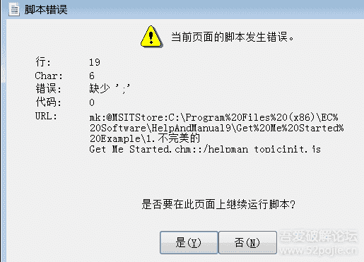

`image.png` (16.65 KB, 下载次数: 0)

<https://www.52pojie.cn/forum.php?mod=attachment&aid=MjU3OTgyNHwxZGRmN2I0YXwxNzkzNTc0MjIxfDE2ODA4NnwxNzI1OTUy&nothumb=yes>

2022-12-17 21:09 上传

发现没有？未破解版，或注册版，这里有5个 `js` 的调用生成动态的菜单，点击可以折叠和伸展。这里却报错。

这就是所谓的爆破后遗症。。。


还是老办法，把 `*.chm` 解出来，变成看得见的 `*.html` 文件，查看源代码。

这里可以对照样6.0去暗桩（其实干翻网址即可）正常的输出与不正常的输出对照着看，修补下我们的补丁程序。。。

时间关系，就不贴细节操作修改哪里了。。

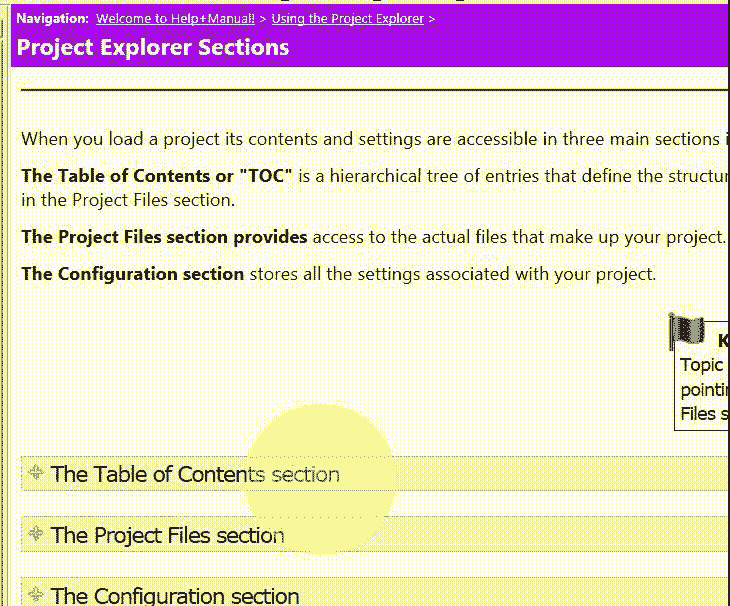

`20221217_211318.gif` (415.97 KB, 下载次数: 0)

<https://www.52pojie.cn/forum.php?mod=attachment&aid=MjU3OTgyOXxhMTgwYmE1NXwxNzkzNTc0MjIxfDE2ODA4NnwxNzI1OTUy&nothumb=yes>

2022-12-17 21:14 上传

## 最终效果

请看折叠菜单修复正常了。


- 水印块滚蛋了
- 随机字符串输出没有了
- 垃圾购买链接移除了
- 随机禁用的超链接也是正常
- 输出多种格式也算是 OK 的

其实到这里已经不影响正常的输出了。

但是作为探索与提高，我们继续汇编与分析，你会发现更多的乐趣与未知的东西。

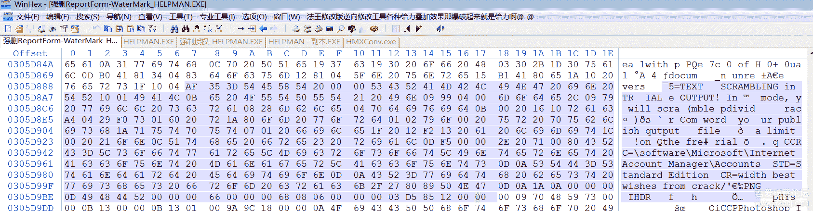

`image.png` (124.42 KB, 下载次数: 0)

<https://www.52pojie.cn/forum.php?mod=attachment&aid=MjU3OTgzMHxhZjMwMGMwMHwxNzkzNTc0MjIxfDE2ODA4NnwxNzI1OTUy&nothumb=yes>

2022-12-17 21:23 上传

最后再来看看内部是长啥样的？直接下断点竟然断不到。

本小节就编到这里吧，说细节操作那就可就太长了。

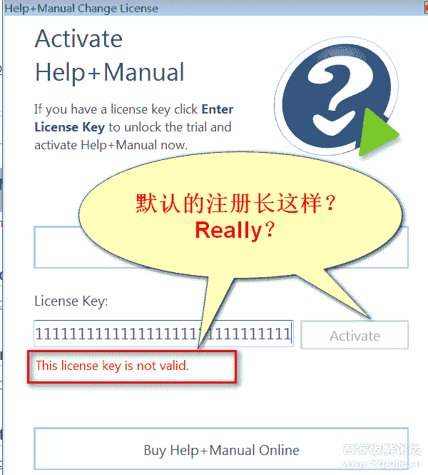

`image.png` (75.95 KB, 下载次数: 0)

<https://www.52pojie.cn/forum.php?mod=attachment&aid=MjU3OTgzM3w3NGRlNWYzYXwxNzkzNTc0MjIxfDE2ODA4NnwxNzI1OTUy&nothumb=yes>

2022-12-17 21:30 上传

打开 `Resource Hacker` 定位到该资源，自己看看真相吧？


这里就不截图了。见下文，激活后，你可看到真相。

## 激活按钮与授权窗口

激活按钮不可用。

### 诡异的 cmd 授权窗口

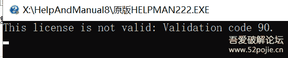

`image.png` (13.88 KB, 下载次数: 0)

<https://www.52pojie.cn/forum.php?mod=attachment&aid=MjU3OTgzNHxmMjk0ODgxY3wxNzkzNTc0MjIxfDE2ODA4NnwxNzI1OTUy&nothumb=yes>

2022-12-17 21:34 上传

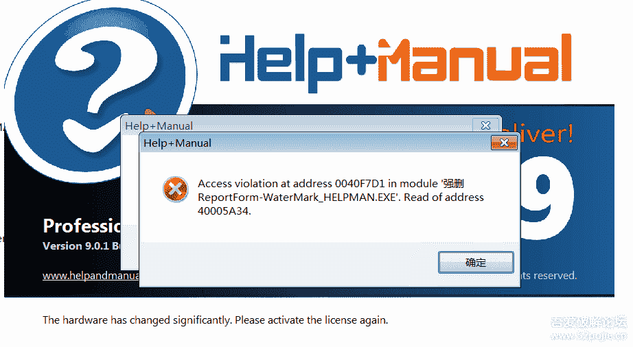

`image.png` (105.28 KB, 下载次数: 1)

<https://www.52pojie.cn/forum.php?mod=attachment&aid=MjU3OTgzOHwzZWFjN2ZiZHwxNzkzNTc0MjIxfDE2ODA4NnwxNzI1OTUy&nothumb=yes>

2022-12-17 21:40 上传


`image.png` (69.84 KB, 下载次数: 1)

<https://www.52pojie.cn/forum.php?mod=attachment&aid=MjU3OTgzOXwwZTdkNTc3OHwxNzkzNTc0MjIxfDE2ODA4NnwxNzI1OTUy&nothumb=yes>

2022-12-17 21:40 上传


`image.png` (334.84 KB, 下载次数: 1)

<https://www.52pojie.cn/forum.php?mod=attachment&aid=MjU3OTg0MHw0OTM2ZmQ3Y3wxNzkzNTc0MjIxfDE2ODA4NnwxNzI1OTUy&nothumb=yes>

2022-12-17 21:40 上传


`image.png` (105.69 KB, 下载次数: 2)

<https://www.52pojie.cn/forum.php?mod=attachment&aid=MjU3OTg0MXwxMjk1ZDU3NHwxNzkzNTc0MjIxfDE2ODA4NnwxNzI1OTUy&nothumb=yes>

2022-12-17 21:42 上传

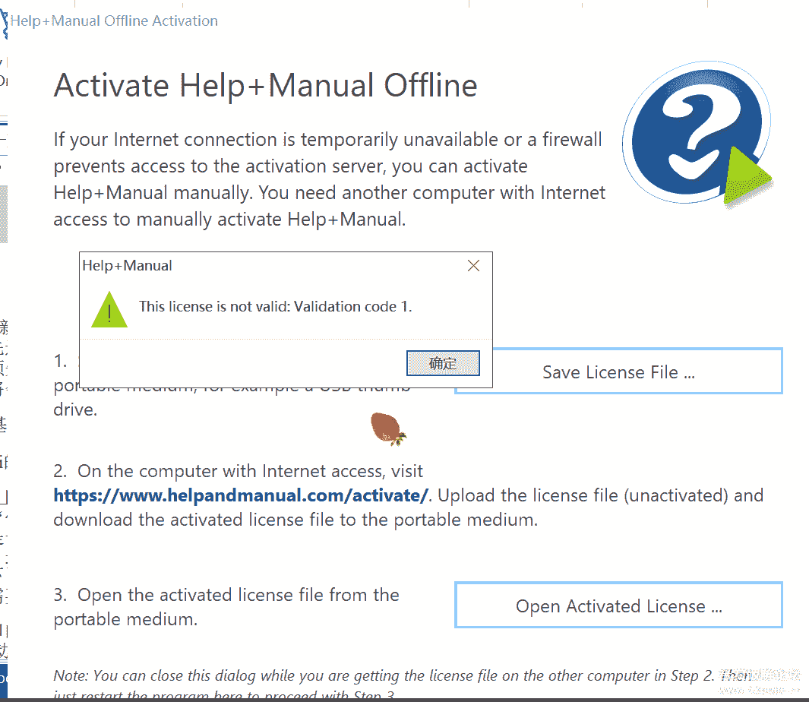

`image.png` (104.08 KB, 下载次数: 1)

<https://www.52pojie.cn/forum.php?mod=attachment&aid=MjU3OTg0MnwxMzcwYzY2ZnwxNzkzNTc0MjIxfDE2ODA4NnwxNzI1OTUy&nothumb=yes>

2022-12-17 21:43 上传

再点激活。。又出来一个错误框。。。

再干掉之后。。就会直接时入主界面。。。

（这里猜测，估计弹出服务器成功激活的提示；不过说真的，离线激活了，你还是无法获得全局注册状态）

## 授权信息

### 注册码的两种存放形式与位置

#### A. 注册表键值

位于 `HKEY_CURRENT_USER\Software\ECSOFTWARE\Help+Manual X`

键值 `HMLIC`

形如下面这样：

```
Windows Registry Editor Version 5.00

[HKEY_CURRENT_USER\Software\ECSOFTWARE\Help+Manual 8]

"HMLIC"="SBJUQCE4vwMXAo4Xhjp5Ez7ZBPojH2BcO2Vt33SFR9OWsLC56xBDYJDVTNFBEBRXd0AmdZsmpxbFZQ2rMAN2eX+suwQf/iAdeP9BUluQeWsk3D9TS7xPdCo7cC431tEycDNGZo3MNJ7sT88aQtey09zCX+kbuU2yoRDVurkMpylvouCSlQB4wWxkPlp8nj/I5kq75JtMGHOto6n/3ZPSDD9FWhClxKfTuz3ddm7sE5uIS4ZW8bGE47Iv2lz6KfVWgNH+6D0p2+jUgRFtEyiB6dqXUJGwBgoeWls7PS5mLhwHI7Lf5MKC/LF+HCB0LIN56zF7TLxPIHv5iMQmaz8zj0T8lPHqbu1WSNzqPvW6WgFR8bzSFxllg7258ZR9SWNx53DJmmJI6cc6ql4PmaZnpPy8KLYIYYZE7Jbhl/w/f3y6eMRnwuEVqTbiceHyH4YLvAYQSGB0PjIAz05RsPpdYBH7MCXX6MJdJ3ZHDAKJmvp2qdkLIPcMberh06cm2yriyhseBOSBvmNoIU/uFd2zJXVii7uSeTmMA3Qtwg79ZQz7bFHEkms3mTlLR2F3rxAZq7yDm5ueQg/x/gbFcaKigr2OfNuwhn+kIFhZIiqZogJ76voug4aSEPsAwK1W5YcngkBi8k4PX7IiKgAU2zgY6YosKVxKf21PIXWImWi21WtEli8MRKkWf3tbcx2t/1o3dyI7P1CHq3WZbzEmM5sVWVYQvmCwH4gWpWAc9k88BJHqFCbGjbHG6/Q1IU6J0YHuBGjtatW2ZxMmX9jLilK5VShRyEWGpRjfC6WwCVRkPgVu5aLWTF8pYnwB6fR10+2QKqG72TFQqYwMc7HKwFjghA=="
```

#### B. 主程序名 + .lic（`HELPMAN.lic`）

```
--- BEGIN REQUEST ---

9C55A86530398C0F6D70DB84C0F0E9F9F724B4AEEBC6DCF85E
EDDFDB85755654FA551C92C4C887BCCDCCDDD737A45290CF2B
45E8D00C6465382B2BCDEA0E06C2CB2252BBDE06698967F0E1
ABAEBCCE7321E16256548B4084FF57F58A02160B2B13343EC4
90CAE89F8E46102A2778B155FABC96C8437B0A25E713760066
B599484C01F8CC1CB72DC97DB08D8F5C39ACD9D7BACF244A7E
3E3D3ED2DE8737ED10A392247DBF7D134CC6749B28FF1670C5
665D61E9852D4871DDA8B52BCE14CB5EFED926BBA5684B6C52
4FE86187F0697FC8518FCDDDD15E84A0C1B22C0960DE973E3E
AB332BB0E6B169B031CB8AF02AFD1C7A290DEA931FEF2216B4
B7A3297E4443478541850032C3B4E878C8222DC5256BC95F06
1A7C1E33EF712461FEED335CCB87E8CAEF9A1093DFE5D6774F
3725EE697A9C83FAA1C83285834EC11FC6C6BD123D285DD3DE
8CC4C568895E84F5438DE9912658C591487FE9B21E59B01E35
99E929EA5949F3B18FBC8198B787F75ECC91CD85C84D520787
88BD1FC807EFFCA4AF08CC3A6E5944E989ABEAA69F54F0E084
95FD85C97CD50E99F2A61256A200993D1ABA4B7EA11D3454AE
0DC96A2806E956B29092C474C48265EFDF82CE7ED8B1DBA1C2
D0B77A1B22B03F31FFA93FD05223B7797BC888708DBE48A9FD
59EDB682C00577D63D76A11BB9742534D29A06C505F21F24D7
36A2270042A1EC9A11E6E698CEBD1FEEECD096DC0945D4607C
8EAF797237D1D76894FEEB28AFE12CA511D00609693EF556DE
AE4EAFC9F614998F0C68B6E7491C717AE5D5118AF11708CE5E
59BD26F28DFE7F7FA9CE2B738563DE33FD77481BD61EDA4C15
8C72C7779299655CD74F143D54831267DD9DA8F7EB94A4B65D
55B0BF0155008E9BD0DAC5339C7845D8C7680A16B8888185FD
861E42F02B8E76641EBA76B77C5EF919A1BB78F300ADEED490
4D501A9DB4CEF162678011A6E37A88B829ADEB7F1D77F677B1
10F7D0C146B89AC1ED5AF9BA561A53584580A6EDA86FDE29E0
A67CA0316D6E8C7F052B65F6FF2639F0F923FF88B99D94EF6F
DFEEA3DA965ABA0E2935462172D6E097DD319FCDBD984242E7
F2ECDD351F3E7240AEB8F80F52A7B2882D9B8EC69F59556383
8116B5401D4289E5C2E081284B03D4E9F5C3E055718EC533B8
06435571BB76B7

--- END REQUEST ---
```

#### C. 批量版

还有一种批量版的，位于：

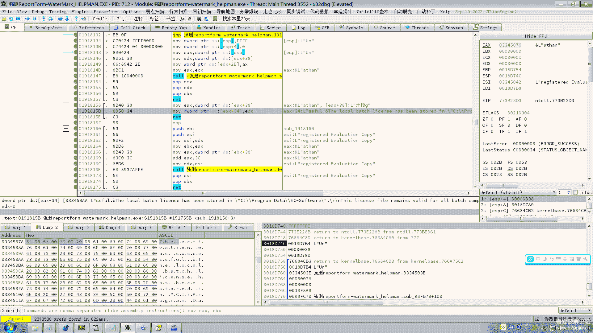

`image.png` (334.84 KB, 下载次数: 1)

<https://www.52pojie.cn/forum.php?mod=attachment&aid=MjU3OTg0M3wwOTk5ZWEzOHwxNzkzNTc0MjIxfDE2ODA4NnwxNzI1OTUy&nothumb=yes>

2022-12-17 21:49 上传

#### D. 隐藏键值

另外授权后注册表中还有一种隐藏的键值（好像是 `lic.qa`，具体截图忘记存哪了？）。

有3种授权方式，其中浮动版的1300多美元；具体在下面的代码中。


```
02622FF0  | B9 58306202             | mov ecx,强删reportform-watermark_helpman.2623058         | 2623058:"Basic Edition"
02622FF5  | BA 74306202             | mov edx,   | 2623074:"STD"
02622FFA  | A1 48DB9B02             | mov eax,dword ptr ds:[29BDB48]                         |
02622FFF  | E8 448016FE             | call        |
02623004  | B9 84306202             | mov ecx,强删reportform-watermark_helpman.2623084         | 2623084:"Professional Edition"
02623009  | BA A8306202             | mov edx,   | 26230A8:"PRF"
0262300E  | A1 48DB9B02             | mov eax,dword ptr ds:[29BDB48]                         |
02623013  | E8 308016FE             | call        | yicang
02623018  | B9 B8306202             | mov ecx,强删reportform-watermark_helpman.26230B8         | 26230B8:"Floa蘨ng Professional License"
0262301D  | BA E4306202             | mov edx,   | 26230E4:"SRV"
02623022  | A1 48DB9B02             | mov eax,dword ptr ds:[29BDB48]                         |
02623027  | E8 1C8016FE             | call        | al=1
0262302C  | 8BC3                    | mov eax,ebx                                            |
0262302E  | 807D FF 00              | cmp byte ptr ss:[ebp-1],0                              |
02623032  | 74 0F                   | je 强删reportform-watermark_helpman.2623043              |
02623034  | E8 3B6CDEFD             | call 强删reportform-watermark_helpman.409C74             | al=1
02623039  | 64:8F05 00000000        | pop dword ptr fs:[0]                                   |
02623040  | 83C4 0C                 | add esp,C                                              |
02623043  | 8BC3                    | mov eax,ebx                                            |
02623045  | 5F                      | pop edi                                                |
02623046  | 5E                      | pop esi                                                |
02623047  | 5B                      | pop ebx                                                |
02623048  | 8BE5                    | mov esp,ebp                                            |
0262304A  | 5D                      | pop ebp                                                |
0262304B  | C3                      | ret                                                    |
```

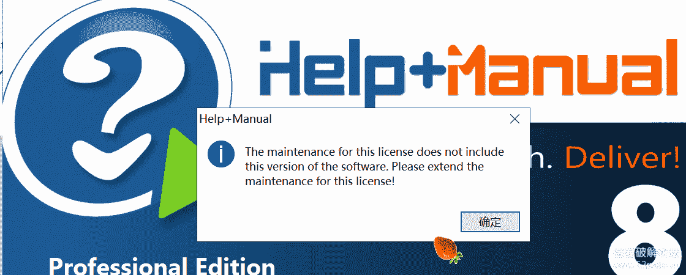

`image.png` (111.15 KB, 下载次数: 1)

[href="forum.php?mod=attachment&aid=MjU3OTI0NXw1NmZhZTA2N3wxNzkzNTc0MjIxfDE2ODA4NnwxNzI1OTUy&nothumb=yes" target="_blank"](https://www.52pojie.cn/forum.php?mod=attachment&aid=MjU3OTI0NXw1NmZhZTA2N3wxNzkzNTc0MjIxfDE2ODA4NnwxNzI1OTUy&nothumb=yes)

2022-12-14 21:00 上传

## 6.0版的授权流程比较简单：

[Asm] 纯文本查看 复制代码


```asm
013E21CA   | 8038 00             | cmp byte ptr ds:[eax],0           |
013E21CD   | 0F84 41020000       | je helpman.13E2414                | 这里跳了，注册不注册都一样
013E21D3   | A1 94404601         | mov eax,dword ptr ds:[1464094]    |
013E21D8   | C600 00             | mov byte ptr ds:[eax],0           |
013E21DB   | 8D55 E0             | lea edx,dword ptr ss:[ebp-20]     |
013E21DE   | B8 02000000         | mov eax,2                         |
013E21E3   | E8 EC2702FF         | call helpman.4049D4               |
013E21E8   | 8B45 E0             | mov eax,dword ptr ss:[ebp-20]     |
013E21EB   | BA 8C253E01         | mov edx,helpman.13E258C           | 13E258C:L"/fc"
013E21F0   | E8 2B6D02FF         | call helpman.408F20               |
013E21F5   | 74 15               | je helpman.13E220C                |
013E21F7   | 6A FF               | push FFFFFFFF                     |
013E21F9   | A1 E8384601         | mov eax,dword ptr ds:[14638E8]    |
013E21FE   | 8B00                | mov eax,dword ptr ds:[eax]        |
013E2200   | FFD0                | call eax                          |
013E2202   | 85C0                | test eax,eax                      |
013E2204   | A1 94404601         | mov eax,dword ptr ds:[1464094]    |
013E2209   | 0F9500              | setne byte ptr ds:[eax]           |
013E220C   | A1 94404601         | mov eax,dword ptr ds:[1464094]    |
013E2211   | 8038 00             | cmp byte ptr ds:[eax],0           |
013E2214   | 74 47               | je helpman.13E225D                |
013E2216   | 33C0                | xor eax,eax                       |
013E2218   | 55                  | push ebp                          |
013E2219   | 68 46223E01         | push helpman.13E2246              |
013E221E   | 64:FF30             | push dword ptr fs:[eax]           |
013E2221   | 64:8920             | mov dword ptr fs:[eax],esp        |
013E2224   | A1 EC464601         | mov eax,dword ptr ds:[14646EC]    |
013E2229   | 66:BA 2000          | mov dx,20                         | 20:' '
013E222D   | E8 AE3402FF         | call helpman.4056E0               |
013E2232   | E8 492D02FF         | call helpman.404F80               |
013E2237   | E8 B02402FF         | call helpman.4046EC               |
013E223C   | 33C0                | xor eax,eax                       |
013E223E   | 5A                  | pop edx                           |
013E223F   | 59                  | pop ecx                           |
013E2240   | 59                  | pop ecx                           |
013E2241   | 64:8910             | mov dword ptr fs:[eax],edx        |
013E2244   | EB 17               | jmp helpman.13E225D               |
013E2246   | E9 F94902FF         | jmp helpman.406C44                |
013E224B   | A1 94404601         | mov eax,dword ptr ds:[1464094]    |
013E2250   | C600 00             | mov byte ptr ds:[eax],0           |
013E2253   | E8 4CD102FF         | call            |
013E2258   | E8 034F02FF         | call helpman.407160               |
013E225D   | A1 94404601         | mov eax,dword ptr ds:[1464094]    |
013E2262   | 8038 00             | cmp byte ptr ds:[eax],0           |
013E2265   | 75 13               | jne helpman.13E227A               |
013E2267   | E8 B8CF02FF         | call           |
013E226C   | 83F8 01             | cmp eax,1                         |
013E226F   | 1BC0                | sbb eax,eax                       |
013E2271   | 40                  | inc eax                           |
013E2272   | 8B15 94404601       | mov edx,dword ptr ds:[1464094]    |
013E2278   | 8802                | mov byte ptr ds:[edx],al          |
013E227A   | 33D2                | xor edx,edx                       |
013E227C   | 55                  | push ebp                          |
013E227D   | 68 0D243E01         | push helpman.13E240D              |
013E2282   | 64:FF32             | push dword ptr fs:[edx]           |
013E2285   | 64:8922             | mov dword ptr fs:[edx],esp        |
013E2288   | 8B0D BC574601       | mov ecx,dword ptr ds:[14657BC]    |
013E228E   | 8B09                | mov ecx,dword ptr ds:[ecx]        |
013E2290   | B2 01               | mov dl,1                          |
013E2292   | A1 3CE7F000         | mov eax,dword ptr ds:[F0E73C]     | 00F0E73C:&"砾D"
013E2297   | E8 60DEB2FF         | call helpman.F100FC               |
013E229C   | 8B15 185A4601       | mov edx,dword ptr ds:[1465A18]    |
013E22A2   | 8902                | mov dword ptr ds:[edx],eax        |
013E22A4   | 33D2                | xor edx,edx                       |
013E22A6   | 55                  | push ebp                          |
013E22A7   | 68 E9233E01         | push helpman.13E23E9              |
013E22AC   | 64:FF32             | push dword ptr fs:[edx]           |
013E22AF   | 64:8922             | mov dword ptr fs:[edx],esp        |
013E22B2   | 8B0D B03A4601       | mov ecx,dword ptr ds:[1463AB0]    |
013E22B8   | A1 BC574601         | mov eax,dword ptr ds:[14657BC]    |
013E22BD   | 8B00                | mov eax,dword ptr ds:[eax]        |
013E22BF   | 8B15 ACA22C01       | mov edx,dword ptr ds:[12CA2AC]    | 012CA2AC:&"悂J"
013E22C5   | E8 DEFA16FF         | call helpman.551DA8               |
013E22CA   | 33D2                | xor edx,edx                       |
013E22CC   | 55                  | push ebp                          |
013E22CD   | 68 BE233E01         | push helpman.13E23BE              |
013E22D2   | 64:FF32             | push dword ptr fs:[edx]           |
013E22D5   | 64:8922             | mov dword ptr fs:[edx],esp        |
013E22D8   | A1 78454601         | mov eax,dword ptr ds:[1464578]    |
013E22DD   | C600 00             | mov byte ptr ds:[eax],0           |
013E22E0   | A1 94404601         | mov eax,dword ptr ds:[1464094]    |
013E22E5   | 8038 00             | cmp byte ptr ds:[eax],0           |
013E22E8   | 0F84 A0000000       | je helpman.13E238E                |
013E22EE   | 33C0                | xor eax,eax                       |
013E22F0   | 55                  | push ebp                          |
013E22F1   | 68 7C233E01         | push helpman.13E237C              |
013E22F6   | 64:FF30             | push dword ptr fs:[eax]           |
013E22F9   | 64:8920             | mov dword ptr fs:[eax],esp        |
013E22FC   | 68 A0253E01         | push helpman.13E25A0              | 13E25A0:"Help & Manual command line compiler version "
013E2301   | A1 185A4601         | mov eax,dword ptr ds:[1465A18]    |
013E2306   | 8B00                | mov eax,dword ptr ds:[eax]        |
013E2308   | FF70 74             | push dword ptr ds:[eax+74]        |
013E230B   | 68 DC253E01         | push helpman.13E25DC              | 13E25DC:" build "
013E2310   | A1 185A4601         | mov eax,dword ptr ds:[1465A18]    |
013E2315   | 8B00                | mov eax,dword ptr ds:[eax]        |
013E2317   | FF70 78             | push dword ptr ds:[eax+78]        |
013E231A   | 8D45 DC             | lea eax,dword ptr ss:[ebp-24]     |
013E231D   | BA 04000000         | mov edx,4                         |
013E2322   | E8 D15F02FF         | call helpman.4082F8               |
013E2327   | 8B55 DC             | mov edx,dword ptr ss:[ebp-24]     |
013E232A   | A1 EC464601         | mov eax,dword ptr ds:[14646EC]    |
013E232F   | E8 903202FF         | call helpman.4055C4               |
013E2334   | E8 133402FF         | call helpman.40574C               |
013E2339   | E8 AE2302FF         | call helpman.4046EC               |
013E233E   | 8D55 D4             | lea edx,dword ptr ss:[ebp-2C]     |
013E2341   | B8 01000000         | mov eax,1                         |
013E2346   | E8 892602FF         | call helpman.4049D4               |
013E234B   | 8B4D D4             | mov ecx,dword ptr ss:[ebp-2C]     |
013E234E   | 8D45 D8             | lea eax,dword ptr ss:[ebp-28]     |
013E2351   | BA F0253E01         | mov edx,helpman.13E25F0           | 13E25F0:L"Compiling "
013E2356   | E8 2D6A02FF         | call helpman.408D88               |
013E235B   | 8B55 D8             | mov edx,dword ptr ss:[ebp-28]     |
013E235E   | A1 EC464601         | mov eax,dword ptr ds:[14646EC]    |
013E2363   | E8 883202FF         | call helpman.4055F0               |
013E2368   | E8 DF3302FF         | call helpman.40574C               |
013E236D   | E8 7A2302FF         | call helpman.4046EC               |
013E2372   | 33C0                | xor eax,eax                       |
013E2374   | 5A                  | pop edx                           |
013E2375   | 59                  | pop ecx                           |
013E2376   | 59                  | pop ecx                           |
013E2377   | 64:8910             | mov dword ptr fs:[eax],edx        |
013E237A   | EB 12               | jmp helpman.13E238E               |
013E237C   | E9 C34802FF         | jmp helpman.406C44                |
013E2381   | A1 94404601         | mov eax,dword ptr ds:[1464094]    |
013E2386   | C600 00             | mov byte ptr ds:[eax],0           |
013E2389   | E8 D24D02FF         | call helpman.407160               |
013E238E   | A1 B03A4601         | mov eax,dword ptr ds:[1463AB0]    |
013E2393   | 8B00                | mov eax,dword ptr ds:[eax]        |
013E2395   | E8 B6FFF1FF         | call helpman.1302350              |
013E239A   | 33C0                | xor eax,eax                       |
013E239C   | 5A                  | pop edx                           |
013E239D   | 59                  | pop ecx                           |
013E239E   | 59                  | pop ecx                           |
013E239F   | 64:8910             | mov dword ptr fs:[eax],edx        |
013E23A2   | 68 C5233E01         | push helpman.13E23C5              |
013E23A7   | A1 B03A4601         | mov eax,dword ptr ds:[1463AB0]    |
013E23AC   | 8B00                | mov eax,dword ptr ds:[eax]        |
013E23AE   | 8B15 B03A4601       | mov edx,dword ptr ds:[1463AB0]    |
013E23B4   | 33C9                | xor ecx,ecx                       |
013E23B6   | 890A                | mov dword ptr ds:[edx],ecx        |
013E23B8   | E8 5B3A02FF         | call helpman.405E18               |
013E23BD   | C3                  | ret                               |
013E23BE   | E9 354B02FF         | jmp helpman.406EF8                |
013E23C3   | EB E2               | jmp helpman.13E23A7               |
013E23C5   | 33C0                | xor eax,eax                       |
013E23C7   | 5A                  | pop edx                           |
013E23C8   | 59                  | pop ecx                           |
013E23C9   | 59                  | pop ecx                           |
013E23CA   | 64:8910             | mov dword ptr fs:[eax],edx        |
013E23CD   | 68 F0233E01         | push helpman.13E23F0              |
013E23D2   | A1 185A4601         | mov eax,dword ptr ds:[1465A18]    |
013E23D7   | 8B00                | mov eax,dword ptr ds:[eax]        |
013E23D9   | 8B15 185A4601       | mov edx,dword ptr ds:[1465A18]    |
013E23DF   | 33C9                | xor ecx,ecx                       |
013E23E1   | 890A                | mov dword ptr ds:[edx],ecx        |
013E23E3   | E8 303A02FF         | call helpman.405E18               |
013E23E8   | C3                  | ret                               |
013E23E9   | E9 0A4B02FF         | jmp helpman.406EF8                |
013E23EE   | EB E2               | jmp helpman.13E23D2               |
013E23F0   | 33C0                | xor eax,eax                       |
013E23F2   | 5A                  | pop edx                           |
013E23F3   | 59                  | pop ecx                           |
013E23F4   | 59                  | pop ecx                           |
013E23F5   | 64:8910             | mov dword ptr fs:[eax],edx        |
013E23F8   | 68 8D243E01         | push helpman.13E248D              |
013E23FD   | A1 94404601         | mov eax,dword ptr ds:[1464094]    |
013E2402   | 8038 00             | cmp byte ptr ds:[eax],0           |
013E2405   | 74 05               | je helpman.13E240C                |
013E2407   | E8 98CF02FF         | call            |
013E240C   | C3                  | ret                               |
013E240D   | E9 E64A02FF         | jmp helpman.406EF8                |
013E2412   | EB E9               | jmp helpman.13E23FD               |
013E2414   | 8B0D BC574601       | mov ecx,dword ptr ds:[14657BC]    | 然后向下执行4句
013E241A   | 8B09                | mov ecx,dword ptr ds:[ecx]        |
013E241C   | B2 01               | mov dl,1                          |
013E241E   | A1 3CE7F000         | mov eax,dword ptr ds:[F0E73C]     | 00F0E73C:&"砾D"
```

### 注册始终无法成功的4个原因与干扰因素

- 因为有网络验证(因为我逆向过6.0版本，修改后水印就不会生成了)
- 有小范围的CRC检测（因为逆向到了几处这样的调用点）
- 有`DebugReportForm`（专门检测你是否修改了窗体）
- 使用了[//www.eurekalog.com/index_delphi.php](https://www.eurekalog.com/index_delphi.php)（一种Delphi专属的控件，用于输出调用堆栈的各种详细信息）

## 第3章

`[Asm]` 纯文本查看 复制代码


# 汇编代码转储

```
009851C2  | E8 F50BF2FF             | call          |
009851C7  | 837D F0 00              | cmp dword ptr ss:[ebp-10],0         | [ebp-10]:L"HMLIC"
009851CB  | 0F84 F5000000           | je 原版helpman.9852C6                 |
009851D1  | 33C0                    | xor eax,eax                         |
009851D3  | 8943 70                 | mov dword ptr ds:[ebx+70],eax       |
009851D6  | 8D95 98FDFFFF           | lea edx,dword ptr ss:[ebp-268]      | [ebp-268]:L"\\SOFTWARE\\ECSOFTWARE\\Help+Manual 8"
009851DC  | 8B45 F4                 | mov eax,dword ptr ss:[ebp-C]        | [ebp-C]:&L"Help+Manual 8"
009851DF  | E8 58E8FFFF             | call          |
009851E4  | 8B85 98FDFFFF           | mov eax,dword ptr ss:[ebp-268]      | [ebp-268]:L"\\SOFTWARE\\ECSOFTWARE\\Help+Manual 8"
009851EA  | 8D8D 9CFDFFFF           | lea ecx,dword ptr ss:[ebp-264]      |
009851F0  | BA CC549800             | mov edx,     | 9854CC:L"AlternateBaseURL"
009851F5  | E8 1EE1FFFF             | call 原版helpman.983318               |
009851FA  | 8B85 9CFDFFFF           | mov eax,dword ptr ss:[ebp-264]      |
00985200  | 8D55 F8                 | lea edx,dword ptr ss:[ebp-8]        |
00985203  | E8 082AADFF             | call          |
00985208  | 837D F8 00              | cmp dword ptr ss:[ebp-8],0          |
0098520C  | 0F84 A8000000           | je 原版helpman.9852BA                 |
00985212  | BA FC549800             | mov edx,原版helpman.9854FC            | 9854FC:L"^(https:\\/\\/)[-A-Za-z0-9+&#/%?=~_|!:,.;]+[-A-Za-z0-9+&#/%=~_|]$"
00985217  | 8B45 F8                 | mov eax,dword ptr ss:[ebp-8]        |
0098521A  | E8 11B7EDFF             | call 原版helpman.860930               |
0098521F  | 84C0                    | test al,al                          |
00985221  | 0F84 93000000           | je 原版helpman.9852BA                 |
00985227  | A1 FC957502             | mov eax,dword ptr ds:[27595FC]      |
0098522C  | 8B55 F8                 | mov edx,dword ptr ss:[ebp-8]        |
0098522F  | E8 F465A8FF             | call 原版helpman.40B828               |
00985234  | EB 2B                   | jmp 原版helpman.985261                |
00985236  | 8B35 FC957502           | mov esi,dword ptr ds:[27595FC]      | esi:sub_2662D8C+2C
0098523C  | 8B36                    | mov esi,dword ptr ds:[esi]          | esi:sub_2662D8C+2C
0098523E  | 85F6                    | test esi,esi                        | esi:sub_2662D8C+2C
00985240  | 74 05                   | je 原版helpman.985247                 |
00985242  | 83EE 04                 | sub esi,4                           | esi:sub_2662D8C+2C
00985245  | 8B36                    | mov esi,dword ptr ds:[esi]          | esi:sub_2662D8C+2C
00985247  | A1 FC957502             | mov eax,dword ptr ds:[27595FC]      |
0098524C  | 50                      | push eax                            |
0098524D  | 8BCE                    | mov ecx,esi                         | esi:sub_2662D8C+2C
0098524F  | 49                      | dec ecx                             |
00985250  | A1 FC957502             | mov eax,dword ptr ds:[27595FC]      |
00985255  | 8B00                    | mov eax,dword ptr ds:[eax]          |
00985257  | BA 01000000             | mov edx,1                           |
0098525C  | E8 3B78A8FF             | call          |
00985261  | 8D85 94FDFFFF           | lea eax,dword ptr ss:[ebp-26C]      |
00985267  | 50                      | push eax                            |
00985268  | A1 FC957502             | mov eax,dword ptr ds:[27595FC]      |
0098526D  | 8B00                    | mov eax,dword ptr ds:[eax]          |
0098526F  | E8 CC66A8FF             | call          |
00985274  | 8BD0                    | mov edx,eax                         |
00985276  | A1 FC957502             | mov eax,dword ptr ds:[27595FC]      |
0098527B  | 8B00                    | mov eax,dword ptr ds:[eax]          |
0098527D  | B9 01000000             | mov ecx,1                           |
00985282  | E8 1578A8FF             | call          |
00985287  | 8B85 94FDFFFF           | mov eax,dword ptr ss:[ebp-26C]      |
0098528D  | BA 88559800             | mov edx,原版helpman.985588            |
00985292  | E8 CD77A8FF             | call          |
00985297  | 74 9D                   | je 原版helpman.985236                 |
00985299  | A1 FC957502             | mov eax,dword ptr ds:[27595FC]      |
0098529E  | 8B00                    | mov eax,dword ptr ds:[eax]          |
009852A0  | BA FC549800             | mov edx,原版helpman.9854FC            | 9854FC:L"^(https:\\/\\/)[-A-Za-z0-9+&#/%?=~_|!:,.;]+[-A-Za-z0-9+&#/%=~_|]$"
009852A5  | E8 86B6EDFF             | call 原版helpman.860930               |
009852AA  | 84C0                    | test al,al                          |
009852AC  | 75 1F                   | jne 原版helpman.9852CD                |
009852AE  | A1 FC957502             | mov eax,dword ptr ds:[27595FC]      |
009852B3  | E8 9061A8FF             | call          |
009852B8  | EB 13                   | jmp 原版helpman.9852CD                |
009852BA  | A1 FC957502             | mov eax,dword ptr ds:[27595FC]      |
009852BF  | E8 8461A8FF             | call          |
009852C4  | EB 07                   | jmp 原版helpman.9852CD                |
009852C6  | C743 70 01000000        | mov dword ptr ds:[ebx+70],1         |
009852CD  | 8B45 FC                 | mov eax,dword ptr ss:[ebp-4]        |
009852D0  | 8943 50                 | mov dword ptr ds:[ebx+50],eax       |
009852D3  | 8BC3                    | mov eax,ebx                         | ebx:&L"Help+Manual 8"
009852D5  | 8B55 F4                 | mov edx,dword ptr ss:[ebp-C]        | [ebp-C]:&L"Help+Manual 8"
009852D8  | 8B0D A0349800           | mov ecx,dword ptr ds:[9834A0]       |
009852DE  | E8 4581A8FF             | call          |
009852E3  | 8D43 08                 | lea eax,dword ptr ds:[ebx+8]        | [ebx+8]:L"HM"
009852E6  | 8BD7                    | mov edx,edi                         | edi:L"HM"
009852E8  | E8 3B65A8FF             | call 原版helpman.40B828               |
009852ED  | 8D43 0C                 | lea eax,dword ptr ds:[ebx+C]        | [ebx+C]:L"HMLIC"
009852F0  | 8B55 F0                 | mov edx,dword ptr ss:[ebp-10]       | [ebp-10]:L"HMLIC"
009852F3  | E8 3065A8FF             | call 原版helpman.40B828               |
009852F8  | 8D85 90FDFFFF           | lea eax,dword ptr ss:[ebp-270]      |
009852FE  | E8 0990EEFF             | call 原版helpman.86E30C               |
00985303  | 8B95 90FDFFFF           | mov edx,dword ptr ss:[ebp-270]      |
00985309  | 8D43 14                 | lea eax,dword ptr ds:[ebx+14]       |
0098530C  | E8 B7A4A8FF             | call 原版helpman.40F7C8               |
00985311  | E8 AA83ADFF             | call          | 像！
```

```
01C8F1DC  | 68 F1F1C801             | push         |
01C8F1E1  | 8B45 EC                 | mov eax,dword ptr ss:[ebp-14]       | [ebp-14]:&"CRC=\\software\\Microsoft\\Internet Account Manager\\Accounts"
01C8F1E4  | E8 C3A377FE             | call          |
01C8F1E9  | C3                      | ret                                 |
01C8F1EA  | E9 C1B677FE             | jmp 原版helpman.40A8B0                |
01C8F1EF  | EB F0                   | jmp          |
01C8F1F1  | 8B45 FC                 | mov eax,dword ptr ss:[ebp-4]        | [ebp-4]:&"劋S"
01C8F1F4  | 8B40 68                 | mov eax,dword ptr ds:[eax+68]       |
01C8F1F7  | BA 74F4C801             | mov edx,     | 1C8F474:"lang1033.txt"
01C8F1FC  | E8 B3F3FFFF             | call 原版helpman.1C8E5B4              |
01C8F201  | 8BD0                    | mov edx,eax                         |
01C8F203  | 8B45 FC                 | mov eax,dword ptr ss:[ebp-4]        | [ebp-4]:&"劋S"
01C8F206  | 8B80 94000000           | mov eax,dword ptr ds:[eax+94]       |
01C8F20C  | 8B08                    | mov ecx,dword ptr ds:[eax]          |
```


```asm
01C8F20E  | FF51 6C                 | call dword ptr ds:[ecx+6C]          |
01C8F211  | 8D85 94FDFFFF           | lea eax,dword ptr ss:[ebp-26C]      |
01C8F217  | 50                      | push eax                            |
01C8F218  | 8D95 40FDFFFF           | lea edx,dword ptr ss:[ebp-2C0]      | [ebp-2C0]:L"X:\\HelpAndManual8\\原版HELPMAN.EXE"
01C8F21E  | A1 B0AF7502             | mov eax,dword ptr ds:[275AFB0]      |
01C8F223  | 8B00                    | mov eax,dword ptr ds:[eax]          |
01C8F225  | E8 7696A2FE             | call 原版helpman.6B88A0               |
01C8F22A  | 8B85 40FDFFFF           | mov eax,dword ptr ss:[ebp-2C0]      | [ebp-2C0]:L"X:\\HelpAndManual8\\原版HELPMAN.EXE"
01C8F230  | E8 2BD477FE             | call          |
01C8F235  | 50                      | push eax                            |
01C8F236  | E8 D19F78FE             | call           |
01C8F23B  | 8BD8                    | mov ebx,eax                         |
01C8F23D  | 85DB                    | test ebx,ebx                        |
01C8F23F  | 74 5C                   | je 原版helpman.1C8F29D                |
01C8F241  | 8D85 98FDFFFF           | lea eax,dword ptr ss:[ebp-268]      |
01C8F247  | 8945 E8                 | mov dword ptr ss:[ebp-18],eax       |
01C8F24A  | 8D85 84FDFFFF           | lea eax,dword ptr ss:[ebp-27C]      | [ebp-27C]:L"-0"
01C8F250  | 50                      | push eax                            |
01C8F251  | 8B45 E8                 | mov eax,dword ptr ss:[ebp-18]       |
01C8F254  | 50                      | push eax                            |
01C8F255  | E8 9A9F78FE             | call =======================>
01C8F25A  | 8D85 84FDFFFF           | lea eax,dword ptr ss:[ebp-27C]      | [ebp-27C]:L"-0"
01C8F260  | E8 6BE37CFE             | call          |
01C8F265  | DD1D 70A97A02           | fstp qword ptr ds:[27AA970],st(0)   |
01C8F26B  | 9B                      | fwait                               |
01C8F26C  | 8D85 A8FDFFFF           | lea eax,dword ptr ss:[ebp-258]      |
01C8F272  | 8945 E4                 | mov dword ptr ss:[ebp-1C],eax       |
01C8F275  | 8D85 84FDFFFF           | lea eax,dword ptr ss:[ebp-27C]      | [ebp-27C]:L"-0"
01C8F27B  | 50                      | push eax                            |
01C8F27C  | 8B45 E4                 | mov eax,dword ptr ss:[ebp-1C]       |
01C8F27F  | 50                      | push eax                            |
01C8F280  | E8 6F9F78FE             | call     |
01C8F285  | 8D85 84FDFFFF           | lea eax,dword ptr ss:[ebp-27C]      | [ebp-27C]:L"-0"
01C8F28B  | E8 40E37CFE             | call          |
01C8F290  | DD1D 78A97A02           | fstp qword ptr ds:[27AA978],st(0)   |
01C8F296  | 9B                      | fwait                               |
01C8F297  | 53                      | push ebx                            |
01C8F298  | E8 679F78FE             | call                |
01C8F29D  | E8 1EE47CFE             | call         ===>里边是多个GetLocalTime的调用点
```

## 第4章

第5章过期后，有意思的是文档会为只读。

由于我知道该软件使用了`RichViewEdit`控件，因此查询一下帮助该方法的实现。

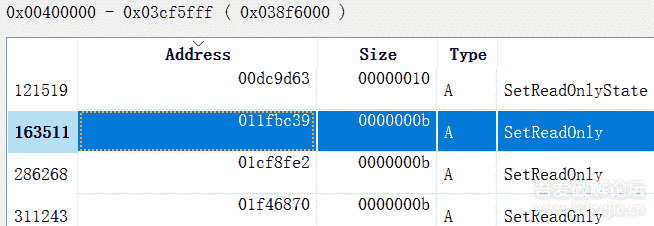

image.png (21.9 KB, 下载次数: 1)

[href="forum.php?mod=attachment&aid=MjU3OTgzNXxkYmI3NjViYnwxNzkzNTc0MjIxfDE2ODA4NnwxNzI1OTUy&nothumb=yes" target="_blank"](https://www.52pojie.cn/forum.php?mod=attachment&aid=MjU3OTgzNXxkYmI3NjViYnwxNzkzNTc0MjIxfDE2ODA4NnwxNzI1OTUy&nothumb=yes)

2022-12-17 21:36 上传

我们就可以用`Delphi` 11.2 + `RichViewEdit`控件编程来模拟实现。

```pascal
procedure TForm4.Button1Click(Sender: TObject);
begin
  RichViewEdit1.ReadOnly := True;   //只读
end;
```

```pascal
procedure TForm4.Button1Click(Sender: TObject);
begin
  RichViewEdit1.ReadOnly := False; //取消只读
end;
```

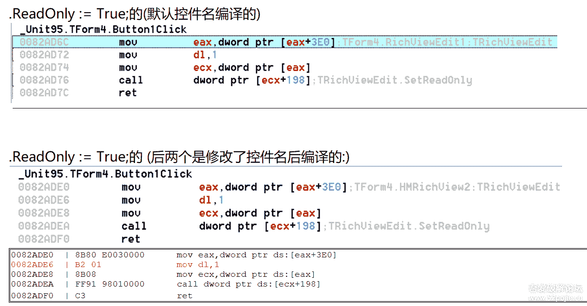

image.png (158.29 KB, 下载次数: 1)

[href="forum.php?mod=attachment&aid=MjU3ODc0NXw1MGUyODE2MnwxNzkzNTc0MjIxfDE2ODA4NnwxNzI1OTUy&nothumb=yes" target="_blank"](https://www.52pojie.cn/forum.php?mod=attachment&aid=MjU3ODc0NXw1MGUyODE2MnwxNzkzNTc0MjIxfDE2ODA4NnwxNzI1OTUy&nothumb=yes)

2022-12-12 20:38 上传

用`IDR`分别打开两份，对比一下机器码一目了然吧？


回到`x64dbg`中，`Ctrl+B`定位修改OK了吧？只有call的那一行不一样。

配图

## 第6章

配图

## 第7章

配图

又过了数月，意外在某QQ群中的某群文件中发现了一个控件名字很有意思

索性上网搜索下吧，一看界面和实现的功能，马上一切疑问一扫而空，天亮了下雪了。。。

## 第8章  额外的启迪与思考

配图

额外的`RichViewEdit`插件

额外的库`pdfium.dll`接口

额外的调试输出日志插件

这些调用方法，法王姥爷你编程都掌握了么？

### 后记：

该软件作为`Delphi`开发的软件还是相当牛逼的。具体表现在几个方面：

- 功能比较完备
- 授权机制中规中矩
- 使用了特殊的日志与堆栈输出控件
- 有网络校验
- 功能限制方面做得可圈可点，对`Delphi`老粉来说是个非常好的素材和模仿对象

如果12分是满分的话，至少我给他打11分。


再说下缺陷吧：正是因为上面的第三点才更快的被破解者找到堆栈调用地址，一击必杀。

我觉得作者这么做还是存在争议的。
