# [原创] 一个小白向的简单逆向

- 原帖: https://www.52pojie.cn/forum.php?mod=viewthread&tid=1726061
- 抓取时间: 2026-11-01T23:03:41

## 定位弹窗入口

执行该`exe`，会出现三个窗口，目标是去除第一个和第三个`Nags`。

[图片1.png](https://www.52pojie.cn/forum.php?mod=attachment&aid=MjU3ODgzOHwxOGYyZGI2NHwxNzkzNTc0MjE5fDE2ODA4NnwxNzI2MDYx&nothumb=yes) (85.41 KB, 下载次数: 1) 2022-12-12 23:53 上传

[图片2.png](https://www.52pojie.cn/forum.php?mod=attachment&aid=MjU3ODgzOXw3MmY5NWQ1MXwxNzkzNTc0MjE5fDE2ODA4NnwxNzI2MDYx&nothumb=yes) (41.48 KB, 下载次数: 2) 2022-12-12 23:53 上传

[图片3.png](https://www.52pojie.cn/forum.php?mod=attachment&aid=MjU3ODg0MHxhODVlMTJkMHwxNzkzNTc0MjE5fDE2ODA4NnwxNzI2MDYx&nothumb=yes) (41.67 KB, 下载次数: 1) 2022-12-12 23:54 上传

程序相对复杂，因此选择直接将程序跑起来，然后弹出第一个`Nags`时点击暂停，查看堆栈的调用情况，毕竟函数的调用全靠堆栈进行的，所以可以看到经历了哪些堆栈的调用。在程序暂停在第一个窗口弹出的时候暂停。

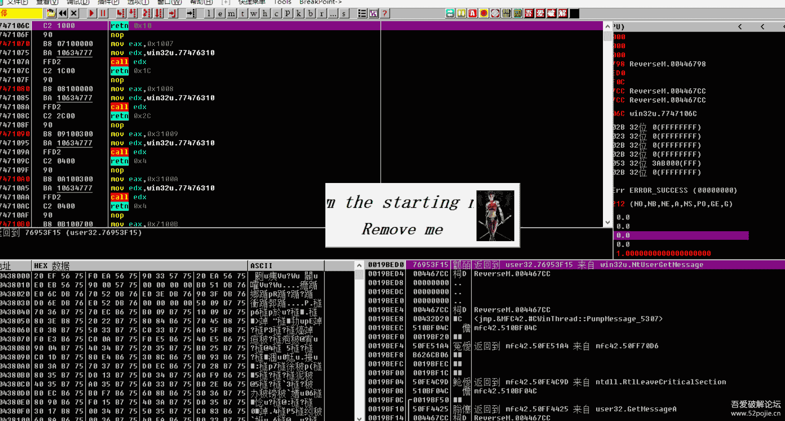

[图片4.png](https://www.52pojie.cn/forum.php?mod=attachment&aid=MjU3ODg0M3w0OTc0NDliN3wxNzkzNTc0MjE5fDE2ODA4NnwxNzI2MDYx&nothumb=yes) (312.55 KB, 下载次数: 1) 2022-12-12 23:56 上传

然后查看堆栈调用情况。

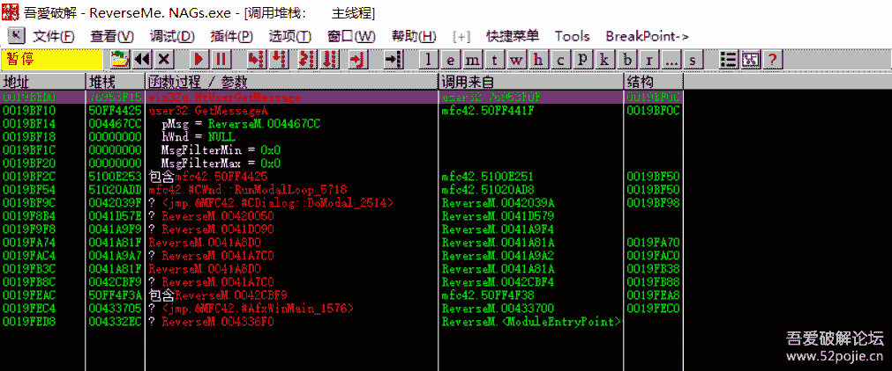

[图片5.png](https://www.52pojie.cn/forum.php?mod=attachment&aid=MjU3ODg0NHw1YTJkYWFmNHwxNzkzNTc0MjE5fDE2ODA4NnwxNzI2MDYx&nothumb=yes) (103.66 KB, 下载次数: 2) 2022-12-12 23:56 上传

认真观察其函数名字，被框出来的函数应该是真正执行`dialog`的地方。

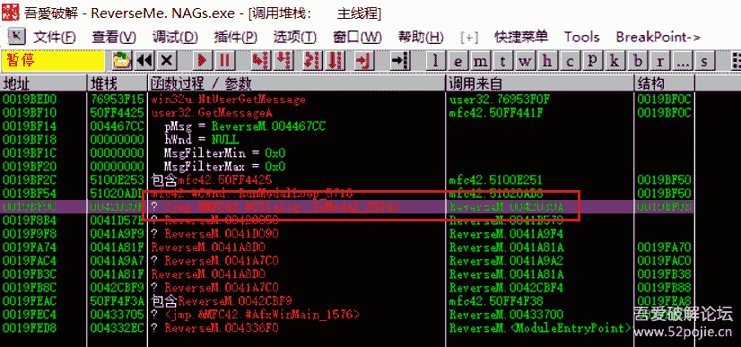

[图片6.png](https://www.52pojie.cn/forum.php?mod=attachment&aid=MjU3ODg0NXxmYzkwYzc2M3wxNzkzNTc0MjE5fDE2ODA4NnwxNzI2MDYx&nothumb=yes) (102.24 KB, 下载次数: 1) 2022-12-12 23:56 上传

在其调用地址`0x42039A`下断点。

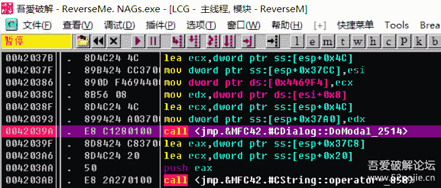

[图片7.png](https://www.52pojie.cn/forum.php?mod=attachment&aid=MjU3ODg0N3xkYmExMjEwMXwxNzkzNTc0MjE5fDE2ODA4NnwxNzI2MDYx&nothumb=yes) (83.95 KB, 下载次数: 1) 2022-12-12 23:59 上传

重载程序，执行到断点处，然后再单步执行，程序确实弹出了第一个窗口，说明调用入口函数没找错。

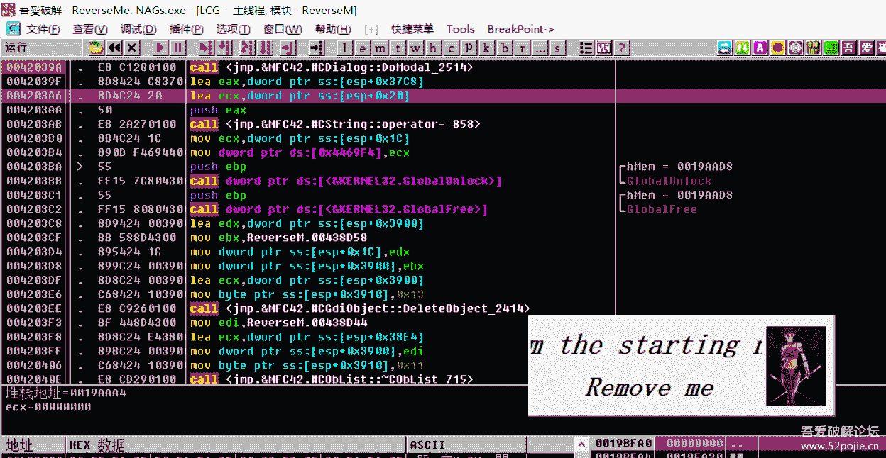

[图片8.png](https://www.52pojie.cn/forum.php?mod=attachment&aid=MjU3ODg0OHwxMDE3NDllZHwxNzkzNTc0MjE5fDE2ODA4NnwxNzI2MDYx&nothumb=yes) (202.88 KB, 下载次数: 2) 2022-12-12 23:59 上传

继续点击执行，发现还是回到了这个地方。说明剩余的两个窗口也是在这里作为调用的入口。

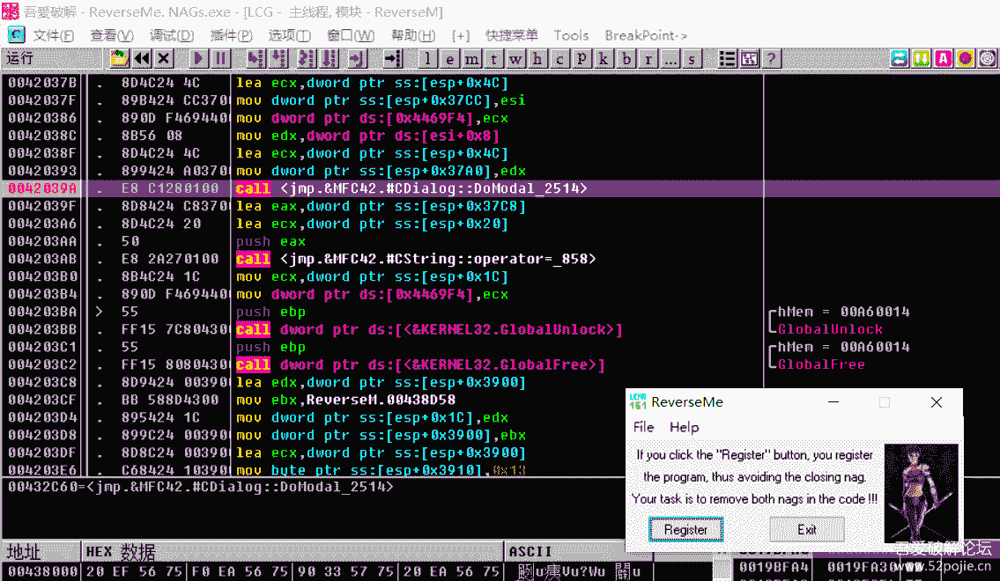

[图片9.png](https://www.52pojie.cn/forum.php?mod=attachment&aid=MjU3ODg0OXwwYzJiZGU5MnwxNzkzNTc0MjE5fDE2ODA4NnwxNzI2MDYx&nothumb=yes) (198.92 KB, 下载次数: 1) 2022-12-13 00:00 上传

## 修改跳转逻辑

那么想要去除掉第一个和第三个就不能只是简单地`nop`或者`jmp`了。选择采用另外编写一段汇编代码来指定什么时候才会执行该语句，从而控制程序流程的执行。

选取`0x445E80`作为控制流程的`flag`位。

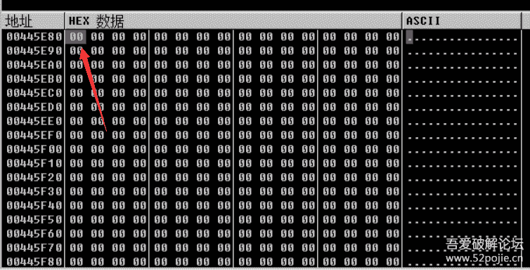

[图片15.png](https://www.52pojie.cn/forum.php?mod=attachment&aid=MjU3ODg1MHw3OTJkZTEzYXwxNzkzNTc0MjE5fDE2ODA4NnwxNzI2MDYx&nothumb=yes) (35.23 KB, 下载次数: 0) 2022-12-13 00:00 上传

再找一块空闲的`text`地址，在其上写入汇编代码。

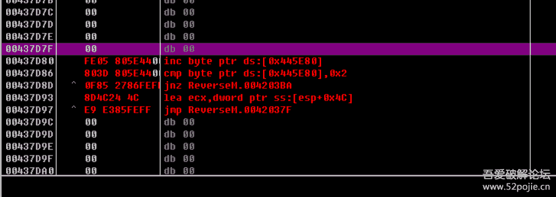

[图片20.png](https://www.52pojie.cn/forum.php?mod=attachment&aid=MjU3ODg1MXwxMTE4YzcyN3wxNzkzNTc0MjE5fDE2ODA4NnwxNzI2MDYx&nothumb=yes) (39.91 KB, 下载次数: 3) 2022-12-13 00:00 上传

选择将`je`这条指令进行修改，因为其本身就是判断指令。但是要注意，因为选择的写入汇编代码位置距离该点位置属于长指令跳转，代码会偏长，将会覆盖下一条指令，所以在上面的汇编代码在编写时还需要考虑加上下一条指令的内容，以保证代码的完整性。

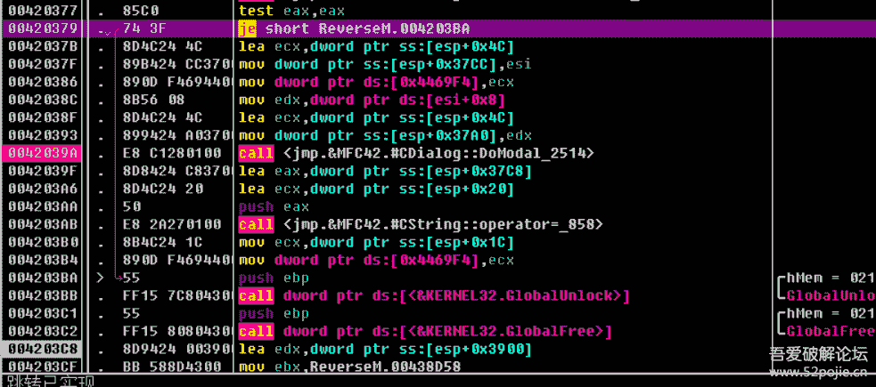

[图片19.png](https://www.52pojie.cn/forum.php?mod=attachment&aid=MjU3ODg1MnwxNzEyNDdiYnwxNzkzNTc0MjE5fDE2ODA4NnwxNzI2MDYx&nothumb=yes) (93.65 KB, 下载次数: 1) 2022-12-13 00:01 上传

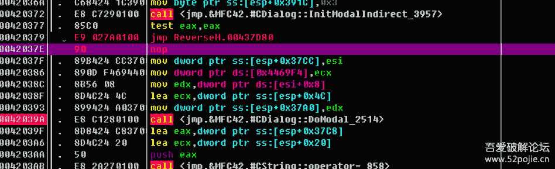

[图片18.png](https://www.52pojie.cn/forum.php?mod=attachment&aid=MjU3ODg1M3w1OWQ4ZWVkOXwxNzkzNTc0MjE5fDE2ODA4NnwxNzI2MDYx&nothumb=yes) (64.06 KB, 下载次数: 2) 2022-12-13 00:01 上传

## 保存并验证

到此就完成了，选择保存一下。

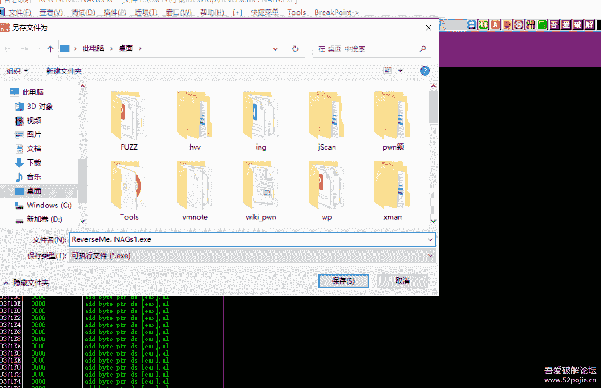

[图片13.png](https://www.52pojie.cn/forum.php?mod=attachment&aid=MjU3ODg0MXw5YWQxYTkxMnwxNzkzNTc0MjE5fDE2ODA4NnwxNzI2MDYx&nothumb=yes) (194.14 KB, 下载次数: 2) 2022-12-12 23:54 上传

运行`exe`，只出现了第二个窗口，成功。

[图片14.png](https://www.52pojie.cn/forum.php?mod=attachment&aid=MjU3ODg0MnxkN2FhOTA5NnwxNzkzNTc0MjE5fDE2ODA4NnwxNzI2MDYx&nothumb=yes) (287.48 KB, 下载次数: 2) 2022-12-12 23:54 上传
