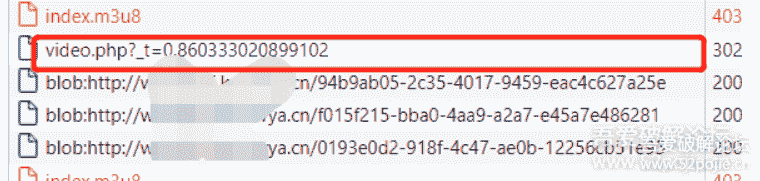
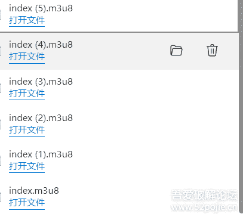
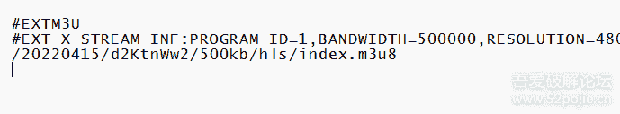
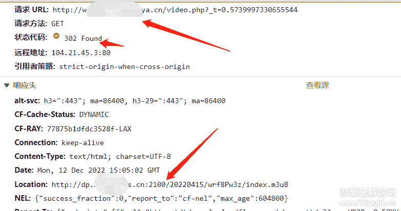
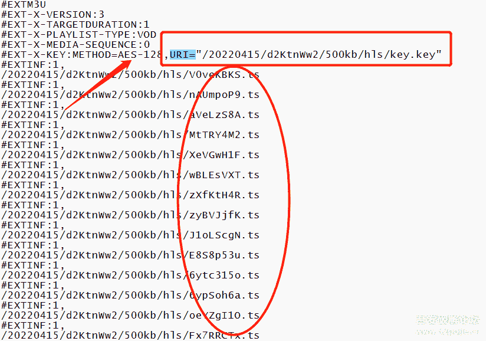
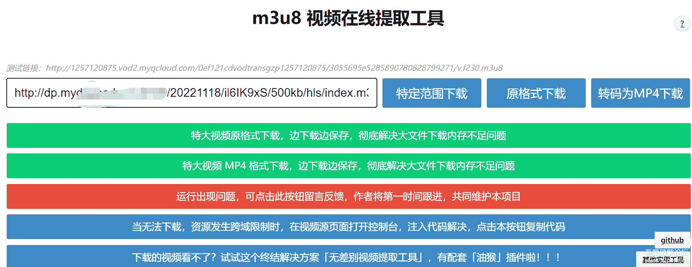
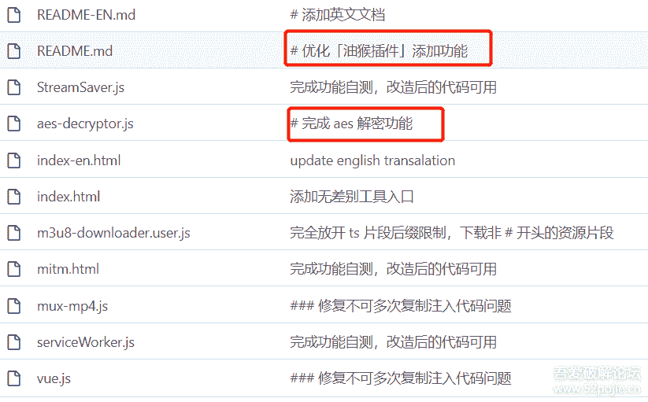
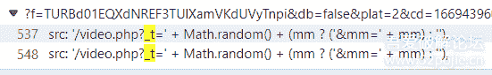
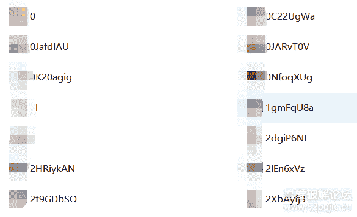

# [Web逆向] `python` 获取 m3u8 真实地址下载视频

- 原帖: https://www.52pojie.cn/forum.php?mod=viewthread&tid=1726069
- 抓取时间: 2026-11-01T23:03:40

**`python` 下载 m3u8 文件，将喜欢的视频存储到本地**

## 一、获取真实的地址

书接上回，在经过三层解密之后，终于在开发者工具中将 JS 跑起来了。

不知道咋回事的朋友可以看[这一帖](https://www.52pojie.cn/thread-1725564-1-1.html)。

在每次重新发送请求的时候，有个请求的链接，映入我的眼帘，因为每次请求 `index.m3u8` 文件失败后，就会出现这个链接以请求新的资源文件。



image.png (92.05 KB, 下载次数: 0)

[附件](https://www.52pojie.cn/forum.php?mod=attachment&aid=MjU4MTY1M3wwZGU4NjExOHwxNzkzNTc0MjE4fDE2ODA4NnwxNzI2MDY5&nothumb=yes)

2022-12-27 22:16 上传

对的就是以 `video.php` 开头的那个链接，后面的参数 `_t` 有没有觉得好面熟，是不是像个时间戳？双击链接直接打开。

发现浏览器竟然直接将 `index.m3u8` 下载下来了。汗:rggrg:rggrg:rggrg:rggrg:rggrg:rggrg（让我情何以堪，上一篇还过了三关才跑起来的 JS）。

这里的 API，竟然直接不用任何 JS 就可以访问到了，想想就气，但是貌似如果不过三关，也发现不了这个 API。

连续刷新了几次链接，发现每次都会下载一个新的 m3u8 文件，文件内容不一致，所以推断文件是随机下载的。



image.png (21.54 KB, 下载次数: 2)

[附件](https://www.52pojie.cn/forum.php?mod=attachment&aid=MjU3ODc5NXw0YjY3ZDgzMXwxNzkzNTc0MjE4fDE2ODA4NnwxNzI2MDY5&nothumb=yes)

2022-12-12 23:06 上传

`index*.m3u8` 文件内容如下：



image.png (12.43 KB, 下载次数: 1)

[附件](https://www.52pojie.cn/forum.php?mod=attachment&aid=MjU3ODc5N3w4YWQyZjY4M3wxNzkzNTc0MjE4fDE2ODA4NnwxNzI2MDY5&nothumb=yes)

2022-12-12 23:07 上传

回到开发者工具的网络选项：注意看下图中的箭头指向。



image.png (45.61 KB, 下载次数: 0)

[附件](https://www.52pojie.cn/forum.php?mod=attachment&aid=MjU3ODgwN3xkYzA0NGM0N3wxNzkzNTc0MjE4fDE2ODA4NnwxNzI2MDY5&nothumb=yes)

2022-12-12 23:10 上传

302 跳转了，注意上下两个地址发生了变化。

用上面的 m3u8 中地址加上跳转后的域名，拼接出来新的请求地址，请求后得到下面的内容：



image.png (75.41 KB, 下载次数: 2)

[附件](https://www.52pojie.cn/forum.php?mod=attachment&aid=MjU3ODgwOHwzZjFjYzM5ZHwxNzkzNTc0MjE4fDE2ODA4NnwxNzI2MDY5&nothumb=yes)

2022-12-12 23:11 上传

Ts 文件终于出现了，但是文件存在加密，但是不怕，因为 `URI=` 后面对应的就是 `key` 的地址啊。加密方式也写出来了 `AES-128` 啊。

其实请求到真实的 m3u8 地址之后，有牛人早就写出来工具了，直接填写真实地址下载即可：分享 GitHub `m3u8-downloader`。



image.png (185.54 KB, 下载次数: 0)

[附件](https://www.52pojie.cn/forum.php?mod=attachment&aid=MjU3ODc5MnwzNzhlZmM5M3wxNzkzNTc0MjE4fDE2ODA4NnwxNzI2MDY5&nothumb=yes)

2022-12-12 23:03 上传

并且大牛写的工具已经实现了自动 AES-解密，还可以再油猴上面添加，直接嗅探页面的视频。



image.png (57.24 KB, 下载次数: 0)

[附件](https://www.52pojie.cn/forum.php?mod=attachment&aid=MjU3ODgxMXxhMDExZGFlMXwxNzkzNTc0MjE4fDE2ODA4NnwxNzI2MDY5&nothumb=yes)

2022-12-12 23:13 上传

另外推荐一个工具就是 `youtube-dl`，也是可以直接命令行下载 m3u8 的，并且能实现自动解密（不过要基于 `ffmpeg`，需要下载 `ffmpeg`，并将其所在的目录添加到环境变量）。

直接 `pip install youtube-dl` 安装即可。

## 二、`python` 自动下载对应视频

既然流程已经搞清楚了，接下来就是用 `python` 实现下载视频的时候了，但是在开始之前我们还是要确定一下那个 `_t` 参数是不是时间戳，直接在开发者工具搜索 `_t`。



image.png (18.76 KB, 下载次数: 2)

[附件](https://www.52pojie.cn/forum.php?mod=attachment&aid=MjU3ODgxNnxkZjU2NDc4M3wxNzkzNTc0MjE4fDE2ODA4NnwxNzI2MDY5&nothumb=yes)

2022-12-12 23:22 上传

找到了 `js` 实现 `_t` 参数的地方，`Math.random()` 的作用就是娶个大于零小于一的随机双浮点小数，奶奶的，分析完了发现不加应该也可以，起初还以为时间戳。

写程序最重要的是思路，而决定思路的就是上面一步步访问的流程，梳理如下：

1. 访问 `domain+/video.php?_t=随机值`，通过重定向 URL，获得第一层的 m3u8 文件内容。
2. 访问重定向后的 `domian` + m3u8 文件内容，得到真实的 m3u8 地址。
3. 自己编写 `Aes-128` 解密信息（或通过 `youtube-dl`）实现下载。

其实把上面的思路理清楚了，程序自然就出来了，`python` 代码如下：

1、访问上面的 `video.php` 地址一千次，得到一个列表（这些代码还是我一次爬取的时候写的那个，现在有个优化版的，所以下面的 `_t` 参数还是用的原来的时间戳形式）。

```python
# 模块导入
import requests
import time

# 定义变量

domain = "http://XXXXXXXX.cn/"
search = "video.php?_t"
now = time.time()

# 定义函数
def get_html(url):
    try:
        r = requests.get(url, timeout=30)
        with open("result.txt", "a") as f:
            f.write(r.text)
            f.close()
        r.close()
        print(r.text)
    except (ValueError):
        return "产生异常"

# 主函数

    for i in range(1, 1000):
        print("正在爬取第" + str(i + 1) + "页")
        time = "=0." + (str(now).replace('.', ''))
        get_html(domain + search + time)
```

经过我10几次实验，也就是访问了10000多次后，去除重复后发现仅剩余649个地址，也就基本探测出这个网站的小视频再650个左右。

2、通过读取 `result.txt` 去重后得到剩余的不重复的地址：

```python
# 读取result.txt文件，并返回以/开始的行  不知道为什么这样写的可以看上面的 第一层m3u8 文件  因为前面两行都是以 # 开头的

domain_301="XXXXX"

def get_m3u8():

    with open("result.txt", "r") as f:

        for line in f.readlines():

            if line.startswith("/"):

                with open("m3u8.txt", "a") as file:

                    file.write(domain_301 + line)

                    file.close()

        f.close()
```

3、去重复上面生成的 `m3u8.txt`：

```python
# 读取m3u8.txt文件，并去除重复行
def get_m3u8():
    with open("m3u8.txt", "r") as f:
        lines = f.readlines()
        print(len(lines))
        lines = list(set(lines))
        print(len(lines))
        f.close()
        with open("m3u8.txt", "w") as file:
            file.writelines(lines)
            file.close()
```

小分享：列表的 `set` 函数可以去除重复的值哦，不记得的赶紧去复习！！！

4、遍历新的文件，`youtube-dl` 下载：

```python
# 导入模块

import os

from multiprocessing.pool import ThreadPool

# 定义变量

save_path = 'D:\\video\\download\\movie\\'

filetype = ".mp4 "

oerder = "youtube-dl -o "

# 读取m3u8.txt，并返回列表

def get_m3u8():

    with open("m3u8.txt", "r") as f:

        lines = f.readlines()

        print(len(lines))

        f.close()

    return lines

# 运行youtube-dl，下载视频

def get_video(url):

    os.chdir(save_path)

    filename = url.split('/')[4]

    if os.path.exists(filename + filetype):

        print("文件已经存在")

    else:

        os.system(oerder + filename + filetype + url)

# 线程函数

def thread_task(lock, data_set):

    lock.acquire()

    get_video(data_set)

    lock.release()

# 主函数

if __name__ == '__main__':

    data_set = get_m3u8()

    with ThreadPool(10) as pool:

        pool.map(get_video, data_set, chunksize=1)
```

嘿嘿嘿，顺带写了一个多线程。

## 三、后记

其实后面优化了上面的程序，但是为了符合流程及一步步的写了代码，这样更便于像我一样的小白编写程序。顺带炫耀一下我的战利品！



image.png (25.37 KB, 下载次数: 1)

[附件](https://www.52pojie.cn/forum.php?mod=attachment&aid=MjU3ODg0Nnw0NjllZTQ0OHwxNzkzNTc0MjE4fDE2ODA4NnwxNzI2MDY5&nothumb=yes)

2022-12-12 23:59 上传

哈哈哈，必须要码啊！！！
