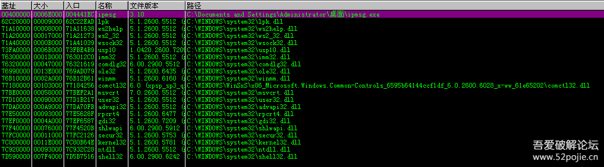
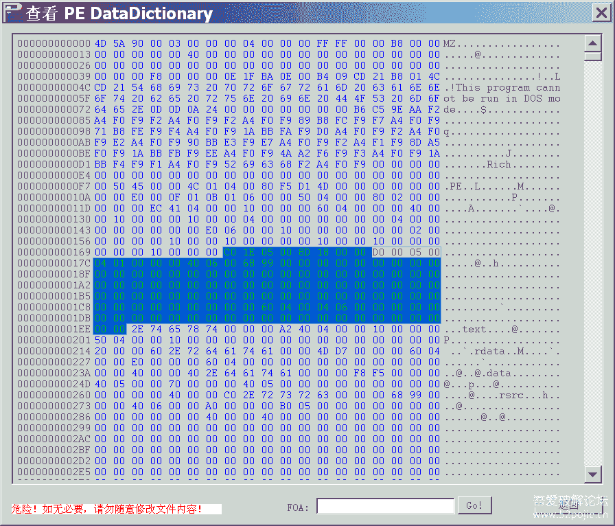
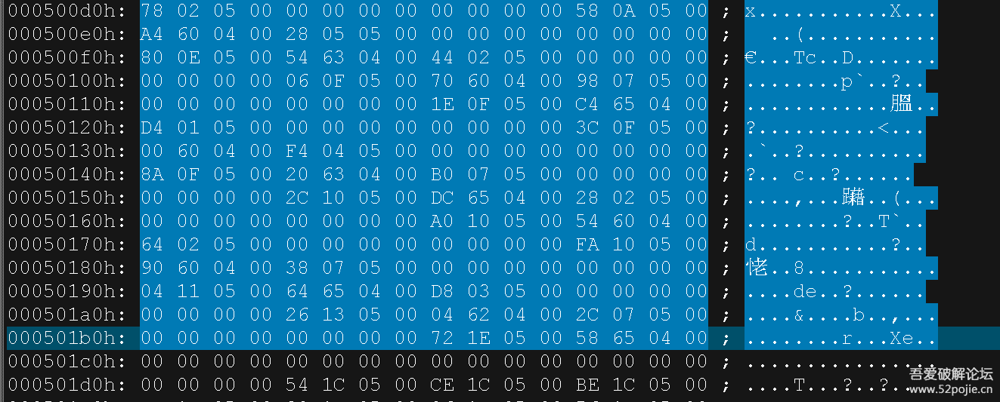
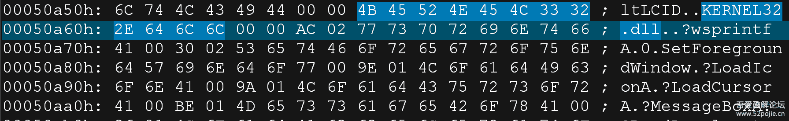
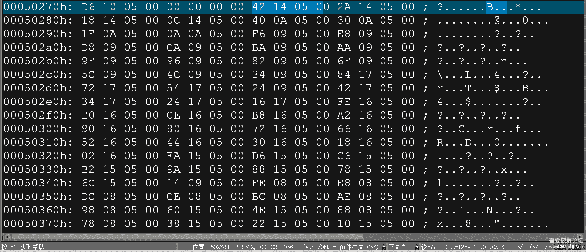
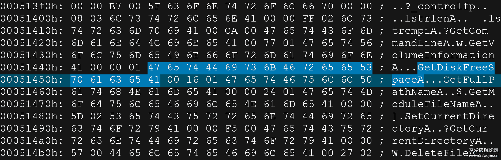
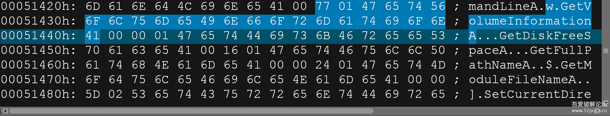
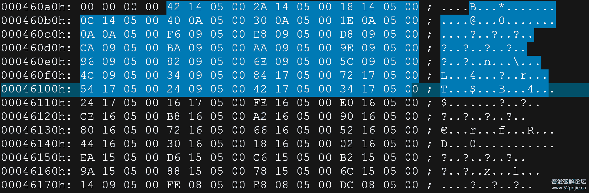
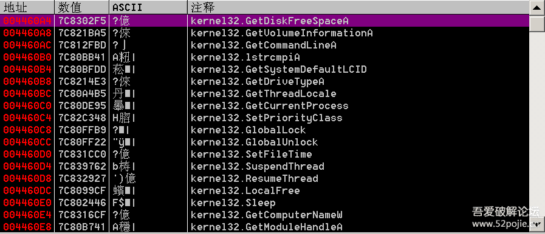

# [原创] PE导入表手动分析

- 原帖: https://www.52pojie.cn/forum.php?mod=viewthread&tid=1726298
- 抓取时间: 2026-11-01T23:03:36

## 导入表的定义

PE 导入表保存了 PE 文件导入的函数和 DLL，并为操作系统提供了调用这些函数所需的信息。PE 导入表确保 PE 文件正常工作，并提供了调用库函数的方法。如图：



`000013.png` (24.33 KB, 下载次数: 2)

[附件](https://www.52pojie.cn/forum.php?mod=attachment&aid=MjU3ODk1MHwwNjU5ODUxMHwxNzkzNTc0MjEzfDE2ODA4NnwxNzI2Mjk4&nothumb=yes)

2022-12-13 15:36 上传

## 导入表的位置

和上一节（[https://www.52pojie.cn/thread-1723600-1-1.html](https://www.52pojie.cn/thread-1723600-1-1.html)）的位置一样，位于扩展 PE 头的 `DIRECTORY DataDirectory[10]` 里，第一个是导出表，第二个就是导入表。

```c
typedef struct _IMAGE_DATA_DIRECTORY
{
    DWORD VirtualAddress; // 导入表开始的地址，注意是 RVA 的值
    DWORD Size;           // 导入表大小
} IMAGE_DATA_DIRECTORY, *PIMAGE_DATA_DIRECTORY;
```



`000014.png` (42.28 KB, 下载次数: 1)

[附件](https://www.52pojie.cn/forum.php?mod=attachment&aid=MjU3ODk1MXw2ZGRhYTMzYXwxNzkzNTc0MjEzfDE2ODA4NnwxNzI2Mjk4&nothumb=yes)

2022-12-13 15:37 上传



`000015.png` (29.59 KB, 下载次数: 2)

[附件](https://www.52pojie.cn/forum.php?mod=attachment&aid=MjU3ODk1MnxiZTkzNTJhYnwxNzkzNTc0MjEzfDE2ODA4NnwxNzI2Mjk4&nothumb=yes)

2022-12-13 15:37 上传

导入表的地址为：`0x000500D0`（`RVA`），大小为：`0x00000104`

由于此文件文件对齐和内存对齐都是 `1000h`，所以 `RVA == FOA`

代表第一个导入表从 `500D0` 开始，从可以引用多个 DLL 知道导入表不止一个，当连续出现 20 个零的时候说明导入表结束；

可以看到从 `501C0` 开始连续 20 个字节为 `0`，则导入表有 12 个（`16*15/20`）

我们会发现 12 个与刚开始利用 `OD` 分析出来的 DLL 个数不相同，这是因为静态文件分析只能分析出程序在编译时所链接的 DLL 文件，而 `OD` 能够检测到程序在运行时动态加载的 DLL 文件。

## 第一个导入表分析

### 导入表的数据结构

```c
typedef struct _IMAGE_IMPORT_DESCRIPTOR {
    union {
        DWORD Characteristics;
        DWORD OriginalFirstThunk; // 指向导入名称表 INT（ImportNameTable）的 RVA
    } DUMMYUNIONNAME;
    DWORD TimeDateStamp;
    DWORD ForwarderChain;
    DWORD Name;          // 指向 DLL 名称的地址 RVA
    DWORD FirstThunk;    // 指向导入地址表 IAT（ImportAddressTable）的 RVA
} IMAGE_IMPORT_DESCRIPTOR;

typedef IMAGE_IMPORT_DESCRIPTOR UNALIGNED *PIMAGE_IMPORT_DESCRIPTOR;
```

### 分析 DLL 名称

先来分析 DLL 名称，在 `0x0C` 处，地址为：`0x00050A58`，跟过去：



`000016.png` (59.22 KB, 下载次数: 2)

[附件](https://www.52pojie.cn/forum.php?mod=attachment&aid=MjU3ODk1M3w0YjgxZGQxZnwxNzkzNTc0MjEzfDE2ODA4NnwxNzI2Mjk4&nothumb=yes)

2022-12-13 15:37 上传

名称以 `00` 结束，完整的 DLL 名称是：`KERNEL32.dll`

### 分析导入名称表

再来分析导入名称表，即 DLL 下的函数名：在 `0x00050278`



`000017.png` (112.32 KB, 下载次数: 2)

[附件](https://www.52pojie.cn/forum.php?mod=attachment&aid=MjU3ODk1NHxiZTY5Mjk4NnwxNzkzNTc0MjEzfDE2ODA4NnwxNzI2Mjk4&nothumb=yes)

2022-12-13 15:38 上传

同样 `KERNEL32.dll` 下的函数名称不可能只有一个，遇到连续的 8 个零代表名称表结束，第一个名称所在的地址为：`00051442`，第二个地址为：`0005142A`



`000011.png` (114.6 KB, 下载次数: 1)

[附件](https://www.52pojie.cn/forum.php?mod=attachment&aid=MjU3ODk1NXwzMWU4NWFjZnwxNzkzNTc0MjEzfDE2ODA4NnwxNzI2Mjk4&nothumb=yes)

2022-12-13 15:38 上传



`000012.png` (70.99 KB, 下载次数: 1)

[附件](https://www.52pojie.cn/forum.php?mod=attachment&aid=MjU3ODk1NnxkYmU5MjlkZHwxNzkzNTc0MjEzfDE2ODA4NnwxNzI2Mjk4&nothumb=yes)

2022-12-13 15:38 上传

后面的函数名就不一一列出了，前两个分别为：`GetDiskFreeSpaceA`、`GetVolumeInformationA`。

`0100` 和 `0177` 是函数在导出表中的索引

### 分析导入地址表 IAT

我们再来分析导入地址表 `IAT`，在 `0x000460A4`



`000018.png` (96.63 KB, 下载次数: 0)

[附件](https://www.52pojie.cn/forum.php?mod=attachment&aid=MjU3ODk1OHxhMzQ1MTAwOXwxNzkzNTc0MjEzfDE2ODA4NnwxNzI2Mjk4&nothumb=yes)

2022-12-13 15:39 上传

我们会发现此处存储的和导入名称地址内的相同，这是为什么呢，原来在程序运行后，导入地址表所指向的内容就会被操作系统改为函数的 `VA`；

那么为什么同一段数据存储两遍呢，因为一旦 `IAT` 被修改后，如果没有 `INT` 的对照，我们无法重新找到该地址调用了哪个函数。

我们来看程序运行后，`IAT` 的变化：



`000019.png` (29.55 KB, 下载次数: 2)

[附件](https://www.52pojie.cn/forum.php?mod=attachment&aid=MjU3ODk1OXw1MTZmYmNjMHwxNzkzNTc0MjEzfDE2ODA4NnwxNzI2Mjk4&nothumb=yes)

2022-12-13 15:39 上传

在 `OD` 数据窗口中跳转到 `0x000460A4`，不难发现存储的是函数的地址。

## 总结

通过分析 PE 导入表，我们可以发现程序依赖于哪些其他文件，以及它们如何使用这些文件中的函数。这可以帮助我们了解程序的工作原理，并对其进行静态分析。分析 PE 导入表的难点在于其结构比较复杂，手动分析它更有利于我们了解它的结构，并对它做出一些恰当的修改使得程序不会出错。
