# [Web逆向] 某讯滑块验证码反汇编分析-第三章

- 原帖: https://www.52pojie.cn/forum.php?mod=viewthread&tid=1729065
- 抓取时间: 2026-11-01T23:03:17

[@某讯滑块验证码反汇编分析-第三章](https://www.52pojie.cn/某讯滑块验证码反汇编分析-第三章)

## `collect`明文处理

上一篇已经跟到明文的拼接函数，接下来看看 `get()` 函数的返回值，对什么进行拼接。

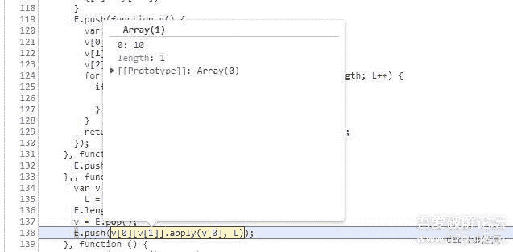

`1.png` (23.93 KB, 下载次数: 1) · [附件下载](https://www.52pojie.cn/forum.php?mod=attachment&aid=MjcyNzc5M3xjNGU4MGU1YXwxNzkzNTc0MTk1fDE2ODA4NnwxNzI5MDY1&nothumb=yes) · 2024-10-11 16:43 上传

在这一次运行中，第一次 `get()` 返回的是一个 10，是怎么计算出来的呢？

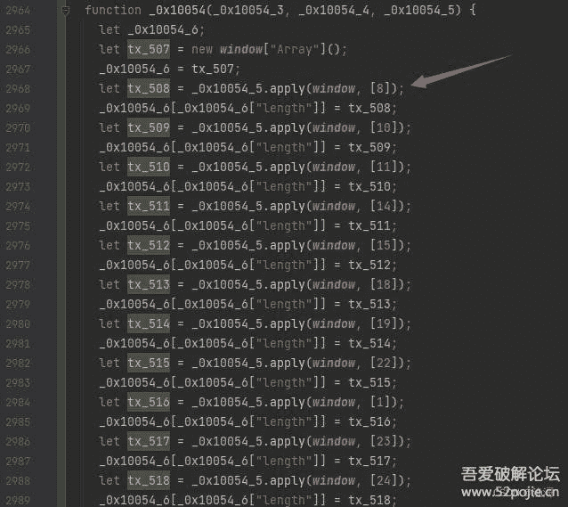

`2.png` (71.89 KB, 下载次数: 1) · [附件下载](https://www.52pojie.cn/forum.php?mod=attachment&aid=MjcyNzc5NHw5NWE3MDIwNnwxNzkzNTc0MTk1fDE2ODA4NnwxNzI5MDY1&nothumb=yes) · 2024-10-11 16:43 上传

第一个是模块 8 返回的，看看里面是什么

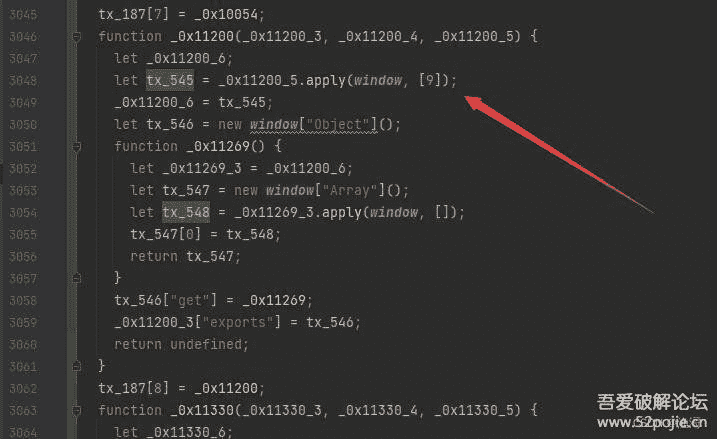

`3.png` (45.39 KB, 下载次数: 1) · [附件下载](https://www.52pojie.cn/forum.php?mod=attachment&aid=MjcyNzc5NXwyMGMyODZiM3wxNzkzNTc0MTk1fDE2ODA4NnwxNzI5MDY1&nothumb=yes) · 2024-10-11 16:43 上传

模块 8 又是调用的模块 9

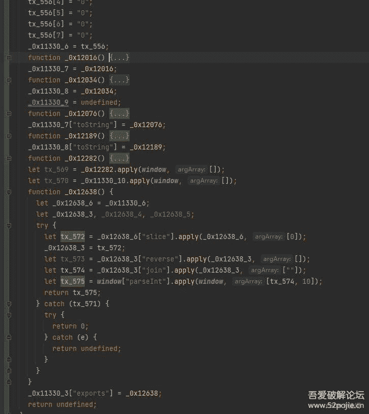

`4.png` (66.16 KB, 下载次数: 1) · [附件下载](https://www.52pojie.cn/forum.php?mod=attachment&aid=MjcyNzc5NnwxNGY3YTI1OXwxNzkzNTc0MTk1fDE2ODA4NnwxNzI5MDY1&nothumb=yes) · 2024-10-11 16:43 上传

模块 9 就是环境检测的函数了，做了一些与环境相关的运算，最终返回 10 为结果。一般来说不需要太理会中间是怎么计算的，只要知道检测正确的返回值是多少，然后固定这个正确的值就可以了，那么接着下一个 `get()`

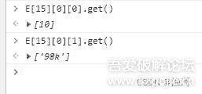

`5.png` (6.14 KB, 下载次数: 1) · [附件下载](https://www.52pojie.cn/forum.php?mod=attachment&aid=MjcyNzc5N3xjOTE4NTY3OHwxNzkzNTc0MTk1fDE2ODA4NnwxNzI5MDY1&nothumb=yes) · 2024-10-11 16:43 上传

第二个 `get()` 的返回值是一个字符串，看看又是怎么运算出来

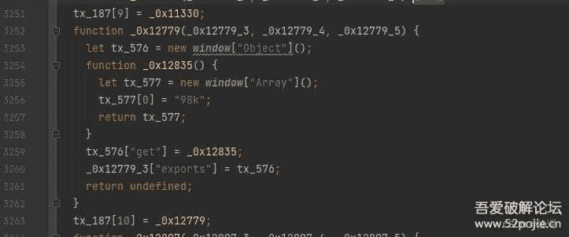

`6.png` (29.81 KB, 下载次数: 1) · [附件下载](https://www.52pojie.cn/forum.php?mod=attachment&aid=MjcyNzc5OHw4YzgzZGRjZnwxNzkzNTc0MTk1fDE2ODA4NnwxNzI5MDY1&nothumb=yes) · 2024-10-11 16:43 上传

实际这是一个固定值，没有任何的运算。如此类推，一直把 37 个 `get()` 函数都执行，然后把返回值拼接

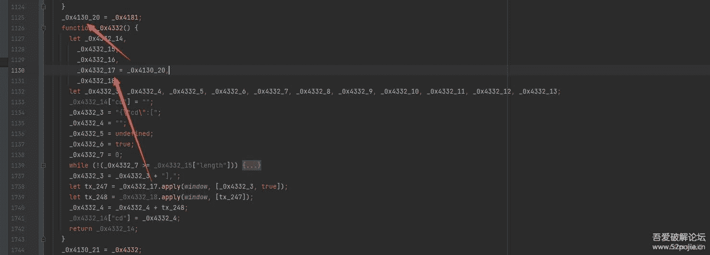

`7.png` (58.67 KB, 下载次数: 0) · [附件下载](https://www.52pojie.cn/forum.php?mod=attachment&aid=MjcyNzc5OXw1ZjcxNjg5NnwxNzkzNTc0MTk1fDE2ODA4NnwxNzI5MDY1&nothumb=yes) · 2024-10-11 16:43 上传

拼接完成后调用了 `4181` 函数

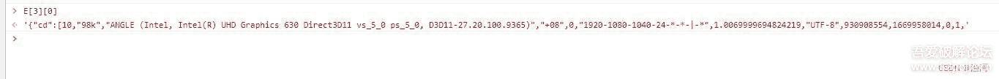

`8.png` (18.94 KB, 下载次数: 1) · [附件下载](https://www.52pojie.cn/forum.php?mod=attachment&aid=MjcyNzgwMHw0YjhiODMyN3wxNzkzNTc0MTk1fDE2ODA4NnwxNzI5MDY1&nothumb=yes) · 2024-10-11 16:44 上传

这里就可以看到待加密的明文字符串，然后这里会调用多次，进行分段加密，结尾是 `"],` 的时候，才是最后一次

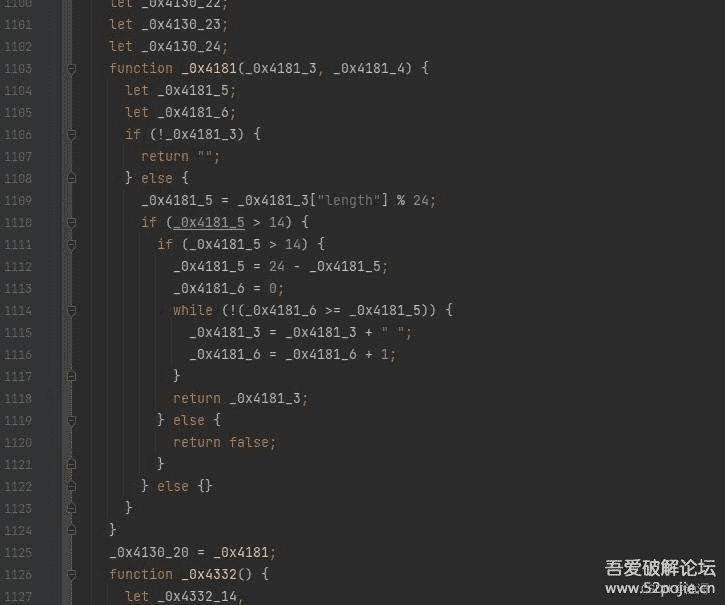

`9.png` (44.95 KB, 下载次数: 1) · [附件下载](https://www.52pojie.cn/forum.php?mod=attachment&aid=MjcyNzgwMXwzNDY0MTA0ZXwxNzkzNTc0MTk1fDE2ODA4NnwxNzI5MDY1&nothumb=yes) · 2024-10-11 16:44 上传

`4181` 函数可以理解为一个填充的函数，然后就调用 `10009` 函数进行加密

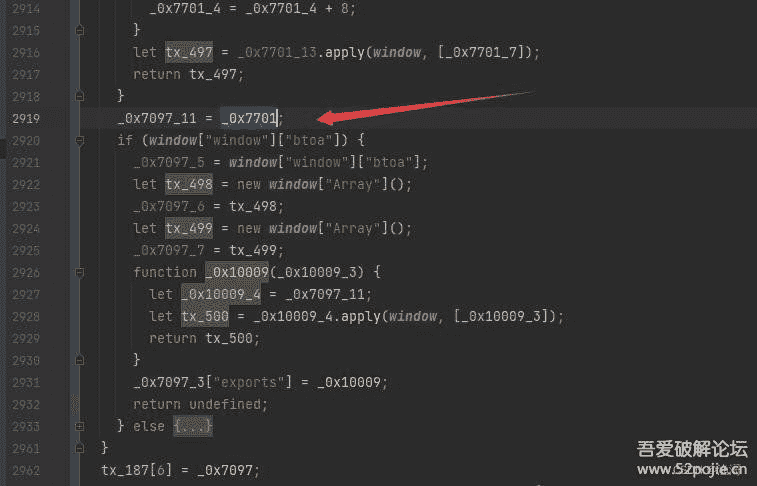

`10.png` (45.7 KB, 下载次数: 0) · [附件下载](https://www.52pojie.cn/forum.php?mod=attachment&aid=MjcyNzgwMnwyOWM2ODViZHwxNzkzNTc0MTk1fDE2ODA4NnwxNzI5MDY1&nothumb=yes) · 2024-10-11 16:44 上传

加密函数又调用了 `7701` 函数

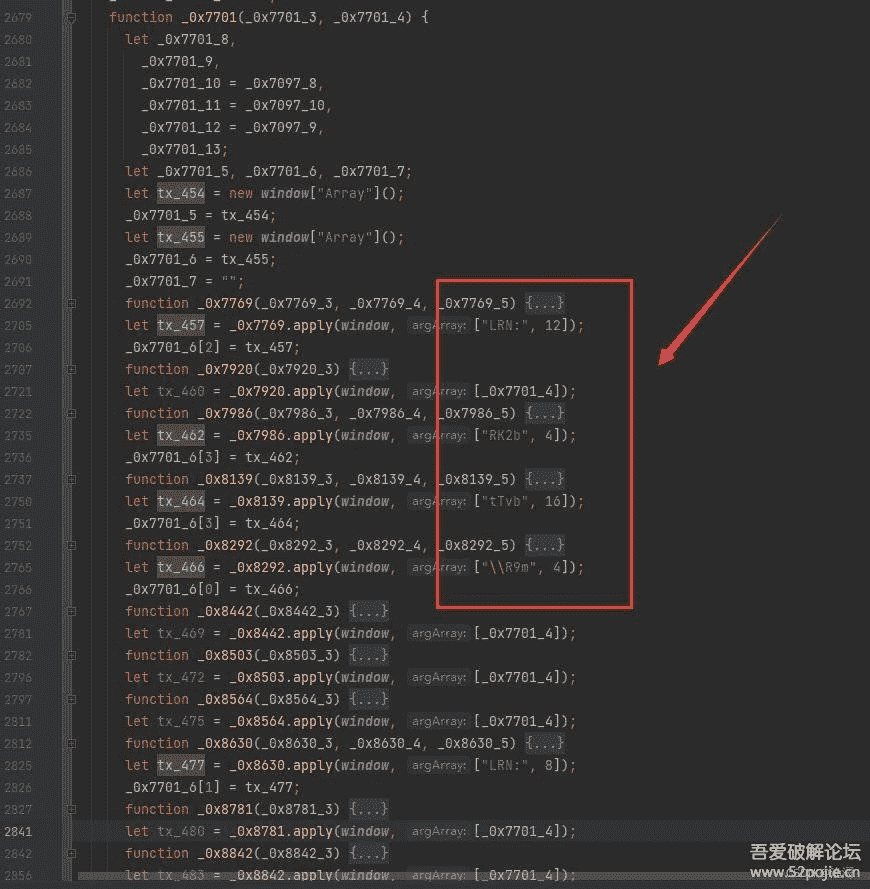

`11.png` (117.53 KB, 下载次数: 1) · [附件下载](https://www.52pojie.cn/forum.php?mod=attachment&aid=MjcyNzgwM3wwZDc2NjgwNnwxNzkzNTc0MTk1fDE2ODA4NnwxNzI5MDY1&nothumb=yes) · 2024-10-11 16:45 上传

这里看到一些特殊的字符串，实际是密钥的初始化

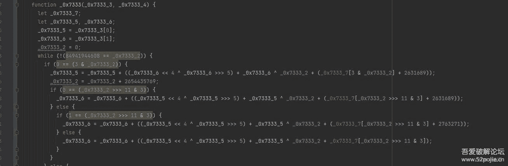

`12.png` (58.23 KB, 下载次数: 0) · [附件下载](https://www.52pojie.cn/forum.php?mod=attachment&aid=MjcyNzgwNHw2ZTRkMGNkMHwxNzkzNTc0MTk1fDE2ODA4NnwxNzI5MDY1&nothumb=yes) · 2024-10-11 16:45 上传

可以看出是一个把 `>> 5` 魔改为 `>>> 5` 的 `tea` 加密，密钥是 4 个 `int`，也就是 16 字节。在几天，或者十几天内，看起来是不变的，那么可以用 `ast` 动态还原出密钥，也可以手动获取 `key` 用它个一段时间。在发文时的 `key` 为 `QiPXNgNXhnjVfFhT`。既然加密知道了，`tea` 是对称加密，用相同的密钥可以解密出密文，那么我们那网页生成的参数试试

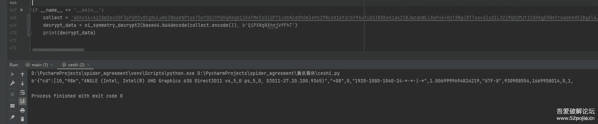

`13.png` (66.07 KB, 下载次数: 2) · [附件下载](https://www.52pojie.cn/forum.php?mod=attachment&aid=MjcyNzgwNXw4ZjU1ZWQ2MnwxNzkzNTc0MTk1fDE2ODA4NnwxNzI5MDY1&nothumb=yes) · 2024-10-11 16:46 上传

非常漂亮的解密出明文，后面只要自己构造参数，然后加密就可以得到可用的 `collect` 参数。

其中计算滑块距离使用的是 `ddddocr` 三方库

距离生成轨迹使用帖子 [https://www.52pojie.cn/thread-1162979-1-1.html](https://www.52pojie.cn/thread-1162979-1-1.html) 提供的帖子

## `vData`明文处理

经过前面的铺垫，部分重复的内容会适当跳过。需要发送请求，还需要一个 `vData`，而这个参数是在另外一个 `js` 文件中。

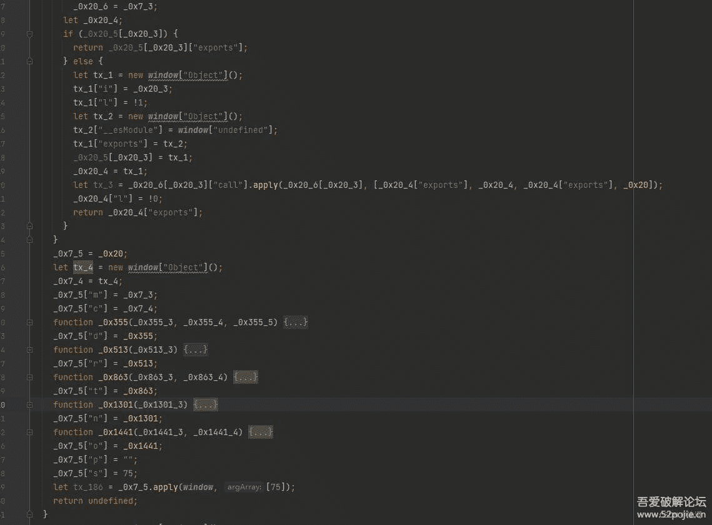

`14.png` (83.48 KB, 下载次数: 2) · [附件下载](https://www.52pojie.cn/forum.php?mod=attachment&aid=MjcyNzgwNnw1Y2ViNjg5MnwxNzkzNTc0MTk1fDE2ODA4NnwxNzI5MDY1&nothumb=yes) · 2024-10-11 16:47 上传

可以看到生成 `vData` 的 `js` 也是一个 `webpack` 的代码

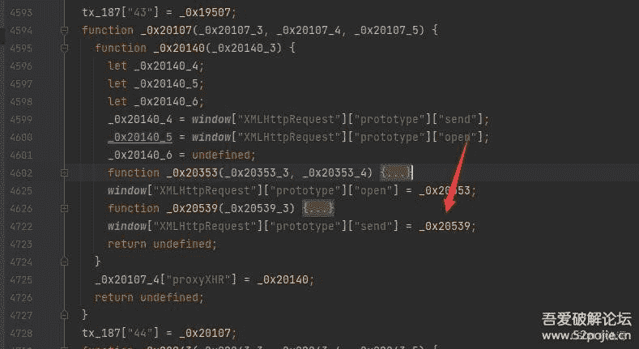

`15.png` (47.93 KB, 下载次数: 1) · [附件下载](https://www.52pojie.cn/forum.php?mod=attachment&aid=MjcyNzgwN3xjMzFlZGMwMXwxNzkzNTc0MTk1fDE2ODA4NnwxNzI5MDY1&nothumb=yes) · 2024-10-11 16:47 上传

直接查找 `send()` 方法，绑定的是 `20539` 函数，里面实际调用的 `getCaptchaData()` 这个函数，地址是 `22317`

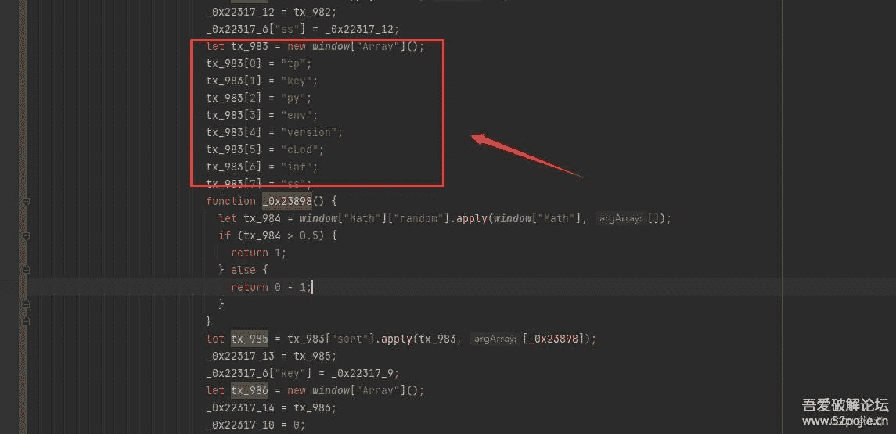

`16.png` (55.37 KB, 下载次数: 0) · [附件下载](https://www.52pojie.cn/forum.php?mod=attachment&aid=MjcyNzgwOHwzNzU3ZDFjZnwxNzkzNTc0MTk1fDE2ODA4NnwxNzI5MDY1&nothumb=yes) · 2024-10-11 16:47 上传

明文就是这一个对象，里面包含 8 个固定的键名，除了 `key` 这个键以外，其他的值都是固定的。`key` 的计算就是把 `tlg` 中的每一个值看做下标，然后在 `sess` 上取值。一般来说 `collect` 都是上千位，所以 `tlg` 是四位数，所以 `key` 的值也是四位。

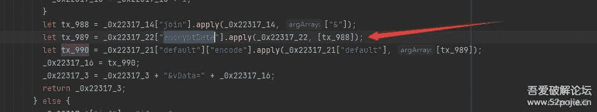

`17.png` (28.26 KB, 下载次数: 1) · [附件下载](https://www.52pojie.cn/forum.php?mod=attachment&aid=MjcyNzgwOXw2ZGNjYWU4YXwxNzkzNTc0MTk1fDE2ODA4NnwxNzI5MDY1&nothumb=yes) · 2024-10-11 16:48 上传

拼接好了以后就进入 `encryptData()` 方法

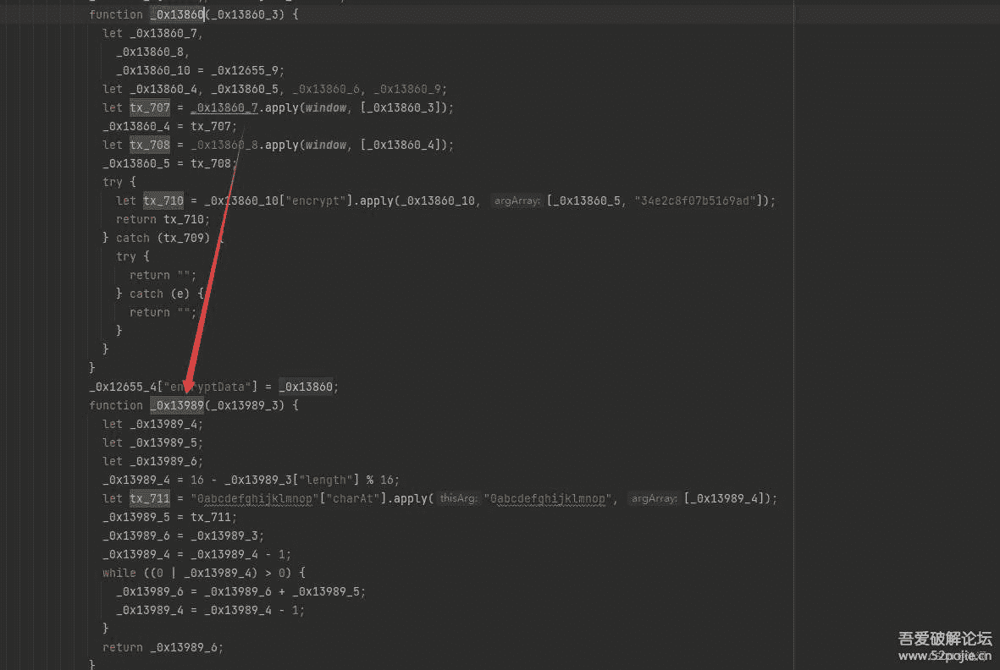

`18.png` (72.43 KB, 下载次数: 2)

### 填充到 16 的倍数

[附件链接](https://www.52pojie.cn/forum.php?mod=attachment&aid=MjcyNzgxMHw5OWZiM2JjY3wxNzkzNTc0MTk1fDE2ODA4NnwxNzI5MDY1&nothumb=yes)

2024-10-11 16:48 上传

首先是进行填充到 16 的倍数

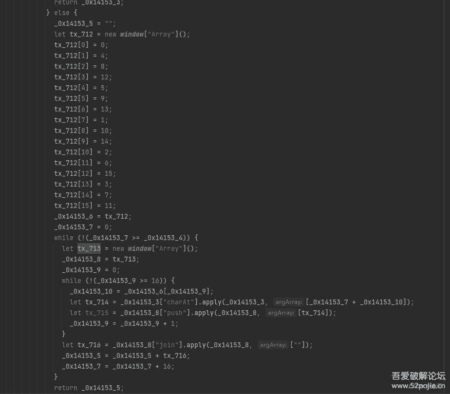

`19.png`（68.39 KB，下载次数：1）

### 乱序与 TEA 加密

[附件链接](https://www.52pojie.cn/forum.php?mod=attachment&aid=MjcyNzgxMXxkZTU3YmI0N3wxNzkzNTc0MTk1fDE2ODA4NnwxNzI5MDY1&nothumb=yes)

2024-10-11 16:48 上传

然后是打乱字符串顺序，最后就是那个魔改的`tea`加密，密钥固定为【`34e2c8f07b5169ad`】

`20.png`（26.2 KB，下载次数：1）

### Base64 编码与验证

[附件链接](https://www.52pojie.cn/forum.php?mod=attachment&aid=MjcyNzgxMnxkMzNmNTZmNXwxNzkzNTc0MTk1fDE2ODA4NnwxNzI5MDY1&nothumb=yes)

2024-10-11 16:48 上传

最后的`encode`是一个`base64`编码，只是编码表被修改了，其他都是一样的。逻辑理顺了之后，使用`python`跑起来试试

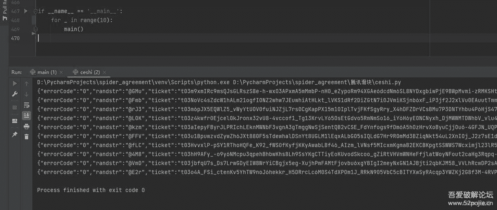

`21.png`（117.62 KB，下载次数：1）

[附件链接](https://www.52pojie.cn/forum.php?mod=attachment&aid=MjcyNzgxM3xhNWE2ZjRlM3wxNzkzNTc0MTk1fDE2ODA4NnwxNzI5MDY1&nothumb=yes)

2024-10-11 16:48 上传

完美！！！
