# [原创] [Windows]Sublime Text 4143注册分析

- 原帖：https://www.52pojie.cn/forum.php?mod=viewthread&tid=1729950
- 抓取时间：2026-11-01T23:03:15

看到论坛里已经有很多朋友分析过如何爆破它了，但好像还没有分析注册过程的。

分析对象是x64的版本4143：
[https://download.sublimetext.com/sublime_text_build_4143_x64_setup.exe](https://download.sublimetext.com/sublime_text_build_4143_x64_setup.exe)

使用工具：

- `x64dbg`
- `winhex`
- `openssl`

## 寻找注册过程函数

我们可以从关于对话框中的`Unregistered`入手。

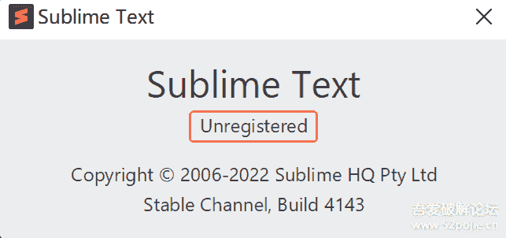

附件：[`win1.png`](https://www.52pojie.cn/forum.php?mod=attachment&aid=MjU4MTE0NHw2Mzg4ODZjNXwxNzkzNTc0MTkyfDE2ODA4NnwxNzI5OTUw&nothumb=yes)（2022-12-24 16:08 上传）

打开`x64dbg`，载入`sublime_text.exe`，运行，搜索=>当前模块=>字符串，过滤`Unresgistered`。

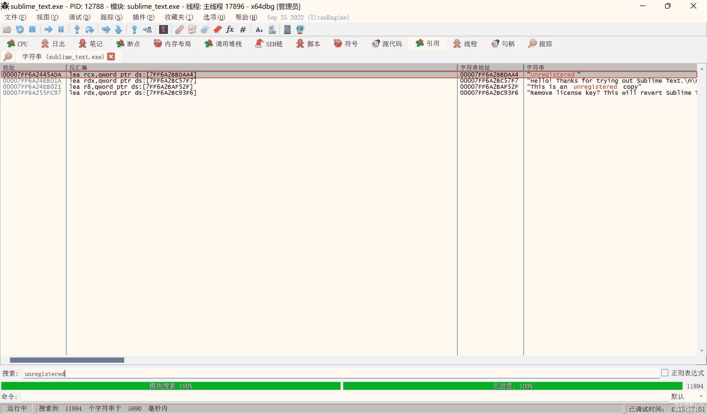

附件：[`win2.png`](https://www.52pojie.cn/forum.php?mod=attachment&aid=MjU4MTE0NXxjZTY5YmNhMHwxNzkzNTc0MTkyfDE2ODA4NnwxNzI5OTUw&nothumb=yes)（2022-12-24 16:08 上传）

双击来到代码段，向上查找，发现有一个跳转跳过`Registered to`，前面比较了`[rsi+5]`的值。

那么我们在此处下断点，找到`[rsi+5]`的地址，在此处下写入断点。

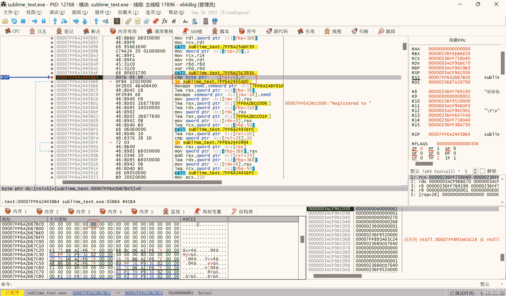

附件：[`win3.png`](https://www.52pojie.cn/forum.php?mod=attachment&aid=MjU4MTE0NnxlZmMwMmNkZHwxNzkzNTc0MTkyfDE2ODA4NnwxNzI5OTUw&nothumb=yes)（2022-12-24 16:08 上传）

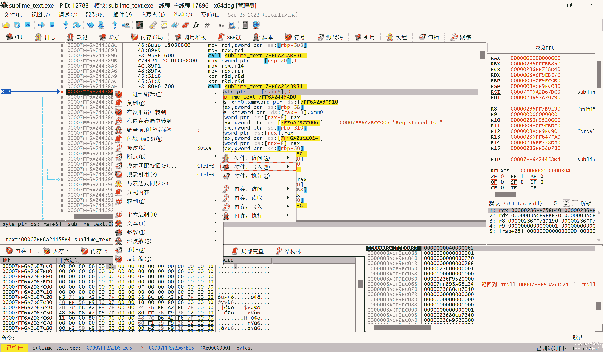

附件：[`win4.png`](https://www.52pojie.cn/forum.php?mod=attachment&aid=MjU4MTE0N3xmN2Q1MGJkMXwxNzkzNTc0MTkyfDE2ODA4NnwxNzI5OTUw&nothumb=yes)（2022-12-24 16:08 上传）

随便在网上找一组没被软件本身屏蔽的注册码（可以被服务器屏蔽），然后断开网络，将注册码输入，点击注册，断下来了，可以发现框出来的函数决定了是否将标志位设置为`1`。

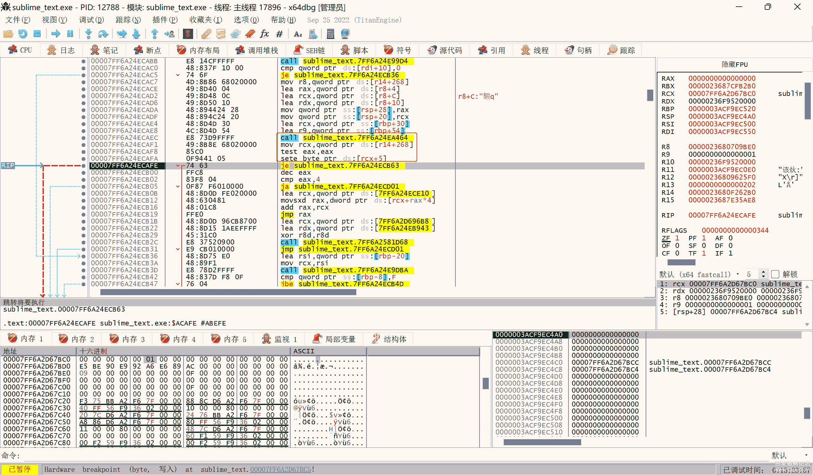

附件：[`win5.png`](https://www.52pojie.cn/forum.php?mod=attachment&aid=MjU4MTE0OHw2Nzg3NWE5MXwxNzkzNTc0MTkyfDE2ODA4NnwxNzI5OTUw&nothumb=yes)（2022-12-24 16:08 上传）

## 分析注册过程

进入刚才那个函数，下断点，断开网络，输入假码注册：

```
----- BEGIN LICENSE -----
52pojie
Unlimited User License
EA7E-8888
88888888888888888888888888888888
88888888888888888888888888888888
88888888888888888888888888888888
88888888888888888888888888888888
88888888888888888888888888888888
88888888888888888888888888888888
88888888888888888888888888888888
88888888888888888888888888888888
------ END LICENSE ------
```

断下来了，我们可以发现函数最开始对`[7FF6A2AC8670]`往后`0xA0`个字节的每个字节异或`FD`，然后拼接出了一个`der`格式的`rsa`公钥。

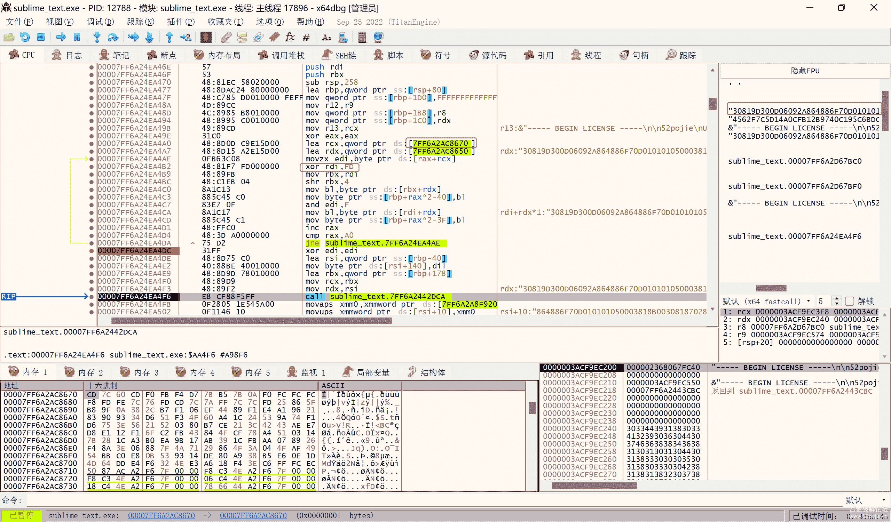

附件：[`win6.png`](https://www.52pojie.cn/forum.php?mod=attachment&aid=MjU4MTE0OXwxYzJmMWEzZnwxNzkzNTc0MTkyfDE2ODA4NnwxNzI5OTUw&nothumb=yes)（2022-12-24 16:08 上传）

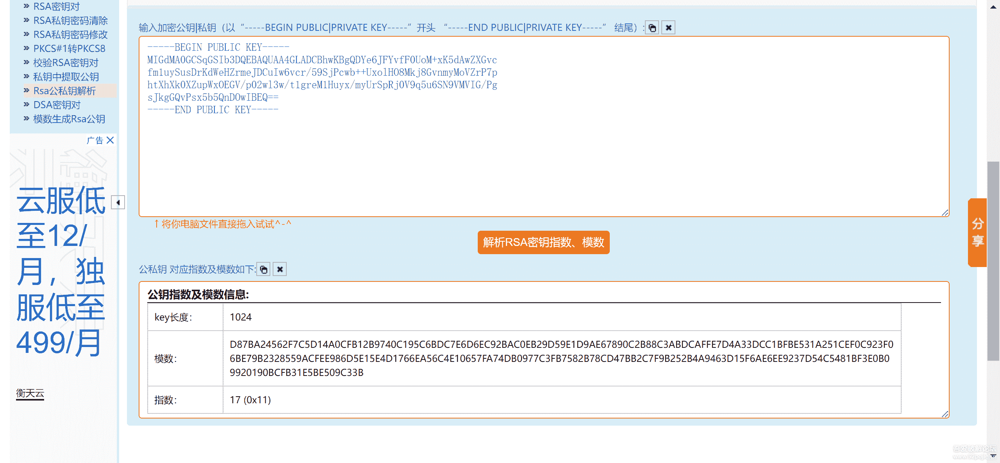

附件：[`key.png`](https://www.52pojie.cn/forum.php?mod=attachment&aid=MjU4MTE0M3xhM2NhMDdjMHwxNzkzNTc0MTkyfDE2ODA4NnwxNzI5OTUw&nothumb=yes)（2022-12-24 16:08 上传）

继续往后，可以发现这个函数前传递了我们输入的假码和公钥，很有可能是注册的关键函数，进去看看。

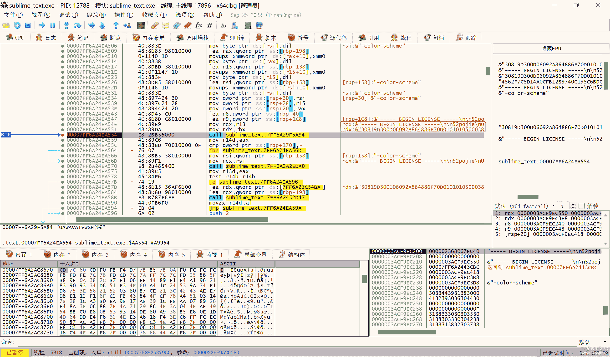

附件：[`win7.png`](https://www.52pojie.cn/forum.php?mod=attachment&aid=MjU4MTE1MHw5ZTY0NzZlZHwxNzkzNTc0MTkyfDE2ODA4NnwxNzI5OTUw&nothumb=yes)（2022-12-24 16:08 上传）

函数中一共只有两个跳转，图中第一个被设置断点的函数前传递了`EA7E`，猜测可能是校验输入的产品编号是否正确。

而下面框出来的函数，很有可能是注册验证的函数，前面传递了`rsa`公钥、假码的前三行（注册信息）、以及假码的剩余部分（注册码），并且下面将`eax`的值传入`esi`，而下面有一个`jmp`跳过了一段不可能运行的代码`xor esi,esi`，说明程序是不希望`esi`的值为`0`的，此时我们观察寄存器，运行完“注册函数”后，`eax`的值为`0`，那么`esi`的值也将为`0`，此时我们将`eax`的值改为`1`试试，结果注册成功了，更加验证了那个函数是注册函数。

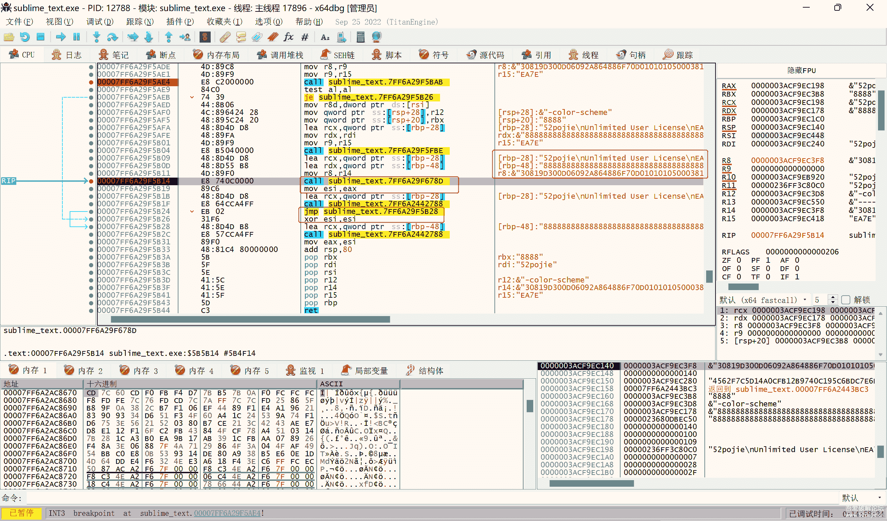

附件：[`win8.png`](https://www.52pojie.cn/forum.php?mod=attachment&aid=MjU4MTE1MXw2NmExY2VmNXwxNzkzNTc0MTkyfDE2ODA4NnwxNzI5OTUw&nothumb=yes)（2022-12-24 16:08 上传）

进入注册函数，下断点，断开网络，再次输入假码。

可以看见函数最开始准备进行一个`sha1`运算。

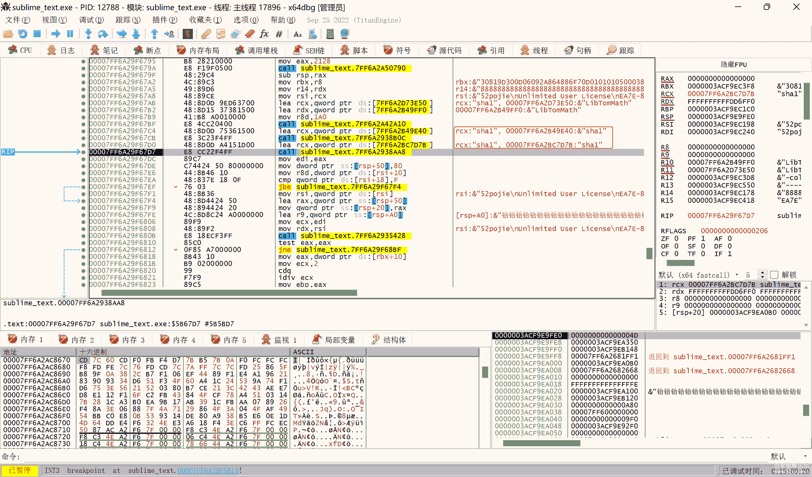

附件：[`win9.png`](https://www.52pojie.cn/forum.php?mod=attachment&aid=MjU4MTE1MnwyOTQ4YzI4OHwxNzkzNTc0MTkyfDE2ODA4NnwxNzI5OTUw&nothumb=yes)（2022-12-24 16:08 上传）

下面的一个决定函数返回值关键跳转前的函数，被传入了`0x80`，假码的剩余部分（注册码），以及一段16进制数据，我们尝试将假码的前三行（注册信息）进行`sha1`运算，恰好就是这段16进制数据，这个函数很有可能就在进行`rsa`验签。

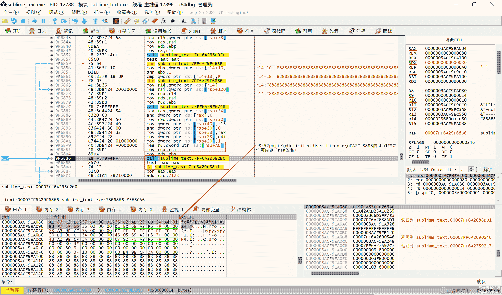

附件：[`win10.png`](https://www.52pojie.cn/forum.php?mod=attachment&aid=MjU4MTE1M3w4ZjQ3ODc1ZXwxNzkzNTc0MTkyfDE2ODA4NnwxNzI5OTUw&nothumb=yes)（2022-12-24 16:08 上传）

综上，可以逆推出注册码的生成过程：

```
注册信息=>sha1哈希运算=>rsa私钥签名
```

### 网验去除

回到刚才设置`[rcx+5]`的地方，可以发现上面有一个判断会跳过本地注册验证，进入框出的函数内。

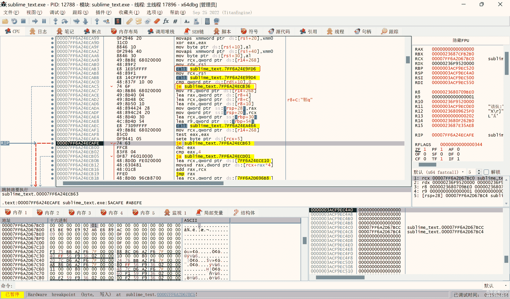

附件：[`win11.png`](https://www.52pojie.cn/forum.php?mod=attachment&aid=MjU4MTE1NHwzMjQ3ZTRkMHwxNzkzNTc0MTkyfDE2ODA4NnwxNzI5OTUw&nothumb=yes)（2022-12-24 16:08 上传）

发现了`"/license_notification"`、`"?n="`等字符串，应该就是网验了，把它们干掉就行。

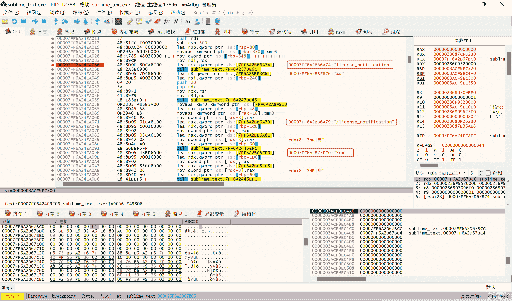

附件：[`win12.png`](https://www.52pojie.cn/forum.php?mod=attachment&aid=MjU4MTE1NXw1MTgwYWNlZHwxNzkzNTc0MTkyfDE2ODA4NnwxNzI5OTUw&nothumb=yes)（2022-12-24 16:08 上传）

同时发现使用假码注册后一段时间会重新变成未注册，怀疑也是网验，搜索字符串`"?n="`，果然还有一个`"/check/"`，干掉就行。

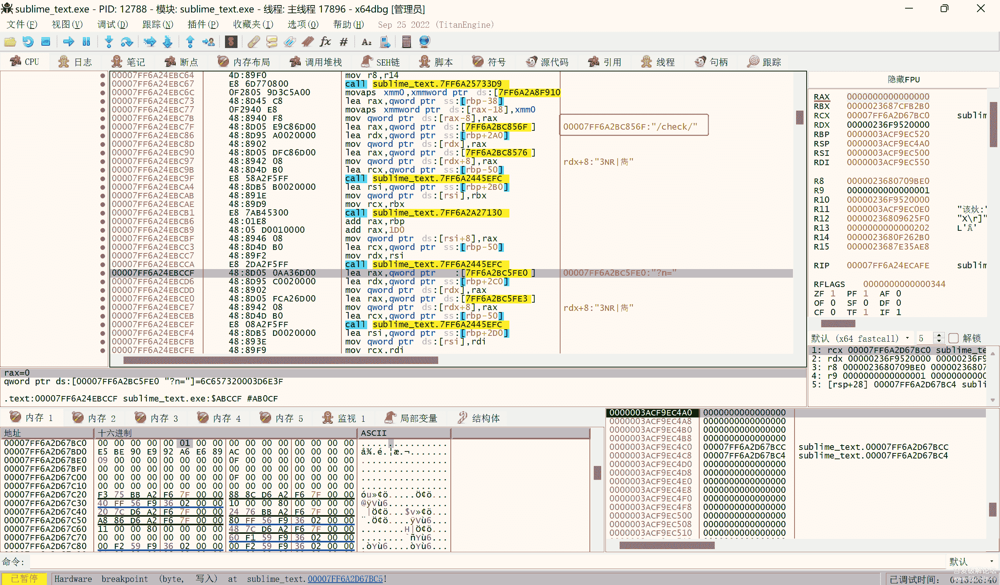

附件：[`win13.png`](https://www.52pojie.cn/forum.php?mod=attachment&aid=MjU4MTE1NnxmMDRjODY4ZXwxNzkzNTc0MTkyfDE2ODA4NnwxNzI5OTUw&nothumb=yes)（2022-12-24 16:09 上传）

### 修改方法

#### 1. 直接爆破（Sublime Merge 与之类似）

首先去掉网验。

直接将刚刚签名函数的返回值强制设为`1`即可。

即将函数的开头修补为：


```asm
mov eax,1
retn
```

然后输入任意符合格式的注册码即可。

## 4> 2.替换公钥，制作注册机

首先去掉网验。

用`openssl`生成一对`der`格式的公私钥（为了保证大小一致，`e`尽量也选`17`），用`winhex`将公钥全部异或`FD`，写入`sublime_text.exe`，然后还要注意程序由一处校验了`rsa`公钥的`sha256`的几位，将这些改成自己的公钥的`sha256`相应的几位即可。

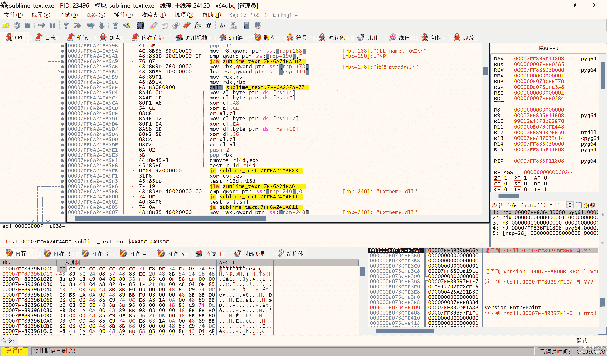

sha256.png (548.16 KB, 下载次数: 266)

[href="forum.php?mod=attachment&aid=MjU4MTE2NXxiOTk0NGU3ZXwxNzkzNTc0MTkyfDE2ODA4NnwxNzI5OTUw&nothumb=yes" target="_blank"](https://www.52pojie.cn/forum.php?mod=attachment&aid=MjU4MTE2NXxiOTk0NGU3ZXwxNzkzNTc0MTkyfDE2ODA4NnwxNzI5OTUw&nothumb=yes)

2022-12-24 17:21 上传

然后写个程序，将注册信息进行一个`sha1`的`rsa`签名即可（不能用中文用户名）。

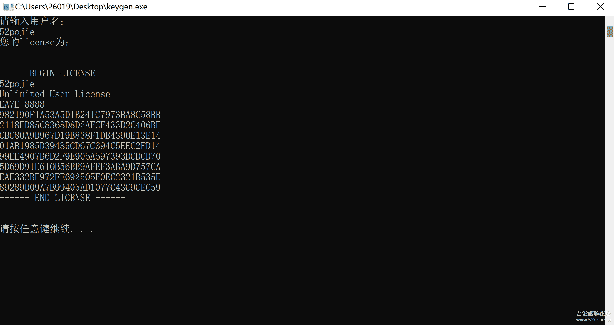

keygen.png (86.86 KB, 下载次数: 261)

[href="forum.php?mod=attachment&aid=MjU4MTE2NnwwNjgyMTg0YXwxNzkzNTc0MTkyfDE2ODA4NnwxNzI5OTUw&nothumb=yes" target="_blank"](https://www.52pojie.cn/forum.php?mod=attachment&aid=MjU4MTE2NnwwNjgyMTg0YXwxNzkzNTc0MTkyfDE2ODA4NnwxNzI5OTUw&nothumb=yes)

2022-12-24 17:24 上传

补个成功图（我看其他破解都不能显示`username`，以上两种方法均能显示`username`）：

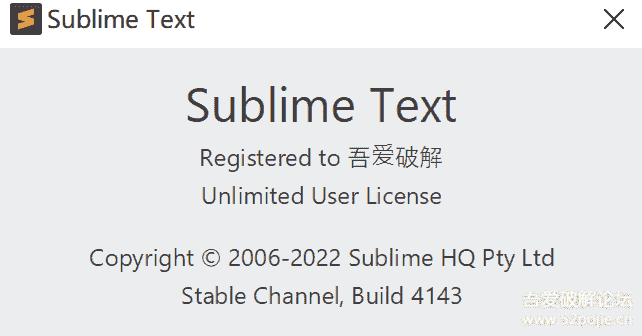

success.png (37.61 KB, 下载次数: 259)

[href="forum.php?mod=attachment&aid=MjU4MTE3N3wzOWJkOGVhMnwxNzkzNTc0MTkyfDE2ODA4NnwxNzI5OTUw&nothumb=yes" target="_blank"](https://www.52pojie.cn/forum.php?mod=attachment&aid=MjU4MTE3N3wzOWJkOGVhMnwxNzkzNTc0MTkyfDE2ODA4NnwxNzI5OTUw&nothumb=yes)

2022-12-24 19:02 上传
