# [Web逆向] 采用抓包的方式逆向获得谷歌翻译的API

- 原帖：`https://www.52pojie.cn/forum.php?mod=viewthread&tid=1730501`
- 抓取时间：`2026-11-01T23:03:13`

## 最开始的尝试

谷歌的翻译API老是发生变化，我们需要自己动手来找到谷歌的翻译API，这样才是最稳妥的解决方法。

首先，用谷歌浏览器打开谷歌的翻译界面，看一下它是怎么请求数据的。

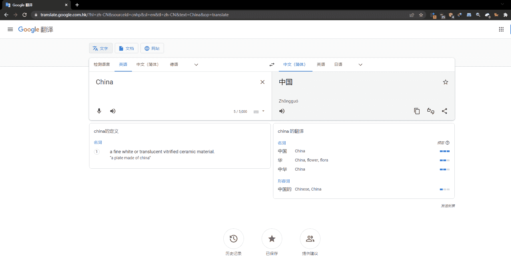

右键检查，进入开发者工具，选择网络（network），如图所示。

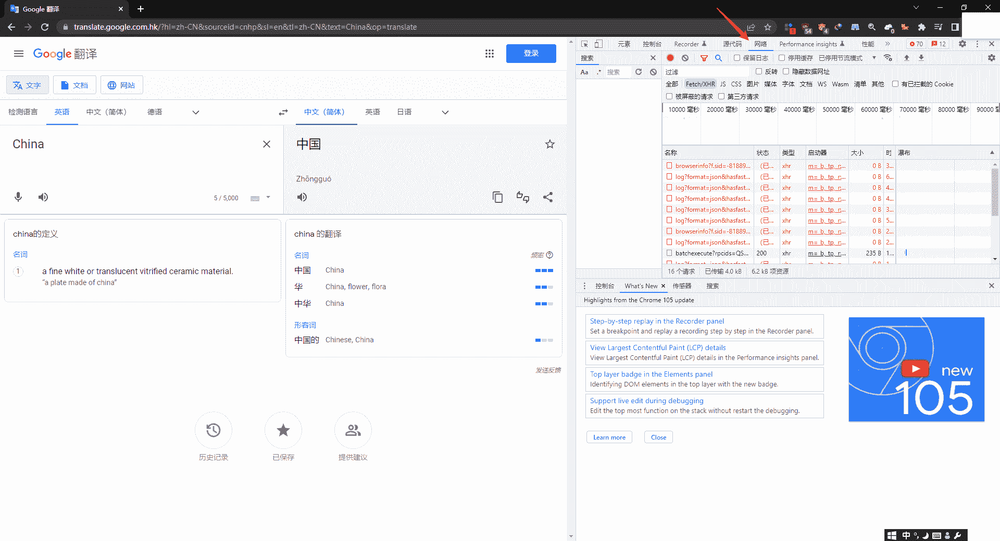

点击`clear`清除，把之前所有的请求视觉上清空，方便我们后续查找真正的API请求。

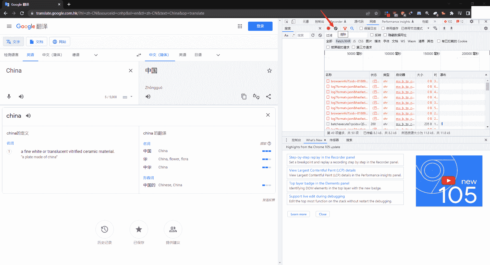

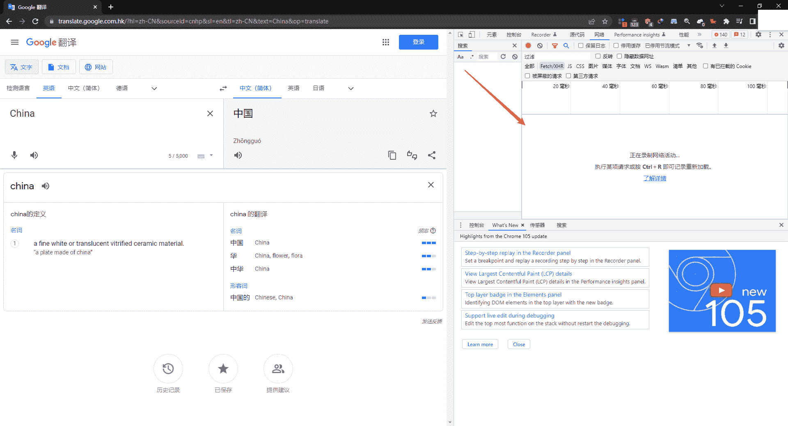

谷歌翻译大约每秒会请求一次，我们很快就可以得到谷歌服务器返回给我们的翻译结果，经过排查，下面的这个`batchexecute`开头的请求就是我们需要的。

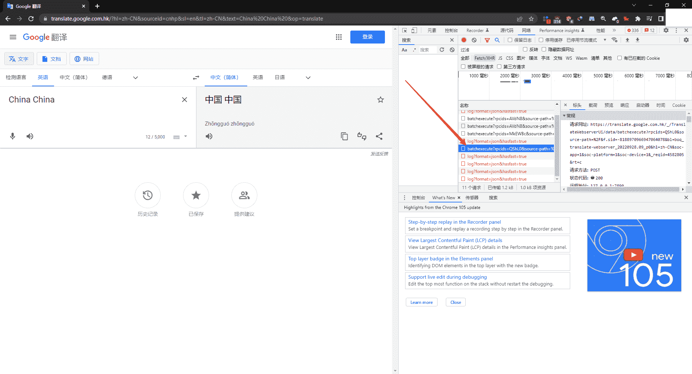

我们点开对其进行进一步分析，可以看到这是一个`post`的请求。

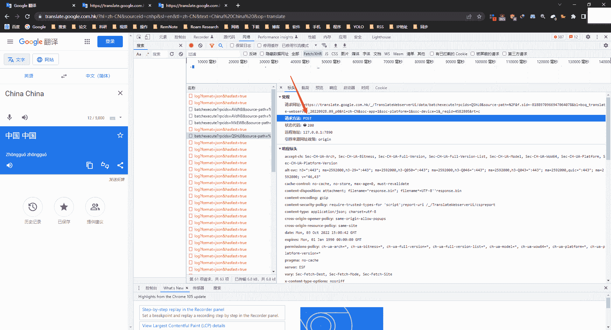

从载荷中可以看到发送`post`请求时使用的参数，是一个表单数据。

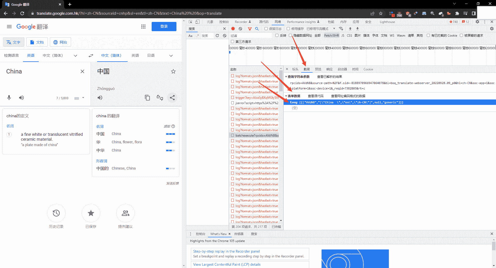

从预览中可以看到翻译的结果，是一个`JSON`格式的数据。

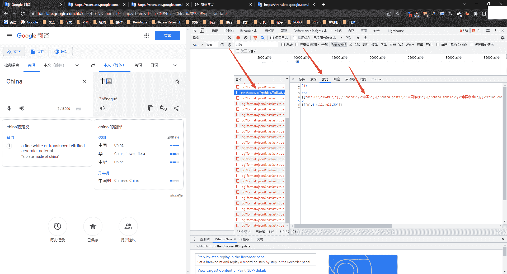

## 2022.12.26

上面的方法是适用的，只不过是现在这个接口没有以前好找了，我们使用谷歌搜索引擎上提供的谷歌翻译来找这个接口。

我们先在网页端测试一个翻译，可以看到这个结果反馈回来了。

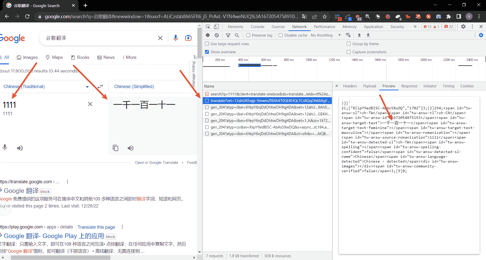

这是一个`post`请求，自己下一个网址发送自己需要翻译的文本，服务器就会给自己反馈回来对应的结果。

## 谷歌翻译API相关信息

### 发送网址

```
https://www.google.com/async/translate?vet=12ahUKEwjp-9mwmZf8AhXT0GEKHQc7Cs8QqDh6BAgFECw..i&ei=6YepY6njDdOhhwOH9qj4DA&yv=3&cs=0
```

这个网址虽然很长，但核心部分应该只是`https://www.google.com/async/translate`。后面的参数都是没有太大用处的，不过我们这里先做保留，之后再做精简验证。

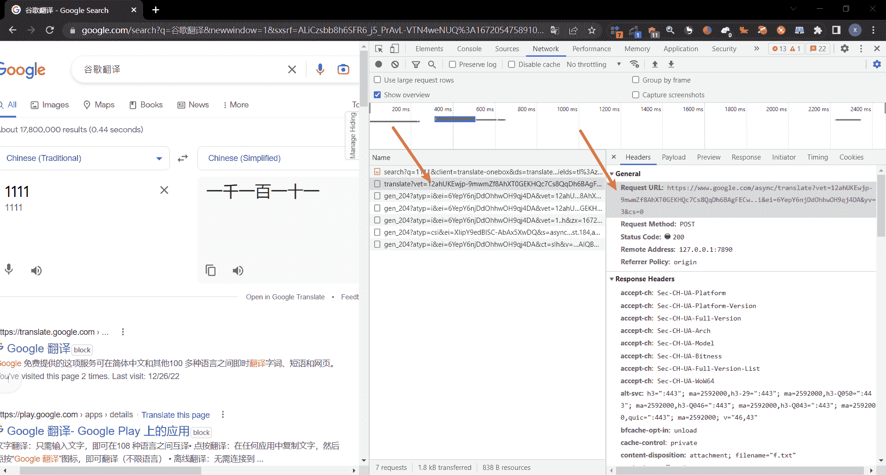

### 提交的数据

```
async=translate,sl:zh-TW,tl:zh-CN,st:1111,id:1672054875193,qc:true,ac:true,_id:tw-async-translate,_pms:s,_fmt:pc
```

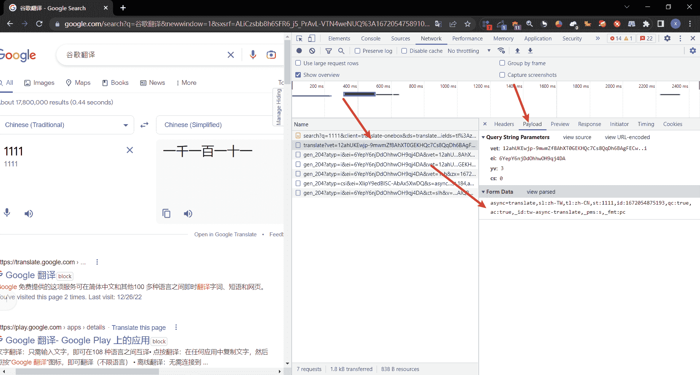

#### 使用 postman 构造请求

使用 postman 构造一个`post`的请求。

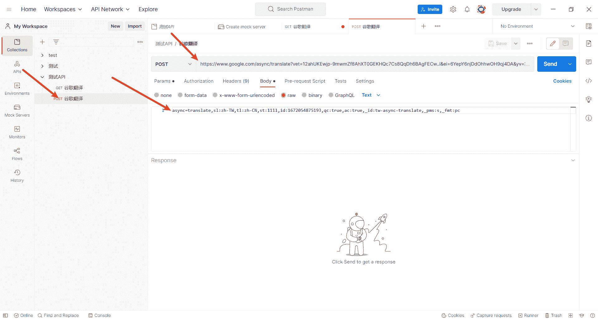

#### 不过不出意外的失败了

返回的是一个`404`的网页，而不是自己想要的翻译结果。

我猜测应该是没有添加`cookie`的关系，我们在参数里面添加一下`cookie`。但没想到添加`cookie`之后依然失败。

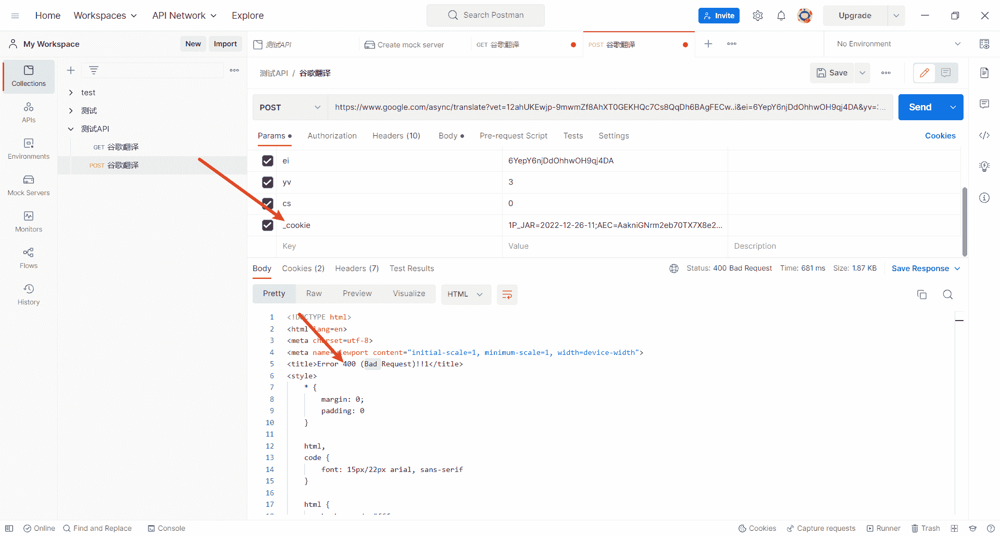

#### 实验

##### 去掉参数

将所有的参数去掉之后，发现仍然可以正常得到结果。

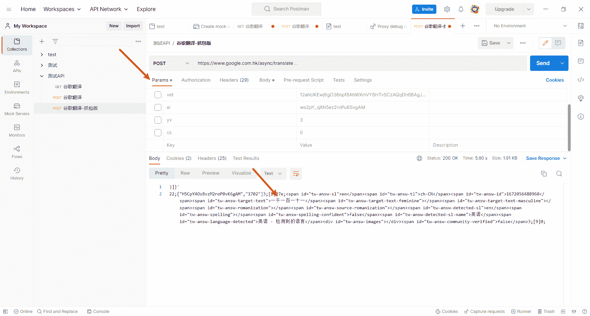

##### 去掉 Headers

去掉`Content-Length`之后就无法返回结果了 #设置的`headers`参数不够

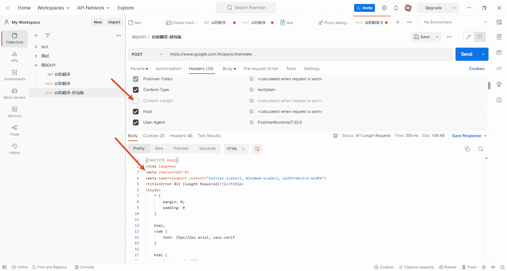

结论：`headers`里面的参数应该尽可能多一点，最好把原请求中的所有参数都带过来。

写成对应的 Python 代码。

###### 代码

```python
import requests

url = "https://www.google.com.hk/async/translate"

payload = "async=translate,sl:en,tl:zh-CN,st:1111,id:1672056488960,qc:true,ac:true,_id:tw-async-translate,_pms:s,_fmt:pc"

headers = {
    'sec-ch-ua': '"Not?A_Brand";v="8", "Chromium";v="108", "Google Chrome";v="108"',
    'DNT': '1',
    'sec-ch-ua-mobile': '?0',
    'User-Agent': 'Mozilla/5.0 (Windows NT 10.0; Win64; x64) AppleWebKit/537.36 (KHTML, like Gecko) Chrome/108.0.0.0 Safari/537.36',
    'sec-ch-ua-arch': '"x86"',
    'sec-ch-ua-full-version': '"108.0.5359.125"',
    'Content-Type': 'application/x-www-form-urlencoded;charset=UTF-8',
    'sec-ch-ua-platform-version': '"10.0.0"',
    'sec-ch-ua-full-version-list': '"Not?A_Brand";v="8.0.0.0", "Chromium";v="108.0.5359.125", "Google Chrome";v="108.0.5359.125"',
    'sec-ch-ua-bitness': '"64"',
    'sec-ch-ua-model': '',
    'sec-ch-ua-wow64': '?0',
    'sec-ch-ua-platform': '"Windows"',
    'Accept': '*/*',
    'X-Client-Data': 'CKW1yQEIhbbJAQiktskBCMS2yQEIqZ3KAQjb08oBCLD+ygEIlaHLAQjv8swBCN75zAEI5PrMAQjxgM0BCLKCzQEI7ILNAQjIhM0BCO+EzQEIt4XNAQ==',
    'Sec-Fetch-Site': 'same-origin',
    'Sec-Fetch-Mode': 'cors',
    'Sec-Fetch-Dest': 'empty',
    'host': 'www.google.com.hk',
    'Cookie': '1P_JAR=2022-12-26-12; NID=511=eVLI1bG9nhyOZtqU14JBHm5Be00epdxfR4XmfQeehYyIkzgpXi6dbpNY75ZMVyS7aOjoM2oZ5WdoR8eNq6wi1-e_J0NeoyI0dtsHW-_8Ik4PGrqvuGHdcvVC03zTOEK2TY1FZL85Wimo_ZPIE3hGIrmGPSiel6-rRRW9lD30UPs'
}

response = requests.request("POST", url, headers=headers, data=payload)

print(response.text)
```

可以正常返回我们现在的结果。

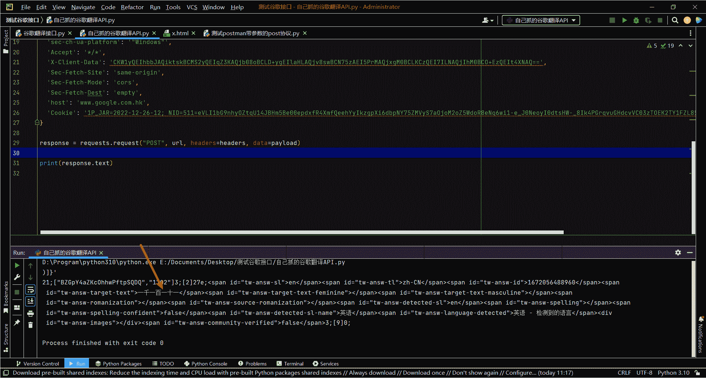

但这个结果还不是我们想要的，我们需要对其进行一并的解析。

##### 对返回结果进行解析

其实也很好定位，就是找到 和 之间的文本即可。

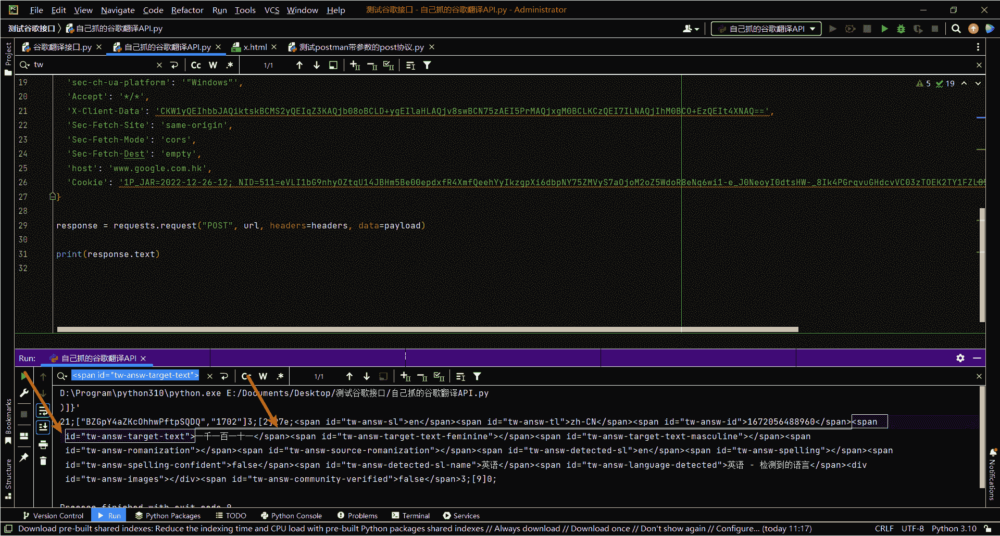

提取完之后非常nice。

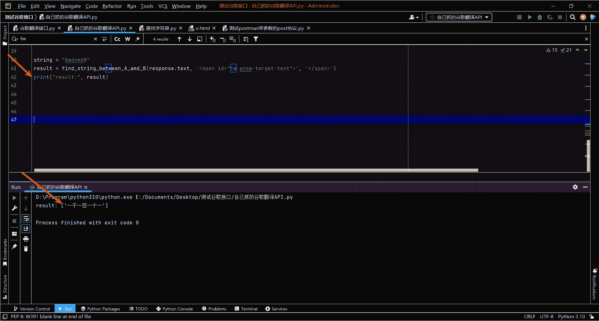

###### 完整代码


```
def Google_Translate(origin_string):
  import requests

  url = "https://www.google.com.hk/async/translate"

  payload = "async=translate,sl:en,tl:zh-CN,st:{},id:1672056488960,qc:true,ac:true,_id:tw-async-translate,_pms:s,_fmt:pc".format(origin_string)
  headers = {
    'sec-ch-ua': '"Not?A_Brand";v="8", "Chromium";v="108", "Google Chrome";v="108"',
    'DNT': '1',
    'sec-ch-ua-mobile': '?0',
    'User-Agent': 'Mozilla/5.0 (Windows NT 10.0; Win64; x64) AppleWebKit/537.36 (KHTML, like Gecko) Chrome/108.0.0.0 Safari/537.36',
    'sec-ch-ua-arch': '"x86"',
    'sec-ch-ua-full-version': '"108.0.5359.125"',
    'Content-Type': 'application/x-www-form-urlencoded;charset=UTF-8',
    'sec-ch-ua-platform-version': '"10.0.0"',
    'sec-ch-ua-full-version-list': '"Not?A_Brand";v="8.0.0.0", "Chromium";v="108.0.5359.125", "Google Chrome";v="108.0.5359.125"',
    'sec-ch-ua-bitness': '"64"',
    'sec-ch-ua-model': '',
    'sec-ch-ua-wow64': '?0',
    'sec-ch-ua-platform': '"Windows"',
    'Accept': '*/*',
    'X-Client-Data': 'CKW1yQEIhbbJAQiktskBCMS2yQEIqZ3KAQjb08oBCLD+ygEIlaHLAQjv8swBCN75zAEI5PrMAQjxgM0BCLKCzQEI7ILNAQjIhM0BCO+EzQEIt4XNAQ==',
    'Sec-Fetch-Site': 'same-origin',
    'Sec-Fetch-Mode': 'cors',
    'Sec-Fetch-Dest': 'empty',
    'host': 'www.google.com.hk',
    'Cookie': '1P_JAR=2022-12-26-12; NID=511=eVLI1bG9nhyOZtqU14JBHm5Be00epdxfR4XmfQeehYyIkzgpXi6dbpNY75ZMVyS7aOjoM2oZ5WdoR8eNq6wi1-e_J0NeoyI0dtsHW-_8Ik4PGrqvuGHdcvVC03zTOEK2TY1FZL85Wimo_ZPIE3hGIrmGPSiel6-rRRW9lD30UPs'
  }

  response = requests.request("POST", url, headers=headers, data=payload)

  def find_string_between_A_amd_B(string, string_A, string_B):  # 查找两段字符串之间的字符
    import re

    regular = '{}(.*?){}'.format(string_A, string_B)
    result = re.findall(regular, string)
    return result

  result = find_string_between_A_amd_B(response.text, '', '')
  return result

result = Google_Translate('222')
print("result:", result)
```

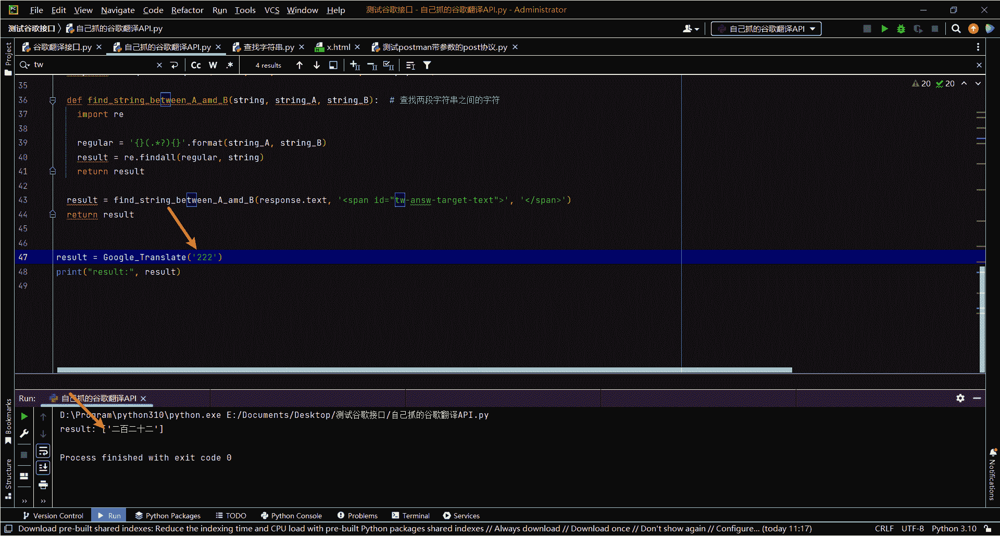

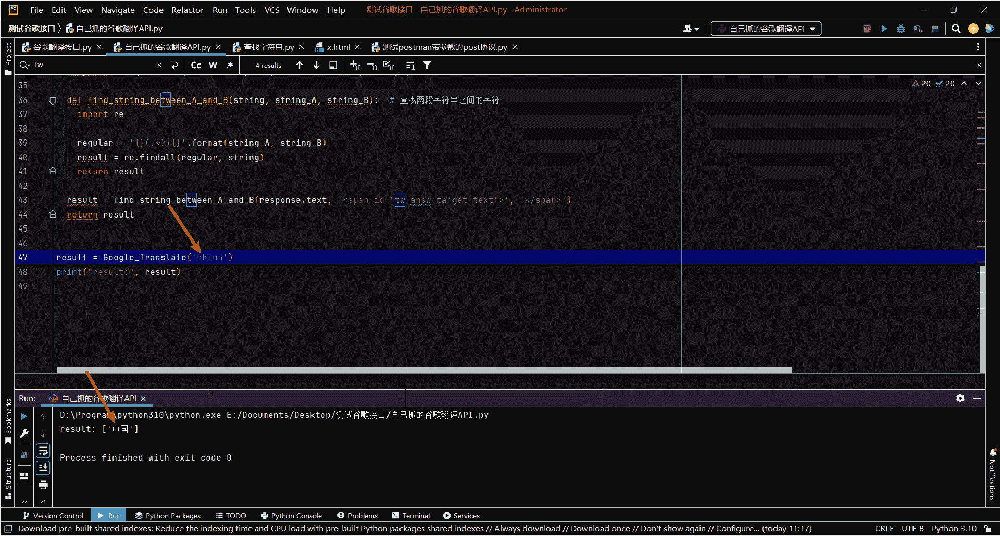
