# [原创] IDA PRO 进行高通 `PackageManager` 破解思路学习分享

- 原帖：https://www.52pojie.cn/forum.php?mod=viewthread&tid=1730504
- 抓取时间：2026-11-01T23:03:11

## 目标与范围

高通 `PackageManager` 是高通公司发布新工具，进行 license 分发、激活、去激活。账号登录的重要工具。本帖子将从如下几个角度定制属于自己的 Package Manager。

1. 自动登录
2. 去除隔一段时间必须重新输入账号和密码登录限制
3. 解除所有软件下载时候的 license 限制，也就是可以下载所有高通的软件。

本帖子只给出主要的思路，由于涉及到商业版权，不提供任何成品软件。仅仅供学习。

## 自动登录与重试间隔

找到任何和重试相关的语句，把重试的间隔设置为非常大

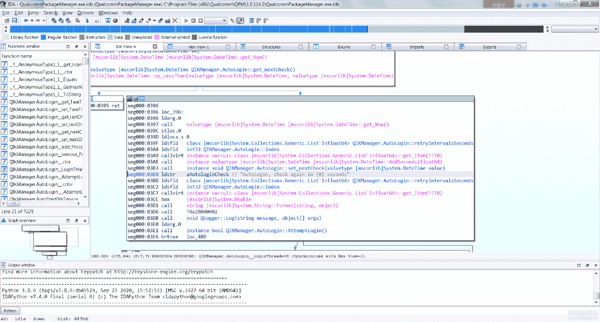

附件：[下载](https://www.52pojie.cn/forum.php?mod=attachment&aid=MjU4MTQxNHw4OWI2ZmNjZXwxNzkzNTc0MTg5fDE2ODA4NnwxNzMwNTA0&nothumb=yes)（2022-12-26 20:30 上传）

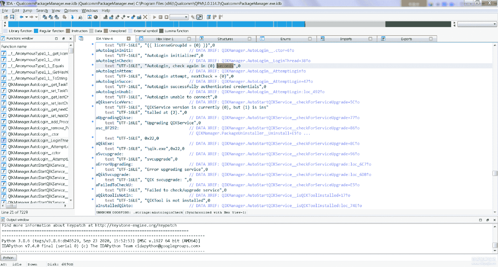

附件：[下载](https://www.52pojie.cn/forum.php?mod=attachment&aid=MjU4MTQxNXxhYTE4OTMwMXwxNzkzNTc0MTg5fDE2ODA4NnwxNzMwNTA0&nothumb=yes)（2022-12-26 20:31 上传）

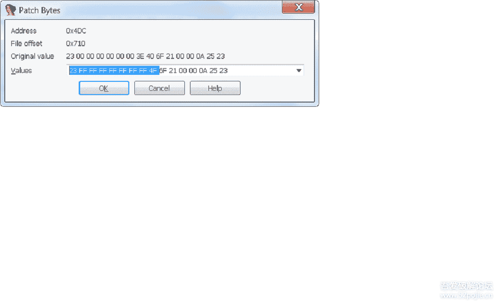

附件：[下载](https://www.52pojie.cn/forum.php?mod=attachment&aid=MjU4MTQxNnw0NWEyYmIwMHwxNzkzNTc0MTg5fDE2ODA4NnwxNzMwNTA0&nothumb=yes)（2022-12-26 20:33 上传）

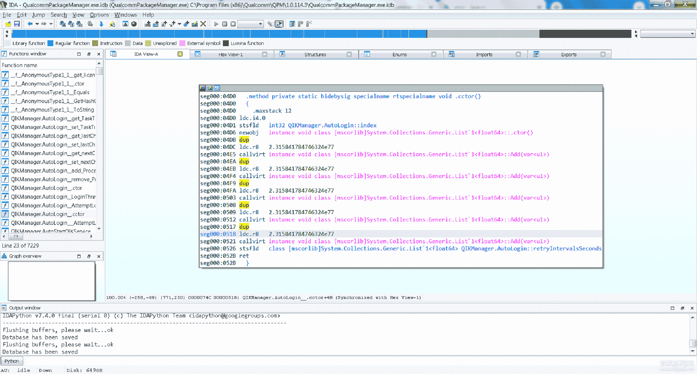

附件：[下载](https://www.52pojie.cn/forum.php?mod=attachment&aid=MjU4MTQxN3w5YzRlNTE3OXwxNzkzNTc0MTg5fDE2ODA4NnwxNzMwNTA0&nothumb=yes)（2022-12-26 20:33 上传）

## 禁用 `License check` 相关函数

禁用掉 `License check` 相关的函数功能

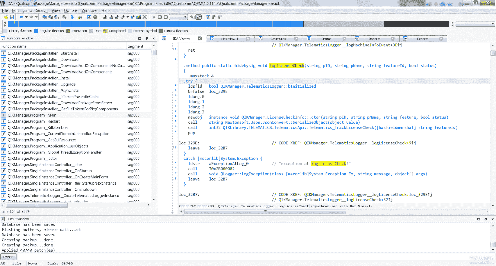

附件：[下载](https://www.52pojie.cn/forum.php?mod=attachment&aid=MjU4MTQxOHxjNzRmYTc3OXwxNzkzNTc0MTg5fDE2ODA4NnwxNzMwNTA0&nothumb=yes)（2022-12-26 20:34 上传）

`nop` 掉如下语句

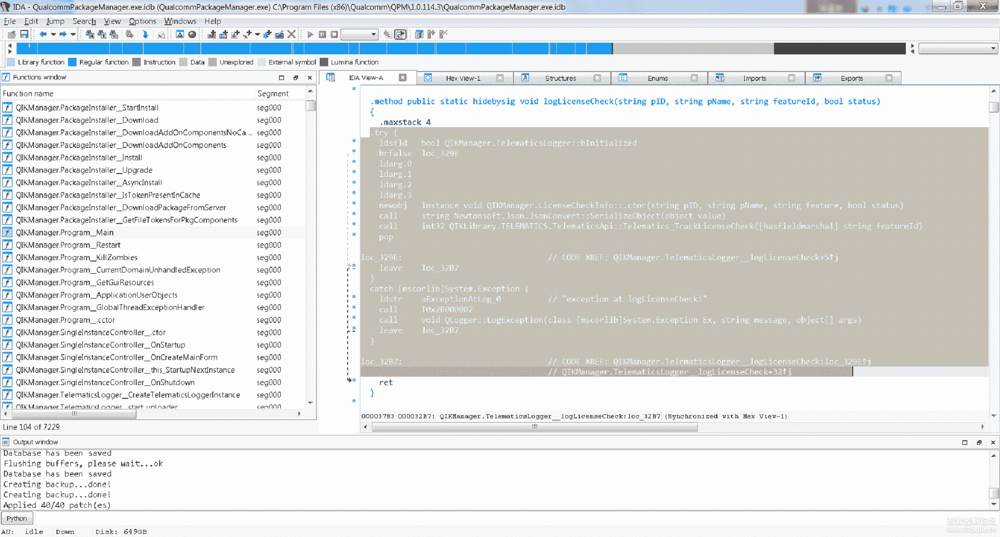

附件：[下载](https://www.52pojie.cn/forum.php?mod=attachment&aid=MjU4MTQyMHw1YTlkYmM1NXwxNzkzNTc0MTg5fDE2ODA4NnwxNzMwNTA0&nothumb=yes)（2022-12-26 20:36 上传）

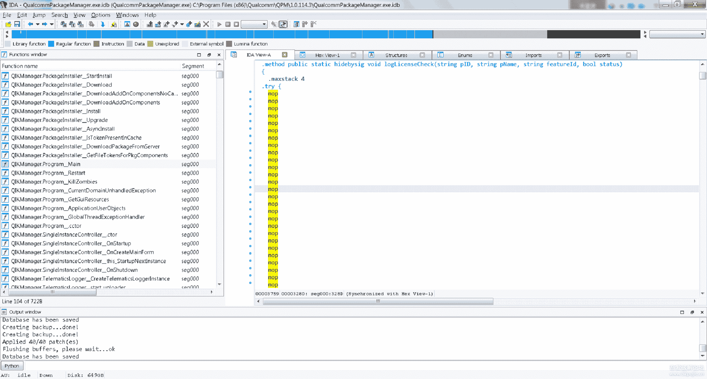

附件：[下载](https://www.52pojie.cn/forum.php?mod=attachment&aid=MjU4MTQyMXw1YzNmZmFlNHwxNzkzNTc0MTg5fDE2ODA4NnwxNzMwNTA0&nothumb=yes)（2022-12-26 20:37 上传）

然后 `nop` 掉 `verifylicense()` 线程函数

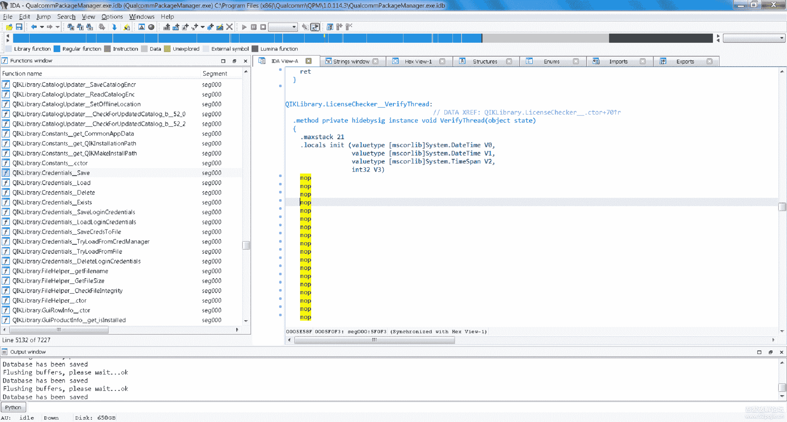

附件：[下载](https://www.52pojie.cn/forum.php?mod=attachment&aid=MjU4MTQyM3w0MmMyMWMxY3wxNzkzNTc0MTg5fDE2ODA4NnwxNzMwNTA0&nothumb=yes)（2022-12-26 20:39 上传）

## 解除软件下载 license 限制

下面解除所有软件的下载 license 限制。

搜索如下关键词

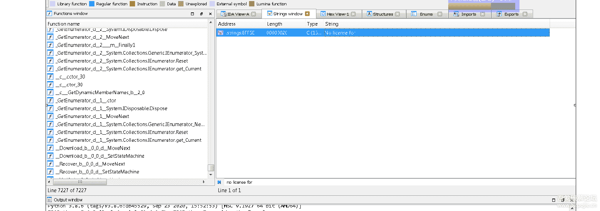

附件：[下载](https://www.52pojie.cn/forum.php?mod=attachment&aid=MjU4MTQyNnwxOTBjMTA1ZXwxNzkzNTc0MTg5fDE2ODA4NnwxNzMwNTA0&nothumb=yes)（2022-12-26 20:43 上传）

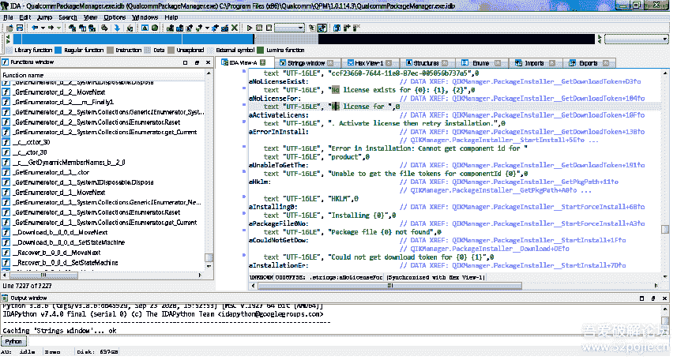

附件：[下载](https://www.52pojie.cn/forum.php?mod=attachment&aid=MjU4MTQyN3wxZGVkMDMwY3wxNzkzNTc0MTg5fDE2ODA4NnwxNzMwNTA0&nothumb=yes)（2022-12-26 20:44 上传）

可见这下面有一个关键性的分支来判断 license 有效就下载，无效就报错。在这里把这个分支判断给干掉。

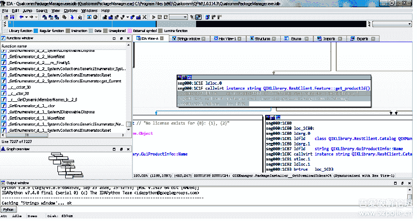

附件：[下载](https://www.52pojie.cn/forum.php?mod=attachment&aid=MjU4MTQyOHw0ZjgxNWJlNXwxNzkzNTc0MTg5fDE2ODA4NnwxNzMwNTA0&nothumb=yes)（2022-12-26 20:45 上传）

那么这样下载所有软件前都不会做 license 限制。

将如下代码 `nop` 掉。并用 `idc.i4.1(0x17)` 作为最后一个指令，这样的意思就是永远判断为真。

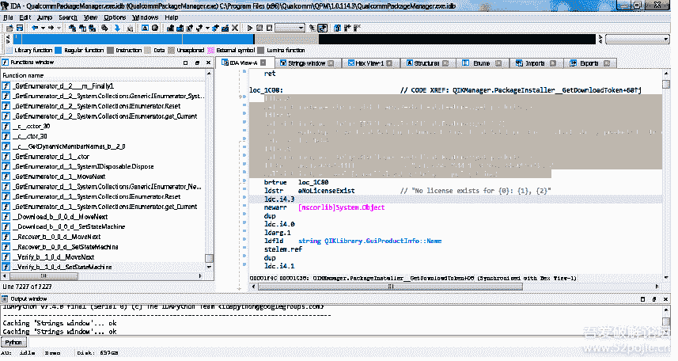

附件：[下载](https://www.52pojie.cn/forum.php?mod=attachment&aid=MjU4MTQyOXw5ODhkOWM0ZXwxNzkzNTc0MTg5fDE2ODA4NnwxNzMwNTA0&nothumb=yes)（2022-12-26 20:47 上传）

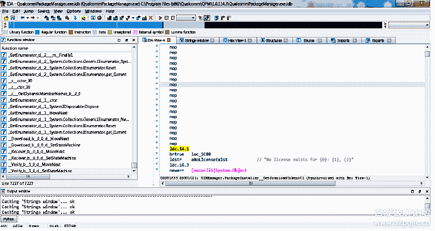

附件：[下载](https://www.52pojie.cn/forum.php?mod=attachment&aid=MjU4MTQzMHw1MDY1ZGIzYnwxNzkzNTc0MTg5fDE2ODA4NnwxNzMwNTA0&nothumb=yes)（2022-12-26 20:48 上传）

至此，所有的软件下载限制已经清除。

## 禁用自动去激活 license 机制

下面禁用掉高通的过段时间自动去激活 license 的机制。

搜索如下关键词

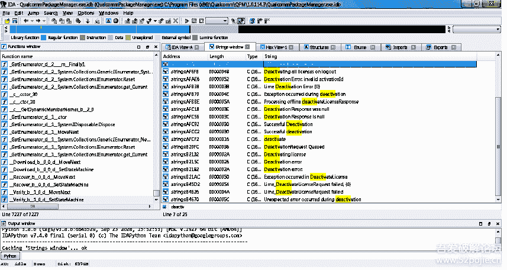

附件：[下载](https://www.52pojie.cn/forum.php?mod=attachment&aid=MjU4MTQzMnwwNzk0MTJjY3wxNzkzNTc0MTg5fDE2ODA4NnwxNzMwNTA0&nothumb=yes)（2022-12-26 20:50 上传）

找到如下函数

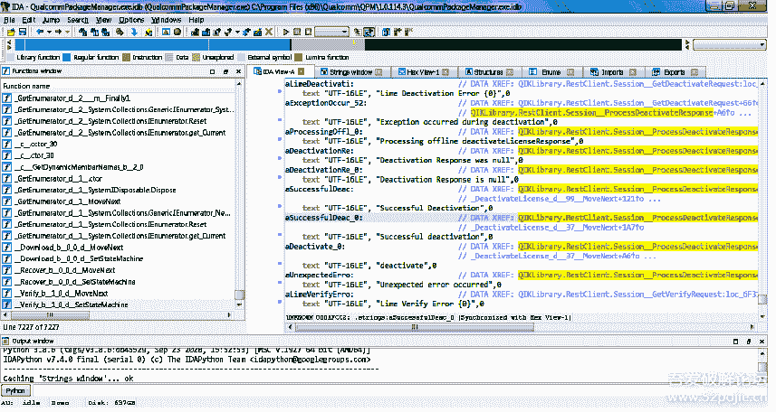

附件：[下载](https://www.52pojie.cn/forum.php?mod=attachment&aid=MjU4MTQzNXwxYWRiNTBjYXwxNzkzNTc0MTg5fDE2ODA4NnwxNzMwNTA0&nothumb=yes)（2022-12-26 20:52 上传）

把如下函数的主要功能 `nop` 掉。

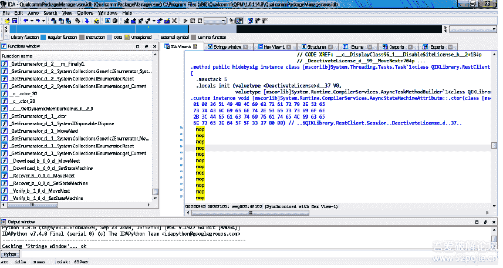

附件：[下载](https://www.52pojie.cn/forum.php?mod=attachment&aid=MjU4MTQzN3xkNDNhNDgwM3wxNzkzNTc0MTg5fDE2ODA4NnwxNzMwNTA0&nothumb=yes)（2022-12-26 20:53 上传）

这样的话，哪怕你手动去激活 license 都无法去激活。这样就做到了只能激活，无法去激活。
