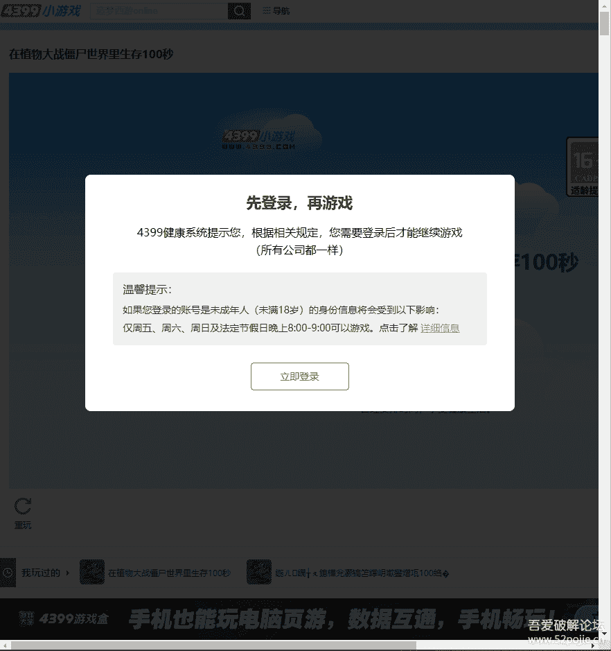
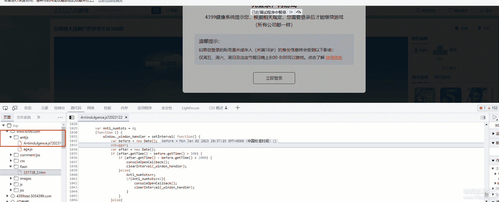
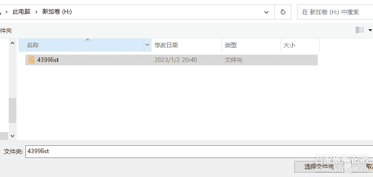
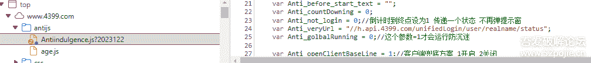
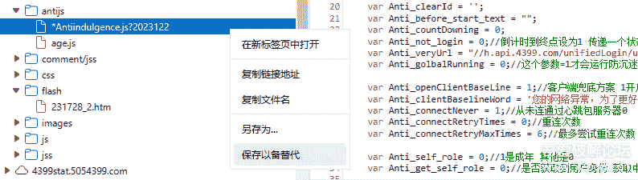

# [Web逆向] 某页游防沉迷通过本地替换破解

- 原帖：<https://www.52pojie.cn/forum.php?mod=viewthread&tid=1732410>
- 抓取时间：2026-11-01T23:03:06

某页游之前的防沉迷弹窗可以通过审查元素直接删除。

但今天游玩发现新增了检测：打开开发者工具会暂停页面，关闭后会刷新页面。

通过源代码分析 `js`，注释却是异常的简单，可以无脑直接修改了。

## 破解过程

`33558df73b5e1f4b9d6592b7941431c.png`（147.78 KB，下载次数：0）｜[附件下载](https://www.52pojie.cn/forum.php?mod=attachment&aid=MjU4MjU1NHxkYWRlNGM1Y3wxNzkzNTc0MTgzfDE2ODA4NnwxNzMyNDEw&nothumb=yes)｜2023-1-2 21:13 上传

### 打开开发者工具

我们打开开发者工具。

`846e0e17747539eaef6de75e7c61764.png`（165.3 KB，下载次数：0）｜[附件下载](https://www.52pojie.cn/forum.php?mod=attachment&aid=MjU4MjU1Nnw1MzdlM2JkNXwxNzkzNTc0MTgzfDE2ODA4NnwxNzMyNDEw&nothumb=yes)｜2023-1-2 21:14 上传

### 定位 `Antiindulgence.js`

`antijs` 目录下 `Antiindulgence.js` 文件，上滑该文件。

`e0a99df8b448d278d3bc48107421292.png`（53.71 KB，下载次数：0）｜[附件下载](https://www.52pojie.cn/forum.php?mod=attachment&aid=MjU4MjU1N3w1OGQzODFkOXwxNzkzNTc0MTgzfDE2ODA4NnwxNzMyNDEw&nothumb=yes)｜2023-1-2 21:14 上传

### 直接本地替换

注释写的非常清楚，第 25 行就是需要修改的东西。对于这种修改那就很好办了，直接本地替换。

在控制台选择“覆盖”，如图所示点击。

`6220199c5baeb5a43db837bf7915d05.png`（11.03 KB，下载次数：0）｜[附件下载](https://www.52pojie.cn/forum.php?mod=attachment&aid=MjU4MjU1OXw1ZTEyOTQwM3wxNzkzNTc0MTgzfDE2ODA4NnwxNzMyNDEw&nothumb=yes)｜2023-1-2 21:15 上传

然后本地预留一个用于替换的目录。

`b831e675a38fb91a6d0882a8c80c70d.png`（21.43 KB，下载次数：0）｜[附件下载](https://www.52pojie.cn/forum.php?mod=attachment&aid=MjU4MjU2MXw0ZDQ3NTRiN3wxNzkzNTc0MTgzfDE2ODA4NnwxNzMyNDEw&nothumb=yes)｜2023-1-2 21:15 上传

浏览器顶部会弹出授权，允许即可。

`e3b28806d78127abd62cf1da268cb0a.png`（11.56 KB，下载次数：0）｜[附件下载](https://www.52pojie.cn/forum.php?mod=attachment&aid=MjU4MjU2Mnw4ZDU4MWU0OHwxNzkzNTc0MTgzfDE2ODA4NnwxNzMyNDEw&nothumb=yes)｜2023-1-2 21:16 上传

### 修改第 25 行

之后我们只需要将第 25 行改成 `=0`。

`e222b11225bc8b0f00816341215fc07.png`（26.92 KB，下载次数：0）｜[附件下载](https://www.52pojie.cn/forum.php?mod=attachment&aid=MjU4MjU2M3xjMTc0MTk0MHwxNzkzNTc0MTgzfDE2ODA4NnwxNzMyNDEw&nothumb=yes)｜2023-1-2 21:16 上传

右键该文件保存。

`捕获.PNG`（47.67 KB，下载次数：0）｜[附件下载](https://www.52pojie.cn/forum.php?mod=attachment&aid=MjU4MjU2NHxlNDAyMDkzOHwxNzkzNTc0MTgzfDE2ODA4NnwxNzMyNDEw&nothumb=yes)｜2023-1-2 21:17 上传

### 刷新验证

之后再次刷新页面，会发现游戏可以正常进入了。

`35cdb373fcdd68abcb268bbf465b024.png`（991.05 KB，下载次数：0）｜[附件下载](https://www.52pojie.cn/forum.php?mod=attachment&aid=MjU4MjU2Nnw3MTNmNjFiMnwxNzkzNTc0MTgzfDE2ODA4NnwxNzMyNDEw&nothumb=yes)｜2023-1-2 21:17 上传

选择其他游戏时如果也弹出防沉迷，只需要再次调出控制台窗口，重新刷新页面就可以正常进入了。
