# [原创] 采用 IDA Pro 分析 878UVII radio 对讲机固件初步研究

- 原帖：<https://www.52pojie.cn/forum.php?mod=viewthread&tid=1732800>
- 抓取时间：2026-11-01T23:02:56

ANYTONE 878 对讲机的固件没有经过任何加密，作为 ARM 固件的初步入门分析相对较简单。本帖原始固件详见附件。

[固件附件](https://www.52pojie.cn/forum.php?mod=attachment&aid=MjU4MjgxOXwzZDcwMGMwY3wxNzkzNTc0MTc0fDE2ODA4NnwxNzMyODAw)（545.53 KB）

此固件包含三个文件，其中 `.CDD` 文件是重点分析的固件文件。

ANYTONE 878 采用 GigaDevice GD32 ARM Cortex-M4 处理器。处理器的技术文件规范可从 <https://www.gigadevice.com/zh-hans/microcontroller/gd32f303vgt6/> 下载。

## 将固件加载到 IDA Pro

将 `CDD` 文件拖入 IDA Pro，可见此时 IDA 无法识别具体格式，需要人为辅助 IDA。

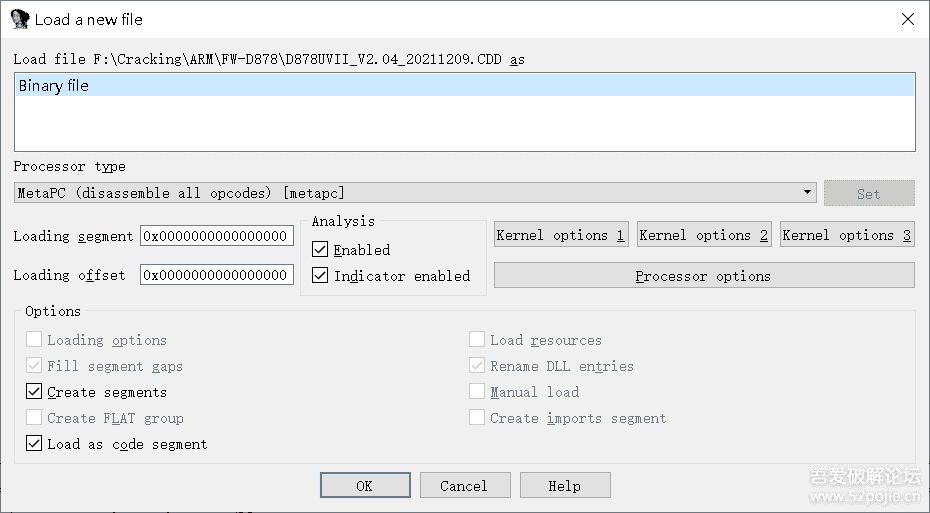

`Processor type` 选择 `ARM little-endian`。

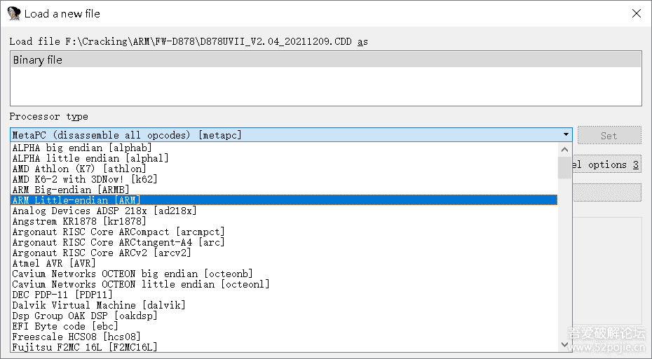

点击 `set` 按钮调出如下对话框。

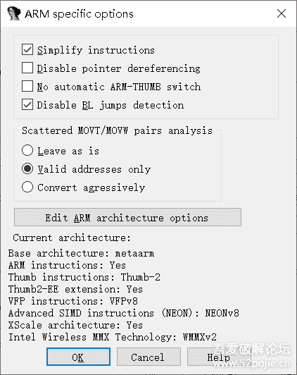

点击 `edit ARM architecture options`。

由于这款 CPU 基于 ARMv7E-M，进行如下选择：

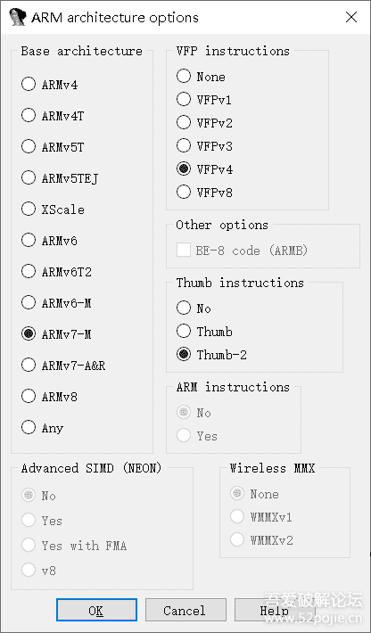

点击 OK，再勾选 `No automatic ARM THUMB switching`。

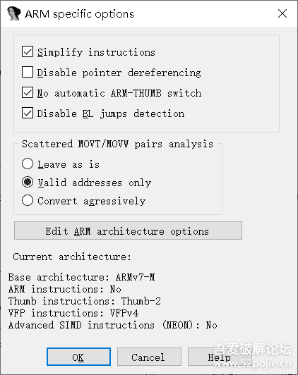

点击 OK，基本完成了 `load` 选项。点击 OK，弹出如下窗口。

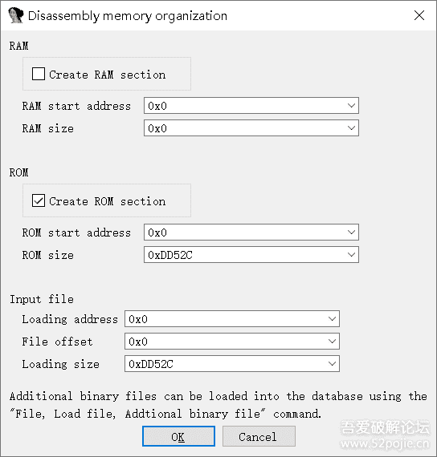

## 设置 ROM/RAM 映射

根据 `DATASHEET` 文档，可获知如下信息：

这款 ARM CPU 要求的 `image` 起始地址是 `0x8004000`。这是映射到物理 ROM 的地址。所以固件地址从这里开始映射。

RAM 开始于 `0x20000000`，大小是 `0x17FFF`。

上方对话框更改相关数据如下：

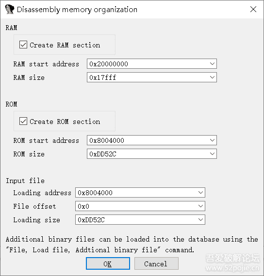

点击 OK。出现这个对话框，再点击 OK。

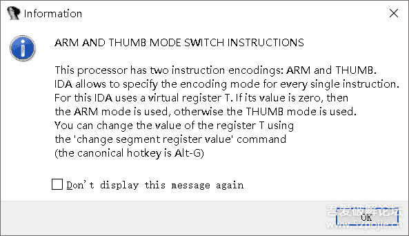

## 分析 Reset Handler

固件初始被 `load` 之后的样子大概如下图。可见 IDA 的自动分析结果非常糟糕，根本看不出什么有用的指令信息。

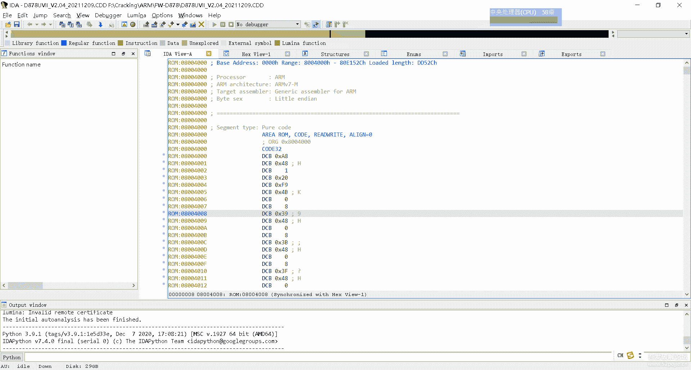
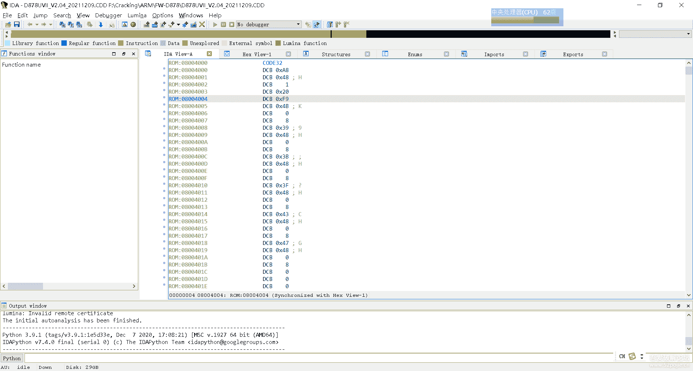

如何协助 IDA，需要阅读规范。如下图所示，根据规范，`offset 0x0000 (0x08004000)` 包含 `initial stack pointer`，CPU 会将接下来的 4 个字节读取后作为未来 stack 的指针。

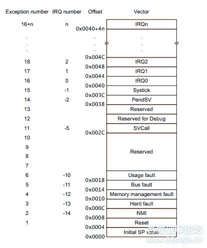

接下来 4 个字节叫做 `Reset Handler`，这是一个非常重要的地方。CPU 进行 boot 或 reboot 时都会 jump 到这里的 handler。

把前几个字节都转换为 `DWORD`，和上面的表对应如下。

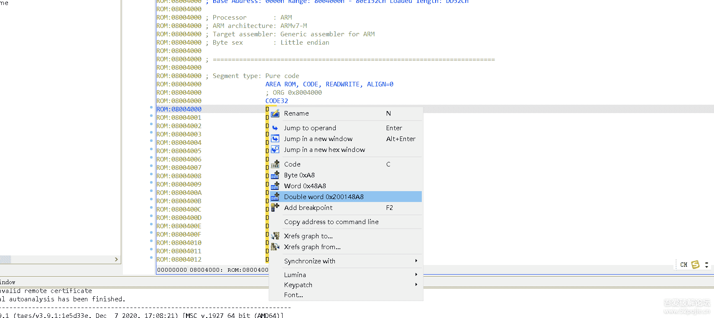

添加注释如下：

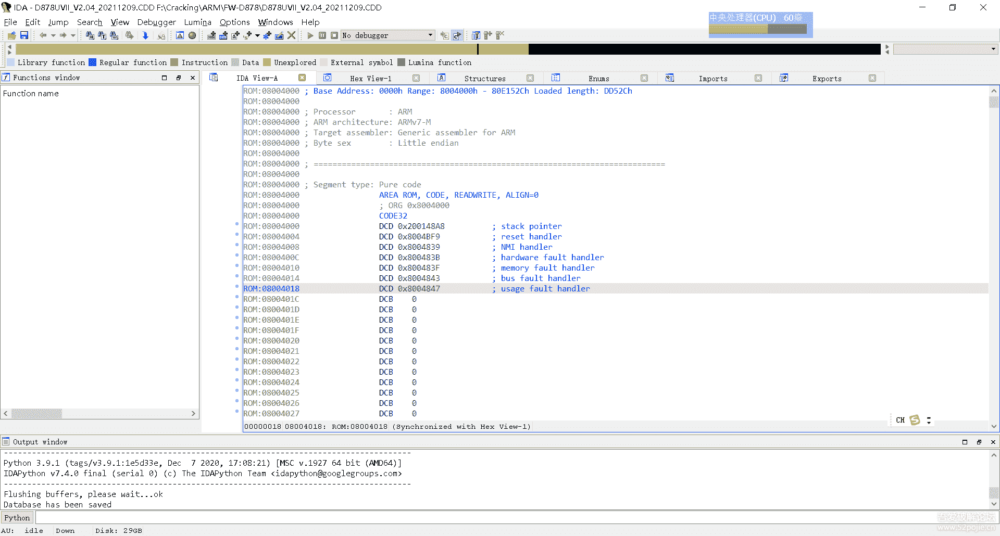

根据 ARM 规范，当 `reset handler` 最低位是 1 时，需要采用 Thumb 指令集。

`0xF9` 转换二进制为 `11111001b`，最低位是 1，是 Thumb。

双击这个地址，跳转到如下位置。由于最低位是 Thumb 指示，实际地址还要再减去 1，也就是将光标放在 `ROM:08004BF8` 位置。

按下 `ALT+G`，设置如下：

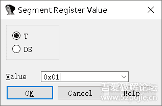

点击 OK，再按下 `C`。

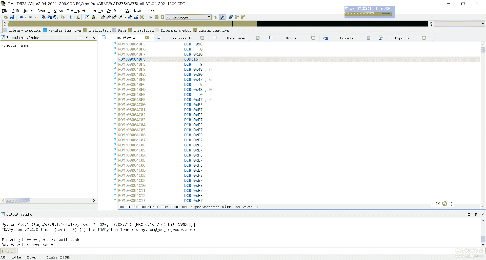

我们可以看到有有效的指令出来了，这是 reset handler 的指令部分。

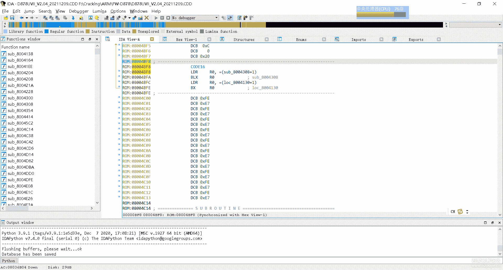
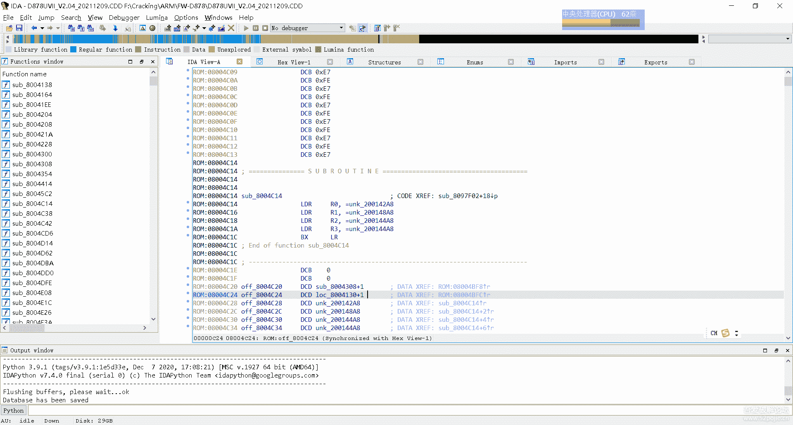

按下 `SHIFT+F12` 键，可以看到有很多有意义的字符串也被解析出来。

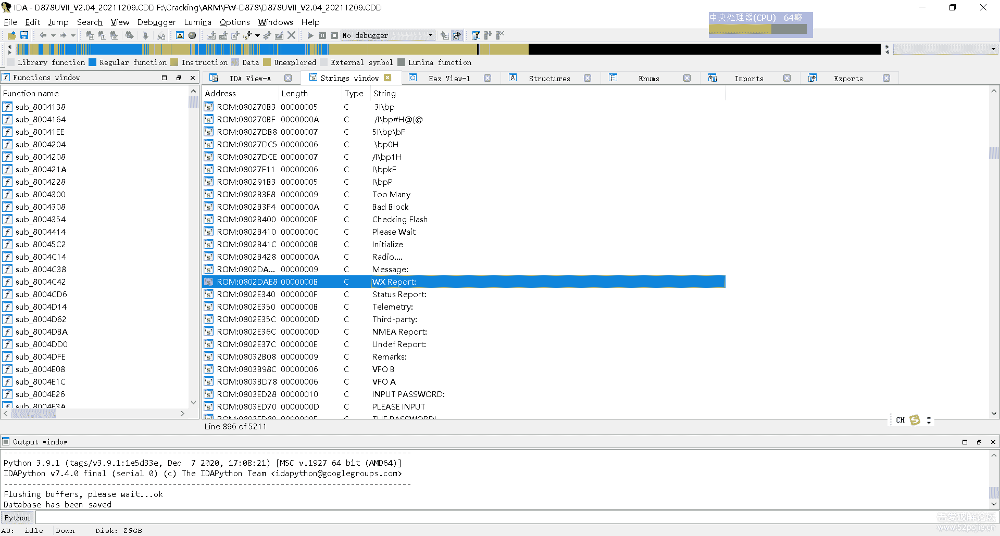

`image.png` (116.66 KB, 下载次数: 0)

[href="forum.php?mod=attachment&aid=MjU4MjgzOXwxMzYwYWMxZXwxNzkzNTc0MTc0fDE2ODA4NnwxNzMyODAw&nothumb=yes" target="_blank"](https://www.52pojie.cn/forum.php?mod=attachment&aid=MjU4MjgzOXwxMzYwYWMxZXwxNzkzNTc0MTc0fDE2ODA4NnwxNzMyODAw&nothumb=yes)

2023-1-3 23:55 上传

至此，采用IDA进行这款固件解析工作的入门操作就完成了。后续就可以按部就班达到开展其他感兴趣的分析了。
