# [MacOS逆向] 浅析AirBuddy 2.6.3 (602)
- 原帖: https://www.52pojie.cn/forum.php?mod=viewthread&tid=1733144
- 抓取时间: 2026-11-01T23:02:50

## 浅析AirBuddy 2.6.3 (602)

### 0x00 版规限制
论坛真不让上传商业软件pj成品, 这里只发学习版的二进制文件。
可以学习但不要传播。
伸手党能帮你的只能到这里了，别问为什么没有成品。请各位支持正版！
你问我支不支持正版？你问我资瓷不资瓷那我肯定还是资瓷的。
声明: 版禁果，然皆附。故贴此，助正宜。

[href="forum.php?mod=attachment&aid=MjU4MzAxN3xkZmQ1N2I4NnwxNzkzNTc0MTY3fDE2ODA4NnwxNzMzMTQ0" target="_blank"](https://www.52pojie.cn/forum.php?mod=attachment&aid=MjU4MzAxN3xkZmQ1N2I4NnwxNzkzNTc0MTY3fDE2ODA4NnwxNzMzMTQ0)
(522.71 KB, 下载次数: 54)
2023-1-4 23:07 上传
点击文件名下载附件
下载积分: 吾爱币 -1 CB

### 0x01 灵根孕育大道生 只因黑子逞英雄
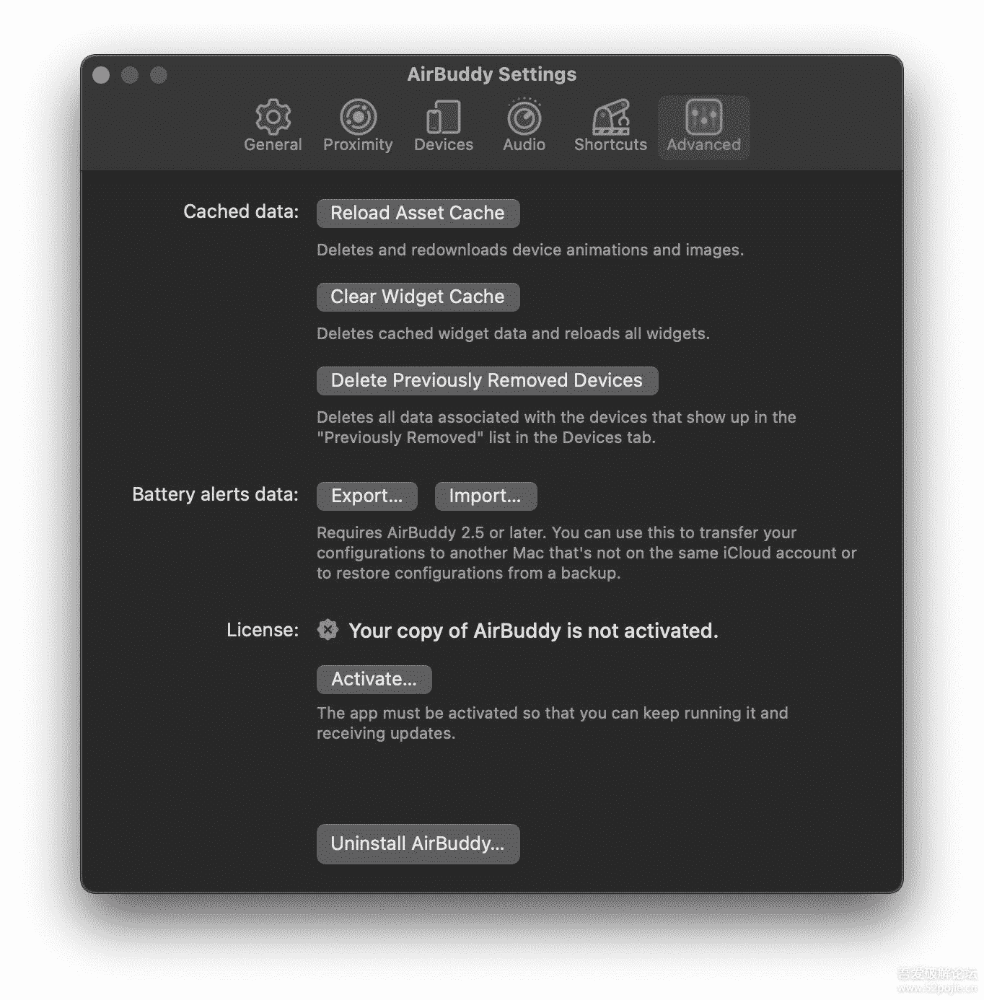
16728331804374.jpg (145.75 KB, 下载次数: 1)
[href="forum.php?mod=attachment&aid=MjU4MzAxOHw3ZjM0NjU3N3wxNzkzNTc0MTY3fDE2ODA4NnwxNzMzMTQ0&nothumb=yes" target="_blank"](https://www.52pojie.cn/forum.php?mod=attachment&aid=MjU4MzAxOHw3ZjM0NjU3N3wxNzkzNTc0MTY3fDE2ODA4NnwxNzMzMTQ0&nothumb=yes)
2023-1-4 23:10 上传
开幕给你一个小小的授权震撼。
在我的HuaweiBook Pro 16in-ch上运行如图所示。

### 0x02 正版暗藏关键语 落叶明察二进制
老样子先找破解点。
然而我根本搜不到字符串内容，所以只能乱搜一气试试看了。
由于`IDA`对原生`Mach-O`支持并不好 所以我这里用`Hopper Dissembler`看伪代码：
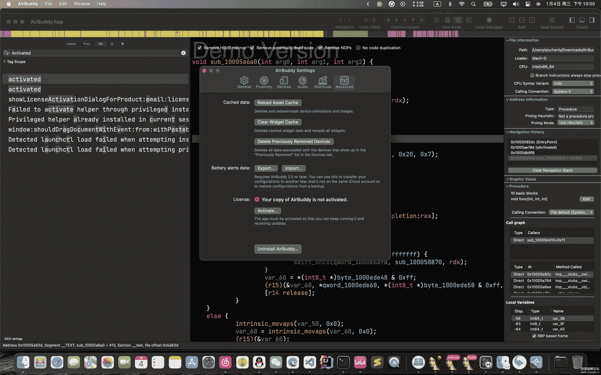
16728408980575.jpg (740.79 KB, 下载次数: 2)
[href="forum.php?mod=attachment&aid=MjU4MzAxOXxiYjY2ZmZlYnwxNzkzNTc0MTY3fDE2ODA4NnwxNzMzMTQ0&nothumb=yes" target="_blank"](https://www.52pojie.cn/forum.php?mod=attachment&aid=MjU4MzAxOXxiYjY2ZmZlYnwxNzkzNTc0MTY3fDE2ODA4NnwxNzMzMTQ0&nothumb=yes)
2023-1-4 23:10 上传
搜索了`activated`关键字符串看看有没有什么发现：
可以看到运气很好有两个字符串引用 但是暂时不知道他们干嘛的，选择第一个看下
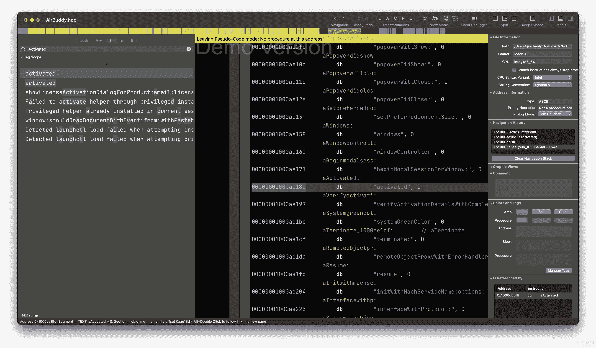
16728409591911.jpg (762.92 KB, 下载次数: 1)
[href="forum.php?mod=attachment&aid=MjU4MzAyMHxjYWJiZjE5YXwxNzkzNTc0MTY3fDE2ODA4NnwxNzMzMTQ0&nothumb=yes" target="_blank"](https://www.52pojie.cn/forum.php?mod=attachment&aid=MjU4MzAyMHxjYWJiZjE5YXwxNzkzNTc0MTY3fDE2ODA4NnwxNzMzMTQ0&nothumb=yes)
2023-1-4 23:10 上传
然后我们继续`x`查找`xref`：
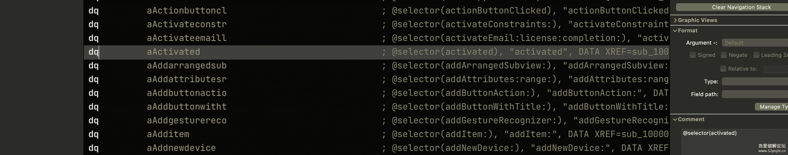
16728409923480.jpg (244.64 KB, 下载次数: 2)
[href="forum.php?mod=attachment&aid=MjU4MzAyMXwwNTMxZDExNnwxNzkzNTc0MTY3fDE2ODA4NnwxNzMzMTQ0&nothumb=yes" target="_blank"](https://www.52pojie.cn/forum.php?mod=attachment&aid=MjU4MzAyMXwwNTMxZDExNnwxNzkzNTc0MTY3fDE2ODA4NnwxNzMzMTQ0&nothumb=yes)
2023-1-4 23:10 上传
我们发现这里引用了这个字符串，这里科普一下`selector`大概意思就是对象的某个属性名 比如`ObjectA`中有一个`activated`这个属性或者函数。
我们翻一下后面的Data XREF：
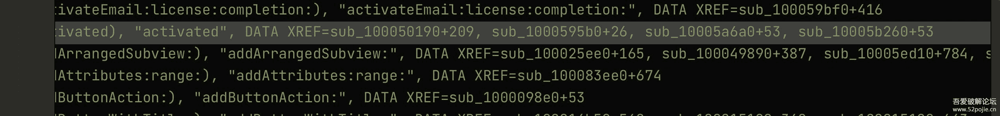
16728410859412.jpg (123.15 KB, 下载次数: 1)
[href="forum.php?mod=attachment&aid=MjU4MzAyMnxmZjZhYmM5MHwxNzkzNTc0MTY3fDE2ODA4NnwxNzMzMTQ0&nothumb=yes" target="_blank"](https://www.52pojie.cn/forum.php?mod=attachment&aid=MjU4MzAyMnxmZjZhYmM5MHwxNzkzNTc0MTY3fDE2ODA4NnwxNzMzMTQ0&nothumb=yes)
2023-1-4 23:10 上传
发现有四个函数引用了这个属性，那么我们随机抽取一个第三个`sub`函数来看看有没有什么发现：
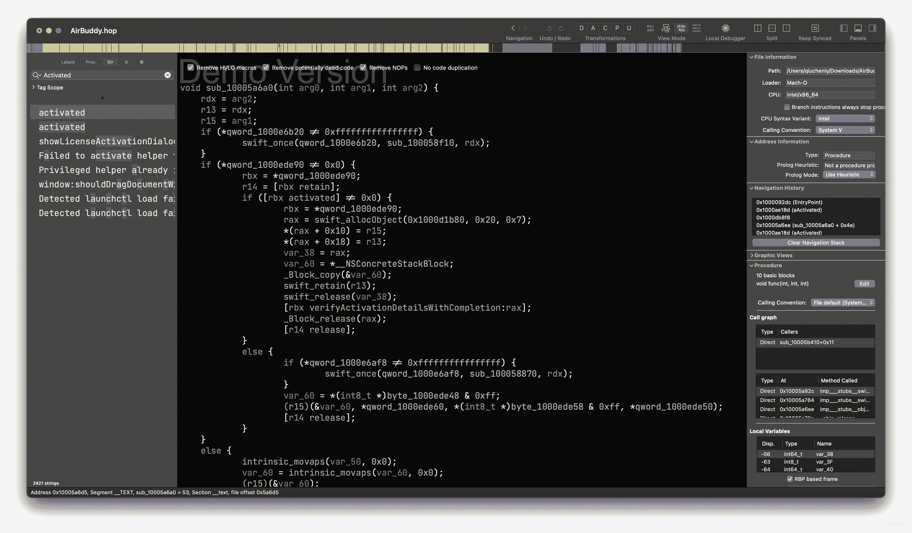
16728411341158.jpg (689.49 KB, 下载次数: 2)
[href="forum.php?mod=attachment&aid=MjU4MzAyM3w5YjM5M2M3NnwxNzkzNTc0MTY3fDE2ODA4NnwxNzMzMTQ0&nothumb=yes" target="_blank"](https://www.52pojie.cn/forum.php?mod=attachment&aid=MjU4MzAyM3w5YjM5M2M3NnwxNzkzNTc0MTY3fDE2ODA4NnwxNzMzMTQ0&nothumb=yes)
2023-1-4 23:10 上传
点进来查看伪代码，格局瞬间打开。
我们发现这里很明显有一个 `if ([rbx activated] != 0x0)` 函数的检查，那么我们可以大胆假设小心求证。
我们假设这个字段返回1表示已激活，那么不等于`0x0`条件成立，然后下面注意有一个函数：`[rbx verifyActivationDetailsWithCompletion:rax]`;字面意思验证激活信息，这个app的细节还是比较清晰的，所以我们发现这个假设貌似很有道理的样子。
那么我们就找找怎么才能 `activated = True`，这里为什么不修改跳转呢？因为你修改这里一处 那么以后后面处处都要修改 累死人。你还不知道是不是全部修改完了，所以我们要找到这个函数/属性的`sub`函数，让他强制返回1即可。
我们此时双击“`activated`”你会发现`HP`毫无反应，这不合理！众所周知，但凡我调用某函数对象，那么必须该函数存在于app中否则我无法调用。那么我们知道`macOS`也有类似于`dll`之类的东西，即`Framework`，你把它当作`dll`看也可以。
我们大胆假设这个字段藏在某个动态链接库中:
先搜一下这个函数名：
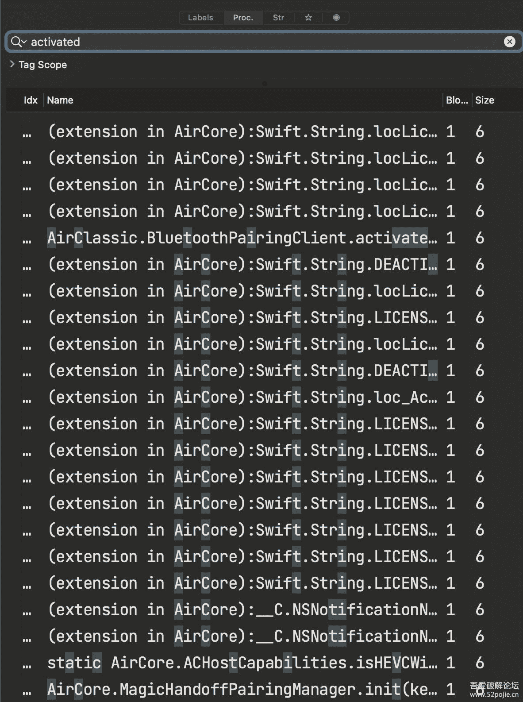
16728415054520.jpg (313.72 KB, 下载次数: 2)
[href="forum.php?mod=attachment&aid=MjU4MzAyNHwwZjQwOTdkY3wxNzkzNTc0MTY3fDE2ODA4NnwxNzMzMTQ0&nothumb=yes" target="_blank"](https://www.52pojie.cn/forum.php?mod=attachment&aid=MjU4MzAyNHwwZjQwOTdkY3wxNzkzNTc0MTY3fDE2ODA4NnwxNzMzMTQ0&nothumb=yes)
2023-1-4 23:10 上传
悲剧了，无匹配。
那么我们该怎么办？
注意这个函数：`verifyActivationDetailsWithCompletion`，你会发现他也是搜不到的。这意味着我们可以拿它当突破口，因为这么长一串数据雷同可能性比较小，你要是单纯拿`activated`去搜能搜出很多无关结果。
我们搜一下看看哈：
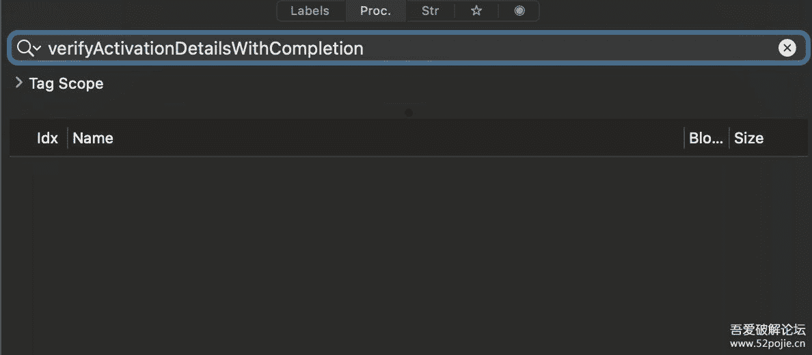
16728416042916.jpg (35.45 KB, 下载次数: 2)
[href="forum.php?mod=attachment&aid=MjU4MzAyNXwzYmNmZGZmOXwxNzkzNTc0MTY3fDE2ODA4NnwxNzMzMTQ0&nothumb=yes" target="_blank"](https://www.52pojie.cn/forum.php?mod=attachment&aid=MjU4MzAyNXwzYmNmZGZmOXwxNzkzNTc0MTY3fDE2ODA4NnwxNzMzMTQ0&nothumb=yes)
2023-1-4 23:10 上传
搜不到，这下给我狠狠的蚌埠住了。难道今天就要饮恨于此？
即然函数中搜不到，字符串只能搜到引用，那么我们就需要换个思路。
首先整理一下我们目前取得的成果：
我们知道了两个幽灵函数可能存在于某个动态库中，但我们不知道是哪个。
现在我们找个函数来看，即然我搜不到,那么我就溯源：很简单，即然你调用了就有调用方存在，那么我就找是谁调用了，然后再找调用方是何方神圣。
我们先在`IDA`中找到他的引用：
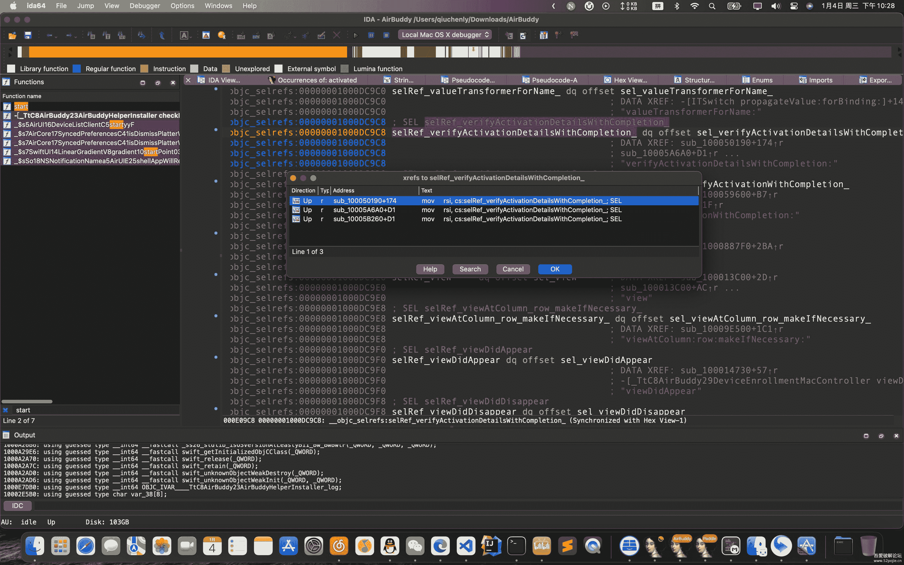
16728425097972.jpg (981.62 KB, 下载次数: 2)
[href="forum.php?mod=attachment&aid=MjU4MzAyNnxhNDFkYWM2OHwxNzkzNTc0MTY3fDE2ODA4NnwxNzMzMTQ0&nothumb=yes" target="_blank"](https://www.52pojie.cn/forum.php?mod=attachment&aid=MjU4MzAyNnxhNDFkYWM2OHwxNzkzNTc0MTY3fDE2ODA4NnwxNzMzMTQ0&nothumb=yes)
2023-1-4 23:10 上传
有三个结果，那么我们就随机抽取第一个幸运函数进去查看伪代码：
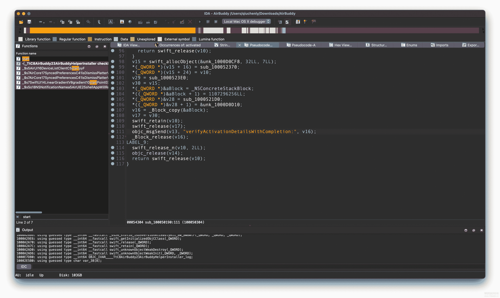
16728425459422.jpg (672.76 KB, 下载次数: 1)
[href="forum.php?mod=attachment&aid=MjU4MzAyN3xiZDU1ZTFjOHwxNzkzNTc0MTY3fDE2ODA4NnwxNzMzMTQ0&nothumb=yes" target="_blank"](https://www.52pojie.cn/forum.php?mod=attachment&aid=MjU4MzAyN3xiZDU1ZTFjOHwxNzkzNTc0MTY3fDE2ODA4NnwxNzMzMTQ0&nothumb=yes)
2023-1-4 23:10 上传
可以看到`msgSend`调用方来自`v13`，那么我们就找一下`v13`是谁赋值了：
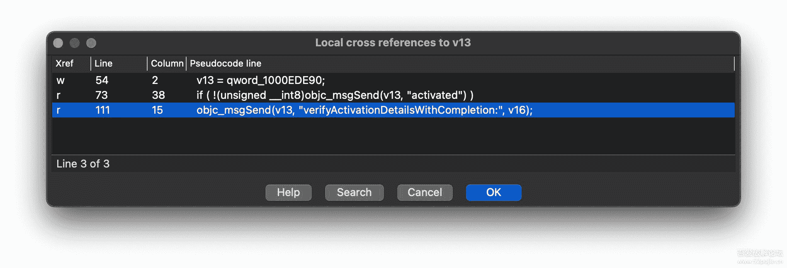
16728425905233.jpg (98.4 KB, 下载次数: 3)
[href="forum.php?mod=attachment&aid=MjU4MzAyOHxlMGVhMjVjMHwxNzkzNTc0MTY3fDE2ODA4NnwxNzMzMTQ0&nothumb=yes" target="_blank"](https://www.52pojie.cn/forum.php?mod=attachment&aid=MjU4MzAyOHxlMGVhMjVjMHwxNzkzNTc0MTY3fDE2ODA4NnwxNzMzMTQ0&nothumb=yes)
2023-1-4 23:11 上传
可以看到`v13`是纯纯的`ylg`，不仅调用了下面的`verify`函数还调用了`activated`，那么就是它了！
我们跳过去54行看下：
```
v13 = qword_1000EDE90;
```
`qword_1000EDE90`又从哪里来？
查找引用发现
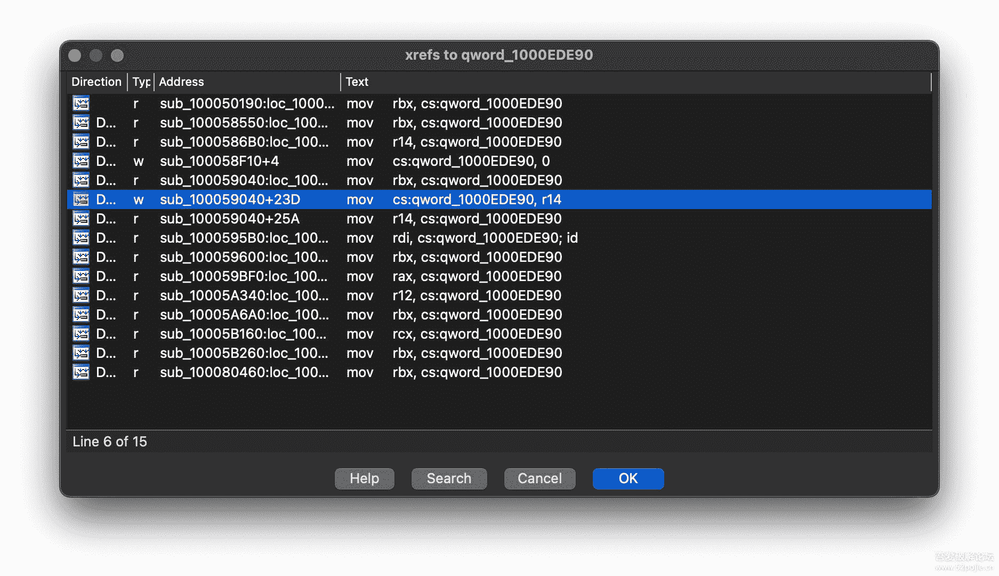
16728426758118.jpg (232.79 KB, 下载次数: 2)
[href="forum.php?mod=attachment&aid=MjU4MzAyOXw5YzQyZjc1OXwxNzkzNTc0MTY3fDE2ODA4NnwxNzMzMTQ0&nothumb=yes" target="_blank"](https://www.52pojie.cn/forum.php?mod=attachment&aid=MjU4MzAyOXw5YzQyZjc1OXwxNzkzNTc0MTY3fDE2ODA4NnwxNzMzMTQ0&nothumb=yes)
2023-1-4 23:11 上传
来自`59040`函数的`mov`赋值,注意看`r14`寄存器。

16728427736873.jpg (29.16 KB, 下载次数: 1)
[href="forum.php?mod=attachment&aid=MjU4MzAzMXw4MmYxNDZiZXwxNzkzNTc0MTY3fDE2ODA4NnwxNzMzMTQ0&nothumb=yes" target="_blank"](https://www.52pojie.cn/forum.php?mod=attachment&aid=MjU4MzAzMXw4MmYxNDZiZXwxNzkzNTc0MTY3fDE2ODA4NnwxNzMzMTQ0&nothumb=yes)
2023-1-4 23:11 上传
跳过来发现是`v18`寄存器，其实在`ASM`里面也是`r14`.
我们接着找`v18`哪来的：
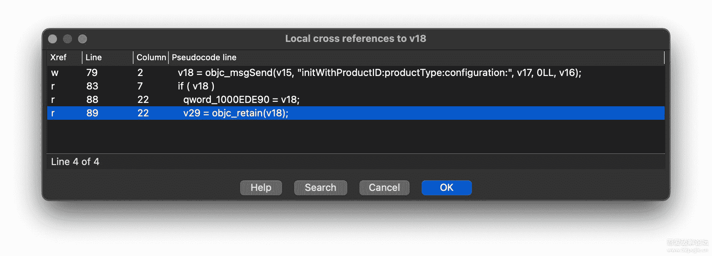
16728428247091.jpg (99.76 KB, 下载次数: 2)
[href="forum.php?mod=attachment&aid=MjU4MzAzMnw4MDA3NWVjMHwxNzkzNTc0MTY3fDE2ODA4NnwxNzMzMTQ0&nothumb=yes" target="_blank"](https://www.52pojie.cn/forum.php?mod=attachment&aid=MjU4MzAzMnw4MDA3NWVjMHwxNzkzNTc0MTY3fDE2ODA4NnwxNzMzMTQ0&nothumb=yes)
2023-1-4 23:11 上传
从这里来到了`v18`的赋值地点，这下要给他们一点小小的汇编震撼了：
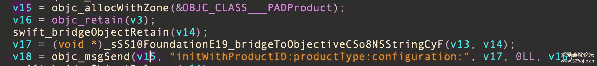
16728428766909.jpg (80.78 KB, 下载次数: 1)
[href="forum.php?mod=attachment&aid=MjU4MzAzM3wyMGY2ZmM2N3wxNzkzNTc0MTY3fDE2ODA4NnwxNzMzMTQ0&nothumb=yes" target="_blank"](https://www.52pojie.cn/forum.php?mod=attachment&aid=MjU4MzAzM3wyMGY2ZmM2N3wxNzkzNTc0MTY3fDE2ODA4NnwxNzMzMTQ0&nothumb=yes)
2023-1-4 23:11 上传
`v18=v15`调用了`init`函数后的返回值，所以我们看到这个`PADProduct`类就浮现出来了。
跳过去看下类定义：


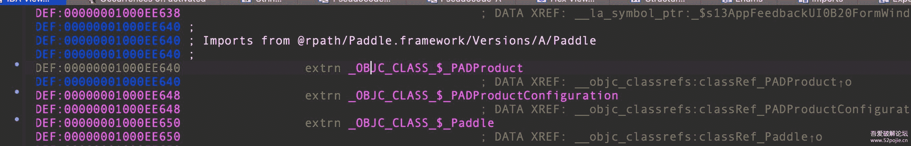

`16728429298734.jpg` (164.62 KB, 下载次数: 3)

[`href="forum.php?mod=attachment&aid=MjU4MzAzNHxmOTcwYWU1NnwxNzkzNTc0MTY3fDE2ODA4NnwxNzMzMTQ0&nothumb=yes" target="_blank"`](https://www.52pojie.cn/forum.php?mod=attachment&aid=MjU4MzAzNHxmOTcwYWU1NnwxNzkzNTc0MTY3fDE2ODA4NnwxNzMzMTQ0&nothumb=yes)

2023-1-4 23:11 上传

OK兄弟们，我们已经狠狠的超到了函数所在位置。

那么我们找到这个`framework`解析一番：

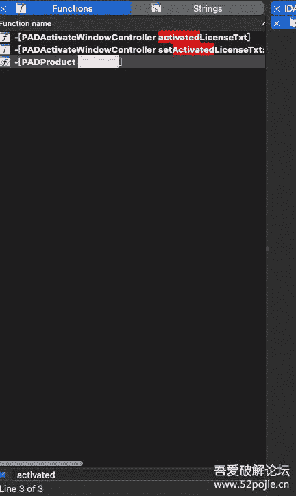

`16728429904663.jpg` (25.5 KB, 下载次数: 2)

[`href="forum.php?mod=attachment&aid=MjU4MzAzNXxlMGU4MjZiMXwxNzkzNTc0MTY3fDE2ODA4NnwxNzMzMTQ0&nothumb=yes" target="_blank"`](https://www.52pojie.cn/forum.php?mod=attachment&aid=MjU4MzAzNXxlMGU4MjZiMXwxNzkzNTc0MTY3fDE2ODA4NnwxNzMzMTQ0&nothumb=yes)

2023-1-4 23:11 上传

成功找到了这个函数。

我们此时可以说进入了一个全新的阶段。

现在我们回到主程序，我们之前上面说他是判断这个`activated`函数返回值的，那么我们先改掉这个函数返回值：`6a 01 58 c3`，战神再次出征：

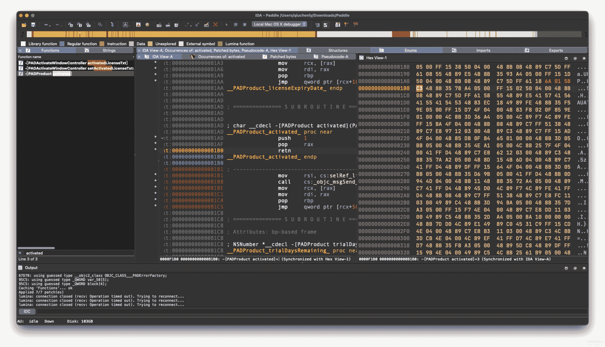

`16728430781584.jpg` (883.15 KB, 下载次数: 0)

[`href="forum.php?mod=attachment&aid=MjU4MzAzNnxlNGVjMmQ0YnwxNzkzNTc0MTY3fDE2ODA4NnwxNzMzMTQ0&nothumb=yes" target="_blank"`](https://www.52pojie.cn/forum.php?mod=attachment&aid=MjU4MzAzNnxlNGVjMmQ0YnwxNzkzNTc0MTY3fDE2ODA4NnwxNzMzMTQ0&nothumb=yes)

2023-1-4 23:11 上传

狠狠的注入激活基因之后我们先保存一番：

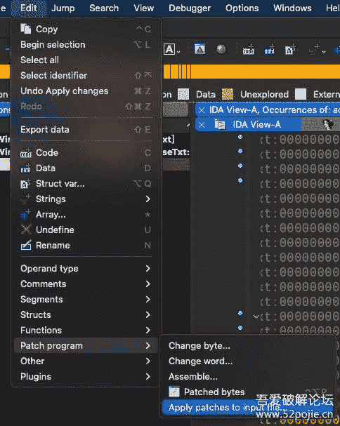

`16728431110539.jpg` (61.61 KB, 下载次数: 2)

[`href="forum.php?mod=attachment&aid=MjU4MzAzN3xkYTk4NDliZHwxNzkzNTc0MTY3fDE2ODA4NnwxNzMzMTQ0&nothumb=yes" target="_blank"`](https://www.52pojie.cn/forum.php?mod=attachment&aid=MjU4MzAzN3xkYTk4NDliZHwxNzkzNTc0MTY3fDE2ODA4NnwxNzMzMTQ0&nothumb=yes)

2023-1-4 23:11 上传

我们回头再看一下判断逻辑：

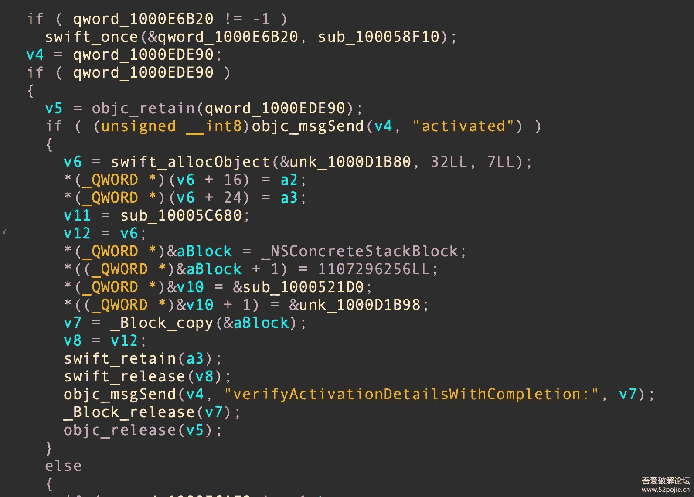

`16728431786480.jpg` (196.25 KB, 下载次数: 2)

[`href="forum.php?mod=attachment&aid=MjU4MzAzOHxjNDg0ZTdhOXwxNzkzNTc0MTY3fDE2ODA4NnwxNzMzMTQ0&nothumb=yes" target="_blank"`](https://www.52pojie.cn/forum.php?mod=attachment&aid=MjU4MzAzOHxjNDg0ZTdhOXwxNzkzNTc0MTY3fDE2ODA4NnwxNzMzMTQ0&nothumb=yes)

2023-1-4 23:11 上传

主程序中认为，当`dll`返回 1 的时候进入`verifyActivation`检查范围，那么我们返回 1 做法是对的。

我们先签名看看效果：

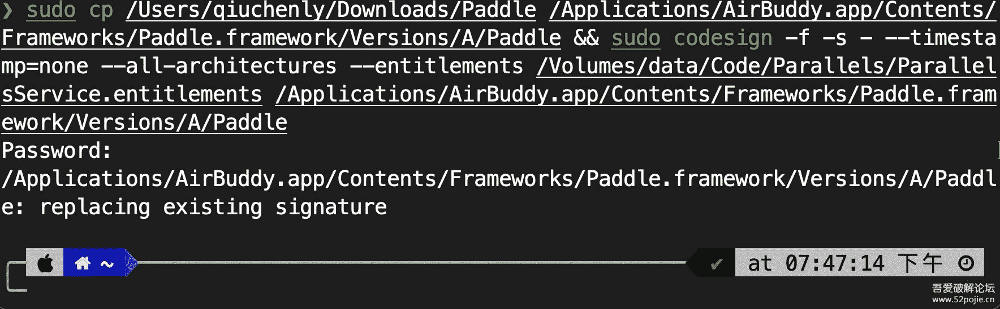

`16728432584460.jpg` (172.82 KB, 下载次数: 1)

[`href="forum.php?mod=attachment&aid=MjU4MzAzOXw4ZjY3MjcwNXwxNzkzNTc0MTY3fDE2ODA4NnwxNzMzMTQ0&nothumb=yes" target="_blank"`](https://www.52pojie.cn/forum.php?mod=attachment&aid=MjU4MzAzOXw4ZjY3MjcwNXwxNzkzNTc0MTY3fDE2ODA4NnwxNzMzMTQ0&nothumb=yes)

2023-1-4 23:11 上传

然后我们打开 App 看看：


`16728433943742.jpg` (18.39 KB, 下载次数: 2)

[`href="forum.php?mod=attachment&aid=MjU4MzA0MHwzMzRhYTZjY3wxNzkzNTc0MTY3fDE2ODA4NnwxNzMzMTQ0&nothumb=yes" target="_blank"`](https://www.52pojie.cn/forum.php?mod=attachment&aid=MjU4MzA0MHwzMzRhYTZjY3wxNzkzNTc0MTY3fDE2ODA4NnwxNzMzMTQ0&nothumb=yes)

2023-1-4 23:11 上传

小老弟你怎么回事？不显示界面？

蚌埠住了，还有这种问题。

那么我们浅浅的分析一下：当激活后他会做一些检查，那么很有可能是下面的检查函数中有什么死循环之类的算法由于我们没有提供正确的授权信息，导致 UI 不显示或者卡住了，那么我们尝试干掉下面那个验证函数：

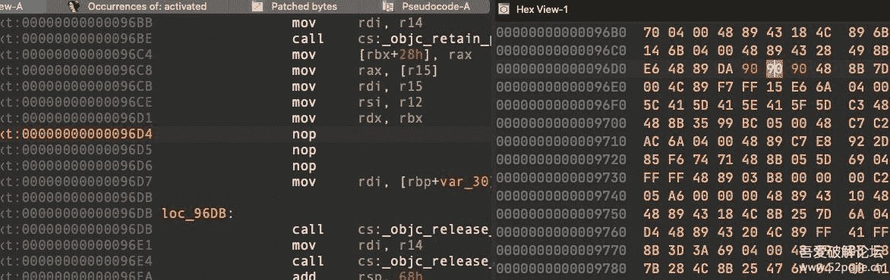

`16728435214637.jpg` (117.2 KB, 下载次数: 1)

[`href="forum.php?mod=attachment&aid=MjU4MzA0MXw4N2U1ODkyZnwxNzkzNTc0MTY3fDE2ODA4NnwxNzMzMTQ0&nothumb=yes" target="_blank"`](https://www.52pojie.cn/forum.php?mod=attachment&aid=MjU4MzA0MXw4N2U1ODkyZnwxNzkzNTc0MTY3fDE2ODA4NnwxNzMzMTQ0&nothumb=yes)

2023-1-4 23:11 上传

给他一点小小的`nop`震撼。

保存签名打开 app 看看。

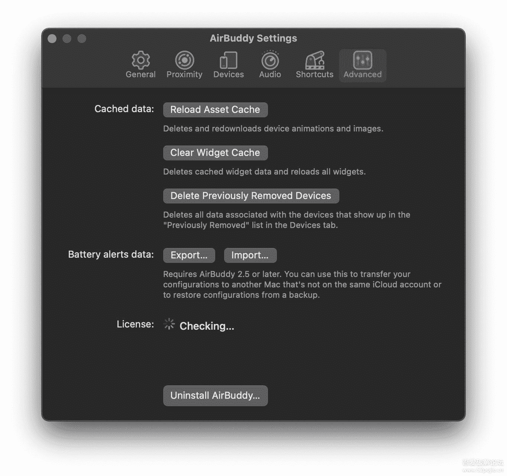

`16728435613116.jpg` (128.28 KB, 下载次数: 3)

[`href="forum.php?mod=attachment&aid=MjU4MzA0MnxkYTYxYzA1Y3wxNzkzNTc0MTY3fDE2ODA4NnwxNzMzMTQ0&nothumb=yes" target="_blank"`](https://www.52pojie.cn/forum.php?mod=attachment&aid=MjU4MzA0MnxkYTYxYzA1Y3wxNzkzNTc0MTY3fDE2ODA4NnwxNzMzMTQ0&nothumb=yes)

2023-1-4 23:11 上传

成功打开，现在`License`显示`Checking`中，其实就是我`nop`掉了检查函数，现在授权是通过的，但是我没有做深入的修改导致它这里不显示激活成功之类的信息，这个`Checking`也是写死的，由于我`nop`掉了更新 UI 的信息函数它根本不动。边上的那个加载动画好像是系统自带的控件。

现在可以说是成功激活！

下一步就是汉化，这个 app 居然不做中文汉化，思想意识形态是有问题的。

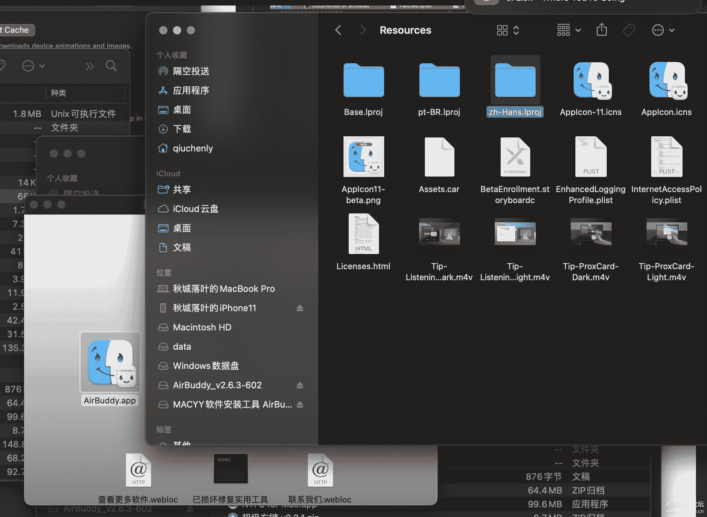

`16728437431086.jpg` (258.53 KB, 下载次数: 0)

[`href="forum.php?mod=attachment&aid=MjU4MzA0M3xjYzRiNzM3NXwxNzkzNTc0MTY3fDE2ODA4NnwxNzMzMTQ0&nothumb=yes" target="_blank"`](https://www.52pojie.cn/forum.php?mod=attachment&aid=MjU4MzA0M3xjYzRiNzM3NXwxNzkzNTc0MTY3fDE2ODA4NnwxNzMzMTQ0&nothumb=yes)

2023-1-4 23:11 上传

从网上旧版本的破解版安装包里翻出汉化包，复制进 app 中，打开即可破解并汉化完成。

### 0x03 是非成败转头空 一朝梦醒心怅然

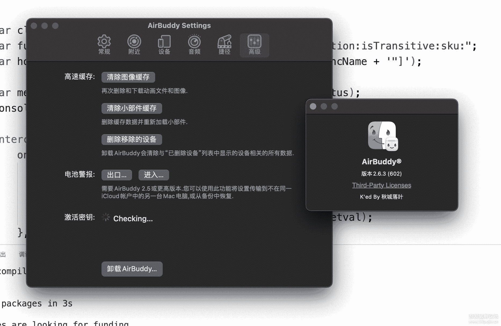

`16728438621372.jpg` (166.76 KB, 下载次数: 3)

[`href="forum.php?mod=attachment&aid=MjU4MzA0NHxmMjhhMWFiM3wxNzkzNTc0MTY3fDE2ODA4NnwxNzMzMTQ0&nothumb=yes" target="_blank"`](https://www.52pojie.cn/forum.php?mod=attachment&aid=MjU4MzA0NHxmMjhhMWFiM3wxNzkzNTc0MTY3fDE2ODA4NnwxNzMzMTQ0&nothumb=yes)

2023-1-4 23:11 上传

其实我这写的挺凌乱的，帖子写的像个不识字的文盲。大家对付着看吧，楼主也在努力的提升文学素养。

我是秋城落叶，蜗居在南京某小公司月薪2500元的小开发，刚学没两天 macOS 逆向。

喜欢文章的同学记得给我一点小小的点赞震撼！
