# [Web逆向] 破解某动漫m3u8加密

- 原帖: https://www.52pojie.cn/forum.php?mod=viewthread&tid=1734656
- 抓取时间: 2026-11-01T23:02:39

## 一、前言

最近有个新上映的动漫很火，但是——国内没引进，B站外服和类似的网站还都是和谐版，只有jp本土才是完整版，很讨厌
于是我找到能看完整版的网站，而且不光要看，还要下载，好，目标已经明确了

## 二、侦察

刚打开网站就给我看这个？看来情况比想象的复杂

1.png (28.93 KB, 下载次数: 4)
[href="forum.php?mod=attachment&aid=MjU4NDA3MHw5MWRkZjJkZHwxNzkzNTc0MTU3fDE2ODA4NnwxNzM0NjU2&nothumb=yes" target="_blank"](https://www.52pojie.cn/forum.php?mod=attachment&aid=MjU4NDA3MHw5MWRkZjJkZHwxNzkzNTc0MTU3fDE2ODA4NnwxNzM0NjU2&nothumb=yes)
2023-1-9 19:18 上传
一开始以为是检测到使用代{过}{滤}理，后来发现是锁IP，一番折腾后总算进入了网站
`F12`抓包分析，不出所料是`m3u8`，`aes-128`加密
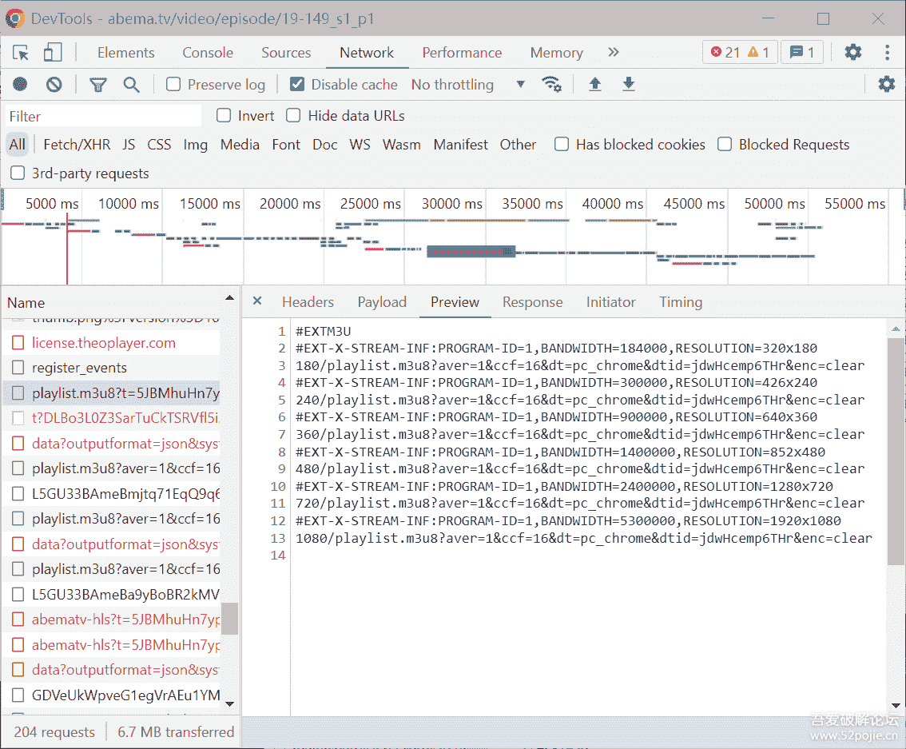
2.png (166.97 KB, 下载次数: 3)
[href="forum.php?mod=attachment&aid=MjU4NDA3MXw1MmQ3ZWZiNHwxNzkzNTc0MTU3fDE2ODA4NnwxNzM0NjU2&nothumb=yes" target="_blank"](https://www.52pojie.cn/forum.php?mod=attachment&aid=MjU4NDA3MXw1MmQ3ZWZiNHwxNzkzNTc0MTU3fDE2ODA4NnwxNzM0NjU2&nothumb=yes)
2023-1-9 19:19 上传
第一个`m3u8`里面是好几个不同清晰度的`m3u8`，区别只有一个参数
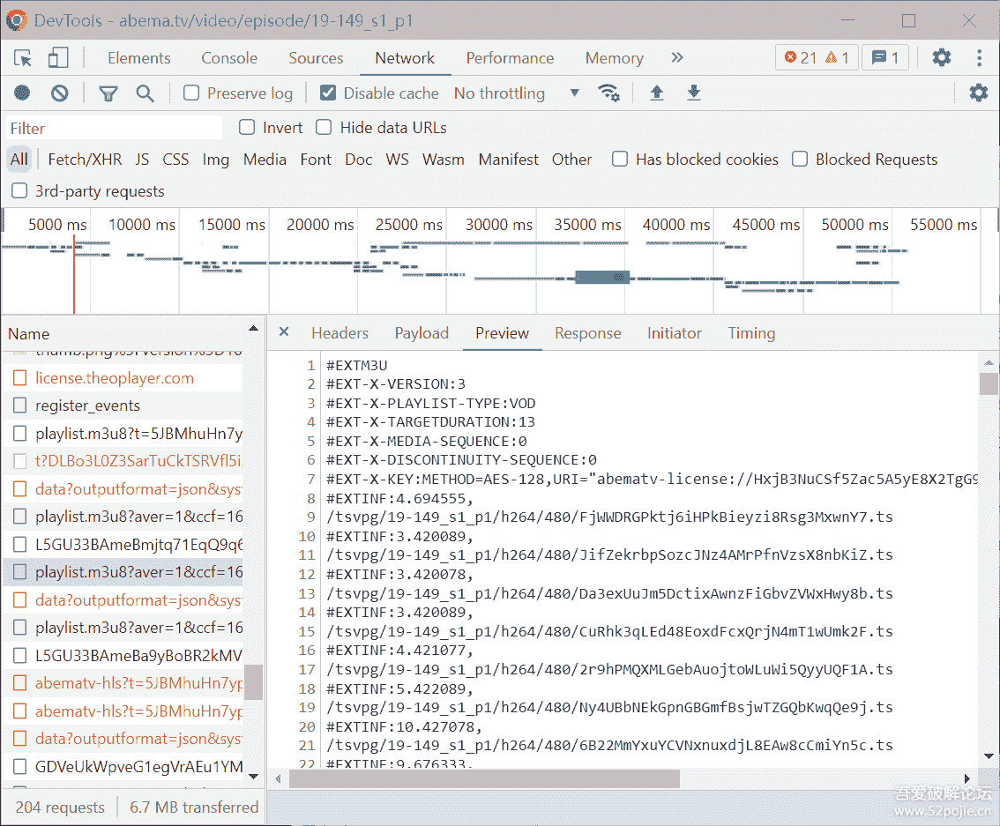
3.png (177.59 KB, 下载次数: 5)
[href="forum.php?mod=attachment&aid=MjU4NDA3MnxjNzBjZTkzZnwxNzkzNTc0MTU3fDE2ODA4NnwxNzM0NjU2&nothumb=yes" target="_blank"](https://www.52pojie.cn/forum.php?mod=attachment&aid=MjU4NDA3MnxjNzBjZTkzZnwxNzkzNTc0MTU3fDE2ODA4NnwxNzM0NjU2&nothumb=yes)
2023-1-9 19:19 上传
找到包含`ts`的`m3u8`，注意`#EXT-X-KEY`这一行，`URI`是自定义的格式，肯定要在某个地方处理，但先忽略这个过程，继续翻请求里和`key`有关的，很快就找到了
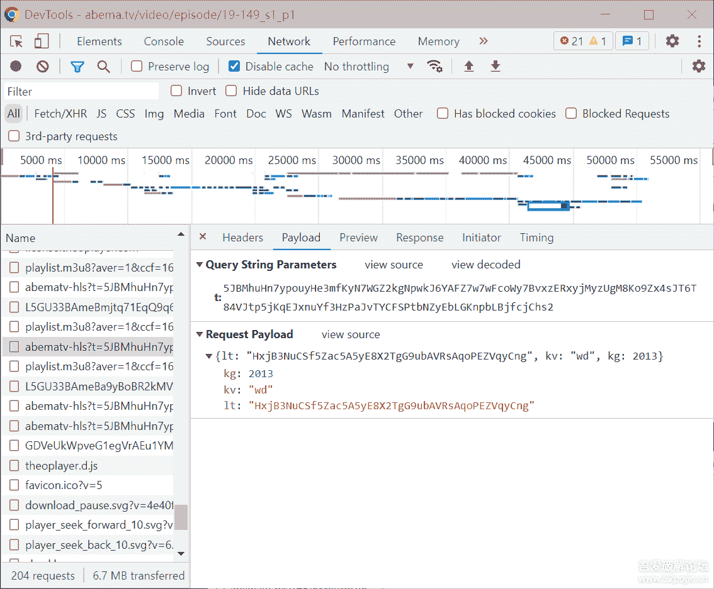
4.png (126.08 KB, 下载次数: 2)
[href="forum.php?mod=attachment&aid=MjU4NDA3M3xiYjhmYzQxYnwxNzkzNTc0MTU3fDE2ODA4NnwxNzM0NjU2&nothumb=yes" target="_blank"](https://www.52pojie.cn/forum.php?mod=attachment&aid=MjU4NDA3M3xiYjhmYzQxYnwxNzkzNTc0MTU3fDE2ODA4NnwxNzM0NjU2&nothumb=yes)
2023-1-9 19:19 上传
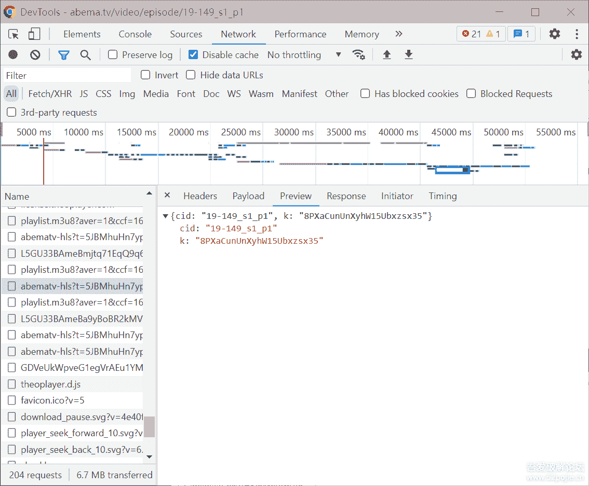
5.png (108.1 KB, 下载次数: 1)
[href="forum.php?mod=attachment&aid=MjU4NDA3NHxjMDZiOGVjNHwxNzkzNTc0MTU3fDE2ODA4NnwxNzM0NjU2&nothumb=yes" target="_blank"](https://www.52pojie.cn/forum.php?mod=attachment&aid=MjU4NDA3NHxjMDZiOGVjNHwxNzkzNTc0MTU3fDE2ODA4NnwxNzM0NjU2&nothumb=yes)
2023-1-9 19:19 上传
发现请求的参数`lt`就是刚才`m3u8`里的`URI`，返回的`k`显然不是真正的`key`，因为不是16位，但应该有关
这个`k`是不是固定值呢？经过重复尝试，发现它是个变量，那`m3u8`应该也不固定，但是。。。整个`m3u8`却一直不变，本来就不擅长算法，现在更迷惑了，看来逆向算法行不通

## 三、尝试

看了论坛的一些帖子，大部分思路都是从函数调用栈入手，下断点，分析`js`，我也先采取这种方法试一下
请求得到参数`k`之后在什么地方进行处理？看一下调用栈
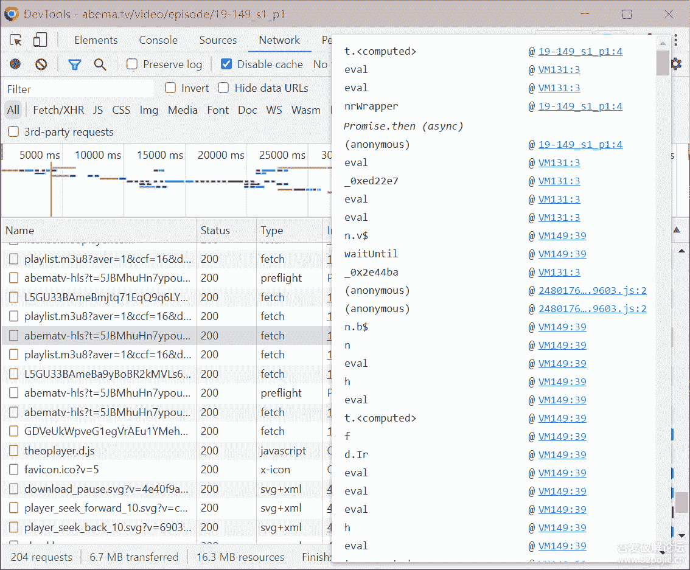
6.png (164.27 KB, 下载次数: 3)
[href="forum.php?mod=attachment&aid=MjU4NDA3NXwxODdmZTM5NHwxNzkzNTc0MTU3fDE2ODA4NnwxNzM0NjU2&nothumb=yes" target="_blank"](https://www.52pojie.cn/forum.php?mod=attachment&aid=MjU4NDA3NXwxODdmZTM5NHwxNzkzNTc0MTU3fDE2ODA4NnwxNzM0NjU2&nothumb=yes)
2023-1-9 19:19 上传
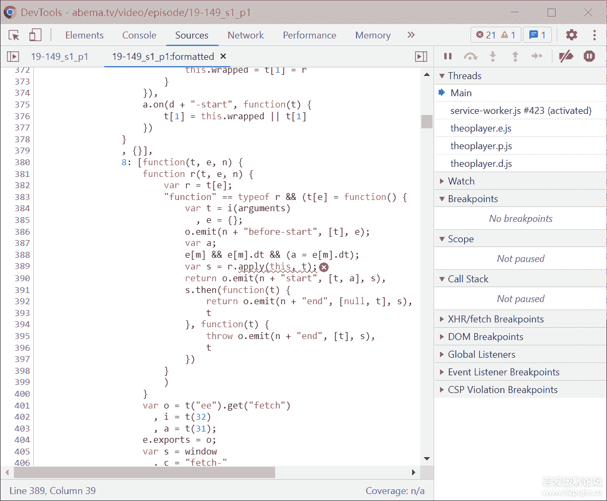
7.png (130.22 KB, 下载次数: 3)
[href="forum.php?mod=attachment&aid=MjU4NDA3Nnw1NTgxOTMwZXwxNzkzNTc0MTU3fDE2ODA4NnwxNzM0NjU2&nothumb=yes" target="_blank"](https://www.52pojie.cn/forum.php?mod=attachment&aid=MjU4NDA3Nnw1NTgxOTMwZXwxNzkzNTc0MTU3fDE2ODA4NnwxNzM0NjU2&nothumb=yes)
2023-1-9 19:19 上传
比想象中复杂的多，这个特别大的`js`直接写在`html`里，看起来功能只是发送请求，关键代码应该在调用栈中间的部分，但是。。。
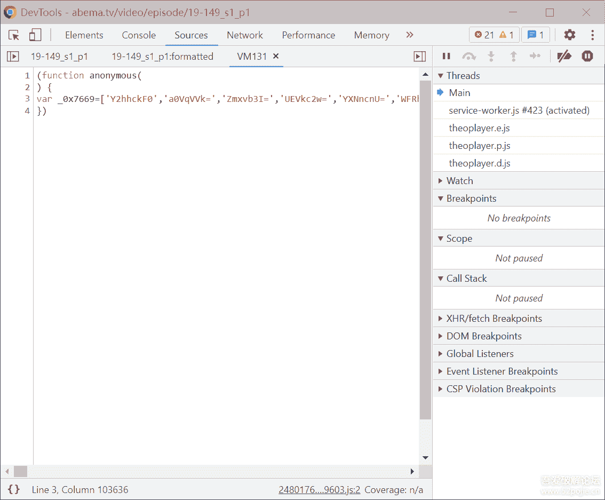
8.png (71.57 KB, 下载次数: 2)
[href="forum.php?mod=attachment&aid=MjU4NDA3N3wzMjVjNGEwOXwxNzkzNTc0MTU3fDE2ODA4NnwxNzM0NjU2&nothumb=yes" target="_blank"](https://www.52pojie.cn/forum.php?mod=attachment&aid=MjU4NDA3N3wzMjVjNGEwOXwxNzkzNTc0MTU3fDE2ODA4NnwxNzM0NjU2&nothumb=yes)
2023-1-9 19:20 上传
看到这里就知道还原代码几乎不可能了，只好换其他方法（当时没注意到调用栈频繁出现的`VM149`，其实它就是突破口，但下面是通过另一种思路找到相同的解决方法）

## 四、灵感

翻看请求的时候，发现了网站使用的播放器
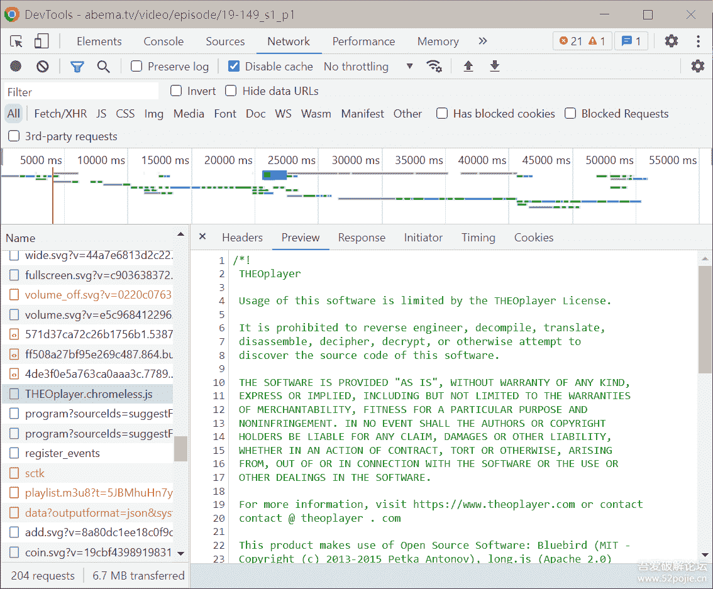
9.png (164.82 KB, 下载次数: 2)
[href="forum.php?mod=attachment&aid=MjU4NDA3OHw3MjFhMzEwYnwxNzkzNTc0MTU3fDE2ODA4NnwxNzM0NjU2&nothumb=yes" target="_blank"](https://www.52pojie.cn/forum.php?mod=attachment&aid=MjU4NDA3OHw3MjFhMzEwYnwxNzkzNTc0MTU3fDE2ODA4NnwxNzM0NjU2&nothumb=yes)
2023-1-9 19:20 上传
代码只经过了压缩，没有混淆，解密`ts`应该也是它做的，如果能定位解密的代码，就离找到密钥不远了
既然是`js`，那就用`Sources`打开，结果。。。
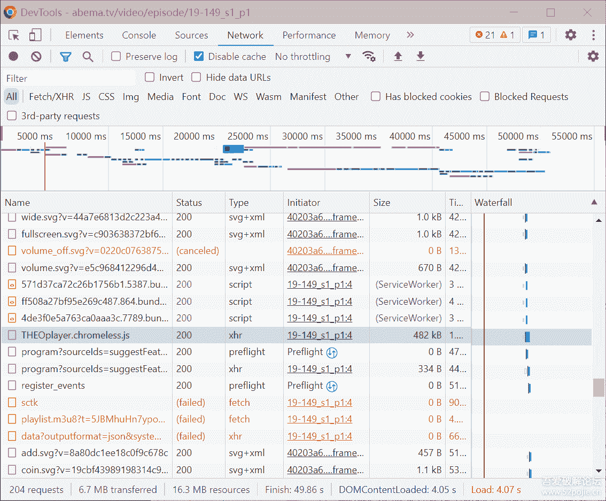
10.png (147.9 KB, 下载次数: 2)
[href="forum.php?mod=attachment&aid=MjU4NDA3OXxkMDljY2ExOHwxNzkzNTc0MTU3fDE2ODA4NnwxNzM0NjU2&nothumb=yes" target="_blank"](https://www.52pojie.cn/forum.php?mod=attachment&aid=MjU4NDA3OXxkMDljY2ExOHwxNzkzNTc0MTU3fDE2ODA4NnwxNzM0NjU2&nothumb=yes)
2023-1-9 19:20 上传
居然是`xhr`！不是`script`！暂且不论是不是网站故意挖坑，调试一下子就变得麻烦了
`js`肯定是在某个`VM`里执行的，如何定位到这个`VM`？这时候我灵光一现——很多网站不是喜欢用`debugger`恶心人吗，我在这个`js`里加一个`debugger`，不就找到它在哪了吗？
这个方法真是巧妙，只要它被加载，马上就被断下来，然后在它解密部分的代码下断点，运行到那里，问题就解决了
至于怎么修改响应，方法很多，我用了最简单的`Fiddler`，先把这个`js`下载下来，在开头加了一行`debugger;`，然后打开`Fiddler`自动回复器，这样填写就可以了

11.png (26.58 KB, 下载次数: 2)
[href="forum.php?mod=attachment&aid=MjU4NDA4MHxlNzhkN2UzZHwxNzkzNTc0MTU3fDE2ODA4NnwxNzM0NjU2&nothumb=yes" target="_blank"](https://www.52pojie.cn/forum.php?mod=attachment&aid=MjU4NDA4MHxlNzhkN2UzZHwxNzkzNTc0MTU3fDE2ODA4NnwxNzM0NjU2&nothumb=yes)
2023-1-9 19:20 上传
现在刷新网页，等到这个`js`被加载，果然断下来了
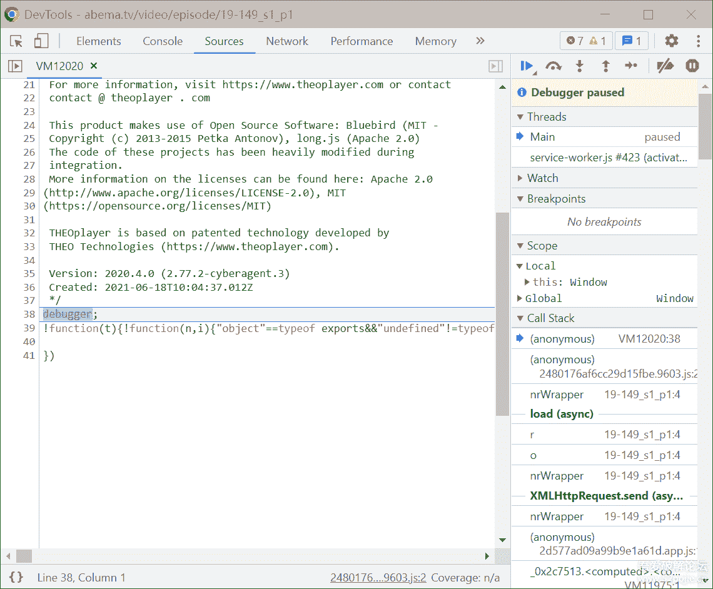
12.png (135.14 KB, 下载次数: 2)
[href="forum.php?mod=attachment&aid=MjU4NDA4MXwxODc3NzEzN3wxNzkzNTc0MTU3fDE2ODA4NnwxNzM0NjU2&nothumb=yes" target="_blank"](https://www.52pojie.cn/forum.php?mod=attachment&aid=MjU4NDA4MXwxODc3NzEzN3wxNzkzNTc0MTU3fDE2ODA4NnwxNzM0NjU2&nothumb=yes)
2023-1-9 19:20 上传
然后应该在哪里下断点呢？参考了一些帖子，可以搜索字符串`decrypt`，发现这里最接近解密的代码
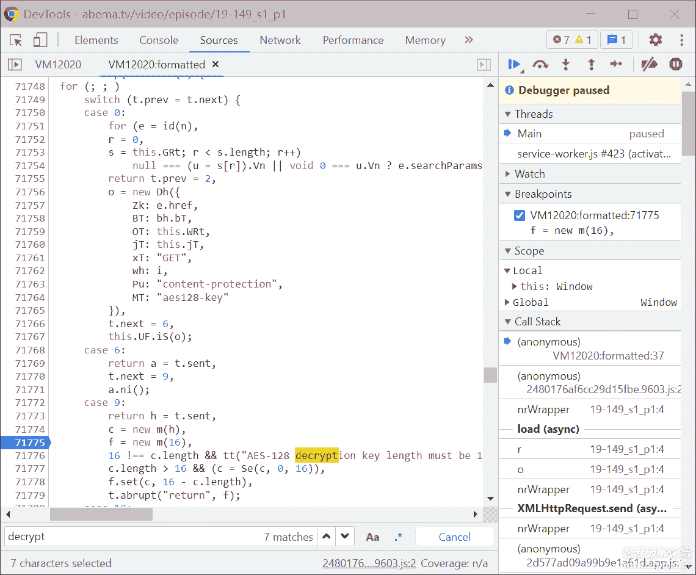
13.png (152.74 KB, 下载次数: 2)
[href="forum.php?mod=attachment&aid=MjU4NDA4MnwxYjY1Nzg2N3wxNzkzNTc0MTU3fDE2ODA4NnwxNzM0NjU2&nothumb=yes" target="_blank"](https://www.52pojie.cn/forum.php?mod=attachment&aid=MjU4NDA4MnwxYjY1Nzg2N3wxNzkzNTc0MTU3fDE2ODA4NnwxNzM0NjU2&nothumb=yes)
2023-1-9 19:21 上传
这段代码比较好理解，参数`c`非常关键，这里判断`c`的长度不等于16，就报错“`AES-128`密钥长度必须为16字节”，显然`c`就是存储密钥的数组
现在继续运行，等到触发断点，查看变量，果然，`c`的类型就是`Uint8Array(16)`
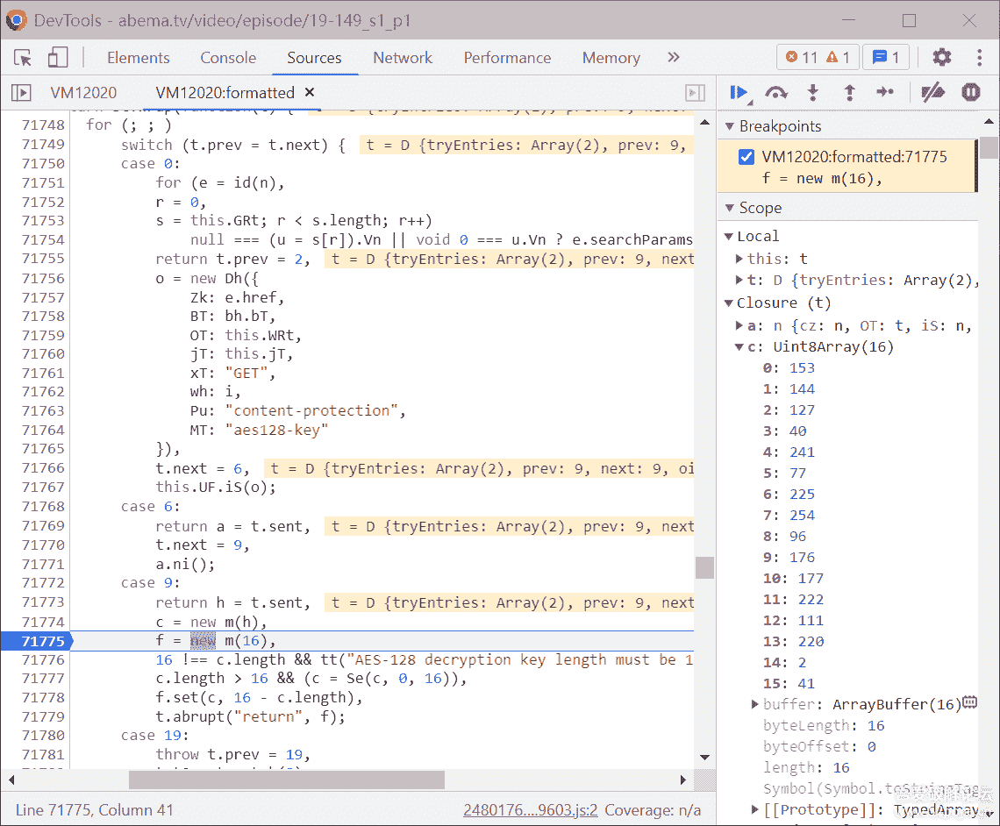
14.png (163.15 KB, 下载次数: 2)
[href="forum.php?mod=attachment&aid=MjU4NDA4M3wzMDQ0NmYzMXwxNzkzNTc0MTU3fDE2ODA4NnwxNzM0NjU2&nothumb=yes" target="_blank"](https://www.52pojie.cn/forum.php?mod=attachment&aid=MjU4NDA4M3wzMDQ0NmYzMXwxNzkzNTc0MTU3fDE2ODA4NnwxNzM0NjU2&nothumb=yes)
2023-1-9 19:21 上传
有了`m3u8`和`key`，终于能开始下载了
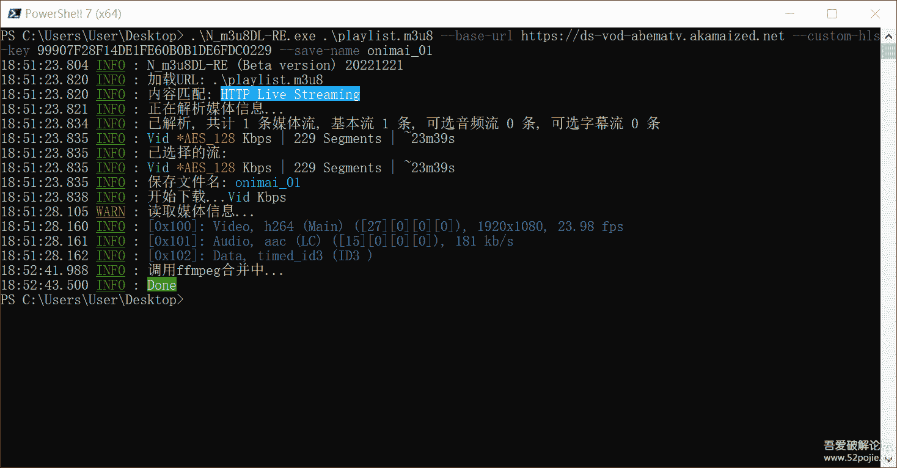
15.png (132.77 KB, 下载次数: 2)
[href="forum.php?mod=attachment&aid=MjU4NDA4NHw1NGNhN2FmNnwxNzkzNTc0MTU3fDE2ODA4NnwxNzM0NjU2&nothumb=yes" target="_blank"](https://www.52pojie.cn/forum.php?mod=attachment&aid=MjU4NDA4NHw1NGNhN2FmNnwxNzkzNTc0MTU3fDE2ODA4NnwxNzM0NjU2&nothumb=yes)
2023-1-9 19:21 上传
最终效果图
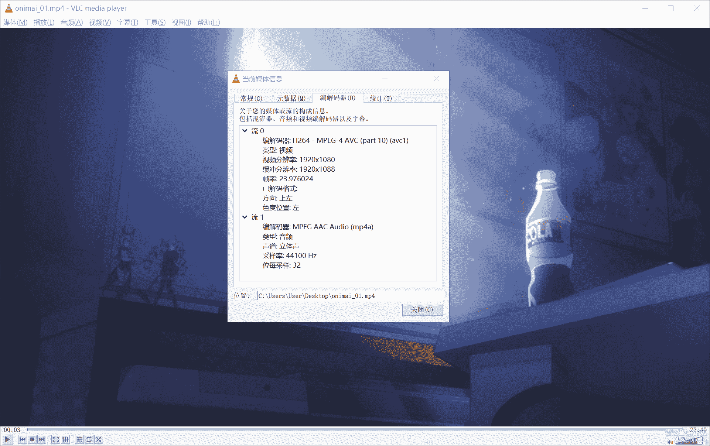
16.png (866.34 KB, 下载次数: 2)
[href="forum.php?mod=attachment&aid=MjU4NDA4NnwzZGIyNzJlZHwxNzkzNTc0MTU3fDE2ODA4NnwxNzM0NjU2&nothumb=yes" target="_blank"](https://www.52pojie.cn/forum.php?mod=attachment&aid=MjU4NDA4NnwzZGIyNzJlZHwxNzkzNTc0MTU3fDE2ODA4NnwxNzM0NjU2&nothumb=yes)
2023-1-9 19:21 上传

## 五、结语

本人只是一个前端小白，对于破解更谈不上熟悉，但破解的魅力就在于此——很多时候，你需要的并不是高超的技术，而是独特的思路，和思考中的灵光一现。正是充满了未知和出奇制胜，破解注定不同于循规蹈矩的工作。经过自己的思考最终实现目标，这种成就感也是难以比拟的。
